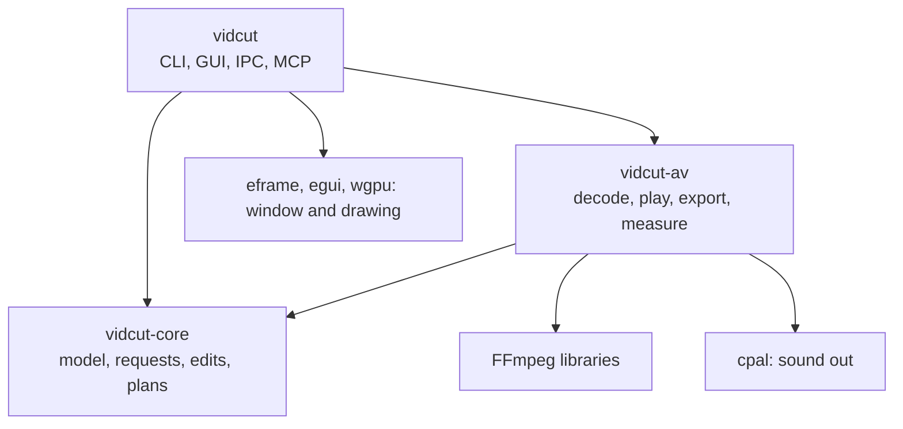
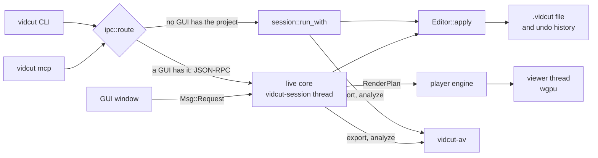

# vidcut design

- These pages tell how vidcut is built, from its code. Start here, then follow the links.
- The [spec](../cut-page-spec.md) and the [deviations](../deviations.md) tell what vidcut does for the user.
- vidcut is one binary in three crates. Each action of a user, a script or an agent is a request, and each request ends in the same editor.
- Media work (decoding, playback, export, measuring) is in its own crate, on the FFmpeg libraries.

| Crate | Holds | Does not touch |
|---|---|---|
| `crates/vidcut-core` | the project model, time, the request protocol, the editor and undo, edit operations, render plans, OpenTimelineIO, decisions of the automatic tools, preferences | FFmpeg, GPUs; it starts no threads |
| `crates/vidcut-av` | probing, decoding on the CPU or a GPU, the player engine, exports, proxies, thumbnails, waveforms, measurements, the CPU pools | the GUI, the CLI, requests |
| `crates/vidcut` | the CLI, the headless session, the GUI and its live core, IPC, the MCP server, themes | |

## The big picture

- A **request** is one `Request` value: a method such as `edit.split` and its params, in an `Envelope` ([requests](requests.md)).
  - The JSON schema of the request type generates the CLI, the MCP tools and `vidcut schema`. The GUI sends the same requests.
- With no GUI open on the project, a command runs **headless**: it locks the `.vidcut` file, loads it, applies the request and saves.
- With a GUI open, the command goes to that GUI over its socket, and runs in its **live core** ([live](live.md)).
- The **editor** (`Editor`) applies edits to the `Project`, records each as a `Change` for undo, and answers queries ([model](model.md)).
- To play or export, vidcut flattens the project into a **render plan** (`RenderPlan`): pieces of sources on lanes, frame by frame.
  - The player engine decodes it ahead of the playhead for the viewer ([playback](playback.md)). An export decodes it into an encoder ([export](export.md)).
- The automatic tools measure media in vidcut-av, and decide in vidcut-core ([analysis](analysis.md)).

## Picture order

vidcut processes each picture in this order. The [spec](../cut-page-spec.md#13-order-of-operations-pp-287296-3407) gives the order of Resolve. [todo/processing-order.md](../todo/processing-order.md) lists where the two are different.

1. The reader decodes the frame, on the GPU or the CPU (`route::plan`, [gpu](gpu.md#routes)).
2. The reader deinterlaces an interlaced frame (`Deinterlacer`, [gpu](gpu.md#deinterlacing-and-hdr)).
3. An AI upscaler of Super Scale enlarges the frame (`Source::ai_picture`, [gpu](gpu.md#super-scale)).
4. Retime Process makes a frame between two source frames (`VideoFrames::retimed_frame`, [export](export.md#which-source-frame)).
   - The pair is upright, at the size that the picture shows at.
5. The draw (`crates/vidcut-av/src/screen/picture.wgsl`) does the rest of the timeline, one layer after the other:
   - It samples each picture where `place::Placing` puts it: Transform, Crop and Dynamic Zoom ([export](export.md#placed-pictures)).
   - Classic Super Scale enlarges in the same sample (`screen::kernel`).
   - It converts each sample into the timeline color space (`color::shader_colors`).
   - It mixes the layer with the layers below, by its composite mode and opacity (`Placing::mode`).
   - Titles and dissolves are layers and mixes of the same draw.
6. The burned-in subtitles go over the frame (`VideoFrames::with_burn`, [export](export.md#subtitles)).
7. `fs_encode` converts the timeline color space into the color space of the output (`Screen::encoded`).

vidcut has none of the other stages of the spec:

- Camera Raw, Lens Correction, the LUTs and Fusion;
- Input Sizing, Image Stabilization and the grades;
- Open FX and Resolve FX, Output Sizing and Data Burn-In.

## Rules the code follows

- **One vocabulary.** Each capability is a variant of `Request`. The CLI, IPC and MCP can do each thing that the GUI can do.
- **The file is the truth.** A command reads and writes the `.vidcut` file. A running GUI watches it and reloads. The revision of the project (`if_rev`) catches edits that cross.
- **The core is pure.** vidcut-core reaches media only through the `Env` trait: `AvEnv` in the app, `FakeEnv` in tests. Thus edits, plans and decisions are tested without FFmpeg.
- **One decode and mix stack.** The player and exports read the same `RenderPlan` through the same `VideoFrames` and `AudioMix`. Thus the viewer shows the frames that an export writes.
- **The GPU first.** Decoding, scaling, mixing and encoding stay on the GPU wherever it gives correct results ([gpu](gpu.md)).
- **AI features name roles.** Where vidcut picks the model, the app, the requests and the files name its role. The roles are AI Fast, AI Best, and AI for the own model of macOS.
  - Where the user picks the model, as for speech, they name the model.
  - In code, a feature is a module (`super_scale`, `interpolate`). Each model that vidcut runs with its own code is a module in it (`nanovsr`, `flashvsr`, `macos`, `rife`, `ema`).
  - Model names show in `vidcut models`, in Stats for Nerds and in the docs.
- **A thread for each purpose.** Each thread waits on one thing. Media jobs run at the lowest priority and yield to playback ([threads](threads.md)).

## Words

| Word | Meaning | In code |
|---|---|---|
| request | one capability call: method and params | `Request`, `Envelope`, `Response` |
| rev | the revision of the project, one more for each change | `Project::rev`, `if_rev` |
| change | the difference that an edit made, kept for undo | `Change`, `History` |
| plan | the timeline flattened for playing or export | `RenderPlan`, `VideoPiece`, `AudioPiece` |
| lane | the pieces of one track in a plan, mixed with the others | `LaneTrack` |
| tape | the plan of the source viewer: media one after another | `render::tape` |
| snapshot | what the GUI draws, published by the live core | `Snapshot` |
| origin | a cache stamp of the path, size and time of a file | `Origin` |
| kept | data of another editor that vidcut carries without a model of it | `Kept` |
| lru | a cache of a set number of entries that lets the least recently used go | `Lru` |

## Pages

| Page | What it covers |
|---|---|
| [requests](requests.md) | the front doors, routing, the headless path, the editor, undo |
| [model](model.md) | the project, time, the `.vidcut` file, OpenTimelineIO, preferences |
| [live](live.md) | the running GUI: the live core, snapshots, jobs, waits |
| [playback](playback.md) | from the playhead to pixels and sound |
| [export](export.md) | from `export.start` to a finished file |
| [gpu](gpu.md) | which GPU does what, and where frames live |
| [analysis](analysis.md) | measurements, the automatic tools, caches |
| [threads](threads.md) | each thread that vidcut starts, the pools, priorities |

## Code

- `crates/vidcut-core/src/lib.rs`
- `crates/vidcut-av/src/lib.rs`
- `crates/vidcut/src/lib.rs`
- `crates/vidcut/src/main.rs`
