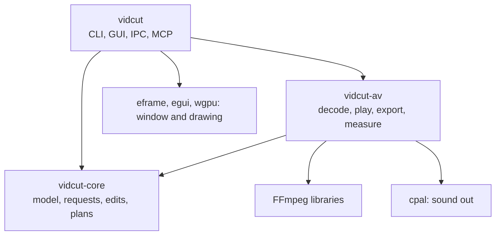
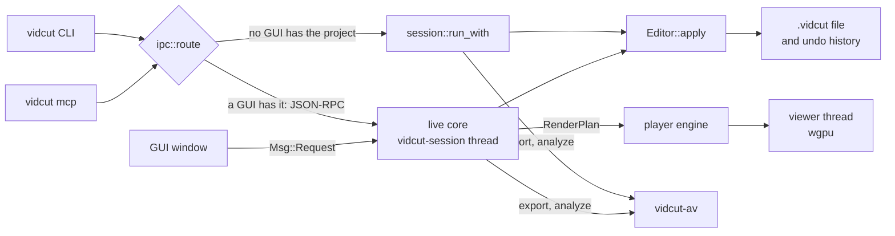
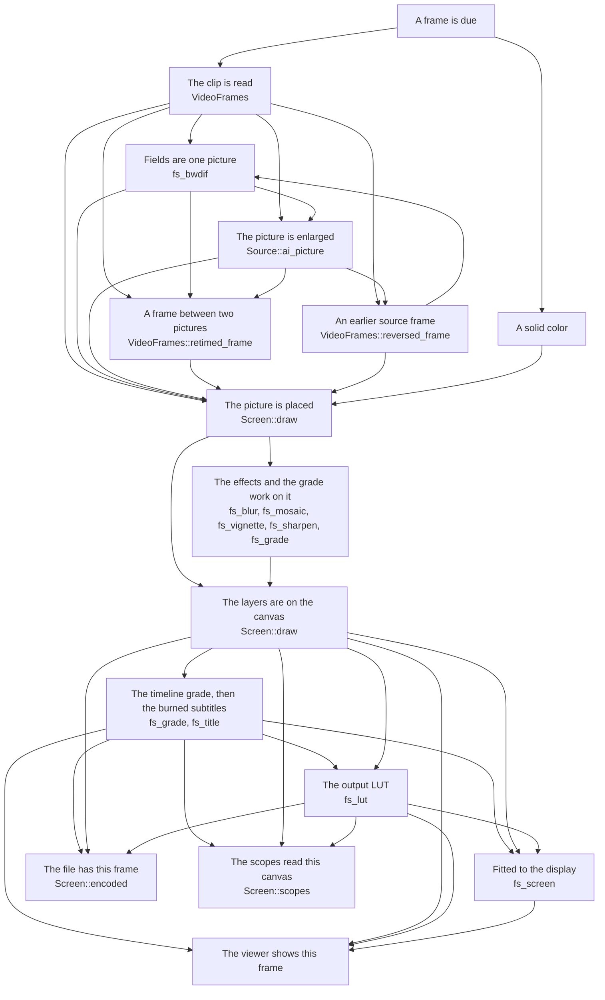

# vidcut design

- These pages tell how vidcut is built, from its code. Start here, then follow the links.
- The [spec](../spec.md) and the [deviations](../deviations.md) tell what vidcut does for the user.
- vidcut is one binary in three crates. Each action of a user, a script or an agent is a request, and each request ends in the same editor.
- Media work (decoding, playback, export, measuring) is in its own crate, on the FFmpeg libraries.

| Crate | Holds | Does not touch |
|---|---|---|
| `crates/vidcut-core` | the project model, time, the request protocol, the editor and undo, edit operations, render plans, OpenTimelineIO, decisions of the automatic tools, preferences | FFmpeg, GPUs; it starts no threads |
| `crates/vidcut-av` | probing, decoding on the CPU or a GPU, the player engine, exports, proxies, thumbnails, waveforms, measurements, the CPU pools | the GUI, the CLI, requests |
| `crates/vidcut` | the CLI, the headless session, the GUI and its live core, IPC, the MCP server, themes | |

## The big picture

- A **request** is one `Request` value: a method such as `edit.split` and its params, in an `Envelope` ([requests](requests.md)).
  - The JSON schema of the request type generates the CLI, the MCP tools and `vidcut schema`. The GUI sends the same requests.
- With no GUI open on the project, a command runs **headless**: it locks the `.vidcut` file, loads it, applies the request and saves.
- With a GUI open, the command goes to that GUI over its socket, and runs in its **live core** ([live](live.md)).
- The **editor** (`Editor`) applies edits to the `Project`, records each as a `Change` for undo, and answers queries ([model](model.md)).
- To play or export, vidcut flattens the project into a **render plan** (`RenderPlan`): pieces of sources on lanes, frame by frame.
  - The player engine decodes it ahead of the playhead for the viewer ([playback](playback.md)). An export decodes it into an encoder ([export](export.md)).
- The automatic tools measure media in vidcut-av, and decide in vidcut-core ([analysis](analysis.md)).

## Picture order

One output frame takes one route. The [spec](../spec.md#13-order-of-operations-pp-287296-3407) gives the order of the picture. [Deviation X98](../deviations.md#x98-in-an-hdr-timeline-ai-slow-works-before-the-conversion) is where vidcut differs.

A clip skips each step that it does not use. The steps run in this order:

- `VideoFrames` reads the clip and keeps its fields (`VideoReader::keep_fields`). It decodes on the GPU or the CPU (`route::plan`). A solid color skips the file.
- `fs_convert` puts the picture into the timeline color space, at the size of the picture (`color::shader_colors`). In an SDR timeline, it tone-maps HDR.
- `fs_convert_lut` is `fs_convert` with the input LUT of the clip after the conversion ([the LUT files](#lut-files)).
- `fs_bwdif` weaves an interlaced frame after that conversion ([gpu](gpu.md#deinterlacing-and-hdr)). It uses the frames before it, at it and after it (`Woven`).
- `Source::ai_picture` enlarges the converted picture when Upscale uses an AI upscaler ([gpu](gpu.md#upscale)). An interlaced source is woven first.
- `VideoFrames::retimed_frame` makes a frame from two pictures that are already converted, woven and enlarged ([export](export.md#which-source-frame)).
  - The draw sizes and places each picture of the pair first. That is Classic Upscale, Transform, Crop and Dynamic Zoom.
  - The draw also applies the effects of the clip to each picture of the pair ([export](export.md#effects)). Thus the effects come before the speed change, as in the spec (§13).
  - The made frame is already placed (`Sampling::Placed`). The later draw takes its edges, its opacity and its mode from `place::Placing`.
- `VideoFrames::reversed_frame` chooses an earlier source frame that was made forward.
  - Without an AI upscaler, an interlaced frame is woven as that frame is placed.
  - With an AI upscaler, the weave and the enlargement come before the choice.
- `Screen::draw` places the picture and mixes the layers (`place::Placing`, `screen::kernel`, [export](export.md#placed-pictures)).
  - A transition's two sides, and each clip placed over another, are layers of the same draw.
  - A title is a layer of the same draw, as a generator is ([export](export.md#titles)). Burned subtitles are draws in that same pass (`fs_title`).
  - A clip with effects is placed into a picture of its own first. The effects work on it there (`fs_blur`, `fs_mosaic`, `fs_vignette`, `fs_sharpen`, [export](export.md#effects)).
  - The grade of a clip works on that picture after its effects (`fs_grade`, [export](export.md#the-grade)).
  - An adjustment clip (`VideoPiece::Adjustment`, `Blurred::adjust`) copies the composited canvas below, runs its composition, placement, effects and grade in order, and mixes back over the canvas.
    - Its placement moves the canvas. Its effects and grade then work on a picture that fills the frame with no placement (`Placed::for_effects`). Why: the picture that they get is the moved canvas, not the clip.
    - The outline of a grade window in the viewer uses `Placed::for_effects` too. Thus it is where the window grades.
- The timeline grade works on the whole canvas after the last layer and title (`fs_grade`, [export](export.md#the-grade)).
- The burned subtitles then go on the canvas (`fs_title`, [export](export.md#subtitles)).
- `fs_lut` runs the output LUT of the project on the whole canvas, after the titles and subtitles.
- The viewer shows the canvas. A wide canvas goes through `fs_screen` first ([playback](playback.md#the-viewer-thread)).
- The scopes read the canvas after `fs_lut` and before `fs_screen` ([gpu](gpu.md#the-scopes)).
- An export encodes that canvas (`Screen::encoded`) and skips `fs_screen` ([export](export.md#timeline-colors)).

The AI stages get the picture in the timeline color space (`Single`).

- Each stage gets 16-bit pictures (`Form`). The models of vidcut get RGB. The AI of macOS gets P416.
- In an HDR timeline, AI Slow gets SDR media only. The draw then converts its result into the timeline color space (X98). There the input LUT comes after AI Slow, because the LUT follows the conversion.

vidcut has none of the other stages of the spec:

- Camera Raw, Lens Correction and Fusion;
- Input Sizing, Image Stabilization and the Pre-Clip and Post-Clip grades of a group;
- Open FX, the Resolve FX other than Gaussian Blur, Mosaic Blur, Glow, Film Grain, Vignette and Sharpen, Output Sizing and Data Burn-In.

### LUT files

The [spec](../spec.md#the-lut-tables) gives the math of a table. vidcut reads a `.cube` file with `cube::read` and draws it on the GPU.

- A media item holds its `input_lut`. The project settings hold an `input_lut`, the `output_lut` and the `video_monitor_lut`. The project file stores each path as it stores a media path ([model](model.md)).
  - The settings also hold the `color_viewer_lut` and the `scopes_lut` (`MonitorLut`). Each one follows the `video_monitor_lut`, has no LUT, or names a file (`MonitorLut::file`).
- Each clip gets the `input_lut` of its media in the render plan (`VideoPiece::Source`). When the media has none, the clip gets the `input_lut` of the project.
  - Thus the render cache, a proxy and an export see one input LUT for each clip, as for a LUT of the media.
  - The plans of the source viewer and of the tiles use the same rule (`Media::input_lut_in`). Thus they show the input LUT too.
- Each table gets the code values of the timeline. vidcut converts nothing for a LUT.
- A table is a texture of 32-bit floats, and the shader interpolates its rows (`table_rows`, `table_cube`). Why: that format has no texture filter without an extra device feature.
- With no LUT, the draw does not change: the pipelines of the LUTs do not exist (`Gpu::luts`).
- A `Lut` holds the rows of its file and its table on the GPU. Each picture, `Screen`, `VideoFrames` and player plan that uses it holds it. The memory goes with the last holder. No global map keeps a table.
- `VideoFrames` keeps its last input LUTs (`VideoFrames::input_lut`), and a new player plan takes the output LUT of the plan before it (`Plan::keeping_output_lut_of`). Why: a cut or an edit does not read the file again.
  - The key holds the path, the size and the time of the file (`cube::stamp`). Thus a changed file gives a new table on the next piece or plan.
- `cube::parse` refuses a file that does not give a whole table, and names the reason:
  - no size line, or a size below 2;
  - a keyword in lower case;
  - too few rows, or a row that is not three finite numbers.
- `Editor` reads the file when a request sets the path (`checked_lut`). Thus a request cannot put a broken file into the project.
- The menus of LUTs list the `.cube` files that `LutList::read` finds:
  - in the LUT folder of vidcut (`luts::dir`, `LUT` in the config dir);
  - in the folders of `luts.folders` in the preferences (`LutPrefs`);
  - in their subfolders.
- Each `Lut` has its name, its subfolders (`menu`) and its path. The name is the file name with no extension.
- `LutList::read` sorts the LUTs by their paths in their folders, letter by letter. Thus the LUTs of a subfolder are next to each other.
  - A dropdown lists them in this order (`luts::combo`). The submenus of the pool group them by `menu` (`luts::menu`).
- `LutList::read` reads each folder once (`dirs::canonical`). Thus a link, or a folder inside another listed folder, gives each LUT once.
- `luts.list` reads the folders again on each call.
- The live core keeps the list of the last `luts.list`, from the GUI or from a script. The snapshot gives it to the menus (`Snapshot::luts`).
- The GUI sends `luts.list` at start, on Update Lists, after a reset, and when the snapshot gives other `luts.folders` (`Workspace::update_luts`). The live core reads them again when the preferences file changes.
- A LUT that is set but not in the list shows by its file name. Thus a path that a script gave stays in view.
- `media.set` refuses an input LUT on a media item with no pictures (`ops::set_media_input_lut`).
- A generator, a title, a compound clip and an adjustment clip have no media item. Thus they have no input LUT, also not the LUT of the project. The clips inside a compound clip get it.
- The viewer of the Color page has a display LUT (`Settings::viewer_lut_file`). The viewers of the other pages have none.
- The scopes read the picture through the scopes LUT (`Settings::scopes_lut_file`). With none, they read the data as it is.
- `Workspace::monitor_luts` gives both paths, and `Viewer::show_luts` gives them to the viewer thread.
  - `MonitorLuts` reads the files there. It keeps the last tables by `cube::stamp` (`MONITOR_LUTS_KEPT`). Thus a change of page does not read a file again.
  - `Screen::set_display_lut` adds one pass after the output LUT. `fs_lut` draws `Wide` into a second canvas, and that canvas goes to the screen.
  - `Screen::set_scopes_lut` adds one more pass into a third canvas, and the scopes read it. With the same table as the display LUT, the scopes read the second canvas.
  - The node shots read `Wide`. Thus they show the data with no display LUT.
  - An export, the render cache, a proxy and `frame.render` get neither LUT. `frame.scope` gets the scopes LUT (`gui::frame::scope`).
  - A file that cannot be read gives a message, and the picture goes on with no LUT.
- Each `luts.list` adds one to `Snapshot::luts_read`, also a `luts.list` from a script. The GUI follows that count (`Workspace::luts_frame`).
  - The viewer thread then reads the stamps again, and a changed file gives a new table (`Workspace::monitor_luts`).
  - `Tiles::check_luts` drops the tiles whose LUT has a new stamp.
- `luts.list` also makes the live core check its LUT files (`Live::finish`):
  - the small pictures of the pool (`check_media`);
  - the plan of the shown player (`Player::reread_luts`);
  - the plan of the render cache (`Background::apply`).
- The player engine and the render cache compare the stamps of the LUT files of a plan (`RenderPlan::lut_stamps`). A changed stamp counts as a new plan. Thus an unchanged file reads nothing again.
  - The key of each frame of the player holds the stamps, also in a compound clip. Thus no frame of the old table shows.
  - The other player prepares its plan again, with the new stamps.
- Why: a file that changes in place gets no other check. vidcut does not read the stamps on each frame.
- After an AI upscaler, the draw of an enlarged picture takes the alpha of its source frame. Thus an input LUT in that draw also follows the Alpha Mode ([export](export.md#which-source-frame)).
- A file that goes away later stops an export or a `frame.render` with the reason. The viewer shows the picture with no output LUT, and the player's status holds the reason.
- `fs_lut` works on colors that are not premultiplied. It leaves a pixel with no alpha as it is.
- The canvas of a frame with no alpha starts as opaque black. Thus the output LUT also changes a gap, and the part of a clip that its alpha lets through.
- The input LUT follows the Alpha Mode of the clip's media ([spec §13](../spec.md#the-lut-tables)). A LUT does not change alpha.
  - In Premultiplied, `fs_convert_lut` takes the alpha out of the color, looks up the color, and multiplies by the alpha again. It gives 0 where the alpha is 0.
  - In the other modes, it looks up the color as it is, before the alpha. Straight and Invert then multiply by their alpha when the picture is placed.
  - Before an AI upscaler, `Source::push` reads a Premultiplied picture in the same way (`PictureId`).
  - The frames around an interlaced picture take its Alpha Mode too (`Woven`). Why: the deinterlacer mixes the three converted frames.
- `fs_lut` reads the canvas, and the canvas holds 32-bit floats.

## Rules the code follows

- **One vocabulary.** Each capability is a variant of `Request`. The CLI, IPC and MCP can do each thing that the GUI can do.
- **The file is the truth.** A command reads and writes the `.vidcut` file. A running GUI watches it and reloads. The revision of the project (`if_rev`) catches edits that cross.
- **The core is pure.** vidcut-core reaches media only through the `Env` trait: `AvEnv` in the app, `FakeEnv` in tests. Thus edits, plans and decisions are tested without FFmpeg.
- **One decode and mix stack.** The player and exports read a `RenderPlan` through the same `VideoFrames` and `AudioMix`, and draw with the same `Screen`.
  - The viewer plan can leave Upscale off, and can read the render cache and a proxy (`preview_plan`, `Cache::apply`, `apply_proxies`). An export reads the timeline as stored, or its proxies with `VideoSettings::use_proxy_media` ([export](export.md)).
- **The GPU first.** Decoding, scaling, mixing and encoding stay on the GPU wherever it gives correct results ([gpu](gpu.md)).
- **AI features name roles.** Where vidcut picks the model, the app, the requests and the files name its role. The roles are AI Fast, AI Slow, and AI for the own model of macOS.
  - Where the user picks the model, as for speech, they name the model.
  - In code, a feature is a module (`upscale`, `interpolate`). Each model that vidcut runs with its own code is a module in it (`nanovsr`, `flashvsr`, `macos`, `rife`, `ema`).
  - Model names show in `vidcut models`, in Stats for Nerds and in the docs.
- **A thread for each purpose.** Each thread waits on one thing. Media jobs run at the lowest priority and yield to playback ([threads](threads.md)).

## Words

| Word | Meaning | In code |
|---|---|---|
| request | one capability call: method and params | `Request`, `Envelope`, `Response` |
| rev | the revision of the project, one more for each change | `Project::rev`, `if_rev` |
| change | the difference that an edit made, kept for undo | `Change`, `History` |
| plan | the timeline flattened for playing or export | `RenderPlan`, `VideoPiece`, `AudioPiece` |
| lane | the pieces of one track in a plan, mixed with the others | `LaneTrack` |
| tape | the plan of the source viewer: media one after another | `render::tape` |
| snapshot | what the GUI draws, published by the live core | `Snapshot` |
| origin | a cache stamp of the path, size and time of a file | `Origin` |
| kept | data of another editor that vidcut carries without a model of it | `Kept` |
| lru | a cache of a set number of entries that lets the least recently used go; a `ByBytes` one has a limit in bytes; an `Uncapped` one has no set number, and its owner decides what goes | `Lru`, `ByBytes`, `Uncapped` |

## Pages

| Page | What it covers |
|---|---|
| [requests](requests.md) | the front doors, routing, the headless path, the editor, undo |
| [model](model.md) | the project, time, the `.vidcut` file, OpenTimelineIO, preferences |
| [live](live.md) | the running GUI: the live core, snapshots, jobs, waits |
| [playback](playback.md) | from the playhead to pixels and sound |
| [export](export.md) | from `export.start` to a finished file |
| [gpu](gpu.md) | which GPU does what, and where frames live |
| [analysis](analysis.md) | measurements, the automatic tools, caches |
| [threads](threads.md) | each thread that vidcut starts, the pools, priorities |

## Code

- `crates/vidcut-core/src/lib.rs`
- `crates/vidcut-av/src/lib.rs`
- `crates/vidcut/src/lib.rs`
- `crates/vidcut/src/main.rs`
