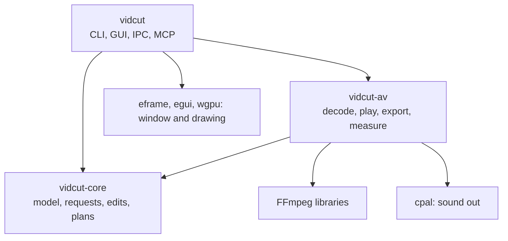
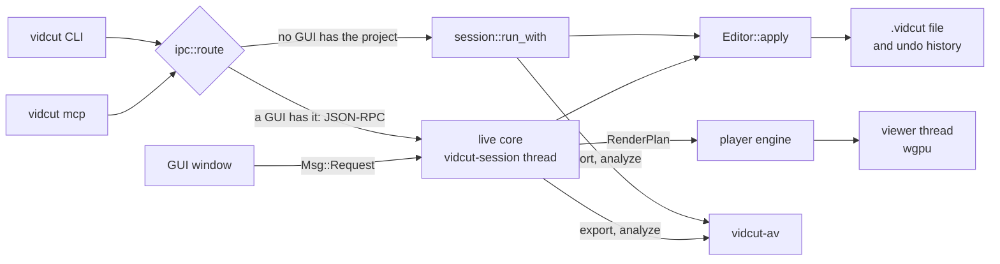

# vidcut design

These pages say how vidcut works.
The text comes from the code.
Start here.
Then open the page for the part you need.
The [spec](../cut-page-spec.md) says what vidcut does for the user.
The [deviations](../deviations.md) say where vidcut differs from that spec.
This folder says how the program is built.

vidcut is one binary.
The binary contains three crates.
A user, a script, or an agent does work through a request.
Every request ends in the same editor.
Decoding, playback, export, and measurement live in one crate.
That crate calls the FFmpeg libraries.

| Crate | Path | Contents | Limit |
|---|---|---|---|
| `vidcut-core` | `crates/vidcut-core` | The project model, time, the request protocol, the editor, undo, edit operations, render plans, OpenTimelineIO, decisions of the automatic tools, and preferences. | The crate does not call FFmpeg. The crate does not use a GPU. The crate starts no thread. |
| `vidcut-av` | `crates/vidcut-av` | Probing, decoding on the CPU or a GPU, the player engine, exports, proxies, thumbnails, waveforms, measurements, and the CPU pools. | The crate does not implement the GUI, the CLI, or a request. |
| `vidcut` | `crates/vidcut` | The CLI, the headless session, the GUI, the live core, IPC, the MCP server, and themes. | This crate is the binary. It calls the other two crates. |

## The big picture

- A request is one `Request` value.
  The value has a method, such as `edit.split`, and its parameters.
  An `Envelope` wraps the request.
  The CLI, the MCP tools, and `vidcut schema` come from the JSON schema of the request type.
  The GUI sends the same requests.
  See [requests](requests.md).
- A command runs headless when no GUI has the project open.
  The headless path locks the `.vidcut` file, loads it, applies the request, and saves.
  When a GUI has the project open, the command goes to that GUI on its socket.
  The command then runs in the live core.
  See [requests](requests.md) and [live](live.md).
- The editor is `Editor`.
  `Editor` applies edits to the `Project`.
  It records each edit as a `Change` for undo.
  It also answers queries.
  See [model](model.md).
- Play and export use a render plan.
  The plan is a `RenderPlan`.
  `render` flattens the project into pieces of sources on lanes, frame by frame.
  The player engine decodes the plan ahead of the playhead for the viewer.
  An export decodes the plan into an encoder.
  See [playback](playback.md) and [export](export.md).
- The automatic tools measure media in vidcut-av.
  They decide in vidcut-core.
  See [analysis](analysis.md).

## Rules the code follows

- One vocabulary.
  Every capability is a variant of `Request`.
  A GUI action has the same request on the CLI, on IPC, and on MCP.
- The file is the truth.
  A command reads and writes the `.vidcut` file.
  A running GUI watches the file and reloads it.
  The project revision, `if_rev`, rejects an edit that crossed another edit.
- The core is pure.
  vidcut-core reaches media only through the `Env` trait.
  The app uses `AvEnv`.
  Tests use `FakeEnv`.
  Edits, plans, and decisions have tests with no FFmpeg.
- One decode path and one mix path.
  The player and an export read the same `RenderPlan`.
  Both use `VideoFrames` and `AudioMix` in vidcut-av.
  The viewer shows the frames that an export writes.
- The GPU is first.
  Decoding, scaling, mixing, and encoding stay on the GPU when the GPU gives correct results.
  See [gpu](gpu.md).
- One thread has one purpose.
  Each thread waits on one thing.
  Media jobs run at the lowest priority.
  They yield to playback.
  See [threads](threads.md).

## Words

| Word | Meaning | In code |
|---|---|---|
| request | One call, with a method and parameters. | `Request`, `Envelope`, `Response` |
| rev | The project revision. Each change adds one. | `Project::rev`, `if_rev` |
| change | The difference that an edit made. Undo keeps it. | `Change`, `History` |
| plan | The timeline, flattened for play or export. | `RenderPlan`, `VideoPiece`, `AudioPiece` |
| lane | The pieces of one track in a plan. The mix includes every lane. | `LaneTrack` |
| tape | The plan for the source viewer. Media items play one after another. | `render::tape` |
| snapshot | The values that the GUI draws. The live core publishes it. | `Snapshot` |
| origin | A cache stamp. It holds the path, the size, and the modification time of a file. | `Origin` |
| kept | Data from another editor. vidcut stores it and does not model it. | `Kept` |

## Pages

| Page | What it covers |
|---|---|
| [requests](requests.md) | The front doors, routing, the headless path, the editor, and undo. |
| [model](model.md) | The project, time, the `.vidcut` file, OpenTimelineIO, and preferences. |
| [live](live.md) | The running GUI: the live core, snapshots, jobs, and waits. |
| [playback](playback.md) | The path from the playhead to pixels and sound. |
| [export](export.md) | The path from `export.start` to a finished file. |
| [gpu](gpu.md) | Which GPU does each step, and where a frame lives. |
| [analysis](analysis.md) | Measurements, the automatic tools, and caches. |
| [threads](threads.md) | Every thread that vidcut starts, the pools, and priorities. |

## Code

- `crates/vidcut-core/src/lib.rs`
- `crates/vidcut-av/src/lib.rs`
- `crates/vidcut/src/lib.rs`
- `crates/vidcut/src/main.rs`
