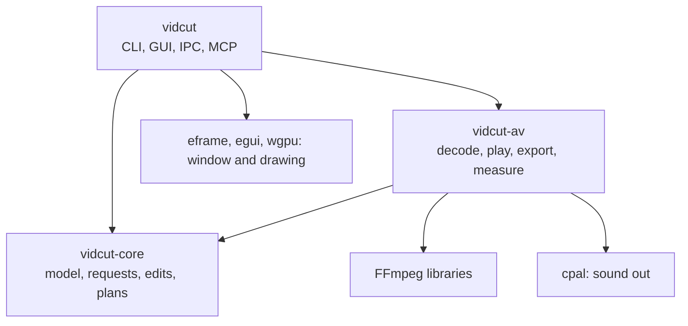
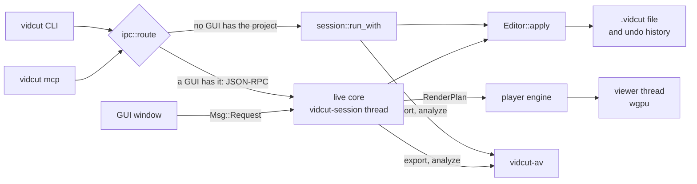

# vidcut design

How vidcut works, from its code. Start here, then follow the links to the part you need. What vidcut does for the user is in the [spec](../cut-page-spec.md) and the [deviations](../deviations.md); this folder is about how it is built.

vidcut is one binary in three crates. Everything a user, a script or an agent can do is a request, and every request ends in the same editor. Media work (decoding, playback, export, measuring) lives in its own crate on the FFmpeg libraries.

| Crate | Holds | Doesn't touch |
|---|---|---|
| `crates/vidcut-core` | the project model, time, the request protocol, the editor and undo, edit operations, render plans, OpenTimelineIO, decisions of the automatic tools, preferences | FFmpeg, GPUs; it starts no threads |
| `crates/vidcut-av` | probing, decoding on the CPU or a GPU, the player engine, exports, proxies, thumbnails, waveforms, measurements, the CPU pools | the GUI, the CLI, requests |
| `crates/vidcut` | the CLI, the headless session, the GUI and its live core, IPC, the MCP server, themes | — |

## The big picture

- A **request** is one `Request` value: a method like `edit.split` and its params, wrapped in an `Envelope`. The CLI, the MCP tools and `vidcut schema` are generated from the request type's JSON schema, and the GUI sends the same requests. [requests](requests.md)
- With no GUI open on the project, a command runs **headless**: it locks the `.vidcut` file, loads it, applies the request and saves. With a GUI open, the command goes to that GUI over its socket and runs in its **live core**. [requests](requests.md), [live](live.md)
- The **editor** (`Editor`) applies edits to the `Project`, records each as a `Change` for undo, and answers queries. [model](model.md)
- To play or export, the project is flattened into a **render plan** (`RenderPlan`): pieces of sources on lanes, frame by frame. The player engine decodes it ahead of the playhead for the viewer, and an export decodes it into an encoder. [playback](playback.md), [export](export.md)
- The automatic tools measure media in vidcut-av and decide in vidcut-core. [analysis](analysis.md)

## Rules the code follows

- **One vocabulary.** Every capability is a variant of `Request`. Nothing the GUI can do is missing from the CLI, IPC or MCP.
- **The file is the truth.** The `.vidcut` file is what a command reads and writes. A running GUI watches it and reloads; the project's revision (`if_rev`) catches edits that crossed.
- **The core is pure.** vidcut-core reaches media only through the `Env` trait: `AvEnv` in the app, `FakeEnv` in tests. Edits, plans and decisions are tested without FFmpeg.
- **One decode and mix stack.** The player and exports read the same `RenderPlan` through the same `VideoFrames` and `AudioMix` in vidcut-av, so the viewer shows the frames an export writes.
- **The GPU first.** Decoding, scaling, mixing and encoding stay on the GPU wherever it gives correct results. [gpu](gpu.md)
- **A thread per purpose.** Each thread waits on one thing; media jobs run at the lowest priority and yield to playback. [threads](threads.md)

## Words

| Word | Meaning | In code |
|---|---|---|
| request | one capability call: method and params | `Request`, `Envelope`, `Response` |
| rev | the project's revision, one more for each change | `Project::rev`, `if_rev` |
| change | the difference an edit made, kept for undo | `Change`, `History` |
| plan | the timeline flattened for playing or export | `RenderPlan`, `VideoPiece`, `AudioPiece` |
| lane | one track's pieces in a plan, mixed with the others | `LaneTrack` |
| tape | the source viewer's plan: media one after another | `render::tape` |
| snapshot | what the GUI draws, published by the live core | `Snapshot` |
| origin | a cache stamp of a file's path, size and time | `Origin` |
| kept | data of another editor that vidcut carries without modeling it | `Kept` |

## Pages

| Page | What it covers |
|---|---|
| [requests](requests.md) | the front doors, routing, the headless path, the editor, undo |
| [model](model.md) | the project, time, the `.vidcut` file, OpenTimelineIO, preferences |
| [live](live.md) | the running GUI: the live core, snapshots, jobs, waits |
| [playback](playback.md) | from the playhead to pixels and sound |
| [export](export.md) | from `export.start` to a finished file |
| [gpu](gpu.md) | which GPU does what, and where frames live |
| [analysis](analysis.md) | measurements, the automatic tools, caches |
| [threads](threads.md) | every thread vidcut starts, the pools, priorities |

## Code

- `crates/vidcut-core/src/lib.rs`
- `crates/vidcut-av/src/lib.rs`
- `crates/vidcut/src/lib.rs`
- `crates/vidcut/src/main.rs`
