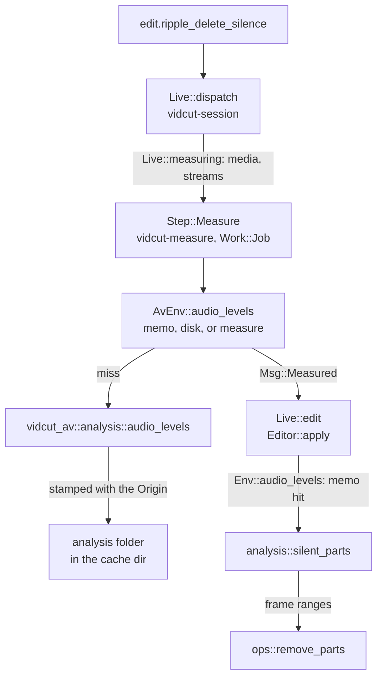

# Analysis

The automatic tools are `edit.ripple_delete_silence` and `edit.detect_scene_cuts`.
The measurements are `analyze.silence`, `analyze.scenes`, `analyze.black`, `analyze.loudness`, and `timeline.boring`.
The work splits in two.
vidcut-av measures media.
vidcut-core decides.
A measurement decodes a whole stream.
Results are cached by the `Origin` of the file.
A GUI measures on a job thread before it edits.

## Measure, then decide

vidcut-core reaches media only through the `Env` trait.
`AvEnv` implements `Env` on vidcut-av.
Tests use `FakeEnv`.
A decision is a plain function of a measurement, a span, and the settings.

| Request | Measurement (`Env`) | Decision (`analysis`) |
|---|---|---|
| `edit.ripple_delete_silence`, `analyze.silence` | `Env::audio_levels` returns the peaks of one audio stream. | `analysis::silent_parts`. The edit then calls `ops::remove_parts`. |
| `edit.detect_scene_cuts`, `analyze.scenes` | `Env::picture_stats` returns one score for each frame, on luma scaled to a small size. The score is the minimum of `mafd` and the absolute change from `prev_mafd`. `mafd` is the sum of absolute sample differences, times 100, divided by the sample count and by 256. The score is clamped to 0 through 100. The first frame scores 0. | `analysis::scene_cuts`. The edit then calls `ops::split_clip`. |
| `analyze.black` | `Env::picture_stats` also returns the black share of each frame. The share is the fraction of those luma samples at or below 25 in full range, or at or below 38 in limited range. | `analysis::black_parts`. There is no edit. |
| `analyze.loudness` | `Env::loudness` measures the flattened timeline. | There is no decision function. |
| `timeline.boring` | There is no measurement. The input is the clip lengths. | `analysis::boring`. |

## In a GUI

`Live::measuring` lists the media of the clips that the two edits name.
For silence, it also lists the audio streams.
A `vidcut-measure` thread runs at job priority.
The thread yields to playback.
It measures into the memo cache and the disk cache of `AvEnv`.
It then sends `Msg::Measured`.
The session thread runs the edit on the project as it is then.
Those measurements return at once.
An `analyze` method runs whole on a job thread, through `Live::project_task`.
In a headless run, the edit measures inside its transaction.

The session thread answers every request.
It also runs the players.
A whole-file decode on that thread would hold up both ([live](live.md)).

## Caches

An `Origin` is the path, the size, and the modification time of a file (`fingerprint::origin`).
Its name names the cache file.
Its text is stamped into the file (`Origin::stamp`).
A read checks the stamp (`Origin::check`).
A changed file misses.
The cache directory is `dirs::cache`.

| Cache | Directory | Key |
|---|---|---|
| Pool filmstrips and timeline tiles | `thumbs` (`thumbcache`) | The origin, the size, and the frames. |
| Waveforms | `waveforms` | The origin and the channels. |
| Audio levels and picture stats | `analysis` (`AvEnv`) | The origin, and the stream or the picture count. |
| Light, for HDR metadata | `analysis` (`light::cache_in`) | The origin. |
| Proxies | `proxies` beside the project. The cache directory when there is no project. | The origin, the size, and the codec. |
| GPU encoders that work | `encoders.json` (`export::detected`) | The FFmpeg build, the system, and the GPUs. |
| Proxy codecs that the GPU decoder plays | `plays.json` (`export::plays`) | The same key, for each GPU. |
| Clips for decoder tests | `decoder-tests` | There is no key. |
| Compiled libplacebo shaders | `shaders` (`cuda::keep_shaders_in`) | The libplacebo version. |

On disk, only the `thumbs` directory has a size limit.
`thumbcache::evict` drops the files used longest ago.
The limit is set in the preferences.
`Tiles` also keeps pictures in memory.
`Tiles::evict` drops the pictures used longest ago when the cache is above 256 MiB.
Audio levels, picture stats, and light are also memoized in the process.

## Storyboards

`storyboard::render` flattens the timeline, or a range.
It takes one picture for each shot, from the middle of each source piece.
Or it takes one picture every `every` frames.
It decodes the pictures with `FrameReader`.
It writes one PNG.
Each picture is labeled `{timecode} {clip id}`.
When the clip is not on V1, the label also has the track id.

## Code

- `crates/vidcut-core/src/analysis.rs`
- `crates/vidcut-core/src/editor.rs`
- `crates/vidcut-core/src/fingerprint.rs`
- `crates/vidcut-core/src/dirs.rs`
- `crates/vidcut-av/src/analysis.rs`
- `crates/vidcut-av/src/light.rs`
- `crates/vidcut-av/src/waveform.rs`
- `crates/vidcut-av/src/thumbs.rs`
- `crates/vidcut/src/env.rs`
- `crates/vidcut/src/paths.rs`
- `crates/vidcut/src/thumbcache.rs`
- `crates/vidcut/src/live/mod.rs`
- `crates/vidcut/src/storyboard.rs`
