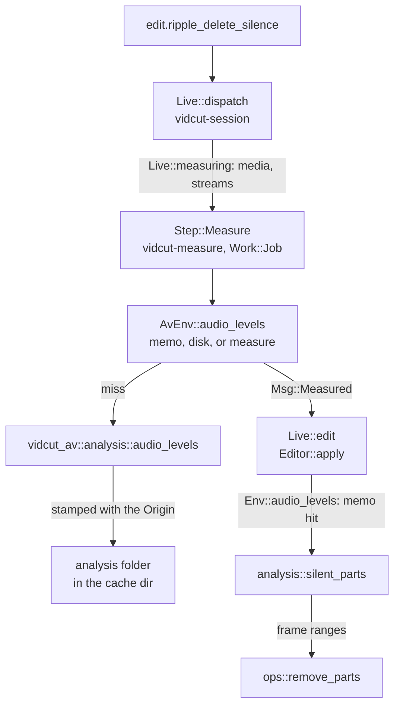
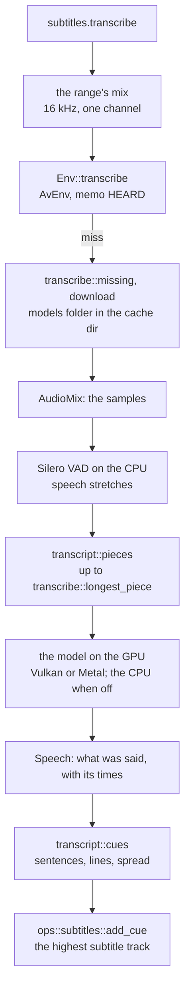
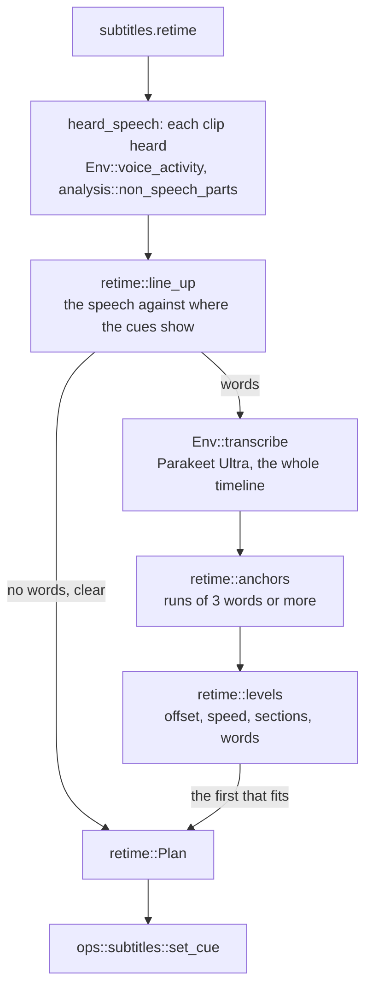

# Analysis

The automatic tools (`edit.ripple_delete_silence`, `edit.detect_scene_cuts`) and the measurements (`analyze.silence`, `analyze.scenes`, `analyze.black`, `analyze.loudness`, `timeline.boring`) split in two: vidcut-av measures media, vidcut-core decides. Measuring decodes whole streams, so results are cached by the file's `Origin`, and a GUI measures on a job thread before it edits.

## Measure, then decide

vidcut-core reaches media only through the `Env` trait. `AvEnv` implements it on vidcut-av; tests use `FakeEnv`. Decisions are plain functions of a measurement, a span and the settings.

| Request | Measurement (`Env`) | Decision (`analysis`) |
|---|---|---|
| `edit.ripple_delete_silence`, `analyze.silence` | `Env::audio_levels`: peaks of one audio stream; with `detect: speech`, `Env::voice_activity`: its speech probabilities | `analysis::silent_parts`, or `analysis::non_speech_parts`; the edit then calls `ops::remove_parts` |
| `edit.detect_scene_cuts`, `analyze.scenes` | `Env::picture_stats`: the smaller of each frame's difference from the last and the change in that difference; the first frame scores 0 | `analysis::scene_cuts`; the edit then calls `ops::split_clip` |
| `analyze.black` | `Env::picture_stats`: each frame's black share | `analysis::black_parts` |
| `analyze.loudness` | `Env::loudness` of the flattened timeline | none |
| `timeline.boring` | none: clip lengths | `analysis::boring` |

Given `parts`, `edit.ripple_delete_silence` measures nothing: it checks that each part lies inside its clip and apart from the clip's others, and cuts them.

## Speech

Ripple Delete Silence with `detect: speech` cuts what isn't speech. vidcut-av's `transcribe::voice_activity` mixes one audio stream in one channel at 16 kHz through `AudioMix`, as transcription listens (`listen`), and feeds it to Silero VAD on the CPU in pieces. `VoiceActivity` keeps its speech probability for each of the VAD's frames (32 ms). `analysis::non_speech` finds the speech in the clip's part of them by Silero's own rule, which transcribe.cpp ports: speech starts at a frame at or above the threshold, and ends at a frame more than 0.15 below it when no frame reaches the threshold again within Minimum to Trip; speech no longer than Shortest Speech doesn't count. What lies between is cut, less Pre Head and Post Tail, as for silence (`analysis::silent_parts`).

**Why** probabilities, not transcribe.cpp's segments: those depend on the threshold and the lengths, so each change in the dialog would run the VAD over the whole file again; the probabilities are measured once, cached like the levels, and decided again at once.

## In a GUI

`Live::measuring` lists the media (and audio streams) of the clips the two edits name. A `vidcut-measure` thread at job priority, which yields to playback, measures them into `AvEnv`'s memo and disk cache and sends `Msg::Measured`. The session thread then runs the edit on the project as it is then; its measurements return at once. The `analyze` methods run whole on a job thread through `Live::project_task`. Headless, the edit measures inside its transaction.

**Why** measure first: the session thread answers every request and runs the players; decoding a whole file there would hold up both ([live](live.md)).

## Transcription

Create Subtitles from Audio (`subtitles.transcribe`) splits the same way. With `hear: mix`, the editor flattens the range of the tracks heard (`heard_tracks`: the request's `tracks`, or those playback hears) in one channel at 16 kHz (`RATE`), as an export would mix it, and asks `Env::transcribe` for what was said; vidcut-av's `transcribe::transcribe` hears it with transcribe.cpp's prebuilt library through the `transcribe_cpp` crate, and vidcut-core makes the cues. With `hear: media`, the default over the whole timeline for a model that times words (`hearing`), `clip_speech` reads each heard clip's file's transcript instead, as `media.transcribe` keeps it, transcribing and keeping one that is missing or that another model or language made (`Asked::made`). With `hear: transcript` it takes whatever transcript each file has and transcribes only a file with none. It places the words through each clip's sound, J and L cuts included (`analysis::words_between`), keeps the first track's word where two tracks have the same one at once (`first_heard`), and hands the cues one `Speech` in the range's times. Re-time's words come the same way.

- **Model files** are pinned in `transcribe::File`: Hugging Face repository, revision, size, SHA-256 and the languages the model's metadata lists. They live in the cache dir's `models` folder (`paths::models_dir`), which `vidcut reset` empties. `transcribe::needed` says what of transcribe.cpp's library, Silero VAD and the speech model isn't there; without `download` the request fails with DEPENDENCY, saying what it would fetch. `transcribe::fetch` reads each through FFmpeg's HTTPS (`avio_open2`), goes on from a `.part` file left before, and keeps the file only when its size and SHA-256 match. `model_file` and `vad_file` name files instead.
- **The GUI's dialog** (`Workspace::speech_window`) asks `transcribe::needed` and `transcribe::short_of_memory` before it sends the request, so it can ask before a download and warn before the run; the run is a job like the CLI's.
- **transcribe.cpp's library is downloaded, not built** (`transcribe::RUNTIME`): the prebuilt bundle transcribe.cpp publishes for this system (Windows and Linux on Vulkan, macOS on Metal), pinned by size and SHA-256 and unpacked into the `models` folder (`transcribe::unpack`). crates/transcribe-cpp-sys stands in for the crate of that name (patched in by the workspace): the bindings that crate ships, rewritten by scripts/transcribe-sys.py so that each function calls the library `transcribe::start` loads (`transcribe_cpp_sys::load`), which then starts the backends beside it. Silero VAD is a pinned file like the models (`transcribe::SILERO_VAD`). `transcribe::get_ready` gets them before anything is heard, for `subtitles.transcribe`, `subtitles.retime`, and `edit.ripple_delete_silence` and `analyze.silence` with `detect: speech`, each of which takes `download`.
- **Finding the speech:** by default (`find: sound`) the stretches louder than `sound_db` that `transcript::sounding` finds in the levels of 32 ms frames, parted by half a second of quiet; with `find: voice`, Silero VAD's stretches; with `find: none`, all of the audio as one stretch, which the pieces then part where it's quietest, and which a paid service gets with its silences. With the voice detection, `missed_singing` warns when it keeps under a quarter of the sound of a range that is mostly loud. A kept transcript records how it was found and at what level (`Speech::found`, `Asked::level`), and `Asked::made` reuses it only for the same `find` and level; the memo of the mix heard (`heard_key`) keys on them too.
- **Pieces:** a model hears a piece at once. `transcript::pieces` puts the VAD's speech stretches together, with a little padding, up to the longest piece, and ends a piece at the longest pause in its second half; a stretch longer than a piece is cut where the sound is quietest. Each piece's times shift back by its start.
- **The GPU** is the one `gpus::in_use` names, found among transcribe.cpp's devices by its PCI slot or name; a failure to load there falls back to the CPU with a warning. `gpu.acceleration` off puts the model on the CPU. The longest piece goes first, and the language it finds is given to the rest.
- **Cues:** `transcript::cues` breaks the words into sentences and at pauses, splits a sentence too long for one cue into even parts, and wraps the lines. Words carry the model's times where it gives them; a model without times has its text spread over the speech of its piece by `transcript::spread` ([spec D62](../cut-page-spec.md#12-decisions-on-gaps-and-contradictions)).
- **Word times on cues:** `transcript::cues` keeps each word's start in its cue (`Made`). Synchronize Word Timings (`subtitles.time_words`) hears the cues' span as Create Subtitles from Audio does, and `retime::word_starts` matches the cues' words to the words heard in order across them, by the longest common runs as Re-time's words do; `subtitles::fill_times` spreads the words left between their matched neighbors by characters. New text with another number of words in `subtitles.set` is read again from the words kept for the clips' files alone (`clip_speech` told not to transcribe), else spread ([spec D70](../cut-page-spec.md#12-decisions-on-gaps-and-contradictions)).
- **Transcripts of media:** `media.transcribe` hears one pool item's sound stream on its own: the Source Tape's plan of it (`render::tape`) at 16 kHz, mono, with the stream asked for. `Env::transcribe_media` keeps the `Speech` as JSON with the file's other measurements (`words0`, `words1`, … per stream), stamped with its origin, so a changed file has none; `Env::transcript` reads it back, and it is used again while the model asked made it, in the language asked (`Asked::made`; `SpeechModel::title` names the model in both). Only a transcript with word times is kept (`transcript::spoken`), and a model known not to time words (`SpeechModel::times_words`) is refused before anything is heard. The core's `transcribed` set, the pool's mark, comes from which of those files exist (`env::transcribed`).
- **Speakers:** `speakers` gives each word a speaker (`Word::speaker`). With a local model, `transcribe::speakers_of` takes the speaker turns of the file's sound from the model `transcribe::speaker_file` picks by `SpeakerModel` and the language asked, else the one the speech model reports: MOSS (`transcribe::MOSS`, a transcription model run with diarization on, of which `moss_turns` keeps only the turns) in English and Chinese, else Sortformer (`transcribe::SORTFORMER`, transcribe.cpp's diarization role). The model picked is downloaded with `download`, else the run stops; a MOSS that fails stops the run with its error, and both errors point to Sortformer under Speakers By. `transcript::give_speakers` gives each word the turn heard over most of it, and none to a word outside every turn. `Speech::speakers` names the run that numbered them (`transcribe::run_id`). The project's `Speakers` makes a file's speaker a person (`Speakers::person`): a word assigned to someone, else the voice's link (`speakers::voice`), else the run's own person (`speakers::heard_person`), so the speakers of one paid run over several files are one person each. `clip_speech` numbers the range's people in order, and `transcript::cues` ends a cue where the number changes and keeps it (`Made::speaker`); `subtitles.transcribe` gives the cue that person, from `clip_speech`'s list or, for the mix, the run's (`speakers::heard_person`). `analyze.words` gives each word read from a transcript its speaker, person, name and `file_time`, which `speakers.assign` takes.
- **Paid services:** `speech_api::transcribe` hears each file as a local model does (`transcribe::find_speech`), joins the files' padded stretches end to end with half a second of quiet between (a `Piece` maps a time back to its file), writes FLAC with FFmpeg's encoder (`write_flac`) and uploads it with `ureq` on a `vidcut-upload` thread, while the job's thread reports `Stage::Uploading` and `Stage::Waiting` and stops it on a cancel. xAI takes all of it in one multipart request (`xai_fields`, 500 MB at most); Gemini takes only the language codes in Google's published list (`GOOGLE_LANGUAGES`, https://ai.google.dev/gemini-api/docs/transcribe, Supported languages); any other is refused before anything is heard. Gemini goes through its Files API and Interactions in one request, refused past `SpeechModel::longest_secs`, and the upload is used once Google reports it `ACTIVE`. Files of different channel counts are refused, as one request carries one count, and a word timed in the quiet between pieces is dropped (`where_in`). `Env::transcribe_files` lets `clip_speech` and `media.transcribe` send every file missing in one run; with `speakers` they send every heard file again, so they share numbers. The editor refuses without `send` (`upload_check`), giving the duration, the size (`transcript::upload_mb`) and the cost (`transcript::cost`).
- **Limits and where they come from:** the numbers vidcut holds a model to sit with the model's other facts, each from its maker's documentation. Gemini 3.5 Transcribe takes 30 minutes of audio with word times or diarization, of which vidcut always asks for word times, and tells up to 8 speakers apart, 3 or more experimentally (`SpeechModel::longest_secs`, `SpeechModel::max_speakers`; Google's transcription guide, https://ai.google.dev/gemini-api/docs/transcribe, Limitations). Sortformer tells up to 4 (`SpeakerModel::max_speakers`): NVIDIA's diar_streaming_sortformer_4spk-v2.1 has one output per speaker, 4 in all (https://huggingface.co/nvidia/diar_streaming_sortformer_4spk-v2.1), and transcribe.cpp reports the same when the model loads.
- **Kept replies:** a reply's text is kept in the cache dir's `speech-replies` (`speech_api::replies_folder`), named by `reply_key`: SHA-256 of the company, the request's settings with their keys sorted, and the audio's 16-bit samples. A request with the same settings and audio reads it and sends nothing, needing no key, and its `notes` say so (`Speech::notes`).
- **Keys:** `services::key` takes the key from `XAI_API_KEY` or `GEMINI_API_KEY`, else reads the system keychain through `keyring` (service `vidcut`). `services.set_key` writes the keychain; the command log keeps only its `service`, and the CLI reads the key from standard input.
- **Words:** `analyze.words` with `media` (the first stream transcribed, unless `stream`) or `clips` (each clip's own stream) reads those transcripts and hears nothing: a word lands on a clip through its source range and speed (`analysis::words_in`), when its middle is inside the clip. Without them it hears the timeline's mix the same way as `subtitles.transcribe` and returns each word `transcript::spoken` kept, at its frames (`transcript::word_frames`). It refuses a model whose times are phrases or none: the spread estimates are not word times. `edit.ripple_delete_words` takes those words' spans out through `ops::cut_ranges`, which closes the gap whether or not ripple is on ([spec D63](../cut-page-spec.md#12-decisions-on-gaps-and-contradictions)). With `quiet`, each edge first moves to the quietest frame boundary nearby (`analysis::quietest`), from the levels of the clips heard there, bounded by the words the clips' transcripts place: no further than a third into any word wholly inside the cut, and outward only to the next word; the core measures levels it doesn't keep yet on a job first (`Live::measuring`). Words are marked as fillers (`transcript::is_filler`) in the transcript's language, or the one `language` names, by the project's list for it (`Settings::fillers`), else the preferences' (`Env::fillers`), else the built-in one (`transcript::built_in_fillers`).

**Why** this piece length (`transcribe::longest_piece`): Qwen3-ASR's memory grows with the length it hears, so its pieces are sized from the GPU's memory (`Gpu::memory_mb`); a model without times needs short pieces to place its words; Whisper large-v3 loops in long ones ([gotchas](../gotchas.md#transcribecpp-and-its-models)). Parakeet Ultra is the default (`SpeechModel`): it gives real word times now, where Qwen3-ASR's are estimates without transcribe.cpp's aligner. No CUDA: its backend and NVIDIA's runtime add about 930 MB, and it was slower than Vulkan for two of the three models.

## Re-timing subtitles

Re-time to Speech (`subtitles.retime`) moves a subtitle track's cues to the timeline's speech. It measures with the two above and decides in vidcut-core's `retime`.

- **Speech** is where the cached voice activity of each clip on the tracks heard (`heard_tracks`) is speech by Silero's rule with its defaults (`SPEECH` 0.5, `SHORTEST_SPEECH` 0.25 s, `SHORTEST_PAUSE` 0.1 s), on the timeline through the clip (`Span`).
- **Lining up** (`retime::line_up`) scores each offset, every 10 ms up to `max_offset`, by the cross-correlation of the speech, less its mean, with where the cues show. It is summed exactly, as the trapezoid each speech stretch and cue make against the offset (`Ramps`), not sampled. Speeds from 0.95 to 1.05 are tried in steps that move the last cue 0.25 s, then a tenth of that around the best. A speed within 0.25 s of 1 or of a frame-rate ratio over the track snaps to it (`retime::snap`), and stays only when it scores above speed 1. The best offset is clear when it scores `CLEAR` (1.25) times the highest other peak more than 2 s from it.
- **Words** (`retime::anchors`): the cues' text and the words heard, as lower-case letters and digits, are matched in order by their longest common runs, as Python's difflib does without its junk heuristic. A cue whose first word is in a run of `RUN` (3) words or more is anchored at that word's start, and at its last word's end when that word matched in the same run, so that only the cue's own words lie between; otherwise the cue keeps its length.
- **Levels** (`retime::levels`) fit the anchors' offsets (the word's start less the cue's): their median; a Theil–Sen line, its speed snapped as above; sections, each starting where 5 anchors in a row sit more than 0.5 s from the last section's offset and within 0.5 s of their own median; and last, each anchored cue at its words, the others as in their section. The first that puts 90% of the anchors within `FIT` (0.5 s) wins. Under `MIN_ANCHORS` (10) the words decide nothing, and a clear offset from the speech stands.
- **In a GUI** it runs as a job (`Step::Encode`) on a copy, so the VAD and the transcription run off the core's thread; the edit then finds both cached.

**Why** the speech first, not the words: where speech is doesn't depend on its language, so a translated file lines up as well as the original. **Why** 1.25: over the NASA press conference and its captions (nasa-roman-presser in the media manifest), lined up in 5-minute windows, the one window whose offset was wrong scored 1.09 times its next peak, and the last, 76 s long, 1.07 though right; the other ten scored 1.38 or more. The whole file scored 2.03 at +2.94 s, where Parakeet Ultra's words put it at +3.02 s.

## Caches

An `Origin` is a file's path, size and modification time (`fingerprint::origin`). Its name names the cache file; its text is stamped into it (`Origin::stamp`) and checked on read (`Origin::check`), so a changed file misses. The cache dir is `dirs::cache`.

| What | Where | Key |
|---|---|---|
| pool filmstrips, timeline tiles | `thumbs` (`thumbcache`) | origin, size, frames, input color space |
| waveforms | `waveforms` | origin, channels |
| audio levels, voice activity, picture stats | `analysis` (`AvEnv`) | origin, stream or picture count |
| transcripts (`media.transcribe`) | `analysis` (`AvEnv`) | origin, stream |
| light, for HDR metadata | `analysis` (`light::cache_in`) | origin, input color space |
| proxies | `proxies.folder` (`Proxies::folder_in`): `proxies` beside the project unless set (in the cache dir without a project); an absolute folder is shared by every project | content (`paths::proxy_origin`), size, codec, input color space |
| GPU encoders that work | `encoders.json` (`export::detected`) | FFmpeg, system and GPUs |
| proxy codecs the GPU decoder plays | `plays.json` (`export::plays`) | the same, per GPU |
| clips for decoder tests | `decoder-tests` | none |
| compiled libplacebo shaders | `shaders` (`cuda::keep_shaders_in`) | libplacebo's |
| speech models | `models` (`paths::models_dir`) | file name, checked by size; SHA-256 when downloaded |
| paid speech replies | `speech-replies` (`speech_api::replies_folder`) | the company, the request's settings, the audio |

`reset` with `keep_downloads` keeps `models` and `speech-replies`. `Tiles::evict` drops kept pictures past the tile cache's own memory budget. Levels, voice activity, picture stats and light are memoized in the process too, and the last few heard (`HEARD`, an `Lru`) only there.

### The disk cache limit

`disk_cache` keeps what vidcut can make again under one limit: the folders of `disk_cache::Kind` (`thumbs`, `waveforms`, `analysis`, `shaders`, `decoder-tests`) and the proxies (`.mkv` files) in `proxies.folder` when it is in the cache dir (`Policy`). Transcripts (`words` files in `analysis`, `Kind::keeps`), `models`, `speech-replies`, `uploads`, `encoders.json` and `plays.json` stay and don't count.

- **The limit** is the preferences' `cache` (`Policy::limit`): `cache.percent` of the disk the cache dir is on (10 by default; `system::disk` reads its size and free space) or `cache.gb`, and never more than keeps 20% of that disk free (`KEEP_FREE_PERCENT`): the files held plus the free space, less that fifth.
- **Reads** go through `disk_cache::read`, which sets the file's modification time to now. `disk_cache::used` does that for a file something else reads: a project's proxies when it opens, a proxy `proxy.generate` finds made, a decoder test clip.
- **Writes** go through `disk_cache::write`: a `.part` file, then the oldest files go until the new one fits under the limit, and it is renamed into place. One larger than the room left, as any is while the disk has less than 20% free, is dropped instead: `write` answers `StorageFull`, and the caller goes on with what it has in memory. `disk_cache::added` runs `disk_cache::evict` after a file FFmpeg wrote (a proxy, a test clip). `evict` lists the files and, past the limit, removes the oldest first. A file being written (a name with a `part` piece) is neither counted nor removed, and one that can't be removed (in use on Windows) is skipped. `main` also runs one on a `vidcut-cache` thread at startup, and `preferences.set` one with the new limit.
- **libplacebo** reads and writes `shaders` itself, so a shader's time is when it was compiled.
- **Usage:** `preferences.get` answers `disk_cache::usage` in `cache`: files, MB, the limit as set (`chosen_mb`) and as it stands (`limit_mb`), the disk's size and free space; the Cache page of Preferences shows it.

**Why** the time on the file, not a list in memory: a GUI and a CLI, each its own process, read and write the same folders, and each one's listing sees what the others used. In one process `evict` runs one pass at a time, and a write meanwhile asks the running one for another pass instead of listing in parallel.

**Why** named folders, not the whole cache dir: a folder vidcut doesn't know (a download, a newer version's) is never removed.

**A new kind** of entry: add a variant to `disk_cache::Kind` and name its folder in `Kind::folder`, name its files with `Kind::file`, and read and write them with `disk_cache::read` and `disk_cache::write`. Files of it that must stay go in `Kind::keeps`.

## Storyboards

`storyboard::render` flattens the timeline or a range and takes one picture per shot, from the middle of each source piece, or one every `every` frames. It decodes them with `FrameReader` and writes one PNG, each picture labeled with its timecode and clip, plus the track when the clip is not on V1.

## Code

- `crates/vidcut-core/src/analysis.rs`
- `crates/vidcut-core/src/editor.rs`
- `crates/vidcut-core/src/fingerprint.rs`
- `crates/vidcut-core/src/dirs.rs`
- `crates/vidcut-core/src/disk_cache.rs`
- `crates/vidcut-av/src/analysis.rs`
- `crates/vidcut-core/src/transcript.rs`
- `crates/vidcut-core/src/speakers.rs`
- `crates/vidcut-core/src/retime.rs`
- `crates/vidcut-av/src/speech_api.rs`
- `crates/vidcut/src/services.rs`
- `crates/vidcut-av/src/transcribe.rs`
- `crates/vidcut-av/src/light.rs`
- `crates/vidcut-av/src/waveform.rs`
- `crates/vidcut-av/src/thumbs.rs`
- `crates/vidcut/src/env.rs`
- `crates/vidcut/src/paths.rs`
- `crates/vidcut/src/preferences.rs`
- `crates/vidcut/src/thumbcache.rs`
- `crates/vidcut/src/live/mod.rs`
- `crates/vidcut/src/storyboard.rs`
