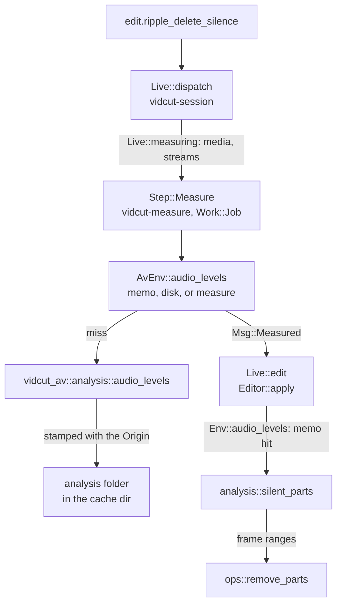
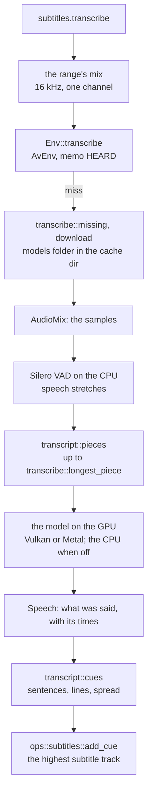
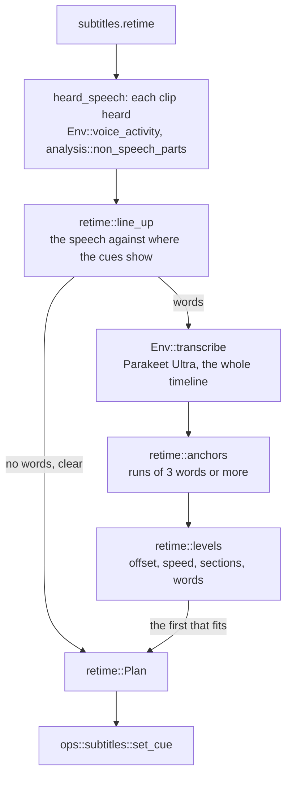

# Analysis

- The automatic tools (`edit.ripple_delete_silence`, `edit.detect_scene_cuts`) and the measurements (`analyze.silence`, `analyze.scenes`, `analyze.black`, `analyze.loudness`, `timeline.boring`) split in two:
  - vidcut-av measures media.
  - vidcut-core decides.
- Measuring decodes whole streams. Thus the results are cached by the `Origin` of the file.
- A GUI measures on a job thread before it edits.

## Measure, then decide

- vidcut-core reaches media only through the `Env` trait.
- `AvEnv` implements it on vidcut-av. Tests use `FakeEnv`.
- Decisions are plain functions of a measurement, a span and the settings.

| Request | Measurement (`Env`) | Decision (`analysis`) |
|---|---|---|
| `edit.ripple_delete_silence`, `analyze.silence` | `Env::audio_levels`: peaks of one audio stream; with `detect: speech`, `Env::voice_activity`: its speech probabilities | `analysis::silent_parts`, or `analysis::non_speech_parts`; the edit then calls `ops::remove_parts` |
| `edit.detect_scene_cuts`, `analyze.scenes` | `Env::picture_stats`: the smaller of each frame's difference from the last and the change in that difference; the first frame scores 0 | `analysis::scene_cuts`; the edit then calls `ops::split_clip` |
| `analyze.black` | `Env::picture_stats`: each frame's black share | `analysis::black_parts` |
| `analyze.loudness` | `Env::loudness` of the flattened timeline | none |
| `clip.normalize` | `Env::loudness` of each clip alone (`render::sound_alone`), without its volume keyframes | `normalize::gains`; the edit then sets each `gain_db`, or moves all the keyframes of a clip (`ClipAudio::raise`) |
| `timeline.boring` | none: clip lengths | `analysis::boring` |

- Given `parts`, `edit.ripple_delete_silence` measures nothing.
- It checks that each part lies inside its clip, and apart from the other parts of the clip. Then it cuts them.

## Speech

- Ripple Delete Silence with `detect: speech` cuts what is not speech.
- `transcribe::voice_activity` in vidcut-av mixes one audio stream into one channel at 16 kHz through `AudioMix`, as transcription listens (`listen`).
- It feeds the mix to Silero VAD on the CPU, in pieces.
- `VoiceActivity` keeps the speech probability for each frame of the VAD (32 ms).
- `analysis::non_speech` finds the speech in the part of these frames that the clip covers. It uses Silero's own rule, which transcribe.cpp ports:
  - Speech starts at a frame at or above the threshold.
  - Speech ends at a frame more than 0.15 below the threshold, when no frame reaches the threshold again within Minimum to Trip.
  - Speech no longer than Shortest Speech does not count.
- What lies between the speech is cut, less Pre Head and Post Tail, as for silence (`analysis::silent_parts`).
- Ducking by speech uses the same probabilities. `analysis::speech_frames` gives the speech of a source clip in timeline frames, by Silero's defaults (`retime::SPEECH`, `retime::SHORTEST_SPEECH`, `retime::SHORTEST_PAUSE`).
- Ducking by level uses the levels. `analysis::loud_frames` gives where a clip's peak, with its gains, reaches the threshold ([export](export.md#sound)).
- The gains of a clip with volume keyframes change over the clip. `keyframes::Gain` gives the gain at each level, for silence, ducking and the quiet edges of `edit.ripple_delete_words` ([spec D84](../cut-page-spec.md#12-decisions-on-gaps-and-contradictions)).

**Why** probabilities, not the segments of transcribe.cpp:

- The segments depend on the threshold and the lengths. Thus each change in the dialog would run the VAD over the whole file again.
- The probabilities are measured once, and cached like the levels. Then each change is decided again at once.

## In a GUI

- `Live::measuring` lists the media (and audio streams) of the clips that the two edits name.
- `Live::duck_measure` does the same for `track.set` with `duck`: the files of the sources that the ducking will have (`duck::patched`, `duck::sounds`).
- `Live::loudness_measure` measures each clip of `clip.normalize` alone. `AvEnv` keeps each loudness by its plan (`LOUD`), and the edit reads it there.
- A `vidcut-measure` thread at job priority measures them into the memo and disk cache of `AvEnv`. This thread yields to playback.
- Then it sends `Msg::Measured`.
- The session thread then runs the edit on the project as it is at that time. The measurements of the edit return at once.
- The `analyze` methods run whole on a job thread, through `Live::project_task`.
- Headless, the edit measures inside its transaction.

**Why** measure first: the session thread answers every request and runs the players. A decode of a whole file there would hold up both ([live](live.md)).

## Transcription

Create Subtitles from Audio (`subtitles.transcribe`) splits in the same way.

With `hear: mix`:

- The editor flattens the range of the tracks heard into one channel at 16 kHz (`RATE`), as an export would mix it.
- This mix has no ducking.
- `heard_tracks` gives the tracks heard: the `tracks` of the request, or the tracks that playback hears.
- The editor asks `Env::transcribe` for what was said.
- `transcribe::transcribe` in vidcut-av hears the mix with the prebuilt library of transcribe.cpp, through the `transcribe_cpp` crate.
- vidcut-core makes the cues.

With `hear: media`:

- This is the default over the whole timeline, for a model that times words (`hearing`).
- `clip_speech` reads the transcript of the file of each heard clip instead, as `media.transcribe` keeps it.
- It transcribes and keeps a transcript that is missing, or that another model or language made (`Asked::made`).

With `hear: transcript`:

- It takes the transcript that each file has, whatever made it.
- It transcribes only a file with no transcript.

Then, for `hear: media` and `hear: transcript`:

- It places the words through the sound of each clip, J and L cuts included (`analysis::words_between`).
- Where two tracks have the same word at the same time, it keeps the word of the first track (`first_heard`).
- It hands the cues one `Speech`, in the times of the range.
- The words of Re-time come in the same way.

- **Model files**
  - They are pinned in `models::File`: the Hugging Face repository, revision, size, SHA-256, and the languages that the metadata of the model lists.
  - They are in the `models` folder of the cache dir (`paths::models_dir`). `vidcut reset` empties it.
  - `transcribe::needed` says which of these are not there: the library of transcribe.cpp, Silero VAD and the speech model.
  - Without `download`, the request fails with DEPENDENCY, and says what it would fetch.
  - `models::fetch` reads each file through the HTTPS of FFmpeg (`avio_open2`).
  - It continues from a `.part` file that an earlier fetch left. It holds `temp::lock` on the target, so that two processes do not write one file.
  - It keeps the file only when its size and SHA-256 match.
  - `model_file` and `vad_file` name files instead.
- **Voice Isolation's model** (`isolate::DPDFNET`)
  - It is pinned and fetched in the same way, by `isolate::get_ready`, when the `download` of an edit allows it.
  - The live session fetches it on a job before the edit (`Step::Measure`).
  - The GUI first asks with the question of the speech dialog (`Workspace::isolation_prompt`).
- **Ducking by speech** (`Workspace::duck`)
  - It needs the speech detector: transcribe.cpp's library and Silero VAD.
  - The GUI asks with the same question before a `track.set` that needs them (`Workspace::ducking_windows`).
- **The GUI's dialog** (`Workspace::speech_window`)
  - It asks `transcribe::needed` and `transcribe::short_of_memory` before it sends the request. Thus it can ask before a download, and warn before the run.
  - The run is a job, as for the CLI.
- **transcribe.cpp's library is downloaded, not built** (`transcribe::RUNTIME`)
  - It is the prebuilt bundle that transcribe.cpp publishes for this system: Windows and Linux on Vulkan, macOS on Metal.
  - It is pinned by size and SHA-256, and unpacked into the `models` folder (`transcribe::unpack`).
  - crates/transcribe-cpp-sys stands in for the crate of that name. The workspace patches it in.
  - It holds the bindings that the crate ships, rewritten by scripts/transcribe-sys.py.
  - Thus each function calls the library that `transcribe::start` loads (`transcribe_cpp_sys::load`). The library then starts the backends beside it.
  - Silero VAD is a pinned file, as the models are (`transcribe::SILERO_VAD`).
  - `transcribe::get_ready` gets them before anything is heard. It does this for these requests, each of which takes `download`:
    - `subtitles.transcribe` and `subtitles.retime`
    - `edit.ripple_delete_silence` and `analyze.silence` with `detect: speech`
    - `track.set` with a `duck` by speech, and `export.start` of a timeline with one
- **Finding the speech:**
  - By default (`find: sound`): the stretches louder than `sound_db` that `transcript::sounding` finds in the levels of 32 ms frames, parted by half a second of quiet.
  - With `find: voice`: the stretches of Silero VAD.
  - With `find: none`: all of the audio as one stretch. The pieces then part it where it is quietest. A paid service gets it with its silences.
  - With voice detection, `missed_singing` warns when it keeps under a quarter of the sound of a range that is mostly loud.
  - A kept transcript records how it was found, and at what level (`Speech::found`, `Asked::level`).
  - `Asked::made` uses it again only for the same `find` and level.
  - The memo of the mix heard (`heard_key`) also keys on them.
- **Pieces:**
  - A model hears a piece at once.
  - `transcript::pieces` puts the speech stretches of the VAD together, with a little padding, up to the longest piece.
  - It ends a piece at the longest pause in its second half.
  - A stretch longer than a piece is cut where the sound is quietest.
  - The times of each piece shift back by its start.
- **The GPU**
  - It is the GPU that `gpus::in_use` names. It is found among the devices of transcribe.cpp by its PCI slot or name.
  - A failure to load there falls back to the CPU, with a warning.
  - `gpu.acceleration` off puts the model on the CPU.
  - The longest piece goes first. The language that it finds is given to the other pieces.
- **Cues:**
  - `transcript::cues` breaks the words into sentences, and at pauses.
  - It splits a sentence that is too long for one cue into even parts, and wraps the lines.
  - Words carry the times of the model, where it gives them.
  - For a model without times, `transcript::spread` spreads its text over the speech of its piece ([spec D62](../cut-page-spec.md#12-decisions-on-gaps-and-contradictions)).
- **Word times on cues:**
  - `transcript::cues` keeps the start of each word in its cue (`Made`).
  - Synchronize Word Timings (`subtitles.time_words`) hears the span of the cues, as Create Subtitles from Audio does.
  - `retime::word_starts` matches the words of the cues to the words heard, in order across the cues. It matches by the longest common runs, as the words of Re-time do.
  - `subtitles::fill_times` spreads the words left between their matched neighbors, by characters.
  - `subtitles.set` can give new text with another number of words.
  - Then its words are read again from the words kept for the files of the clips alone (`clip_speech` told not to transcribe).
  - Else the new words are spread ([spec D70](../cut-page-spec.md#12-decisions-on-gaps-and-contradictions)).
- **Transcripts of media:**
  - `media.transcribe` hears the sound stream of one pool item on its own, with the stream asked for.
  - It hears the Source Tape's plan of the item (`render::tape`) at 16 kHz, mono.
  - `Env::transcribe_media` keeps the `Speech` as JSON with the other measurements of the file (`words0`, `words1`, … per stream).
  - The transcript is stamped with its origin. Thus a changed file has no transcript.
  - `Env::transcript` reads it back.
  - It is used again while the model asked is the model that made it, in the language asked (`Asked::made`). `SpeechModel::title` names the model in both.
  - Only a transcript with word times is kept (`transcript::spoken`).
  - A model known not to time words (`SpeechModel::times_words`) is refused before anything is heard.
  - The `transcribed` set of the core, the mark in the pool, comes from which of those files exist (`env::transcribed`).
- **Speakers:**
  - `speakers` gives each word a speaker (`Word::speaker`).
  - With a local model, `transcribe::speakers_of` takes the speaker turns of the sound of the file from a speaker model.
  - `transcribe::speaker_file` picks that model by `SpeakerModel` and the language: the language asked, else the language that the speech model reports.
  - Automatic picks MOSS (`transcribe::MOSS`) in English and Chinese, else Sortformer (`transcribe::SORTFORMER`, the diarization role of transcribe.cpp).
  - MOSS is a transcription model run with diarization on. `moss_turns` keeps only its turns.
  - The picked model is downloaded with `download`. Else the run stops.
  - A MOSS that fails stops the run with its error. Both errors point to Sortformer under Speakers By.
  - `transcript::give_speakers` gives each word the turn heard over most of it. A word outside every turn gets none.
  - `Speech::speakers` names the run that numbered the speakers (`transcribe::run_id`).
  - The project's `Speakers` makes the speaker of a file a person (`Speakers::person`). In order:
    1. a word assigned to someone
    2. else the link of the voice (`speakers::voice`)
    3. else the own person of the run (`speakers::heard_person`)
  - Thus the speakers of one paid run over several files are one person each.
  - `clip_speech` numbers the people of the range in order.
  - `transcript::cues` ends a cue where the number changes, and keeps the number (`Made::speaker`).
  - `subtitles.transcribe` gives the cue that person: from the list of `clip_speech`, or, for the mix, the person of the run (`speakers::heard_person`).
  - `analyze.words` gives each word read from a transcript its speaker, person, name and `file_time`. `speakers.assign` takes these.
- **Paid services:**
  - `speech_api::transcribe` hears each file as a local model does (`transcribe::find_speech`).
  - It joins the padded stretches of the files end to end, with half a second of quiet between them. A `Piece` maps a time back to its file.
  - It writes FLAC with the encoder of FFmpeg (`write_flac`), and uploads it with `ureq` on a `vidcut-upload` thread.
  - In the meantime, the job's thread reports `Stage::Uploading` and `Stage::Waiting`, and stops the upload on a cancel.
  - xAI takes all of the audio in one multipart request (`xai_fields`, 500 MB at most).
  - Gemini takes only the language codes in the list that Google publishes (`GOOGLE_LANGUAGES`, https://ai.google.dev/gemini-api/docs/transcribe, Supported languages).
  - Any other language code is refused before anything is heard.
  - Gemini goes through its Files API and Interactions in one request. The request is refused past `SpeechModel::longest_secs`.
  - The upload is used when Google reports it `ACTIVE`.
  - Files of different channel counts are refused, because one request carries one count.
  - A word timed in the quiet between pieces is dropped (`where_in`).
  - `Env::transcribe_files` lets `clip_speech` and `media.transcribe` send every missing file in one run.
  - With `speakers`, they send every heard file again. Thus the files share speaker numbers.
  - The editor refuses without `send` (`upload_check`). It gives the duration, the size (`transcript::upload_mb`) and the cost (`transcript::cost`).
- **Limits and where they come from:**
  - The numbers to which vidcut holds a model are with the other facts of the model. Each number comes from the documentation of the maker.
  - Gemini 3.5 Transcribe takes 30 minutes of audio with word times or diarization. vidcut always asks for word times.
  - It tells up to 8 speakers apart. Speaker counts of 3 or more are experimental.
  - These are `SpeechModel::longest_secs` and `SpeechModel::max_speakers`. The source is the transcription guide of Google, https://ai.google.dev/gemini-api/docs/transcribe, Limitations.
  - Sortformer tells up to 4 speakers apart (`SpeakerModel::max_speakers`).
  - NVIDIA's diar_streaming_sortformer_4spk-v2.1 has one output per speaker, 4 in all (https://huggingface.co/nvidia/diar_streaming_sortformer_4spk-v2.1).
  - transcribe.cpp reports the same number when the model loads.
- **Kept replies:**
  - The text of a reply is kept in `speech-replies` in the cache dir (`speech_api::replies_folder`).
  - `reply_key` names it: a SHA-256 of the company, the settings of the request with their keys sorted, and the 16-bit samples of the audio.
  - A request with the same settings and audio reads the kept reply, and sends nothing.
  - Such a request needs no key, and its `notes` say so (`Speech::notes`).
- **Keys:**
  - `services::key` takes the key from `XAI_API_KEY` or `GEMINI_API_KEY`. Else it reads the system keychain through `keyring` (service `vidcut`).
  - `services.set_key` writes the keychain.
  - The command log keeps only its `service`. The CLI reads the key from standard input.
- **Words:**
  - `analyze.words` with `media` or `clips` reads those transcripts, and hears nothing.
    - `media`: the first stream transcribed, unless `stream` is given.
    - `clips`: the own stream of each clip.
  - A word lands on a clip through its source range and speed (`analysis::words_in`), when the middle of the word is inside the clip.
  - Without `media` or `clips`, it hears the mix of the timeline in the same way as `subtitles.transcribe`.
  - Then it returns each word that `transcript::spoken` kept, at its frames (`transcript::word_frames`).
  - It refuses a model whose times are phrases or none, because the spread estimates are not word times.
  - `edit.ripple_delete_words` takes the spans of those words out through `ops::cut_ranges`. This closes the gap, whether or not ripple is on ([spec D63](../cut-page-spec.md#12-decisions-on-gaps-and-contradictions)).
  - With `quiet`, each edge first moves to the quietest frame boundary nearby (`analysis::quietest`), from the levels of the clips heard there.
  - The words that the transcripts of the clips place bound this move:
    - no further than a third into any word wholly inside the cut
    - outward only to the next word
  - The core first measures, on a job, the levels that it does not keep yet (`Live::measuring`).
  - Words are marked as fillers (`transcript::is_filler`) in the language of the transcript, or in the language that `language` names.
  - The list for that language comes from the project (`Settings::fillers`), else the preferences (`Env::fillers`), else the built-in list (`transcript::built_in_fillers`).

**Why** this piece length (`transcribe::longest_piece`):

- The memory of Qwen3-ASR grows with the length that it hears. Thus its pieces are sized from the memory of the GPU (`Gpu::memory_mb`).
- A model without times needs short pieces to place its words.
- Whisper large-v3 loops in long pieces ([gotchas](../gotchas.md#transcribecpp-and-its-models)).

Other choices:

- Parakeet Ultra is the default (`SpeechModel`). It gives real word times.
- The word times of Qwen3-ASR are estimates without the aligner of transcribe.cpp.
- No CUDA: the CUDA backend and the runtime of NVIDIA add about 930 MB. CUDA is slower than Vulkan for two of the three models.

## Re-timing subtitles

- Re-time to Speech (`subtitles.retime`) moves the cues of a subtitle track to the speech of the timeline.
- It measures with the two measurements above, and decides in `retime` in vidcut-core.

- **Speech**
  - Speech is where the cached voice activity of each clip on the tracks heard (`heard_tracks`) is speech by Silero's rule.
  - The rule uses its defaults: `SPEECH` 0.5, `SHORTEST_SPEECH` 0.25 s, `SHORTEST_PAUSE` 0.1 s.
  - The speech is placed on the timeline through the clip (`Span`).
- **Lining up** (`retime::line_up`)
  - It scores each offset, every 10 ms up to `max_offset`.
  - The score is the cross-correlation of the speech, less its mean, with where the cues show.
  - The sum is exact, not sampled. It uses the trapezoid that each speech stretch and cue make against the offset (`Ramps`).
  - It tries speeds from 0.95 to 1.05, in steps that move the last cue 0.25 s. Then it tries a tenth of that step around the best speed.
  - A speed snaps to 1, or to a frame-rate ratio, when the two differ by 0.25 s or less over the track (`retime::snap`).
  - A snapped speed stays only when it scores above speed 1.
  - The best offset is clear when it scores `CLEAR` (1.25) times the highest other peak more than 2 s from it.
- **Words** (`retime::anchors`)
  - The text of the cues and the words heard are compared as lower-case letters and digits.
  - They are matched in order by their longest common runs, as Python's difflib does without its junk heuristic.
  - A cue whose first word is in a run of `RUN` (3) words or more is anchored at the start of that word.
  - The cue is also anchored at the end of its last word, when that word matched in the same run. Thus only the cue's own words lie between.
  - Else the cue keeps its length.
- **Levels** (`retime::levels`) fit the offsets of the anchors: the start of the word less the start of the cue. In order:
  1. their median
  2. a Theil–Sen line, with its speed snapped as above
  3. sections: each section starts where 5 anchors in a row sit more than 0.5 s from the offset of the last section. These anchors also sit within 0.5 s of their own median.
  4. last, each anchored cue at its words, and the other cues as in their section
  - The first level that puts 90% of the anchors within `FIT` (0.5 s) wins.
  - Under `MIN_ANCHORS` (10), the words decide nothing, and a clear offset from the speech stands.
- **In a GUI**
  - Re-time runs as a job (`Step::Encode`) on a copy. Thus the VAD and the transcription run off the core's thread.
  - The edit then finds both cached.

**Why** the speech first, not the words: where speech is does not depend on its language. Thus a translated file lines up as well as the original.

**Why** 1.25:

- The test is the NASA press conference and its captions (nasa-roman-presser in the media manifest), lined up in 5-minute windows.
- The one window whose offset was wrong scored 1.09 times its next peak.
- The last window, 76 s long, scored 1.07, though its offset was right.
- The other ten windows scored 1.38 or more.
- The whole file scored 2.03 at +2.94 s. The words of Parakeet Ultra put it at +3.02 s.

## Caches

- An `Origin` is the path, size and modification time of a file (`fingerprint::origin`).
- Its name names the cache file.
- Its text is stamped into the file (`Origin::stamp`) and checked on read (`Origin::check`). Thus a changed file misses.
- The cache dir is `dirs::cache`.

| What | Where | Key |
|---|---|---|
| pool filmstrips, timeline tiles | `thumbs` (`thumbcache`) | origin, size, frames, input color space |
| waveforms | `waveforms` | origin, channels |
| audio levels, voice activity, picture stats | `analysis` (`AvEnv`) | origin, stream or picture count |
| transcripts (`media.transcribe`) | `analysis` (`AvEnv`) | origin, stream |
| light, for HDR metadata | `analysis` (`light::cache_in`) | origin, input color space |
| proxies | `proxies.folder` (`Proxies::folder_in`): `proxies` beside the project unless set (in the cache dir without a project); an absolute folder is shared by every project | content (`paths::proxy_origin`), size, codec, input color space |
| GPU encoders that work | `encoders.json` (`export::detected`) | FFmpeg, system and GPUs |
| proxy codecs the GPU decoder plays | `plays.json` (`export::plays`) | the same, per GPU |
| clips for decoder tests | `decoder-tests` | none |
| compiled libplacebo shaders | `shaders` (`cuda::keep_shaders_in`) | libplacebo's |
| speech models | `models` (`paths::models_dir`) | file name, checked by size; SHA-256 when downloaded |
| paid speech replies | `speech-replies` (`speech_api::replies_folder`) | the company, the request's settings, the audio |

- `reset` with `keep_downloads` keeps `models` and `speech-replies`.
- `Tiles::evict` drops kept pictures past the memory budget of the tile cache.
- Levels, voice activity, picture stats and light are also memoized in the process.
- The last few results heard (`HEARD`, an `Lru`) are memoized only in the process.

### The disk cache limit

`disk_cache` keeps what vidcut can make again under one limit:

- the folders of `disk_cache::Kind`: `thumbs`, `waveforms`, `analysis`, `shaders`, `decoder-tests`
- the proxies (`.mkv` files) in `proxies.folder`, when it is in the cache dir (`Policy`, compared with . and .. resolved)

These stay, and do not count:

- transcripts (`words` files in `analysis`, `Kind::keeps`)
- `models`, `speech-replies` and `uploads`
- `encoders.json` and `plays.json`

Files that are still written:

- A file with a `part` piece in its name is still being written, and does not count.
- Such a file that a killed job left goes at the next listing, when it is a day old.

The parts:

- **The limit** is the `cache` of the preferences (`Policy::limit`):
  - `cache.percent` of the disk that the cache dir is on (10 by default), or `cache.gb`. `system::disk` reads the size and free space of the disk.
  - The limit never takes more than what keeps 20% of that disk free (`KEEP_FREE_PERCENT`): the files held plus the free space, less that fifth.
  - Without the size of the disk, a share of it sets no limit, and Preferences says so.
- **The index** (`Index`)
  - It is an `Lru` of the counted files, with the size of each file and their total.
  - The `Lru` is a hashmap and a linked list from least to most recently used.
  - Only the GUI keeps an index.
  - Its `vidcut-cache` thread builds it at startup, from one listing of the folders (`disk_cache::start`). The modification times of the files give the order.
  - Then the thread pops what is past the limit.
  - Every hour, it lists the folders again, to see what other processes wrote or removed (`disk_cache::rebuild`, `REBUILD_EVERY`).
  - It does this without the lock, and keeps what the index gained in the meantime.
  - A CLI process has no index. Its reads and writes go straight to the files, with no listing and no eviction.
- **Reads**
  - Reads go through `disk_cache::read`.
  - `disk_cache::used` marks a file that something else reads:
    - the proxies of a project, when it opens and when the preview plays them
    - a proxy that `proxy.generate` finds made
    - a decoder test clip
  - The entry moves to the head.
  - The modification time of a file is written the first time it is used in a run. Thus the order at the next start follows use.
  - A file that is not there is a miss, and leaves the index. A file that the index does not have yet joins it.
- **Writes**
  - Writes go through `disk_cache::write`.
  - A file larger than the limit is refused with `StorageFull`, and nothing is written. The caller goes on with what it has in memory.
  - Else the oldest entries are popped until the file fits, and the file goes in at the head.
  - Then the popped files are removed, and the file is written (`temp::write`).
  - `disk_cache::added` decides the same for a file that FFmpeg wrote (a proxy, a test clip). It removes a file that cannot stay, and says so.
  - Then `proxy.generate` into the cache dir fails with the reason. It fails before it encodes while `disk_cache::room` is 0.
  - A decoder test clip goes through `disk_cache::added` only after its test. Thus a full disk costs the clip, not the result.
- **The lock** covers only the map and list of the index.
  - Listing folders, reading, writing and removing files, and writing times all occur outside the lock.
- **A preference change** (`disk_cache::set_policy`, from `preferences.set` and `Msg::PreferencesChanged`) pops what the new limit leaves out.
  - When thumbnails are turned off, `thumbs` is cleared, and their entries go as misses.
- **libplacebo** reads and writes `shaders` itself. Thus the time of a shader is when it was compiled.
- **Usage:**
  - The preferences requests answer `disk_cache::usage` in `cache`.
  - In the GUI, the usage comes from the index. In a CLI process, it comes from one listing of the folders.
  - It holds the files, the MB, the limit as set (`chosen_mb`) and as it stands (`limit_mb`), and the size and free space of the disk.
  - The Cache page of Preferences shows it.

How often the bookkeeping touches the disk:

- one listing of the folders when the GUI starts, and one an hour
- a write touches its own file and the files that it pops
- a read writes the time of a file once per run at most
- a CLI command lists nothing, except for a preferences request: once, for its usage

**Why** an index built from the files:

- An LRU makes every operation constant time.
- An index built from the folders is right after anything else touched them: a CLI run, or a person who clears the cache.
- The writes and removals of other processes show at the next rebuild. Until then, a removed file is a miss.

**Why** named folders, not the whole cache dir: vidcut never removes a folder that it does not know. Examples are a download, or a folder of a newer version.

**A new kind** of entry:

1. Add a variant to `disk_cache::Kind`.
2. Name its folder in `Kind::folder`, and list it in `Kind::ALL`. A variant left out of `ALL` is never counted or evicted.
3. Name its files with `Kind::file`.
4. Read and write them with `disk_cache::read` and `disk_cache::write`.

Then:

- A file that FFmpeg writes goes to a name with a `part` piece. When it is renamed into place, it goes through `disk_cache::added`.
- Mark a file that FFmpeg reads with `disk_cache::used`.
- Files of the kind that must stay go in `Kind::keeps`.

## Storyboards

- `storyboard::render` flattens the timeline or a range.
- It takes one picture per shot, from the middle of each source piece, or one picture every `every` frames.
- It decodes the pictures with `FrameReader`, and writes one PNG.
- Each picture is labeled with its timecode and clip, and with the track when the clip is not on V1.

## Code

- `crates/vidcut-core/src/analysis.rs`
- `crates/vidcut-core/src/editor.rs`
- `crates/vidcut-core/src/fingerprint.rs`
- `crates/vidcut-core/src/dirs.rs`
- `crates/vidcut-core/src/disk_cache.rs`
- `crates/vidcut-av/src/analysis.rs`
- `crates/vidcut-core/src/transcript.rs`
- `crates/vidcut-core/src/speakers.rs`
- `crates/vidcut-core/src/retime.rs`
- `crates/vidcut-av/src/speech_api.rs`
- `crates/vidcut/src/services.rs`
- `crates/vidcut-av/src/transcribe.rs`
- `crates/vidcut-av/src/models.rs`
- `crates/vidcut-av/src/light.rs`
- `crates/vidcut-av/src/waveform.rs`
- `crates/vidcut-av/src/thumbs.rs`
- `crates/vidcut/src/env.rs`
- `crates/vidcut/src/paths.rs`
- `crates/vidcut/src/preferences.rs`
- `crates/vidcut/src/thumbcache.rs`
- `crates/vidcut/src/live/mod.rs`
- `crates/vidcut/src/storyboard.rs`
