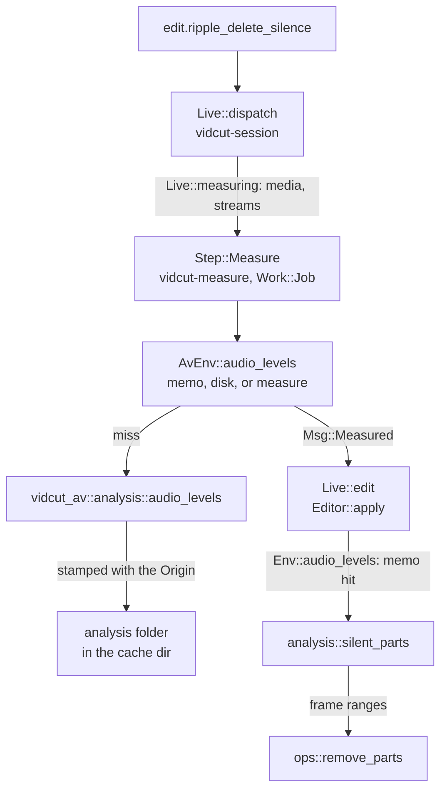
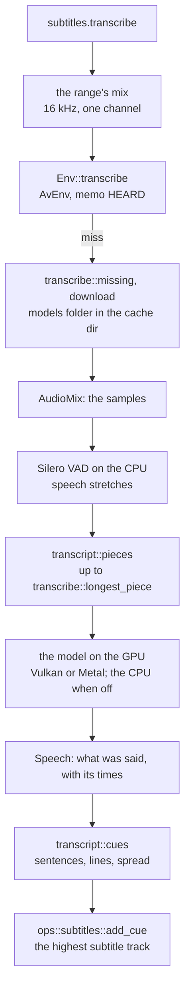
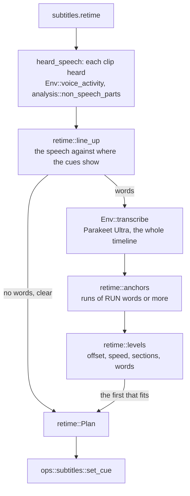

# Analysis

- The automatic tools (`edit.ripple_delete_silence`, `edit.detect_scene_cuts`) and the measurements (`analyze.silence`, `analyze.scenes`, `analyze.black`, `analyze.loudness`, `timeline.boring`) split in two: vidcut-av measures media, and vidcut-core decides.
- A measurement decodes whole streams. Thus the results are cached by the `Origin` of the file.
- A GUI measures on a job thread before it edits.

## Measure, then decide

- vidcut-core reaches media only through the `Env` trait. `AvEnv` implements it on vidcut-av. Tests use `FakeEnv`.
- A decision is a plain function of a measurement, a span and the settings.

| Request | Measurement (`Env`) | Decision (`analysis`) |
|---|---|---|
| `edit.ripple_delete_silence`, `analyze.silence` | `Env::audio_levels`: peaks of one audio stream; with `detect: speech`, `Env::voice_activity`: its speech probabilities | `analysis::silent_parts`, or `analysis::non_speech_parts`; the edit then calls `ops::remove_parts` |
| `edit.detect_scene_cuts`, `analyze.scenes` | `Env::picture_stats`: the smaller of each frame's difference from the last and the change in that difference; the first frame scores 0 | `analysis::scene_cuts`; the edit then calls `ops::split_clip` |
| `analyze.black` | `Env::picture_stats`: each frame's black share | `analysis::black_parts` |
| `analyze.loudness` | `Env::loudness` of the flattened timeline | none |
| `clip.normalize` | `Env::loudness` of each clip alone (`render::sound_alone`), without its volume keyframes | `normalize::gains`; the edit then sets each `gain_db`, or moves all the keyframes of a clip (`ClipAudio::raise`) |
| `timeline.boring` | none: clip lengths | `analysis::boring` |

- Given `parts`, `edit.ripple_delete_silence` measures nothing. It checks that each part is inside its clip and apart from the other parts, and cuts them.

## Speech

- Ripple Delete Silence with `detect: speech` cuts what is not speech.
- `transcribe::voice_activity` mixes one audio stream into one channel at 16 kHz through `AudioMix`, as transcription listens (`listen`). It feeds the mix to Silero VAD on the CPU.
- `VoiceActivity` keeps the speech probability of each frame of the VAD.
- `analysis::non_speech` finds the speech in the frames that the clip covers, by the rule of Silero that transcribe.cpp ports:
  - Speech starts at a frame at or above the threshold.
  - Speech ends at a frame well below the threshold, when no frame reaches the threshold again within Minimum to Trip.
  - Speech no longer than Shortest Speech does not count.
- What is between the speech is cut, less Pre Head and Post Tail, as for silence (`analysis::silent_parts`).
- Ducking by speech uses the same probabilities. `analysis::speech_frames` gives the speech of a source clip in timeline frames, by the defaults of Silero (`retime::SPEECH`, `retime::SHORTEST_SPEECH`, `retime::SHORTEST_PAUSE`).
- Ducking by level uses the levels. `analysis::loud_frames` gives where the peak of a clip, with its gains, reaches the threshold ([export](export.md#sound)).
- `keyframes::Gain` gives the gain of a clip with volume keyframes at each level. Silence, ducking and the quiet edges of `edit.ripple_delete_words` use it ([spec D84](../cut-page-spec.md#12-decisions-on-gaps-and-contradictions)).

**Why** probabilities, not the segments of transcribe.cpp: the segments depend on the threshold and the lengths. Thus each change in the dialog would run the VAD over the whole file again. The probabilities are measured once and cached, and each change is decided again at once.

## In a GUI

- `Live::measuring` lists the media (and audio streams) of the clips that the two edits name.
- `Live::duck_measure` does the same for `track.set` with `duck`: the files of the sources of the ducking (`duck::patched`, `duck::sounds`).
- `Live::loudness_measure` measures each clip of `clip.normalize` alone. `AvEnv` keeps each loudness by its plan (`LOUD`), and the edit reads it there.
- A `vidcut-measure` thread at job priority measures into the memo and disk cache of `AvEnv`, and yields to playback. Then it sends `Msg::Measured`.
- The session thread then runs the edit on the project as it is at that time. The measurements of the edit return at once.
- The `analyze` methods run whole on a job thread, through `Live::project_task`.
- Headless, the edit measures inside its transaction.

**Why** measure first: the session thread answers each request and runs the players. A decode of a whole file there would hold up both ([live](live.md)).

## Transcription

Create Subtitles from Audio (`subtitles.transcribe`) splits in the same way.

How it hears:

- `hear: mix`: the editor flattens the range of the tracks heard into one channel at 16 kHz (`RATE`), as an export mixes it, without ducking.
  - `heard_tracks` gives the tracks heard: the `tracks` of the request, or the tracks that playback hears.
  - The editor asks `Env::transcribe` for what was said. `transcribe::transcribe` hears the mix with the prebuilt library of transcribe.cpp, through the `transcribe_cpp` crate.
- `hear: media`: the default over the whole timeline, for a model that times words (`hearing`).
  - `clip_speech` reads the transcript of the file of each heard clip, as `media.transcribe` keeps it.
  - It transcribes a transcript that is missing, or that another model or language made (`Asked::made`).
- `hear: transcript`: it takes the transcript that each file has, whatever made it. It transcribes only a file with no transcript.
- For `media` and `transcript`, it places the words through the sound of each clip, J and L cuts too (`analysis::words_between`).
  - Where two tracks have the same word at the same time, the word of the first track stays (`first_heard`).
  - The cues get one `Speech`, in the times of the range. The words of Re-time come in the same way.

**The catalog** (`catalog`, in `crates/vidcut-core/src/catalog.rs`):

- It holds each model and speech service of vidcut.
- A `catalog::Model` has its id, its files, the languages of its metadata, its kind of times and its limits. A paid service also has its price. `SpeechModel::times_words` reads the kind of times there.
- A `catalog::File` is pinned by its URL with the revision, its size and its SHA-256. The library of transcribe.cpp is pinned there too (`catalog::RUNTIMES`).
- `models.list` gives the catalog, and whether this computer has each file (`catalog::Model::json`).
- `models.check` checks one model ([tools](../tools.md)):
  - It gets the files ready, and checks the SHA-256 of each (`models::verify`).
  - It loads the model (`models::inspect`). FlashVSR+ loads onto the GPU, as AI Best does, and goes when nothing else uses it (`flashvsr::inspect`).
  - `catalog::differences` compares what transcribe.cpp reports with the catalog. A difference is an error.
- [model-catalog.md](../todo/model-catalog.md) has the open work.

**Model files:**

- They are in the `models` folder of the cache dir (`paths::models_dir`).
- `transcribe::needed` tells which are not there: the library of transcribe.cpp, Silero VAD (`transcribe::SILERO_VAD`) and the speech model.
- Without `download`, the request fails with DEPENDENCY, and tells what it would fetch.
- `models::fetch` reads each file through the HTTPS of FFmpeg (`avio_open2`).
  - It continues from the `.part` file of an earlier fetch. It holds `temp::lock` on the target. Why: two processes do not write one file.
  - It keeps the file only when its size and SHA-256 match.
- `model_file` and `vad_file` name files instead.
- Voice Isolation's model (`isolate::DPDFNET`) is pinned and fetched in the same way (`isolate::get_ready`). The live session fetches it in a `Step::Measure` before the edit. The GUI asks first (`Workspace::isolation_prompt`).
- Ducking by speech needs the library of transcribe.cpp and Silero VAD. The GUI asks before a `track.set` that needs them (`Workspace::duck`).
- The GUI's dialog (`Workspace::speech_window`) asks `transcribe::needed` and `transcribe::short_of_memory` before it sends the request. Thus it can ask before a download, and warn before the run.
- `transcribe::get_ready` gets the files before anything is heard. These requests take `download` for it:
  - `subtitles.transcribe` and `subtitles.retime`
  - `edit.ripple_delete_silence` and `analyze.silence` with `detect: speech`
  - `track.set` with a `duck` by speech, and `export.start` of a timeline with one

**transcribe.cpp's library is downloaded, not built** (`catalog::RUNTIME`):

- It is the prebuilt bundle that transcribe.cpp publishes for this system: Windows and Linux on Vulkan, macOS on Metal. `transcribe::unpack` unpacks it into the `models` folder.
- `crates/transcribe-cpp-sys` stands in for the crate of that name, and the workspace patches it in. It holds the bindings of the crate, rewritten by `scripts/transcribe-sys.py`.
- Thus each function calls the library that `transcribe::start` loads (`transcribe_cpp_sys::load`). The library then starts the backends beside it.

**Finding the speech:**

- `find: sound` (the default): the stretches louder than `sound_db` that `transcript::sounding` finds in the levels, parted by quiet.
- `find: voice`: the stretches of Silero VAD. `missed_singing` warns when this keeps little of a range that is mostly loud.
- `find: none`: all of the audio as one stretch. The pieces then part it where it is quietest. A paid service gets it with its silences.
- A kept transcript records how it was found, and at what level (`Speech::found`, `Asked::level`). `Asked::made` uses it again only for the same `find` and level. The memo of the mix heard (`heard_key`) also keys on them.

**Pieces:**

- A model hears one piece at a time. `transcript::pieces` puts the speech stretches together, with padding, up to the longest piece.
- It ends a piece at the longest pause in its second half. A stretch longer than a piece is cut where the sound is quietest.
- The times of each piece shift back by its start.
- The longest piece goes first. The language that it finds goes to the other pieces.

**Why** this piece length (`transcribe::longest_piece`):

- The memory of Qwen3-ASR grows with the length that it hears. Thus its pieces are sized from the memory of the GPU (`Gpu::memory_mb`).
- A model without times needs short pieces to place its words.
- Whisper large-v3 loops in long pieces ([gotchas](../gotchas.md#transcribecpp-and-its-models)).

**The GPU:**

- It is the GPU that `gpus::in_use` names, found among the devices of transcribe.cpp by its PCI slot or name.
- A failure to load there falls back to the CPU, with a warning. `gpu.acceleration` off puts the model on the CPU.
- No CUDA. Why: its backend and the NVIDIA runtime add hundreds of MB.

**Cues:**

- `transcript::cues` breaks the words into sentences and at pauses. It splits a sentence that is too long for one cue into even parts, and wraps the lines.
- Words carry the times of the model. For a model without times, `transcript::spread` spreads its text over the speech of its piece ([spec D62](../cut-page-spec.md#12-decisions-on-gaps-and-contradictions)).
- `transcript::cues` keeps the start of each word in its cue (`Made`).
- Synchronize Word Timings (`subtitles.time_words`) hears the span of the cues, as Create Subtitles from Audio does.
  - `retime::word_starts` matches the words of the cues to the words heard, in order, by their longest common runs.
  - `subtitles::fill_times` spreads the words left between their matched neighbors, by characters.
- `subtitles.set` can give new text with another number of words. Then its words come again from the transcripts of the files of the clips (`clip_speech`, without a new transcription). Else they spread ([spec D70](../cut-page-spec.md#12-decisions-on-gaps-and-contradictions)).
- Parakeet Ultra is the default (`SpeechModel`). It gives real word times. The word times of Qwen3-ASR are estimates.

**Transcripts of media:**

- `media.transcribe` hears one sound stream of one pool item alone: the Source Tape's plan of the item (`render::tape`), at 16 kHz, mono.
- `Env::transcribe_media` keeps the `Speech` as JSON with the other measurements of the file.
- A file can have one transcript for each sound stream, model and group of settings. `transcripts::key` is a hash of the model, the language, how speech was found, the sound level and the speaker model.
- The name of the file ends with "words", the stream and the key. A new transcript with the same key replaces it.
- The transcript is stamped with its origin. Thus a changed file has no transcript.
- `Env::transcripts` lists the transcripts of a stream, newest first (`transcripts::Kept`). `Env::remove_transcript` removes one file. The kept replies of the paid services stay.
- `transcripts::made` finds a transcript that the model and language asked made (`Asked::made`). `SpeechModel::title` names the model in both.
- Only a transcript with word times is kept (`transcript::spoken`). A model known not to time words (`SpeechModel::times_words`) is refused before anything is heard.
- The `transcribed` set of the core, the mark in the pool, comes from one read of the folder (`env::transcribed`).

**The words that a project takes:**

- `Media::words` keeps a `ChosenWords` for each stream: the main transcript, and the changes (`WordsChange`). Without a main transcript, the newest is the main (`transcripts::main`).
- `transcripts::chosen` puts the changes over the words of the main transcript. A change replaces each word whose middle is in its time.
- `transcripts::read` gives these words. Subtitles, cutting by words and `analyze.words` read them.
- `media.words.set` puts a change (`transcripts::put`).
  - A new change cuts the older changes that it covers in part. A cut part with no words joins the new change.
  - Going back to the main transcript removes each change that the time touches.
- Words taken from a transcript (`transcripts::taken`) keep their times when these are between the words around the change. Else they fit into the time of the change. Thus the words stay in order.
- Typed words keep the times of the old words when the count is the same. Else they share the time by their length (`transcripts::typed`).
- `transcripts::differences` compares these words with each transcript, word by word (`align`):
  - Two words match when their text is the same, without capitals and the punctuation around them.
  - The times only keep the match near (`NEAR`). Why: transcripts can time the same words differently.
  - After words that do not match, the next match must be two words in a row, within `LOOK` words.
  - Words that do not match make a difference. Each choice gives its text and the transcripts that heard it.
- `analyze.words` gives the transcripts and the differences of each media (`transcripts`, `differences`).

**Speakers:**

- `speakers` gives each word a speaker (`Word::speaker`).
- With a local model, `transcribe::speakers_of` takes the speaker turns of the file from a speaker model.
  - `transcribe::speaker_file` picks it by `SpeakerModel` and the language: the language asked, else the language that the speech model reports.
  - Automatic picks MOSS (`transcribe::MOSS`) for the languages of `catalog::MOSS`, else Sortformer (`transcribe::SORTFORMER`).
  - MOSS is a transcription model run with diarization on. `moss_turns` keeps only its turns.
  - The picked model needs `download`. A MOSS that fails stops the run, and the error points to Sortformer.
- `transcript::give_speakers` gives each word the turn heard over most of it. A word outside each turn gets none.
- `Speech::speakers` names the run that numbered the speakers (`transcribe::run_id`).
- The project's `Speakers` makes the speaker of a file a person (`Speakers::person`). In order:
  1. a word assigned to someone
  2. else the link of the voice (`speakers::voice`)
  3. else the own person of the run (`speakers::heard_person`)
  - Thus the speakers of one paid run over several files are one person each.
- `clip_speech` numbers the people of the range in order. `transcript::cues` ends a cue where the number changes (`Made::speaker`).
- `analyze.words` gives each word its speaker, person, name and `file_time`. `speakers.assign` takes these.

**Paid services:**

- `speech_api::transcribe` finds the speech of each file as a local model does (`transcribe::find_speech`).
- It joins the padded stretches of the files end to end, with quiet between them. A `Piece` maps a time back to its file. A word timed in the quiet is dropped (`where_in`).
- It writes FLAC with the encoder of FFmpeg (`write_flac`), and uploads it with `ureq` on a `vidcut-upload` thread. Meanwhile the job reports `Stage::Uploading` and `Stage::Waiting`, and a cancel stops the upload.
- xAI takes all of the audio in one multipart request (`xai_fields`).
- Gemini takes only the language codes that Google lists for its API (`catalog::GOOGLE_LANGUAGES`). It goes through its Files API and Interactions in one request.
  - The upload is used when Google reports it `ACTIVE`.
- Files of different channel counts are refused. Why: one request carries one count.
- `Env::transcribe_files` lets `clip_speech` and `media.transcribe` send each missing file in one run. With `speakers`, they send each heard file again. Why: the files then share speaker numbers.
- The editor refuses without `send` (`upload_check`). It gives the duration, the size (`transcript::upload_mb`, each channel counted) and the cost (`transcript::cost`).

**Limits and where they come from:**

- The limits of a model are in its `catalog::Model`, each with its source (`catalog::Source`). A source is the documentation of the maker, the model file, vidcut itself, or not recorded.
- `catalog::check` compares the values of a job with the limits of its model. A hard limit gives a refusal. A cap or a soft limit gives a warning.
- `Measure::direction` gives the direction of a limit:
  - `Direction::Most`: the value must not be above the limit.
  - `Direction::Least`: the value must not be below the limit, for example the GPU memory of a speech model.
  - `Direction::Reached`: a count of the result, for example the speakers. At the limit, more people can share one number.
- `speech_api::transcribe`, `super_scale::unfit`, `transcribe::short_of_memory` and `transcript::channels_of` call it.
- `SpeechModel::longest_secs` and `SpeechModel::max_speakers` read the limits of Gemini from `catalog::GOOGLE`. `SpeakerModel::max_speakers` reads Sortformer's from `catalog::SORTFORMER`. `models.check` compares that with what transcribe.cpp reports.
- The editor and the GUI refuse an xAI file with more channels than `catalog::XAI` allows, before they ask for `send`.

**Kept replies:**

- The text of a reply is kept in `speech-replies` in the cache dir (`speech_api::replies_folder`).
- `reply_key` is a SHA-256 of the company, the settings of the request with their keys sorted, and the 16-bit samples of the audio.
- A request with the same settings and audio reads the kept reply and sends nothing. It needs no key, and its `notes` say so (`Speech::notes`).

**Keys:**

- `services::key` takes the key from `XAI_API_KEY` or `GEMINI_API_KEY`, else from the system keychain through `keyring` (service `vidcut`).
- `services.set_key` writes the keychain. The command log keeps only its `service`. The CLI reads the key from standard input.

**Words:**

- `analyze.words` with `media` or `clips` reads those transcripts, and hears nothing.
  - `media`: the first stream transcribed, unless `stream` is given. `clips`: the own stream of each clip.
  - A word lands on a clip through its source range and speed when its middle is inside the clip (`analysis::words_in`).
- Without `media` or `clips`, it hears the mix of the timeline, as `subtitles.transcribe` does. It returns each word that `transcript::spoken` kept, at its frames (`transcript::word_frames`).
- It refuses a model whose times are phrases or none. Why: spread estimates are not word times.
- `edit.ripple_delete_words` takes the spans of the words out through `ops::cut_ranges`. This closes the gap, with ripple on or off ([spec D63](../cut-page-spec.md#12-decisions-on-gaps-and-contradictions)).
  - With `quiet`, each edge first moves to the quietest frame boundary nearby (`analysis::quietest`), from the levels of the clips heard there.
  - The words around bound this move: no further than a third into a word inside the cut, and outward only to the next word.
  - The core first measures the levels that it does not keep yet, on a job (`Live::measuring`).
- `transcript::is_filler` marks fillers in the language of the transcript, or of `language`. The list comes from the project (`Settings::fillers`), else the preferences (`Env::fillers`), else the built-in list (`transcript::built_in_fillers`).

## Re-timing subtitles

- Re-time to Speech (`subtitles.retime`) moves the cues of a subtitle track to the speech of the timeline.
- It measures with the two measurements above, and decides in `retime` in vidcut-core.

- **Speech:** the cached voice activity of each clip on the tracks heard (`heard_tracks`), by the rule of Silero with its defaults (`SPEECH`, `SHORTEST_SPEECH`, `SHORTEST_PAUSE`). It is placed on the timeline through the clip (`Span`).
- **Lining up** (`retime::line_up`):
  - It scores each offset up to `max_offset`. The score is the cross-correlation of the speech, less its mean, with where the cues show.
  - The sum is exact, not sampled. It uses the trapezoid that each speech stretch and cue make against the offset (`Ramps`).
  - It tries speeds near 1, then a finer step around the best one. A speed snaps to 1, or to a frame-rate ratio, when they differ little over the track (`retime::snap`). A snapped speed stays only when it scores above speed 1.
  - The best offset is clear when it scores `CLEAR` times the highest other peak far from it.
- **Words** (`retime::anchors`):
  - The text of the cues and the words heard compare as lower-case letters and digits.
  - They match in order by their longest common runs, as Python's difflib does without its junk heuristic.
  - A cue whose first word is in a run of `RUN` words or more anchors at the start of that word. It also anchors at the end of its last word, when that word matched in the same run. Else the cue keeps its length.
- **Levels** (`retime::levels`) fit the offsets of the anchors: the start of the word less the start of the cue. In order:
  1. their median
  2. a Theil–Sen line, with its speed snapped as above
  3. sections, where a run of anchors in a row moves away from the offset of the last section
  4. each anchored cue at its words, and the other cues as in their section
  - The first level that puts most anchors within `FIT` wins. Under `MIN_ANCHORS`, the words decide nothing, and a clear offset from the speech stands.
- **In a GUI:** Re-time runs as a job (`Step::Encode`) on a copy. Thus the VAD and the transcription run off the core's thread. The edit then finds both cached.

**Why** the speech first, not the words: where speech is does not depend on its language. Thus a translated file lines up as well as the original.

**Why** `CLEAR`: it was set on the NASA press conference and its captions (nasa-roman-presser in the media manifest), in 5-minute windows.

- The one window with a wrong offset scored 1.09 times its next peak. The last, short window scored 1.07 with a right offset.
- The other windows scored 1.38 or more. The whole file scored 2.03 at +2.94 s, and the words of Parakeet Ultra put it at +3.02 s.

## Caches

- An `Origin` is the path, size and modification time of a file (`fingerprint::origin`). Its name names the cache file.
- Its text is stamped into the file (`Origin::stamp`) and checked on read (`Origin::check`). Thus a changed file misses.
- The cache dir is `dirs::cache`.

| What | Where | Key |
|---|---|---|
| pool filmstrips, timeline tiles | `thumbs` (`thumbcache`) | origin, size, frames, input color space |
| waveforms | `waveforms` | origin, channels |
| audio levels, voice activity, picture stats | `analysis` (`AvEnv`) | origin, stream or picture count |
| transcripts (`media.transcribe`) | `analysis` (`AvEnv`) | origin, stream |
| light, for HDR metadata | `analysis` (`light::cache_in`) | origin, input color space |
| proxies | `proxies.folder` (`Proxies::folder_in`): `proxies` beside the project unless set (in the cache dir without a project); an absolute folder is shared by each project | content (`paths::proxy_origin`), size, codec, input color space |
| GPU encoders that work | `encoders.json` (`export::detected`) | FFmpeg, system and GPUs |
| proxy codecs the GPU decoder plays | `plays.json` (`export::plays`) | the same, per GPU |
| clips for decoder tests | `decoder-tests` | none |
| compiled libplacebo shaders | `shaders` (`cuda::keep_shaders_in`) | libplacebo's |
| downloaded models | `models` (`paths::models_dir`) | file name, checked by size; SHA-256 when downloaded |
| paid speech replies | `speech-replies` (`speech_api::replies_folder`) | the company, the request's settings, the audio |

- `reset` with `keep_downloads` keeps `models` and `speech-replies`.
- `Tiles::evict` drops kept pictures past the memory budget of the tile cache.
- Levels, voice activity, picture stats and light are also kept in memory. The last results heard (`HEARD`, an `Lru`) are kept only in memory.

### The disk cache limit

`disk_cache` keeps what vidcut can make again under one limit:

- the folders of `disk_cache::Kind`: `thumbs`, `waveforms`, `analysis`, `shaders`, `decoder-tests`
- the proxies (`.mkv` files) in `proxies.folder`, when it is in the cache dir (`Policy`)

These stay, and do not count: transcripts (`words` files in `analysis`, `Kind::keeps`), `models`, `speech-replies`, `uploads`, `encoders.json` and `plays.json`.

A file with a `part` piece in its name is still being written, and does not count. Such a file that a killed job left goes at a later listing (`UNFINISHED_FOR`).

**The limit** is the `cache` of the preferences (`Policy::limit`):

- `cache.percent` of the disk of the cache dir, or `cache.gb`. `system::disk` reads the size and free space of the disk.
- The limit always keeps a share of that disk free (`KEEP_FREE_PERCENT`).
- Without the size of the disk, a share sets no limit, and Preferences says so.

**The index** (`Index`):

- It is an `Lru` of the counted files, with the size of each file and their total. Only the GUI keeps an index.
- Its `vidcut-cache` thread builds it at startup from one listing of the folders (`disk_cache::start`). The modification times give the order. Then it pops what is past the limit.
- At each `REBUILD_EVERY`, it lists the folders again (`disk_cache::rebuild`). Why: other processes write and remove files. It does this without the lock, and keeps what the index gained meanwhile.
- A CLI process has no index. Its reads and writes go straight to the files, with no listing and no eviction.

**Reads and writes:**

- Reads go through `disk_cache::read`. `disk_cache::used` marks a file that something else reads: the proxies of a project, a proxy that `proxy.generate` finds made, a decoder test clip.
- A read moves the entry to the head. It writes the modification time once in a run. Thus the order at the next start follows use.
- A file that is not there is a miss, and leaves the index. A file that the index does not have yet joins it.
- Writes go through `disk_cache::write`. A file larger than the limit is refused with `StorageFull`, and the caller goes on with what it has in memory.
- Else the oldest entries pop until the file fits, and the file goes in at the head. Then the popped files are removed, and the file is written (`temp::write`).
- `disk_cache::added` decides the same for a file that FFmpeg wrote, and removes a file that cannot stay.
  - Then `proxy.generate` into the cache dir fails with the reason. It fails before it encodes while `disk_cache::room` is 0.
  - A decoder test clip goes through `disk_cache::added` only after its test. Thus a full disk costs the clip, not the result.
- The lock covers only the map and list of the index. Listings, reads, writes, removals and time writes occur outside it.
- A preference change (`disk_cache::set_policy`) pops what the new limit leaves out. Thumbnails turned off clear `thumbs`.
- libplacebo reads and writes `shaders` itself. Thus the time of a shader is when it was compiled.
- The preferences requests give `disk_cache::usage` in `cache`: from the index in the GUI, from one listing in a CLI process. The Cache page of Preferences shows it.

**Why** an index built from the files:

- An LRU makes each operation constant time.
- An index built from the folders is right after anything else touched them: a CLI run, or a person who clears the cache.
- Until the next rebuild, a file that another process removed is a miss.

**Why** named folders, not the whole cache dir: vidcut never removes a folder that it does not know, for example a download.

**A new kind** of entry:

1. Add a variant to `disk_cache::Kind`.
2. Name its folder in `Kind::folder`, and list it in `Kind::ALL`. A variant left out of `ALL` is never counted or evicted.
3. Name its files with `Kind::file`, and read and write them with `disk_cache::read` and `disk_cache::write`.
4. A file that FFmpeg writes goes to a name with a `part` piece, and through `disk_cache::added` when it is renamed into place. Mark a file that FFmpeg reads with `disk_cache::used`.
5. Put files that must stay in `Kind::keeps`.

## Storyboards

- `storyboard::render` flattens the timeline or a range. It takes one picture per shot from the middle of each source piece, or one picture every `every` frames.
- It decodes the pictures with `FrameReader`, and writes one PNG.
- Each picture has a label with its timecode and clip, and with the track when the clip is not on V1.

## Code

- `crates/vidcut-core/src/analysis.rs`, `crates/vidcut-core/src/editor.rs`, `crates/vidcut-core/src/catalog.rs`
- `crates/vidcut-core/src/fingerprint.rs`, `crates/vidcut-core/src/dirs.rs`, `crates/vidcut-core/src/disk_cache.rs`
- `crates/vidcut-core/src/transcript.rs`, `crates/vidcut-core/src/transcripts.rs`, `crates/vidcut-core/src/speakers.rs`, `crates/vidcut-core/src/retime.rs`
- `crates/vidcut-av/src/analysis.rs`, `crates/vidcut-av/src/transcribe.rs`, `crates/vidcut-av/src/speech_api.rs`, `crates/vidcut-av/src/models.rs`
- `crates/vidcut-av/src/light.rs`, `crates/vidcut-av/src/waveform.rs`, `crates/vidcut-av/src/thumbs.rs`
- `crates/vidcut/src/env.rs`, `crates/vidcut/src/paths.rs`, `crates/vidcut/src/preferences.rs`, `crates/vidcut/src/services.rs`
- `crates/vidcut/src/thumbcache.rs`, `crates/vidcut/src/live/mod.rs`, `crates/vidcut/src/storyboard.rs`
