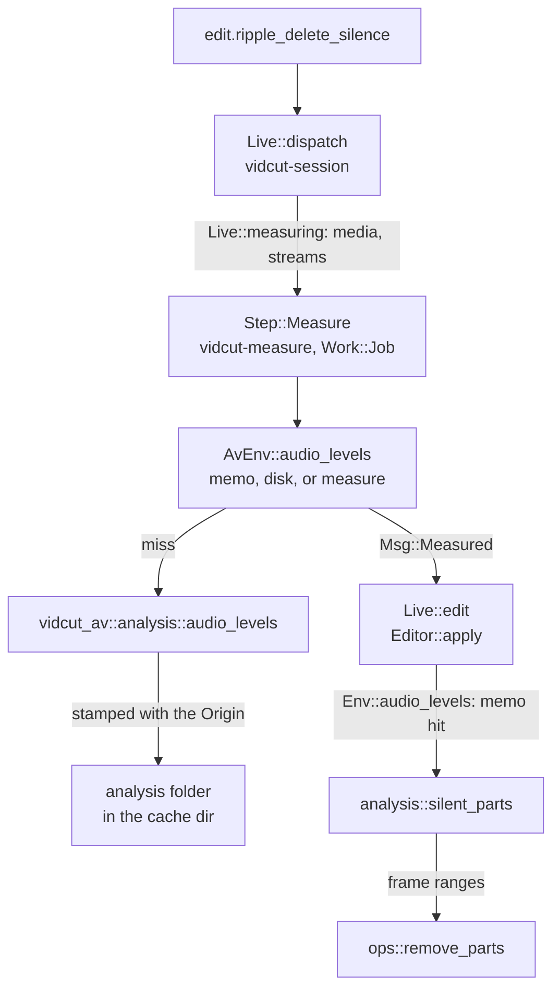

# Analysis

The automatic tools (`edit.ripple_delete_silence`, `edit.detect_scene_cuts`) and the measurements (`analyze.silence`, `analyze.scenes`, `analyze.black`, `analyze.loudness`, `timeline.boring`) split in two: vidcut-av measures media, vidcut-core decides. Measuring decodes whole streams, so results are cached by the file's `Origin`, and a GUI measures on a job thread before it edits.

## Measure, then decide

vidcut-core reaches media only through the `Env` trait. `AvEnv` implements it on vidcut-av; tests use `FakeEnv`. Decisions are plain functions of a measurement, a span and the settings.

| Request | Measurement (`Env`) | Decision (`analysis`) |
|---|---|---|
| `edit.ripple_delete_silence`, `analyze.silence` | `Env::audio_levels`: peaks of one audio stream | `analysis::silent_parts`; the edit then calls `ops::remove_parts` |
| `edit.detect_scene_cuts`, `analyze.scenes` | `Env::picture_stats`: the smaller of each frame's difference from the last and the change in that difference; the first frame scores 0 | `analysis::scene_cuts`; the edit then calls `ops::split_clip` |
| `analyze.black` | `Env::picture_stats`: each frame's black share | `analysis::black_parts` |
| `analyze.loudness` | `Env::loudness` of the flattened timeline | none |
| `timeline.boring` | none: clip lengths | `analysis::boring` |

## In a GUI

`Live::measuring` lists the media (and audio streams) of the clips the two edits name. A `vidcut-measure` thread at job priority, which yields to playback, measures them into `AvEnv`'s memo and disk cache and sends `Msg::Measured`. The session thread then runs the edit on the project as it is then; its measurements return at once. The `analyze` methods run whole on a job thread through `Live::project_task`. Headless, the edit measures inside its transaction.

**Why** measure first: the session thread answers every request and runs the players; decoding a whole file there would hold up both ([live](live.md)).

## Caches

An `Origin` is a file's path, size and modification time (`fingerprint::origin`). Its name names the cache file; its text is stamped into it (`Origin::stamp`) and checked on read (`Origin::check`), so a changed file misses. The cache dir is `dirs::cache`.

| What | Where | Key |
|---|---|---|
| pool filmstrips, timeline tiles | `thumbs` (`thumbcache`) | origin, size, frames |
| waveforms | `waveforms` | origin, channels |
| audio levels, picture stats | `analysis` (`AvEnv`) | origin, stream or picture count |
| light, for HDR metadata | `analysis` (`light::cache_in`) | origin |
| proxies | `proxies.folder` (`Proxies::folder_in`): `proxies` beside the project unless set (in the cache dir without a project); an absolute folder is shared by every project | content (`paths::proxy_origin`), size, codec |
| GPU encoders that work | `encoders.json` (`export::detected`) | FFmpeg, system and GPUs |
| proxy codecs the GPU decoder plays | `plays.json` (`export::plays`) | the same, per GPU |
| clips for decoder tests | `decoder-tests` | none |
| compiled libplacebo shaders | `shaders` (`cuda::keep_shaders_in`) | libplacebo's |

On disk only `thumbs` has a size limit (`thumbcache::evict`, least recently used first), set in the preferences. `Tiles::evict` also drops kept pictures past the tile cache's own budget. Levels, picture stats and light are memoized in the process too.

## Storyboards

`storyboard::render` flattens the timeline or a range and takes one picture per shot, from the middle of each source piece, or one every `every` frames. It decodes them with `FrameReader` and writes one PNG, each picture labeled with its timecode and clip, plus the track when the clip is not on V1.

## Code

- `crates/vidcut-core/src/analysis.rs`
- `crates/vidcut-core/src/editor.rs`
- `crates/vidcut-core/src/fingerprint.rs`
- `crates/vidcut-core/src/dirs.rs`
- `crates/vidcut-av/src/analysis.rs`
- `crates/vidcut-av/src/light.rs`
- `crates/vidcut-av/src/waveform.rs`
- `crates/vidcut-av/src/thumbs.rs`
- `crates/vidcut/src/env.rs`
- `crates/vidcut/src/paths.rs`
- `crates/vidcut/src/thumbcache.rs`
- `crates/vidcut/src/live/mod.rs`
- `crates/vidcut/src/storyboard.rs`
