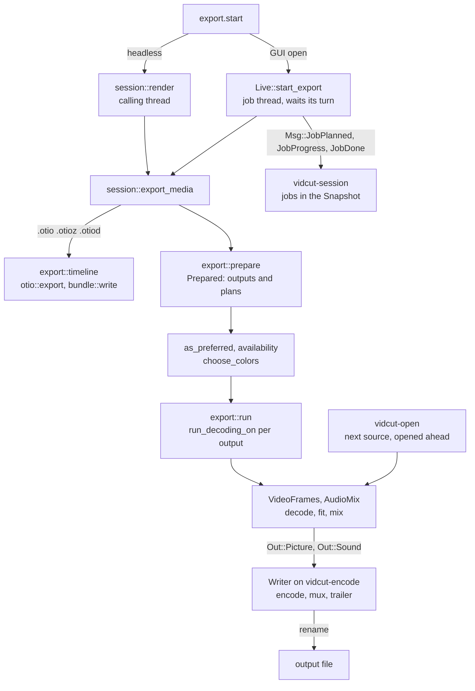
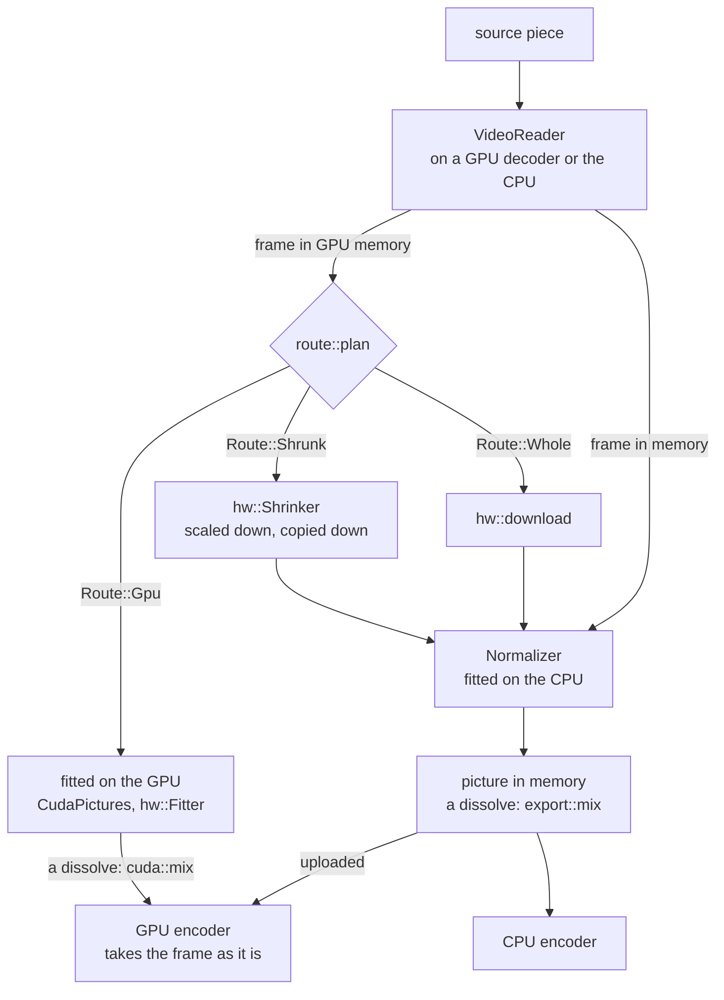

# Export

An export turns the project into files.
`export.start` names an output.
vidcut flattens the timeline into a render plan.
It decodes the plan with the player reader.
It fits each picture to the output.
It mixes the sound.
It encodes and muxes.
The engine is `crates/vidcut-av/src/export/`.
`crates/vidcut/src/export.rs` resolves presets, outputs, GPU preferences, and color first.
[playback](playback.md) shares the reader and the mixer.
[gpu](gpu.md) has the part of each GPU.

## Where the request runs

Both doors end in `session::export_media`.
In a headless run, `session::run_with` loads the project and calls `session::render` on the calling thread.
It refuses `background`, because the export would stop with the process.
When a GUI is open, `Live::start_export` takes the project as it is now.
It runs the export on its own job thread.
The thread name is vidcut- plus the job id.
The id is the letter j and a number.
`Live::request` does this for every `export.start` whose path is not an `.otio` file.
An `.otio` export is a task (`Live::project_task`), not a job.
The job reports its planned files (`Msg::JobPlanned`).
It then waits for its turn.
`Turns` lets one job encode at a time.
An export encodes before a proxy encode.
A `background` request is answered with the job after planning.
Any other job request is answered when the job ends ([live](live.md)).

Job threads run at the lowest priority.
They pause decoding while a player plays (`first::as_job`).
An export does not hold up the viewer.

## Preparing

`export::prepare` makes a `Prepared`.
`Prepared` holds the settings and the `Output` values.
Each `Output` has a plan, a path, and its own settings.

- Settings come from `settings`, from a `preset`, or from the default preset of the extension.
  `set` overrides fields (`apply_overrides`).
  `encoder` sets the video encoder.
  The extension sets the container.
  Presets are `builtin_presets` plus the user TOML files (`export::presets`).
- The range is the given range.
  If no range is given, and both marks are set, the range is In to Out.
  Otherwise the range is the whole timeline ([spec §10](../cut-page-spec.md#10-quick-export-ch-39-pp-788790-40954096-41044109)).
- The plan is `render::flatten` over the range.
  With `per_clip`, the plan is one `render::flatten_clip` for each clip.
  The project is planned at the rate and the channel count of the audio encoder (`resolve_audio`).
  Sample math then matches the encoder.

`export::as_preferred` applies `gpu.acceleration`.
When acceleration is off, every video encoder becomes `cpu`.
When acceleration is on, an encoder that the GPU in use lacks becomes `auto`, with a note (`encoder_changed`).
`export::availability` lists the working encoders of the GPU.

`export::choose_colors` picks the dynamic range and the bit depth of each output.
It uses the pictures that the output shows, where the settings leave those values open (spec D44).
It then picks the HDR metadata (spec D46), by the rules in `vidcut_core::export`.
A depth that is set wins.
A depth that the codec or the profile fixes also wins.
SDR takes 10 bits only from the encoder that an 8-bit export would start with.
It does not move to a slower encoder for those 10 bits.
DNxHR HQ in 10 bits becomes HQX (`ColorChoice::apply`).
An export first measures light that the files do not state (`light::analysis`, cached).
The peaks come from every pixel.
The averages and the distribution come from a grid of at most 500,000 samples in a frame.
`export.plan` measures nothing.
It returns `export::describe`.

## Choosing an encoder

`encode::video_encoders` lists the candidates in order.

| `video.encoder` | Candidates, in order |
|---|---|
| `auto` | The encoders of the GPU in use that passed detection, in the platform order, then the CPU encoder. |
| NVENC, VAAPI, AMF, QSV, or VideoToolbox | That one encoder. An error says why it cannot open. |
| `cpu` | The first CPU encoder of the codec that this FFmpeg has (`parts`). |

The export takes the first candidate that opens.
A detected encoder can still fail.
NVENC allows few sessions.
`auto` with Dolby Vision uses only the CPU encoder.
Quality or bitrate, profile, and depth become the options of each encoder.
10 bits are used for `bit_depth` 10, for `main10`, or for HDR.
A `speed` goes to the first candidate only.
Encoders do not share speed names.

Two passes (spec D45) come with a bitrate, or with `passes` set to 2.
x264, x265, and libvpx-vp9 encode the range twice (`Passes::TwoRuns`).
The first run drops its packets and keeps statistics.
The statistics go in a hidden `.passes` folder (`passes_path`), or in memory for libvpx.
The encoder then opens again for the real run.
NVENC passes twice inside one encode (`Passes::TwoInside`).
Every other encoder makes one pass.
VAAPI, AMF, QSV, VideoToolbox, and libsvtav1 are in that group.
Given a bitrate alone, such an encoder encodes in one pass.
With `passes` set to 2, `encode::passes` refuses that encoder.
`auto` then tries the next candidate.

## Encoding one output

`export::run` calls `run_decoding_on` for each output, one after another.
When GPU decoding is on, the call uses a GPU decoder of the export (`GpuDecoding::own_decoder`).
The export writes a hidden `.part` file beside the output (`partial_path`).
It renames that file over the output on success.
An error or a cancel removes the `.part` file.

`encode` opens the muxer and both encoders.
It starts the `Writer` on `vidcut-encode`, behind a bounded channel.
The export thread loops over the frames.
`VideoFrames::next_frame` gives the picture.
`AudioMix::read` gives exactly the samples that the frame spans.
Both go to the writer in order.
The writer encodes, puts HDR metadata into the packets, and interleaves them.
It then flushes the encoders and writes the trailer.

Static HDR values go to the encoder.
x265 repeats them at every keyframe.
They also go to the container.
MP4, MOV, Matroska, and WebM write them.
`hdr` puts HDR10+ into each HEVC frame or AV1 frame.
The FFmpeg encoders do not do that step.
Dolby Vision profile 8.1 and profile 10.1 are kept in PQ output.
Profile 8.4 and profile 10.4 are kept in HLG output.
The written profile is 8 for HEVC.
The written profile is 10 for AV1.
The compatibility number stays 1 for PQ and 4 for HLG.
Only libx265 and libsvtav1 write Dolby Vision.
Every frame needs it.
A black frame takes the metadata of the previous picture.
Black frames before the first picture omit it.

The writer thread encodes while the export thread decodes the next pictures.
An encoder that waits on the GPU does not hold up that decode.

`VideoFrames` reads the pieces in order.
A piece of the same file keeps its decoder.
The next file opens on `vidcut-open` (`Ahead`).
It seeks on that thread.
It decodes its first frame on that thread.
That work runs while the current piece encodes.
Each layer of a dissolve reads its own file.

`Noting::set` installs a listener on the calling thread.
`progress::note` sends a `Note` to that listener.
With no listener, a note is one thread-local lookup.
When the export chooses color or HDR metadata, it sends `Note::Color`.
When a video encoder fails to open, it sends `Note::Tried`.
The note has the error.
When `open_video` fails, the note names that encoder.
When the candidate itself is an error, the note has no encoder name.
When a video encoder opens, it sends `Note::Video`.
The note has the encoder name, the pixel format, the bit depth, and the pass count.
It includes the device when the encoder has one.
It also says whether the encoder takes frames from the GPU.
When the audio encoder opens, it sends `Note::Audio`.
The note has the encoder, the rate, the channel count, and the bitrate.
When loudness is set, the note also has the measured gain.
When `VideoFrames` starts a file, it sends `Note::Source`.
It sends `Note::Source` again when that file changes decoder.
The note has the path and the `Decoding`.
`proxy::write` sends `Note::Source`, `Note::Tried`, and `Note::Video` for a proxy.
Each headless output `Report` keeps `tried` and `sources`.
`tried` lists the encoders that did not open.
`sources` lists the files and their decoders.
A job collects the same notes ([live](live.md#jobs)).

## Which source frame

Output frame `k` of a piece shows the first source frame at or after a target time.
`export::video::target` computes that time.
The time is the piece position plus `k` frames, minus half a project frame.
`Source::advance` keeps the first decoded frame whose time is at least that target.
When the source rate equals the project rate, that frame is the source frame at the same index.
When the rates differ, the half frame is a project frame, not a source frame.
The chosen frame is not always the nearest source frame.
A tie can keep the earlier source frame.
A 24 fps timeline and a 25 fps source do that at output frame 12.
A piece at another speed steps through its source by `render::Pace`.

A reader seeks exactly (`VideoReader::seek`).
It seeks to a keyframe at or before the target.
It seeks further back while the first decoded frame lands after the target.
MP4 seeks by decode time.
An open GOP shows frames from before its keyframe.
The reader then decodes forward.
It drops the frames before the target, including the keyframe.
A reader that only looked for the keyframe (`VideoFrames::keyframe_time`) calls `VideoReader::from_keyframe`.
That call decodes forward from the keyframe instead.
A backward piece is decoded forward from the keyframe before its pictures.
`VideoFrames::reversed_frames` keeps as many pictures as fit in the memory budget.
The budget divides 256 MiB by width times height times 3.
Every pixel format uses that same 3 bytes.
The count is at least 1.
It is at most 64 pictures.
When the output is `Output::Cuda` or `Output::FittedOnGpu`, the count is at most 4.
The player reads through the same `VideoFrames`.
The viewer shows the frames that an export writes.

`Maker` makes each picture by the route from `route::plan`.
A frame stays on the GPU when its GPU fits it for an encoder on that GPU.
Otherwise the frame comes down.
When the output shows the frame smaller, the GPU shrinks it first.
`Normalizer` turns, scales, pads, and converts the frame.
A GPU route that fails is planned again without that GPU.
The encoder that opened sets the destination (`make::Output`).
With GPU decoding on, NVENC gets CUDA frames.
VAAPI, AMF, and VideoToolbox on its GPU get frames from the decoder device.
Otherwise the destination is memory.
A dissolve uses the same sums on the GPU for NVENC (`cuda::mix`) and on the CPU (`export::mix`).

## Sound

`AudioMix` mixes the lanes sample by sample.
The mix has clip gains, cross fades, and de-click fades at cuts.
A clip at another speed is stretched with its pitch kept.
With `audio.loudness`, `analysis::mix_loudness` first measures the mix as it will be encoded.
`loudness_gain` gives one gain (`AudioMix::set_gain_db`).
That gain reaches the target.
The true peak stays under a ceiling.

## Errors and logs

FFmpeg logs only fatal errors unless `VIDCUT_AV_LOG` asks for more ([tools](../tools.md)).
A decoder that recovers after a seek logs a harmless error.
A real failure comes back as a vidcut error.
The error says what failed.

## The GUI's exports

Quick Export and the Export dialog set `background`.
Quick Export lists the presets marked `quick_export`.
It sends one preset with `overwrite` and no range.
The Export dialog ([deviation X3](../deviations.md#x3-export-dialog-beyond-quick-export)) starts from a preset.
It sends changes as `set` overrides, with a range, per-clip names, and `overwrite`.
It shows `export.plan` as its parameters change.

`jobs.cancel` sets the cancel flag of the job.
It also removes the gate, so a job that waits for its turn leaves the queue.
A foreground client that leaves sets the same cancel flag.
It does not remove the gate.
The frame loop checks the flag.
The light measurement and the loudness measurement check the flag.
A job that is still queued waits for its turn, then stops.
A GUI that quits during a job removes the partial files.

## Timeline exports

An `.otio`, `.otioz`, or `.otiod` output (`export::timeline_format`) writes the edit.
It does not write pictures ([deviation X9](../deviations.md#x9-opentimelineio-interchange)).
`export::timeline` takes only a range and `overwrite`.
It writes the document from `otio::export` through the partial path.
A bundle adds the used media (`bundle::plan`, `bundle::write`), with byte progress and cancel.
In the GUI, an `.otio` file runs as a task (`Live::project_task`).
A bundle runs as a job.

## Proxies

`proxy.generate` uses the same machinery (spec D41).
`Env::generate_proxy` in `AvEnv` picks encoders (`proxy::encoders`).
The choice uses the codec preference, the detected GPU encoders, and, for automatic, the codecs that the GPU plays (`export::plays`).
It calls `proxy::write`.
One source is decoded on a GPU decoder of its own.
`Maker` makes the pictures.
They are encoded on `vidcut-encode` and renamed into place.
The Matroska file keeps the timestamp of each source frame.
Its `VIDCUT_ORIGIN` tag lets an unchanged source reuse the file.
The Vulkan ProRes encoder serves proxies only.

Automatic tries DNxHR LB, ProRes Proxy, AV1, HEVC, and H.264, in that order, in four rounds.
The rounds are: made and played on the GPU, played on the GPU, made on the GPU (through Vulkan too), then the rest.
The first encoder that opens wins.
A proxy is 10-bit when the source has more than 8 bits and the encoder accepts 10 bits.
It keeps the PQ or HLG of an HDR source.
It keeps the static metadata of a PQ source.
An 8-bit proxy is SDR BT.709.
`ProxyEncoder::video_encoder` sets `g` to 60 and `bf` to 0 on every proxy encoder.
ProRes and DNxHR store each frame on its own, so each frame is a keyframe.
A long-GOP proxy has a keyframe every 60 frames and no frame reordering.
A seek then decodes at most 60 frames.

## Code

- `crates/vidcut/src/session.rs`
- `crates/vidcut/src/live/mod.rs`
- `crates/vidcut/src/live/jobs.rs`
- `crates/vidcut/src/export.rs`
- `crates/vidcut/src/bundle.rs`
- `crates/vidcut/src/env.rs`
- `crates/vidcut/src/gui/export.rs`
- `crates/vidcut-core/src/export.rs`
- `crates/vidcut-core/src/export/color.rs`
- `crates/vidcut-core/src/export/metadata.rs`
- `crates/vidcut-core/src/render.rs`
- `crates/vidcut-av/src/export/mod.rs`
- `crates/vidcut-av/src/export/encode.rs`
- `crates/vidcut-av/src/export/worker.rs`
- `crates/vidcut-av/src/export/ahead.rs`
- `crates/vidcut-av/src/export/video.rs`
- `crates/vidcut-av/src/export/make.rs`
- `crates/vidcut-av/src/export/normalize.rs`
- `crates/vidcut-av/src/export/mix.rs`
- `crates/vidcut-av/src/export/audio.rs`
- `crates/vidcut-av/src/route.rs`
- `crates/vidcut-av/src/light.rs`
- `crates/vidcut-av/src/proxy.rs`
