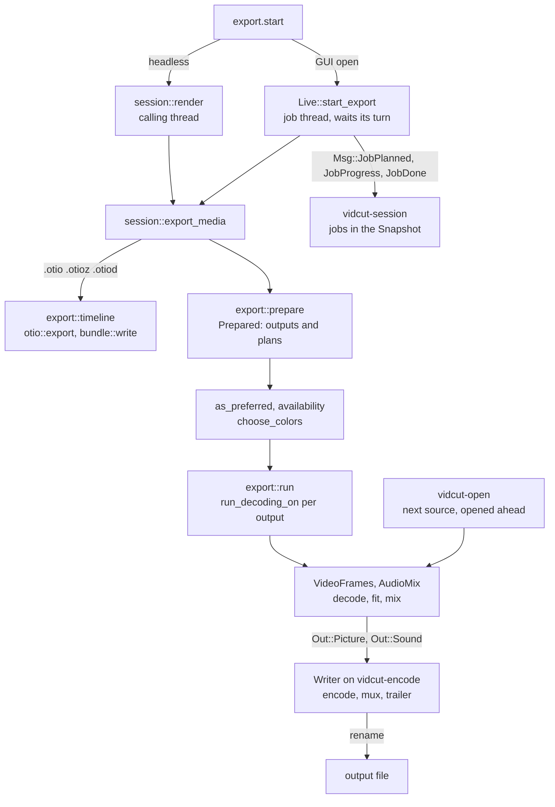
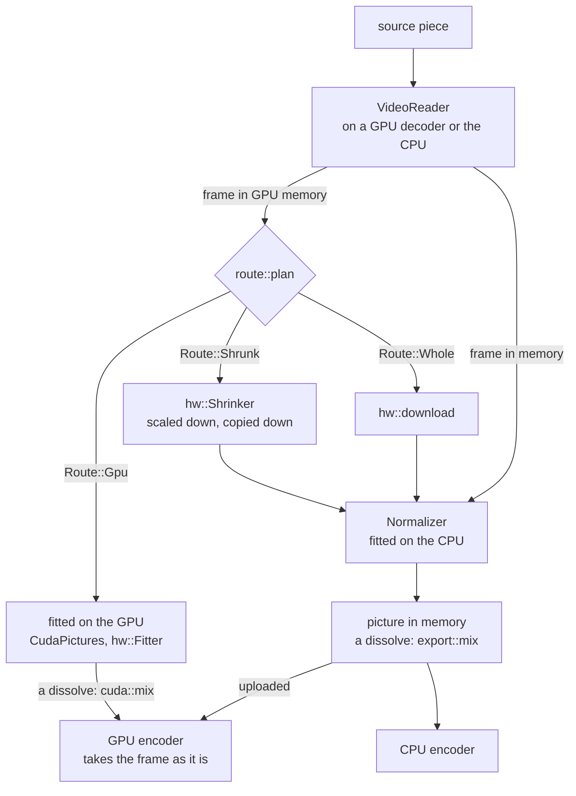

# Export

- An export turns the project into files. `export.start` names an output.
- vidcut flattens the timeline into a render plan and decodes it with the player's reader. It fits each picture to the output, mixes the sound, encodes and muxes.
- The engine is `crates/vidcut-av/src/export/`.
- `crates/vidcut/src/export.rs` first resolves presets, outputs, GPU preferences and color.
- [playback](playback.md) shares the reader and mixer. [gpu](gpu.md) has the part of each GPU.

## Where the request runs

- Both doors end in `session::export_media`.
- Headless, `session::run_with` loads the project and calls `session::render` on the calling thread.
- A headless run refuses `background`, because the export would stop with the process.
- With a GUI open, `Live::start_export` takes the project as it is at that moment. It runs the export on a job thread of its own (vidcut-j1, …).
- The job reports its planned files (`Msg::JobPlanned`). Then it waits for its turn.
- [live](live.md#jobs) tells how jobs take turns, and when the request is answered.

**Why:** job threads run at the lowest priority, and pause decoding while a player plays (`first::as_job`). Thus an export never holds up the viewer.

## Preparing

`export::prepare` makes a `Prepared`: the settings and the `Output`s. Each `Output` has a plan, a path and its own settings.

- **Settings:** from `settings`, a `preset`, or the default preset of the extension.
  - `set` overrides fields (`apply_overrides`). `encoder` overrides the video encoder, and the extension sets the container.
  - Presets are `builtin_presets` plus the user's TOML files (`export::presets`).
- **Range:** the range given, else In–Out when both marks are set, else everything ([spec §10](../cut-page-spec.md#10-quick-export-ch-39-pp-788790-40954096-41044109)).
- **Plans:** `render::flatten` over the range, or with `per_clip` one `render::flatten_clip` per clip.
  - The project is planned at the rate and channels of the audio encoder (`resolve_audio`). Thus the sample math agrees with the encoder.

GPU preferences:

- `export::as_preferred` applies `gpu.acceleration`.
  - When it is off, every video encoder becomes `cpu`.
  - When it is on, an encoder that the GPU in use does not have becomes `auto`, with a note (`encoder_changed`).
- `export::availability` lists the working encoders of the GPU.

Colors:

- Where the settings leave them open, `export::choose_colors` picks the dynamic range and bit depth of each output (spec D44).
  - The dynamic range follows the timeline color space of the plan (`RenderPlan::colors`).
  - The bit depth follows the pictures that the output shows.
- `render::timeline_colors` resolves the timeline color space when the plan is made.
  - For Auto, vidcut must know how much of the timeline's picture is HDR. To find out, it counts the pictures of a plan of the whole timeline.
  - The viewer's plan covers the whole timeline. Thus vidcut counts the pictures in that plan.
  - An export of a range has a plan of only a part. Then `render::auto_colors` makes a second plan, of the whole timeline, for the count.
- Then it picks the HDR metadata (spec D46). It uses the rules in `vidcut_core::export`.
- With an SDR timeline, `export::choose_metadata` counts every picture as SDR.
- A depth that is set, or fixed by the codec or profile, wins.
- SDR takes 10 bits only from the encoder that an 8-bit export would start with. It does not move to a slower encoder for 10 bits.
- DNxHR HQ in 10 bits becomes HQX (`ColorChoice::apply`).
- An export first measures the light that the files do not state (`light::analysis`, cached).
  - It measures the peaks of every pixel.
  - It measures the averages and distribution of at most half a million pixels a frame.

The plan:

- `export.plan` measures nothing. It returns `export::describe`, with `auto` from `export::auto_picks`.
- `export::auto_picks` puts each automatic setting (encoder, passes, bit depth, range, metadata) back on auto, one at a time.
- The same `choose_output` and `encode::resolve_video` then choose that setting again.
- Thus the "auto (…)" of the dialog names what auto picks, whatever the user chose instead.
- The plan reads the GPU encoders whenever GPU acceleration is on, because auto can pick one while the CPU is chosen.

## Choosing an encoder

`encode::video_encoders` lists the candidates in order:

| `video.encoder` | Candidates |
|---|---|
| `auto` | the GPU in use's encoders that passed detection, in the platform's order, then the CPU's |
| NVENC, VAAPI, AMF, QSV, VideoToolbox | that one; an error says why it cannot |
| `cpu` | the codec's first CPU encoder this FFmpeg has (`parts`) |

- The export takes the first candidate that opens.
- A detected encoder can still fail. For example, NVENC allows few sessions.
- With Dolby Vision, the candidates of `auto` are the CPU's alone.
- Quality or bitrate, profile and depth become the options of each encoder.
- 10 bits come from `bit_depth` 10, `main10` or HDR.
- A `speed` goes to the first candidate only, because encoders name speeds differently.
- The encoder records the speed and profile that it took (`Chosen`). `export.plan` returns them with the encoder.
- Thus the auto and default choices of the Export dialog name what the plan picked.

**Two passes** (spec D45):

- Two passes come with a bitrate, or with `passes` set to 2.
- x264, x265 and libvpx-vp9 encode the range twice (`Passes::TwoRuns`):
  1. A first run drops its packets and keeps statistics. The statistics go in a hidden folder beside the output (`temp::dir`), or in memory for libvpx.
  2. Then the encoder opens again for the real run.
- NVENC makes two passes inside one encode (`Passes::TwoInside`).
- Every other encoder makes one pass. VAAPI, AMF, QSV, VideoToolbox and libsvtav1 are among them.
  - With a bitrate alone, such an encoder encodes in one pass.
  - With `passes` set to 2, `encode::passes` refuses it. Thus `auto` goes on to the next candidate.

## Encoding one output

- `export::run` calls `run_decoding_on` for each output in turn.
- While GPU decoding is on, the export has a GPU decoder of its own (`GpuDecoding::own_decoder`).
- It writes a hidden file beside the output (`temp::file`), and renames it on success.
- An error or cancel removes the hidden file ([model](model.md#the-vidcut-file)).
- `encode` opens the muxer and both encoders. It starts the `Writer` on `vidcut-encode`, behind a bounded channel.
- The thread of the export loops over the frames:
  - `VideoFrames::next_frame` gives the picture.
  - `AudioMix::read` gives exactly the samples that the frame spans.
  - Both go to the writer in order.
- The writer encodes, puts HDR metadata into the packets, and interleaves them. Then it flushes the encoders and writes the trailer.

**Why:** an encoder that waits on the GPU does not hold up the decoding of the next pictures.

**HDR metadata:**

- Static values go to the encoder and to the container.
  - x265 repeats them at every keyframe.
  - MP4, MOV, Matroska and WebM write them in the container.
- `hdr` puts HDR10+ into each HEVC or AV1 frame. The FFmpeg encoders do not do this.
- Dolby Vision is kept from a source of profile 8 or 10, with compatibility 1 in PQ and 4 in HLG.
- It is written as profile 8, or as 10 in AV1.
- Only libx265 and libsvtav1 write Dolby Vision.
- Every frame needs Dolby Vision. Thus black frames take the metadata of the frame before them.
- Black frames before the first picture leave Dolby Vision out.

Sources:

- `VideoFrames` reads the pieces in order.
- A piece of the same file keeps its decoder.
- While the current piece encodes, the next file opens, seeks and decodes its first frame on `vidcut-open` (`Ahead`).
- Each layer of a dissolve reads its own file.

Notes:

- The export also says what it does to whoever listens on its thread (`vidcut_av::progress::Noting`):
  - the color choice
  - each video encoder that did not open, and why
  - the video encoder that opened
  - the audio encoder and loudness gain
  - each source file with its `Decoding`
- For headless runs, the report keeps the failed encoders (`tried`) and the files (`sources`).
- [live](live.md#jobs) shows how a job collects the notes.

## Which source frame

- `export::video::target` gives the time of output frame k of a piece: the position of the piece plus k frames, less half a frame.
- Output frame k shows the first source frame whose time is at least this time.
- At the project's rate, this is exact.
- At other rates, the half frame is half of a project frame. The first source frame at or after that time is kept, and a tie can keep the earlier frame.
- A piece at another speed steps through its source by `render::Pace`.

Retimed frames ([deviation X93](../deviations.md#x93-retime-process-has-ai-models-in-the-place-of-optical-flow)):

- A source piece carries the Retime Process of its clip (`Retime`). With Nearest, the rules above apply.
- A piece carries Nearest when each of its frames lands on a source frame (`render::retime_of`). Then its speed, times the rate of the source over the rate of the project, is a whole number.
- With another process, `VideoFrames::retimed_frame` takes the exact source position of the frame (`VideoPiece::exact`, `Pace::exact`). That time has no half frame.
- While its process is not Nearest, a `Source` keeps the two frames before its current frame (`prev`, `prev2`).
- The source advances to the first frame at or after the time. When that frame is later, the frame before it and this frame are the pair.
- When no frame before it was decoded, the source seeks a second earlier and decodes up to the time again.
- The weight of the later frame is how far the time is from the earlier frame, in the times of the two frames.
- A shot change between the two frames keeps the nearer frame (`Source::cut`).
  - The test is the scene score of `analysis::picture_stats`, from the three frames at 96×54 luma (`analysis::small_luma`, `analysis::mafd`, `analysis::scene_score`).
  - The limit is `SCENE_SCORE`, the default of Detect Scene Cuts.
  - A pair without a decoded frame before it has no score, and is not a cut. Detect Scene Cuts scores such a pair by its difference alone, but there a false cut only marks a shot; here it would hold a frame.
- Both frames become RGB, upright, at the size that the picture shows at (`between_size`). This size is at most the size of the source.
  - `Source::rgb_of` keeps the RGB of the last two frames. Thus the later frame of one pair is the earlier frame of the next.
- `interpolate::between` makes the frame ([gpu](gpu.md)). The picture then goes through the usual fitting, upright, as an AI picture of Super Scale does.
- An exact source frame, a weight of 0, and the first frame of a file take the usual path.
- A piece played backward and a still take the usual path.

Seeks:

- A reader seeks exactly (`VideoReader::seek`):
  1. It seeks to a keyframe at or before the target.
  2. While the first frame that it decodes lands after the target, it seeks further back. MP4 seeks by decode time, and open GOPs show frames from before their keyframe.
  3. Then it decodes on, and drops the frames before the target, the keyframe too.
- A reader that only looked for the keyframe (`VideoFrames::keyframe_time`) calls `VideoReader::from_keyframe`, to decode on from it instead.
- A piece played backward is decoded forward from the keyframe before its pictures (`VideoFrames::reversed_frames`).
  - It decodes as many pictures at a time as fit a memory budget.
  - The budget counts 3 bytes a pixel. Thus 10-bit 4:2:2 pictures, such as the pictures of ProRes at 4 bytes, take a third more.
- The player reads through the same `VideoFrames`. Thus the viewer shows the frames that an export writes.

Pictures:

- `Maker` makes each picture by the route that `route::plan` gives its frame.
- A frame stays on the GPU where its GPU fits it for an encoder there.
- Else the frame comes down, shrunk first where the output shows it smaller. Then `Normalizer` turns, scales, pads and converts it.
- When a GPU route fails, the frame is planned again without that route.
- The encoder that opened sets the destination (`make::Output`):
  - With GPU decoding on: CUDA frames for NVENC, and the decoder's device for VAAPI, AMF and VideoToolbox on its GPU.
  - Else: memory.
- A dissolve mixes by the same sums on the GPU for NVENC (`cuda::mix`) as on the CPU (`export::mix`).
- On the CPU, the layers of a frame mix in a `Canvas`:
  - It holds each component of the frame as 32-bit floats, in the code values of the frame.
  - Thus a color above 1 or below 0 stays between the layers ([spec D75](../cut-page-spec.md#12-decisions-on-gaps-and-contradictions)).
  - After the last layer, `Canvas::frame` rounds the values and cuts them to the range of the code.
  - The layers under a title become a frame before the title is drawn. Thus a title cuts the values ([todo](../todo/composite-masks.md)).
  - A wipe in the viewer mixes in a `Canvas` too (`Picture::at_wipe`).

## Timeline colors

Every mix occurs in the timeline color space ([spec D50](../cut-page-spec.md#12-decisions-on-gaps-and-contradictions)). When an output has other colors, `VideoFrames::with_timeline` sets up two stages:

1. `Maker` fits each picture to the timeline colors. Then `VideoFrames` mixes, draws the titles and burns in the subtitles in these colors.
2. `Finish` converts each finished frame to the colors and format of the encoder.

- In memory, the timeline's frames are 12-bit 4:4:4 (`MIXING`). `Normalizer` makes the conversion.
- For NVENC, the timeline's frames are P010 in a pool of their own. libplacebo makes the conversion on the GPU (`CudaPictures::converting`).
- When the GPU's conversion fails, the frame is copied to memory. `Normalizer` converts it there, and it is copied back to the GPU.
- The other GPUs can fit a picture only when its colors do not change. Thus, for the timeline colors, their frames are copied to memory, and go to the encoder from there.
- `color::tag_frame` gives the timeline's frames and the black frame their color tags. `burn::blend` and `Normalizer` read these tags.
- The conversion keeps the HDR10+ and Dolby Vision metadata of the frame, as a mix does.
- When the output has the timeline's colors, there is no second stage.

Picture renders:

- `frame.render` of a timeline frame and the storyboards use the same stages (`renderer::frames`, `FrameReader::rgba`).
- `frame.render` of a media and the tiles do not use the timeline color space. They convert each picture of the file directly to RGB.

## Sound

- `AudioMix` mixes the lanes sample-exact: clip gains, cross fades, de-click fades at cuts, and clips at other speeds, stretched with their pitch kept.
- A piece of a clip with volume keyframes carries them (`Keyed`), and its `gain_db` holds only the fader of the track.
  - `AudioMix` multiplies each sample by `Keyed::gain` at the source position of the sample, as it multiplies by `Fade::gain`.
  - Thus the player and the export play the same curve ([spec D81](../cut-page-spec.md#12-decisions-on-gaps-and-contradictions)).
- With `audio.loudness`, `analysis::mix_loudness` first measures the mix as it will be encoded, ducking included.
- `loudness_gain` gives one gain (`AudioMix::set_gain_db`) that reaches the target, with the true peak under a ceiling. Thus it comes after the ducking.

Ducking ([spec D76](../cut-page-spec.md#12-decisions-on-gaps-and-contradictions)):

- `render::flatten_lanes` adds a `Ducking` to the plan for each ducked track that has lanes (`duck::planned`).
- A `Ducking` names the lanes of its track, its `Dip` and the `DuckSource` of each source clip that can reach the range.
- The range of the sources reaches Hold + Recovery Time before the plan, and Lookahead + Rise Time after it. Thus a range dips as the whole timeline does.
- `duck::hear` finds where the sources are active, from the measurements of their files:
  - by speech: `analysis::speech_frames`, from the `VoiceActivity` of the file
  - by level: `analysis::loud_frames`, from its `AudioLevels`, with the gain of the clip at each level (`keyframes::Gain`). A `DuckSource` carries the volume keyframes of its clip.

  - It puts these parts, in samples of the plan, into `Dip::active`.
- `session::export_media` calls `duck::hear_with`, which measures what is missing. A missing speech detector needs `download`.
- `AudioMix::ducked` gives each lane its `Dip`. A lane multiplies each sample by `Dip::gain`, on every channel.
- `Dip::gain_db` is the lowest gain of the active parts near the sample: their fall, full dip and recovery.

Voice Isolation:

- A piece with Voice Isolation (the `isolation` of an `AudioPiece`) goes through an `Isolator` in its lane, after the speed stage.
- The `Isolator` runs DPDFNet on the CPU runtime of tract, at 48 kHz.
- It has one model state per channel. When a mono file fills a wider mix, it has one state for all channels.
- When the mix runs at another rate, `Resampler::between` converts on each side of the model.
- The output of the model lags its input by two of its windows, as its own code trims.
- Thus the isolator reads that far ahead and drops as much. The voice stays in sync.
- The Amount mixes the voice with the dry sound, sample for sample.
- When the lane starts a piece afresh (another clip, a seek, the start of a range), the model starts fresh.
- A piece that plays on from the last piece with the same Amount keeps the model running, as through a cross fade.
- An export first checks for the model (`isolate::check`). `export.start` with `download` downloads it.
- In playback, a lane without the model plays dry, and `AudioMix::unheard` says why.

## Errors and logs

- FFmpeg logs only fatal errors, unless `VIDCUT_AV_LOG` asks for more ([tools](../tools.md)).
- Decoders that recover after a seek log harmless errors.
- A real failure comes back as a vidcut error that says what failed.

## The GUI's exports

- GUI media exports are `background`.
- Quick Export lists the presets marked `quick_export`. It sends one with `overwrite` and no range.
- The Export dialog ([deviation X3](../deviations.md#x3-export-dialog-beyond-quick-export)) starts from a preset.
- The dialog sends changes as `set` overrides, with a range, per-clip names and `overwrite`.
- The dialog shows `export.plan` as its params change.

Cancel:

- `jobs.cancel`, or a foreground client that leaves, sets the cancel flag of the job ([live](live.md#jobs)).
- The frame loop and the light and loudness measurements check this flag.
- A GUI that quits during a job removes the partial files.

## Timeline exports

- An `.otio`, `.otioz` or `.otiod` output (`export::timeline_format`) writes the edit, not pictures ([deviation X9](../deviations.md#x9-opentimelineio-interchange)).
- `export::timeline` takes only a range, `overwrite` and the subtitle files.
- It writes the document of `otio::export` through the partial path.
- A bundle adds the media used (`bundle::plan`, `bundle::write`), with byte progress and cancel.
- In the GUI, an `.otio` runs as a task (`Live::project_task`), and a bundle runs as a job.

## Subtitles

- `subtitles_as` says how the tracks that `subtitles` names go out with media ([deviation X45](../deviations.md#x45-subtitles-go-into-any-container-and-burn-in-from-any-track)):
  - as files beside the media (the default)
  - as streams in it
  - burned into the picture
- Streams and burning in take the shown track, unless `subtitles` names other tracks.
- `export::prepare` refuses these:
  - a container without subtitle streams
  - burning in without video
  - more than one track to burn
- It gives each output the cues of its range, in its own frames (`subtitles::Subtitles`).

**Files.**

- `subtitles` names the subtitle tracks to write beside the output. They are SRT unless `subtitle_format` says otherwise.
- When `subtitles` is not given, a timeline export writes every track that has cues.
- `subtitles::beside` names each file after the output, with the language of the track. When there are several tracks, a track without a language adds its name.
- It cuts the cues of each file to the range of the output:
  - Beside media, the cues start from zero (`export::subtitles_beside`, one set per output of a `per_clip` export).
  - Beside a timeline file, the cues are in the timecode of the timeline ([spec D58](../cut-page-spec.md#12-decisions-on-gaps-and-contradictions)).
- An existing file stops the export before it starts, unless `overwrite` is set (`export::refuse_existing`).
- `export::write_subtitles` writes the files through partial paths after the output is done. The answer lists them.
- An IMSC1 file can have warnings ([spec D64](../cut-page-spec.md#12-decisions-on-gaps-and-contradictions)): cues with more lines than their region holds.
- These warnings go in the entry of each file and in the notes (`export::subtitle_notes`).

**Streams.**

- `SubtitleOut::add` opens the FFmpeg encoder for the container: mov_text in MP4, MOV and M4A, SubRip in Matroska, and WebVTT in WebM.
- It encodes every cue before the header is written.
- It adds the stream with the name of the track, and its language as an ISO 639-2 code (`three_letter`).
- The stream of the shown track is the default.
- `subtitles::dialog` turns the markup of a cue into the override codes that the encoders read.
- Cues that overlap become one cue for each stretch of time (`subtitles::segments`).
  - mov_text samples cannot overlap.
  - Matroska keeps one stretch per place.
- The place of a cue reaches SubRip as an alignment tag, and WebVTT as a `line` setting. mov_text has no place.
- The `Writer` writes the packets of a track as the frames reach their start.

**Burning in** ([spec D61](../cut-page-spec.md#12-decisions-on-gaps-and-contradictions)).

- `VideoFrames::with_burn` draws the cues over every picture they span.
- A cue with its own style uses `SubtitleStyle::for_cue`. A field it leaves out keeps the track style.
- A word with its own style uses `SubtitleStyle::for_cue` on that result. A field it leaves out keeps the cue style.
- The burn-in and a subtitle stream draw that word's font, size, color, bold face and letter case.
- `burn::paint` draws that result. Cues that share a place and a style stay one block.
- It draws them in both runs of a two-pass encode.
- `subtitles::shown` gives what each cue that shows draws at the frame ([spec D69](../cut-page-spec.md#12-decisions-on-gaps-and-contradictions)):
  - its pieces
  - the spoken word in its color
  - the words not yet spoken, hidden or left out
  - the size of a pop

Drawing:

- `burn::draw` lays out the cues with cosmic-text: shaping, right-to-left text, and the system's fonts for scripts that the first font lacks.
- A hidden word has no ink, outline or shadow.
- `burn::paint` draws one picture for each run of cues that share a place and a style. A popping word is a picture of its own over it.
- The last few lines laid out are kept (`laid_line`, an `Lru`). Thus a pop draws only its word again.
- A line whose only ink is the popping word keeps its layout, which places the word. It draws no picture of its own.
- The `Burner` keeps the pictures while the same pieces show. Thus an animated track is drawn again at each word and each pop step.
- While only the step of a pop changes, the NVENC overlay of the lines stays. The popping word goes over it as a second, small overlay ([todo](../todo/burn-in-ahead.md)).

Blending:

- A picture in memory takes the drawing with `burn::blend`, in its own layout, matrix, range and transfer.
- The CUDA frames of NVENC take it on the GPU (`cuda::burn`):
  - The colors and coverage of the area that the pictures cover (`burn::bounds`) go up into two frames of the pool (`Overlay`).
  - In these frames, each place is laid over the places before it, as `burn::blend` lays them.
  - A kernel mixes them into a copy of each frame inside that area, and copies the rest.
- The frames of other GPUs come down while a cue shows ([gpu](gpu.md)).

## Titles

The plan:

- A title is in the plan as `VideoPiece::Titled` ([spec D65](../cut-page-spec.md#12-decisions-on-gaps-and-contradictions)). It holds a picture and the titles over it, in track order.
- The picture is a source, black or a `VideoPiece::Mix`.
- A clip that fades in or out above a title nests the other way: its `Mix` is over the titled picture.
- `VideoPiece::layers` lists the pictures to decode here too. `VideoPiece::titles` gives how many of them each title goes over.
- `VideoFrames::next_frame` mixes the layers under a title, draws the title, and mixes the other layers over it. Then it burns in the subtitles.

The layout:

- `burn::title` lays out a title with the code of the burn-in (`lay_out` in `crates/vidcut-av/src/burn.rs`).
- `lay_out` holds the fonts only while it shapes and draws the glyphs, on a canvas the size of the text.
- `lay_out` outlines the glyphs: it strokes the path of each glyph with zeno. It grows the drawn letters only for a glyph with no path.
- A title has spans, each with its own face, size, weight, slant, underline and color.
- A title is aligned by its kind and wrapped at title safe. It has one box behind the block, and is placed by its anchor.

Motion and fades:

- Each title in the plan carries its clip, and where the piece is in that clip (`ShownTitle`, its `Run`).
- A title that moves, a scroll, is placed each frame by `Run::top`.
- A title in a dissolve at the edge of its clip carries the `Ramp` of the dissolve as its `fade`. It is drawn through the frames of the dissolve, on both sides of the edge.
- `ShownTitle::alpha` gives the level at which the title is drawn, with its opacity.

Drawing:

- A title is drawn once for the size of the output, and kept while it shows.
- A `Placing` moves and fades it (`burn::blend_at`). The CUDA overlay is made again for each placing.
- As the cues of the burn-in do (`Drawn`), the title goes onto a picture in memory with `burn::blend`. It goes into the CUDA frames of NVENC with `cuda::burn`.
- The frames of other GPUs come down while a title shows ([todo](../todo/gpu-burn-in.md)).
- Titles draw in every export and in `frame.render`, whatever the subtitle settings are.

Titles in a placed compound clip:

- `render::flatten_lanes` gives a title the pictures of the compound clips that it plays inside (`ShownTitle::placed`).
- A clip above it in the same compound clip takes its place where the clip fills the frame, as for the pictures below that clip.
- `VideoFrames` draws such a title without its rotation.
- `export::place::title` maps each pixel of the frame back to that drawing with one affine map:
  - first through the pictures of the compound clips (`Placing::inner`)
  - then through the scroll, the turn and the zoom of the title about its pivot (`place::lettered`)
- It taps the drawing over the footprint of the pixel. Outside the drawing, a tap is clear.
- It covers the edges of each compound clip in part (`Placing::at`). Thus the frame and the crop of each compound clip cut the title.
- The result is a new drawing in the frame. It goes onto the frame as the other titles do (`Drawn`).
- `VideoFrames` makes it again only when the pictures or the scroll change, for example on each frame of a Dynamic Zoom.
- The CPU does this map, as for placed pictures ([todo](../todo/gpu-placement.md)). For NVENC, the mix into the frame stays on the GPU.

## Placed pictures

The plan:

- A placed clip ([spec D75](../cut-page-spec.md#12-decisions-on-gaps-and-contradictions)) is a source piece with `placed` pictures (`render::Placed`). These are the picture of its clip, then the pictures of the compound clips that it plays inside.
- `render::flatten_lanes` lays it over the tracks below, as an `Over` of a `VideoPiece::Mix` without a ramp.
- In a dissolve with a placed side, the incoming side is marked `cross`.
- A clip at its usual values is laid over the same way, where its fitted picture leaves bars and something is below it.
- Where its fitted picture fills the frame, it takes the place of the layers below. `place::fills` tells this, by the `place::fit` that the export and the viewer fit with.
- Inside a placed compound clip, it takes the place of the layers of the compound.
- With nothing below it, it is drawn with black bars, which costs less.

The pictures:

- `VideoFrames` fits a placed layer at the size that it shows, up to the size of its source (`layer_size`, `Maker::size_layer`). Thus a punch-in keeps the detail of the source.
- `VideoFrames` makes the frames of a placed layer in memory. On a GPU, they come down shrunk.
- `place::Placing` maps each pixel of the frame back to the picture.
- `place::Placing` leaves out the level of a clip in a compound clip when the clip fills the frame at its usual values. Thus the edges of the compound clip are covered once.
- `export::place::over` lays the picture over the `Canvas` of the layers below, in its code values. It taps each component over the footprint of the pixel, and covers the edges in part, as the viewer's shader does.
- The coverage of a pixel is the product over the levels of `place::Placing::at`. Each level gives its smoothed edges, its soft crop edges and its opacity.
- A picture with a composite mode (`Placing::mode`) mixes in R'G'B' (D75):
  - For each sample of the frame, `export::place::over` taps all three components of the picture at that place.
  - It averages the components of the frame below over the same place. Thus a chroma sample takes the mean of the luma under it.
  - It converts both to R'G'B' by the matrix and the range of the frame, and mixes them by `blend::mixed`.
  - It converts the mix back, and lays it over the frame below by the coverage.
  - `place::Placing` takes the first mode other than Normal, from the picture out through its compound clips.
- For NVENC, the frame below stays on the GPU.
  - A frame with a composite mode is mixed on the CPU, as a frame with a wipe is.
  - `cuda::burn::Overlay::of` makes the colors and coverage of the placed picture in memory.
  - `cuda::burn` mixes them in, as for a title.
- A crossing pair lays each side over what was below the first side, and adds the two. Then it takes that lower part away once.
  - In memory, `mix::crossed` does this. On the GPU, `cuda::mix::sum` does this.

A picture with a Dynamic Zoom is placed on each frame by its own box:

- Its `render::Placed` has a `Run`: where the piece starts in its clip. `VideoPiece::part` and `Placed::after` move the `Run` with the piece.
- `VideoFrames` gives `place::Placing` the frame's `Run`, so `Placed::zoomed` gives the box of that frame.
- A clip inside a compound clip keeps the `Run` of its own frames, which `render::inside` gives.
- In a reversed compound, that `Run` has a negative length and goes backward. In a frozen compound, it holds its frame (`Run::held`).
- `layer_size` fits the layer for the smaller of the two boxes (`DynamicZoom::closest`).
- The NVENC path is the same, as `cuda::burn::Overlay::of` takes the frame's `Placing`.

A picture value with keyframes is sampled on that same `Placing` (D75):

- `Placed` holds the source frame of the piece and its `Pace`.
- `Placed::after` moves that source frame with the piece, as it moves the `Run`.
- `Picture::sampled` reads position, zoom, rotation, each crop side, the crop softness and the opacity at that source frame.
- The key's own value follows the volume Bezier curve (`value_at`).
- Position Y and zoom Y keep the handle frames and use a value offset of 0.
- `place::detail` uses the largest zoom key in the piece, as it uses the closer Dynamic Zoom box.
- The viewer and the export both take this `Placing`. There is no second draw path.

Soft crop edges and opacity (D75):

- `place::Level` holds the crop (`shown`), the hard edges that it draws (`edge`), its soft edges (`place::Soft`) and its `opacity`.
- `place::Soft` holds the rectangle inside which nothing fades, and the length of the fade on each axis, in fractions of the picture.
- The fade is the crop softness × the width of the fitted picture / 400, rounded down to whole pixels.
- With a softness above 0, `edge` is the crop grown by the fade and cut at the picture's edge. Below 0, `edge` is the crop.
- `Soft::alpha` takes a smooth maximum of the distances outside that rectangle on each axis. Then it fades over the fade length with a smoothstep.
- `place::Placing::bounds` and `place::Placing::share` use `edge`. The handles in the viewer use `shown`.
- The shader of the viewer (`picture.wgsl`) packs the same values for each level and does the same sums.

## Proxies

- `proxy.generate` uses the same machinery (spec D41).
- `Env::generate_proxy` in `AvEnv` picks encoders (`proxy::encoders`). It uses the codec preference and the detected GPU encoders. For automatic, it uses the codecs that the GPU plays (`export::plays`).
- Then it calls `proxy::write`:
  - One source is decoded on a GPU decoder of its own.
  - `Maker` makes the pictures.
  - The pictures are encoded on `vidcut-encode`, and the file is renamed into place.
- The Matroska file keeps the timestamp of each source frame.
- Its `VIDCUT_ORIGIN` tag lets an unchanged source use the proxy again.
- The ProRes encoder of Vulkan serves proxies only.

Automatic:

- Automatic tries DNxHR LB, ProRes Proxy, AV1, HEVC and H.264 in four rounds:
  1. made and played on the GPU
  2. played on the GPU
  3. made on the GPU (through Vulkan too)
  4. the rest
- The first codec that opens wins.
- A proxy is 10-bit from a source of more than 8 bits, where its encoder takes them.
- It keeps the PQ or HLG of an HDR source, and the static metadata of a PQ source.
- An 8-bit proxy is SDR BT.709.
- Each proxy has a keyframe every 60 frames (ProRes and DNxHR: every frame), and no reordering. Thus a seek decodes at most 60 frames.

## Code

- `crates/vidcut/src/session.rs`
- `crates/vidcut/src/live/mod.rs`
- `crates/vidcut/src/live/jobs.rs`
- `crates/vidcut/src/export.rs`
- `crates/vidcut/src/bundle.rs`
- `crates/vidcut/src/env.rs`
- `crates/vidcut/src/gui/export.rs`
- `crates/vidcut-core/src/export.rs`
- `crates/vidcut-core/src/export/color.rs`
- `crates/vidcut-core/src/export/metadata.rs`
- `crates/vidcut-core/src/render.rs`
- `crates/vidcut-core/src/duck.rs`
- `crates/vidcut-av/src/isolate.rs`
- `crates/vidcut-core/src/subtitles.rs`
- `crates/vidcut-av/src/export/mod.rs`
- `crates/vidcut-av/src/export/subtitles.rs`
- `crates/vidcut-av/src/burn.rs`
- `crates/vidcut-av/src/cuda/burn.rs`
- `crates/vidcut-av/src/export/encode.rs`
- `crates/vidcut-av/src/export/worker.rs`
- `crates/vidcut-av/src/export/ahead.rs`
- `crates/vidcut-av/src/export/video.rs`
- `crates/vidcut-av/src/export/make.rs`
- `crates/vidcut-av/src/export/normalize.rs`
- `crates/vidcut-av/src/export/mix.rs`
- `crates/vidcut-av/src/export/audio.rs`
- `crates/vidcut-av/src/route.rs`
- `crates/vidcut-av/src/light.rs`
- `crates/vidcut-av/src/proxy.rs`
