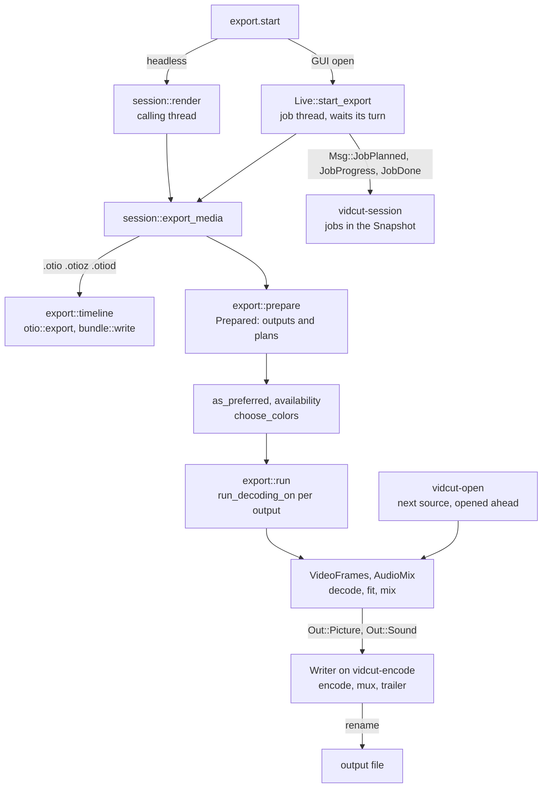

# Export

- An export turns the project into files. `export.start` names an output.
- vidcut flattens the timeline into a render plan, and decodes the plan with the player's reader. It fits each picture to the output, mixes the sound, encodes and muxes.
- `crates/vidcut/src/export.rs` resolves presets, outputs, GPU preferences and colors. The engine is `crates/vidcut-av/src/export/`.
- [playback](playback.md) shares the reader and the mixer. [gpu](gpu.md) tells what each GPU does.

## Where the request runs

- Both paths end in `session::export_media`.
- Headless, `session::run_with` loads the project, and `session::render` runs the export on the calling thread.
- A headless run refuses `background`. Why: the export would stop with the process.
- With a GUI open, `Live::start_export` copies the project and runs the export on a job thread of its own (vidcut-j1, …).
- The job reports its planned files (`Msg::JobPlanned`), and then waits for its turn ([live](live.md#jobs)).
- A job thread runs at the lowest priority, and its decoding waits while a player plays (`first::as_job`). Why: an export never holds up the viewer.

## Preparing

`export::prepare` makes a `Prepared`: the settings and the `Output`s. Each `Output` has a plan, a path and its own settings.

- **Settings:** `settings`, a `preset`, or the default preset of the extension.
  - `set` changes fields (`apply_overrides`). `encoder` sets the video encoder. The extension sets the container.
  - A `null` in `set` takes the field out, and the field gets its default. Why: the Export page sends `null` for a field that its preset has and its settings do not.
  - The presets are `builtin_presets` and the user's TOML files (`export::presets`).
  - A preset's name is any text that is not empty. The file holds the name.
  - The file name is the preset's name when that name is short, lowercase ASCII and safe on each system (`user_preset_path`). Otherwise it is a digest of the name. Why: two names that differ only in case stay two files.
- **Range:** the range given, else In to Out when both marks are set, else the whole timeline ([spec §10](../spec.md#10-quick-export-ch-39-pp-788790-40954096-41044109)).
- **Plans:** `render::flatten` over the range. With `per_clip`, one `render::flatten_clip` for each clip.
  - `clip_path` makes the path of each clip file from the File tab fields of `ExportParams`. `kept_levels` gives the folders of `source_levels`. `Track::number` gives the track in the folder of `separate_folders`.
  - The frame count is the source timecode of the clip's first frame: `Media::timecode_at` plus the source frame (`render::per_frame` and `render::shown_frame`). An image sequence numbers its frames from it.
  - `check_clip_names` refuses these fields without `per_clip`, and a `subfolder` that leaves the output folder.
  - `prepare` also refuses the combinations of rows whose names are not measured. Why: the order of the parts is then not known.
  - `render::flatten` works in stages. `planned_video` makes the pictures and `planned_audio` makes the sound.
  - `cuts_of` finds the frames where the picture changes. A `render::Span` is one track between two cuts. It gives the layers of that track and what they hide (`Drawn`).
  - `uncovered` removes the layers that a higher layer hides. It also removes the layers of a compound clip that a Smooth Cut draws as one picture.
  - `piece_of` puts the layers of all tracks between two cuts into one `VideoPiece`.
  - The plan uses the sample rate and channels of the audio encoder (`resolve_audio`). Why: the sample math then agrees with the encoder.
  - A count with no default layout in FFmpeg uses the first channels of the 22.2 layout (`channel_layout`). Why: the mix needs a layout, and a stereo file then goes to the first two channels.
  - An encoder can take fewer channels. Then the export fails with the name of the encoder and the channel count.
  - An export shows the clips of removed media as Media Offline. Its report then has the note `media_offline`, with the names of the media (`Project::offline_in`).
  - Before an export, the GUI asks when a clip of the timeline uses removed media (`ask_offline`). Cancel stops the export.
- **Render Speed:** `paced` wraps the progress of `run_decoding_on`. It waits before it reports a frame that is early for `render_speed`. Why: the progress comes once for each frame, in each path of the encode.
  - The time starts at the first frame of each pass. Thus the setup of the encoders gives no frames at full speed.
  - Each frame is due one interval of the limit after the frame before. A frame that is late is due at once, and the next frame counts from it.
  - Thus a slow stretch gives no frames at full speed after it.
  - It waits in short steps (`PACE_STEP`) and stops when the export is cancelled.
  - A count that goes down starts a new pass, and the time starts again.
- **Models:** `session::export_media` first checks the models of Voice Isolation, Upscale, Retime Process and the Process of each Smooth Cut. A missing model needs `download`.

GPU preferences:

- `export::as_preferred` applies `gpu.acceleration`.
  - Off: each video encoder becomes `cpu`.
  - On: an encoder that the GPU in use does not have becomes `auto`, with a note (`encoder_changed`).
- `export::availability` lists the encoders of the GPU that work ([gpu](gpu.md#encoders)).

Colors:

- `export::choose_colors` picks the dynamic range and the bit depth that the settings leave open (spec D44).
- The dynamic range follows the timeline color space of the plan (`RenderPlan::colors`).
  - With Auto, 8 bits that are set, or that the codec or profile fixes, make the export SDR.
- `render::timeline_colors` resolves the timeline color space. With Auto, the timeline is HDR when most of its picture is HDR.
  - A plan of the whole timeline counts its own pictures. For a plan of a range, `render::auto_colors` counts the pictures of the whole timeline.
- The bit depth:
  - HDR is 10-bit, also when 8 bits are set.
  - Else a depth that is set, or that the codec or profile fixes, wins.
  - SDR is 10-bit when more than half of the picture has 10 bits or more.
  - SDR H.264 is 8-bit. Why: few players play 10-bit H.264.
  - SDR takes 10 bits only from the encoder that an 8-bit export starts with. Why: vidcut does not move to a slower encoder for 10 bits.
  - DNxHR HQ in 10 bits becomes HQX (`ColorChoice::apply`).
- `export::choose_metadata` picks the HDR metadata, by the rules of `vidcut_core::export` (spec D46). With an SDR timeline, each picture counts as SDR.
- With a grade or a LUT in the plan (`RenderPlan::changes_light`), `metadata::choose_graded` takes nothing from the sources. Why: a grade or a LUT changes the light of the picture.
  - A grade counts only when it has keyframes or `Graded::of` gives passes (`Grade::is_active`). The grades inside compound clips count too.
  - It keeps the mastering display and the light that the user gives. The report says this.
  - Without given light, the choice says that the output frames give it (`metadata::FROM_OUTPUT`). The plan shows this.
  - An asked HDR10+ or Dolby Vision gets a line that says that the grade drops it (`metadata::GRADED_DROPS`).
  - The report, the job details and a line beside the metadata menu of the Export page show that line (`graded_drops`).
- Before the export, `export::choose_colors` measures the light of those output frames (`export::output_light`).
  - `output_light` draws each frame as the encode does (`frames_of`). It uses the same decoder, draw, grades, LUTs and burned subtitles.
  - It uses the sizes of the export and the pixel format of the first encoder (`encode::resolve_video`).
  - The frames come back to memory. `light::made_level` measures them with `light::Meter` on up to four threads. It keeps only the highest light and the highest frame average so far.
  - The source files use the same math (`measure_with`). `light::level_of` gives MaxCLL and MaxFALL for both.
  - `MetadataChoice::measured` puts the values into the choice. The report says that they come from the output frames.
  - `export::run_decoding_on` does the same when it chooses the metadata itself.
  - Nothing keeps the result. Why: any edit can change the frames.
- An export first measures the light that the files do not state (`Lights::analysis`), and caches it.
  - The GPU measures the HDR pictures that stay on the GPU ([gpu](gpu.md#the-light-meter)).
  - A generator has no file. Thus it adds no light (`light::sampled`).

The plan:

- `export.plan` measures nothing. It returns `export::describe`, with `auto` from `export::auto_picks`.
- `export::auto_picks` sets each automatic setting (encoder, passes, bit depth, range, metadata) back to auto, one at a time. `choose_output` and `encode::resolve_video` then choose it again.
  - Why: the "auto (…)" of the Export page names what auto picks, whatever the user chose instead.
- The plan reads the GPU encoders whenever GPU acceleration is on. Why: auto can pick one while the CPU is chosen.

## Choosing an encoder

`encode::video_encoders` lists the candidates in order:

| `video.encoder` | Candidates |
|---|---|
| `auto` | the encoders of the GPU in use that passed detection, in the platform's order, then the CPU's |
| NVENC, VAAPI, AMF, QSV, VideoToolbox | that one; an error tells why it cannot encode |
| `cpu` | the first CPU encoder of the codec that this FFmpeg has (`parts`) |

- The export takes the first candidate that opens. Why: a detected encoder can fail, for example when NVENC has no free session.
- With Dolby Vision, `auto` has only the CPU's candidates.
- Quality or bitrate, profile and depth become the options of each encoder. `bit_depth` 10, `main10` or HDR give 10 bits.
- Only the first candidate that vidcut can use gets the `speed`. Why: encoders name their speeds differently.
- The encoder records the speed and profile that it takes (`Chosen`). `export.plan` returns them, and the Export page shows them.

**Two passes** (spec D45):

- A bitrate, or `passes` set to 2, asks for two passes.
- x264, x265 and libvpx-vp9 encode the range twice (`Passes::TwoRuns`). The first run keeps statistics and drops its packets. The statistics go in a hidden folder beside the output (`temp::dir`), or in memory for libvpx.
- NVENC makes two passes inside one encode (`Passes::TwoInside`).
- The other encoders make one pass. With a bitrate alone, they encode in one pass. With `passes` set to 2, `encode::passes` refuses them, and `auto` goes on to the next candidate.

## Encoding one output

- `export::run` calls `run_decoding_on` for each output in turn.
- With GPU decoding on, the export has a GPU decoder of its own (`GpuDecoding::own_decoder`).
- The export writes a hidden file beside the output (`temp::file`), and renames it on success. An error or a cancel removes the hidden file ([model](model.md#the-vidcut-file)).
- `encode` opens the muxer and both encoders. It starts the `Writer` on `vidcut-encode`, behind a bounded channel.
  - Why: an encoder that waits on the GPU does not hold up the decoding of the next pictures.
- The export thread loops over the frames. `VideoFrames::next_frame` gives the picture, and `AudioMix::read` gives the samples of that frame.
- The writer encodes, puts the HDR metadata into the packets, and interleaves them. At the end, it flushes the encoders and writes the trailer.

**HDR metadata:**

- Static values go to the encoder and to the container. x265 repeats them at each keyframe.
- `hdr` puts HDR10+ into each HEVC or AV1 frame. Why: the FFmpeg encoders do not do this.
- vidcut keeps Dolby Vision from a source of profile 8 or 10, with compatibility 1 in PQ or 4 in HLG.
  - It writes profile 8, or profile 10 in AV1. Only libx265 and libsvtav1 write it.
  - Each frame needs it. Thus a black or generated frame takes the metadata of the frame before it.
  - Black or generated frames at the start have no frame before them. Then the export has no Dolby Vision.

**Export Alpha** ([spec §10](../spec.md#10-quick-export-ch-39-pp-788790-40954096-41044109)):

- `VideoSettings::holds_alpha` tells which settings have alpha. `validate` refuses `video.alpha` for the others.
- With it off, the canvas starts black, and each frame is opaque. Thus the file has no alpha channel. The pixel formats are:
  - ProRes 4444 and 4444 XQ: `YUV444P10LE` on the CPU and `P416LE` on VideoToolbox.
  - TIFF: `RGB24` or `RGB48LE`.
  - OpenEXR: `GBRPF32LE`.
- With it on, `VideoFrames::writing_alpha` starts the canvas transparent. The pixel formats are:
  - ProRes 4444 and 4444 XQ: `YUVA444P10LE` on the CPU and `AYUV64LE` on VideoToolbox.
  - TIFF: `RGBA` or `RGBA64LE`.
  - OpenEXR: `GBRAPF32LE`.
- A black piece is then a picture with an alpha of 0 (`VideoFrames::clear`). Thus a gap is transparent.
- The canvas holds premultiplied colors. `pixel_at` in `picture.wgsl` takes the alpha out before it converts the colors of the output. Why: a transfer curve gives another color for a premultiplied color.
  - `AlphaOut::Straight` writes that color.
  - `AlphaOut::Premultiplied` multiplies it by the alpha again.
  - `VideoSettings::alpha_modes` gives the modes of a format. OpenEXR takes only `AlphaOut::Premultiplied`, and `validate` refuses Straight with it.
- A composite mode over a part with alpha (`mode_mixed`) mixes with the color below as far as that part shows. Over nothing, the color stays as it is.

**Image sequences** ([spec §10](../spec.md#10-quick-export-ch-39-pp-788790-40954096-41044109)):

- `Container::image_sequence` is true for TIFF and OpenEXR.
- A packet of FFmpeg's `tiff` encoder is one whole file.
- An OpenEXR does not use FFmpeg's encoder ([gotchas](../gotchas.md#ffmpeg-encoding-and-muxing)):
  - FFmpeg's `rawvideo` encoder gives the float planes of each frame. Thus the choice of encoder, the stream and the report stay as for other formats. The report names `rawvideo`.
  - `openexr::Writer` writes each file with the `exr` crate, in scan lines from the top down.
  - `openexr::chosen` gives the half or float samples and the compression from the profile.
  - DWAA and DWAB take `compression_level`, or `DWA_LEVEL`. ZIP and ZIP1 have the fixed level 4 of the crate, which is Resolve's default.
  - A half sample is the nearest half float to the 32-bit value.
  - Each channel has `quantize_linearly` off, as OpenEXR's channels have by default.
- `FrameFiles` writes the packets to a temporary folder beside the output, and `Writer::end` moves them to their names. Thus a cancelled export leaves no frames and keeps the old ones.
- `Output::named` reads the name of the last frame file before the encode. Thus a name that the system refuses stops the export before the encode, and not at the move.
- `Output::taken` reads the folder once. It checks only the files whose names end in a number of the export. Why: a check of each frame file costs one call to the system for each frame, on each `export.plan`.
- For a Premultiplied TIFF, `FrameFiles` changes the ExtraSamples tag of each file to associated alpha ([gotchas](../gotchas.md#ffmpeg-encoding-and-muxing)).
- `openexr::Writer` puts the timecode of the frame on the timeline and the frame rate (`frames_per_second`) in the header of each OpenEXR.
  - `packed_timecode` packs the timecode, as two digits for each field.
  - The frame digits count at most 30 numbers in each second. Above 30 fps, 2, 3 or 4 frames in a row share one number. Why: Resolve writes this ([spec §10](../spec.md#10-quick-export-ch-39-pp-788790-40954096-41044109)).
  - Bit 15 marks the second frame only where 2 frames share a number.
- The muxer is `null`. Why: FFmpeg's image muxer takes a pattern, and a percent sign in a folder name would break the pattern.
- `ExportSettings::frame_file` makes each name. `ExportSettings::numbering` makes the `Numbering` of an output: the first number, and the frame on the timeline for the timecode.
- `VideoSettings::image_bits` gives the depth from the profile. `ColorChoice` reports it.
- `carries_hdr` is true for both, because their files hold the code values of the timeline. The FFmpeg encoders write no HDR tags and no HDR metadata.
- OpenEXR planes are `R32Float` and use `fs_encode_float`. `encoded_rgb` does not clamp them when the transfer does not change. Thus a value above 1 stays in the file.
- A TIFF is 8 or 16 bits, so its values stop at 1.

Sources:

- `VideoFrames` reads the pieces in order. A piece of the same file keeps its decoder.
- While the current piece encodes, `Ahead` opens the next file on `vidcut-open`, seeks, and decodes the first frame.
- Each layer of a dissolve reads its own file.
- A `VideoPiece::Generated` has no file. `VideoFrames::generated_frame` makes its frame at the size of the plan.
  - `Generated::at` gives the `generators::Pattern` of a frame. A gradient with keyframes gives a new pattern on each frame.
  - `slate::draw` draws the box and the sign of `Pattern::Offline`. `burn::line_coverage` lays out its words with the fonts of the titles. `slate::put_text` puts them on the frame.
  - A Solid Color in an SDR timeline is RGB24.
  - Each other frame is RGBAF32LE, in 32-bit floats with an alpha of 1. It holds the code values from `generators::draw`, with the tag of the timeline colors (`screen::held::tag`).
  - Why: Resolve draws its generators in 32-bit floats ([spec §8.17](../spec.md#817-generators-p-766)).
  - The screen takes the frame as one `Rgba32Float` texture (`Layout::Rgbaf32`). Thus the shader reads it as RGB, with no unpack pass.
  - `VideoFrames` keeps the last patterns. Why: two generators under a dissolve need two frames.

Notes:

- The export tells its listener on the thread what it does (`vidcut_av::progress::Noting`):
  - the color choice
  - each video encoder that did not open, and why
  - the encoders that opened, and the loudness gain
  - each source file, with its `Decoding`
- The report of a headless run keeps the failed encoders (`tried`) and the files (`sources`).
- The error of a video encoder that does not open (`open_video`) names the encoder and the output size. Then it gives the reason from FFmpeg.
  - The error does not say that the size is the cause. Why: the error code does not tell the cause, and the FFmpeg codec data holds no size limits.
- [live](live.md#jobs) tells how a job collects the notes.

## Bypass re-encode

[Spec §10](../spec.md#10-quick-export-ch-39-pp-788790-40954096-41044109) gives the rule. `VideoSettings::bypass_reencode` turns it on.

**What the export can copy:**

- `plan_copies` checks the whole output first. When the export can copy nothing, it gives the reason in the `BypassNote`.
- `Copying::new` walks the pieces of the plan. `copyable` takes a piece that shows one file with no change:
  - a `VideoPiece::Source` that fills the frame, with no map of its scaling (`Placed.mapped`)
  - with `video.alpha`, a `VideoPiece::Mix` of one such source over black
- `File::open` checks each file once against the `Output`: codec, size, pixel layout, profile, colors, field order, pixel shape and rotation.
  - A file that does not match goes into the `Refused` list with its reason.
- Each piece that copies gives a `Span` of timeline frames. A burned-in subtitle cue cuts its frames out of the span.

**Which packets:**

- `Span::target` gives the target time of a timeline frame, as `VideoFrames` finds the source frame ([which source frame](#which-source-frame)).
- `Span::at` gives the last timeline frame that shows a source time.
- `Copying::run_at` starts a run at the first start frame of the span at or after the timeline frame (`Bits::starts`).
- `Copying::next` reads the packets in decode order and holds them in groups.
  - A group is complete when the next packets of the file all come after it in time.
  - It looks at as many packets as the decoder delay of the file, plus a margin.
- A source frame shows on the timeline frames from the one after the `Span::at` of the frame before it, to its own `Span::at`.
  - A frame with no such timeline frame ends the run. Thus a gap in a file of variable rate holds a frame, and a skipped frame ends the copy.
- A packet at or after the end of the span ends the run. Thus a frame that needs such a packet is encoded.
- Leading pictures before the start frame are dropped.
- `Copying::end` gives the timeline frame after the last copied frame. The export encodes from there.

**The bitstream:**

- `Bits` holds what the first packet of a run needs:
  - H.264 and HEVC: the parameter sets of the file. The packets change from NAL units with lengths to Annex B.
  - The first packet gets the parameter sets after its access unit delimiter, if it has no SPS.
  - In HEVC, a CRA in the first packet becomes a BLA. Why: then a decoder drops the RASL pictures, which use frames before the cut.
  - AV1: the sequence header of the file, after the temporal delimiter.
  - VP9, ProRes and DNxHR: nothing.
- In MP4 and MOV, the sample entry is `avc3` or `hev1`. Why: each run of frames carries its own parameter sets.
- A copied packet gets a PTS on the frame grid of the timeline. Its DTS keeps the distance from PTS to DTS of the source.
- `Copying::time_base` gives a stream time base that holds each frame of the timeline and each time of the files exactly. Matroska uses 1/1000.

**The encoder:**

- The export thread sends `Out::Cut` before a run, and `Out::Packet` for each copied packet. It sends the sound of each frame as before.
- `VideoFrames::skip` moves the decoders past the copied frames.
- At `Out::Cut`, the writer drains the encoder and drops it. An encoder that got no frame is dropped without a drain.
- The next picture opens a new encoder (`Reopen`) with the same settings and GPU frames. Thus each encoded run starts with an IDR ([gotchas](../gotchas.md#ffmpeg-encoding-and-muxing)).
- The first packet of each encoded run gets the parameter sets of the encoder (`headers_of`).
- `rising` keeps the DTS of the stream rising where two runs meet.
- `Report::bypass` gives the frames copied, the reason when nothing can copy, and the refused files.

## Which source frame

- Output frame k of a piece shows one frame of its media (`VideoPiece::position`).
  - The exact source position is the position of the piece, plus its `phase`, plus k frames at the pace of the piece.
  - `render::shown_frame` turns this position into a frame at the rate of the media, rounded down.
  - A slack keeps a position on a frame boundary on that frame (`render::grid_slack`). The slack is less than half of the smallest step between two positions at the two rates.
  - Thus a frame of 29.97 fps media on a 30 fps timeline does not move one frame early.
  - Thus media at 25 fps on a 30 fps timeline shows each frame one or two times. Media at 60 fps shows each second frame.
- `Clock::target` gives the time of that frame for the decoder: the start of the frame, less half a frame of the media.
- The decoder shows the first decoded frame at or after this time.
- A piece at another speed steps through its source by `render::Pace`. Each section of the speed is a piece of its own (`Clip::runs`).
  - Over an ease, each frame is a piece of its own (`Pace::steady`).

Retimed frames ([deviation X93](../deviations.md#x93-retime-process-has-ai-models-in-the-place-of-optical-flow)):

- `render::retime_of` gives each source piece its Retime Process (`Retime`): the clip's own, or the project's (`ClipRetime`, `ProjectRetime`).
  - Auto gives an SDR clip slower than 100% the AI of this computer (`Retime::ai_here`), and Nearest to the other clips.
  - A still, and a piece whose frames each land on a source frame, take Nearest.
- With a process other than Nearest, `VideoFrames::retimed_frame` takes the exact source time of the frame (`VideoPiece::exact`, `Pace::exact`).
- The `Source` keeps the two frames before its current frame (`prev`, `prev2`). The frame before the time and the frame after it are the pair.
  - With no decoded frame before the time, the source seeks a second back and decodes again.
- The weight is where the time falls between the two frames.
- At a shot change between the two frames, the nearer frame shows (`Source::cut`).
  - The test is the scene score of Detect Scene Cuts over three frames (`analysis::scene_score`, `SCENE_SCORE`).
  - A pair with no decoded frame before it is not a cut. Why: a false cut holds a frame here, but only marks a shot in Detect Scene Cuts.
  - The score compares small luma pictures of 96×54 (`analysis::MEASURE`).
  - A frame on the GPU, or a frame with its RGB on the GPU, gets its small picture on the GPU (`held::small_luma`). It is the area average of the BT.709 luma of the RGB, in TV range.
  - Only the small picture comes down. Why: the test does not need the whole frame.
  - A frame in memory gets its small picture from FFmpeg's scaler (`analysis::small_luma`).
- With an AI upscaler, the upscaler enlarges the two frames of the pair first (`scaled_pair`). The frame is then made from the two enlarged pictures.
  - Why: Upscale works on the source, before the retime ([deviation X93](../deviations.md#x93-retime-process-has-ai-models-in-the-place-of-optical-flow)).
  - The `Source` keeps the last two enlarged pictures (`Source::ai_picture`). Thus the later picture of one pair is the earlier picture of the next.
- An AI upscaler takes the colors of a picture with no alpha in them. Why: its model has three channels.
  - The draw enlarges the alpha of the source frame to the size of the enlarged picture (`Matte`). This occurs at each speed (`VideoFrames::shown`).
  - With no Retime Process, the layer goes over the layers below as Straight, or as Premultiplied when its media has that Alpha Mode.
  - With a Retime Process, the draw of each enlarged picture of a pair takes that enlarged alpha (`Source::matted_from`, `Look::matted`).
    - Thus the colors of the pair have the alpha in them, as with no upscaler. An input LUT in that draw gives `T(clamp(C / A)) * A` in Premultiplied.
    - The draw makes the alpha only for an enlarged picture that it does not keep yet. Why: the alpha and the gray picture of a frame share one entry (`Drawings`).
- With the frame rate conversion of macOS, `interpolate::between_frames` makes a VideoToolbox frame from the pair ([gpu](gpu.md#frame-interpolation)).
  - The draw puts both frames into P416 VideoToolbox frames in the timeline color space first (`Source::frame_of`). They are sized and placed as the RGB pair is.
- The pair is sized and placed before the frame is made. Why: Edit Sizing comes before Speed Effects ([spec §13](../spec.md#13-order-of-operations-pp-287296-3407)).
  - A clip with no placed picture: each frame becomes RGB on the GPU, upright. The size of the RGB is the size that it fills in the frame, rounded up to even (`fitted_size`).
    - The picture has its exact fit in that RGB (`Look::fitted`). Thus the part of a pixel at its edge is in the RGB, and the RGB goes into the frame at a whole pixel.
  - A placed clip: the draw places each frame into RGB with its Transform, Crop and Dynamic Zoom (`Sampling::Colors`). The RGB covers only the bounds of the placed picture (`placed_look`).
  - Upscale enlarges each frame with the kernel of its Sharpness, as the draw of an export does (`screen::kernel`).
  - `Source::rgb_from` keeps the RGB of the last two frames. Thus the later frame of one pair is the earlier frame of the next, while the placing stays the same (`Look`).
  - Each of the two frames keeps its colors and its gray picture in one entry (`Drawings`).
- With the other processes, `interpolate::between` makes the frame from the two RGB pictures.
- The key of a pair names its placing (`Source::look_id`). Thus a new placing gets new features.
- A made frame of a placed clip is already placed (`Sampling::Placed`). The draw takes only its edges, its opacity and its composite mode from `place::Placing`.
  - The draw uses the placing that the frame was made with. Thus during a drag in the viewer, a made frame moves only when it is made again.
- An exact source frame, the first frame of a file, a piece played backward and a still take the usual path.
- The RGB of the pair is 16-bit, in the timeline color space (`Form`). In an SDR timeline, an HDR frame is tone-mapped into it.
- A picture with an alpha channel keeps it through the pair. The RGB has three channels, thus the alpha is a second picture (`Matte`).
  - The draw makes each frame of the pair twice (`Look::with_alpha`): its colors by its Alpha Mode, and its alpha as gray (`AlphaUse::Matte`).
  - The colors have the alpha in them (`AlphaUse::Multiplied`). Why: a mix of two such pictures gives the mix of the two frames over any picture below.
  - `interpolate::matte_between` makes the gray picture from its own pair. The `Engine` holds that pair beside the pair of colors. Why: otherwise each pair would push the other out at each frame.
  - AI Retime makes the gray picture with a flow of its own, from the gray pair. Thus the edges of the gray picture and of the colors can differ.
  - With the frame rate conversion of macOS, Frame Blend makes the gray picture. Why: that conversion takes VideoToolbox frames, and the gray pair is RGB.
  - At a shot change, the gray picture comes from the same frame as the colors.
  - The layer goes over the layers below as Premultiplied (`Matte::of`). With a composite mode, the draw first takes the alpha out of the colors (`AlphaUse::TakenOut`). A media with the Alpha Mode Premultiplied keeps its colors.
  - The Alpha Mode None makes no gray picture, and its colors have no alpha in them.
  - A retimed clip with alpha gets no job of the clip level (`Setup::keeps_alpha`). It stays at the timeline level ([playback](playback.md#the-render-cache)).
  - A job of the clip level with AI Upscale and no retime makes the alpha of the enlarged frame (`VideoFrames::shown`).

Seeks:

- A reader seeks exactly (`VideoReader::seek`). It seeks to a keyframe at or before the target, then decodes on and drops the frames before the target.
- While the first frame lands after the target, it seeks further back. Why: MP4 seeks by decode time, and open GOPs show frames from before their keyframe.
- A reader that only looked for the keyframe (`VideoFrames::keyframe_time`) decodes on from it (`VideoReader::from_keyframe`).
- A piece played backward decodes forward from the keyframe before its pictures, as many pictures at a time as a memory budget holds (`VideoFrames::reversed_frames`).
- The player reads through the same `VideoFrames`, and both draw with the same `Screen`.
- The viewer plan can leave Upscale off, and can read the render cache and a proxy (`preview_plan`, `Cache::apply`, `apply_proxies`). Exports read the timeline as stored unless `VideoSettings::use_proxy_media` is on (`export::prepare`, `use_proxies`).

Pictures:

- `VideoFrames::next_layers` gives the layers of each frame as they are decoded, as the player gets them.
- `Maker` decodes by the route that `route::plan` gives each frame ([gpu](gpu.md#routes)). A frame stays on the GPU where the drawing reads it there (`Gpu::gpu_pictures`).
- `player::picture` makes one `Picture` of the layers, as the player does.
- `VideoFrames::next_frame` draws that picture with the viewer's `Screen`, on the shared off-screen wgpu device (`screen::offscreen`).
- Thus the export and the viewer have one draw path: `crates/vidcut-av/src/screen/picture.wgsl` ([playback](playback.md#the-viewer-thread)).

## Smooth Cuts

A Smooth Cut morphs its outgoing picture into its incoming picture ([spec §8.11](../spec.md#811-dissolves-pp-645-747-758761-895-1114-1159-1173), [deviation X99](../deviations.md#x99-smooth-cut-has-a-process-row-in-the-place-of-speed-warp)).

- `render::flatten` puts the incoming side over the outgoing side. Its `Over` holds a `render::Smooth`: the `Retime` of the Process and the keys of the curve.
- Each side takes Nearest. With Faster, each side stays on one source frame (`Pace::of` at the speed 0).
- Each side is one whole picture of the timeline size. Why: the models take whole RGB frames, with no alpha.
- A side with a placed picture or played backward is one side as a compound clip is (`VideoPiece::Flat`). A gap is a flat side of black, and it is clear over the layers below.
- In a frozen compound clip, a flat side holds one frame of its track (`Span::flat`).
- A composite mode alone does not make a placed picture here (`without_mode`). `Smooth::mode` holds the mode of the outgoing clip.
- A side is a file, a generator's picture or a compound clip (`Side`). Why: a Solid Color acts as a still in a Smooth Cut ([spec §8.11](../spec.md#811-dissolves-pp-645-747-758761-895-1114-1159-1173)).
- A compound clip is one side (`VideoPiece::Flat`). `flat_pieces` makes the plan of that clip alone, and its inner tracks draw nothing in those frames.
- `FlatSide` draws these pieces with a `VideoFrames` of its own, into a float frame of the timeline size. Thus its tracks, transitions and titles take the usual path.
- `FlatSide` keeps the alpha of the side, premultiplied. `VideoFrames::smooth_frame` mixes the alpha of the two sides at `Smooth::at` (`interpolate::matte_between`). A side that is a file or a generator is opaque.
- A flat side in a compound clip keeps the `Placed` list of that compound clip (`VideoPiece::Flat`).
- With Faster, a gradient with keyframes stays on one source frame (`Generated::held`).
- `VideoFrames::smooth_frame` draws the current frame of each side into 16-bit RGB at the size of the timeline (`Look::fitted`, `Source::rgb_from`). `ColorSides` draws a generator's picture the same way.
- `interpolate::between` makes the frame at `Smooth::at`. On macOS, `interpolate::between_frames` makes it from two VideoToolbox frames (`Source::frame_from`).
- The made frame replaces the incoming layer, at full weight. With no `Smooth::mode` and no flat side, it covers the outgoing layer, and the layers below are not in the plan.
- With a flat side, `Smooth::clear` is true. The made frame carries the mixed alpha as its matte. `Smooth::lay` gives it a place in the layers, in the mix of its compound clip.
- With a flat side, the layers below show through. They stay in the plan, also when that side covers the frame. `VideoFrames::smoothed` sets the weight of the outgoing layer to 0.
- With a `Smooth::mode`, the layers below stay. `Smooth::lay` gives the made frame that mode, and `VideoFrames::smoothed` sets the weight of the outgoing layer to 0.
- The key of the pair holds both files, both frames, both looks and both sides. The time of the outgoing frame orders the pairs. Why: the session of macOS takes times that go up.
- The morph has no shot-change test. Why: a Smooth Cut always joins two shots.
- The morph takes the decoded frames. AI Upscale does not enlarge them.
- The morph draws each side with no frames around it. Thus an interlaced side gives only the rows of its own field ([gpu](gpu.md#deinterlacing-and-hdr)).

## Timeline colors

Each mix occurs in the timeline color space ([spec D50](../spec.md#12-decisions-on-gaps-and-contradictions)).

- `Screen::for_export` draws each frame into `Wide`: 32-bit floats in the code values of the timeline (`VideoFrames::with_timeline`).
  - Each layer, title and subtitle goes there as in the viewer.
  - Why: a color above 1 or below 0 stays between the layers ([spec D75](../spec.md#12-decisions-on-gaps-and-contradictions)).
- `fs_lut` then runs the output LUT on `Wide` (`VideoFrames::with_output_lut`, [the LUT files](README.md#lut-files)). A black piece of the plan goes through it too. The render cache holds no output LUT.
- Then `fs_encode` writes each plane of the encoder's pixel format from `Wide` (`Screen::encoded`).
  - It converts the timeline colors to the colors of the output. An SDR output is BT.709 and an HDR output is BT.2020.
  - A YUV output is in limited range. An RGB output is in full range, and its tags say so (`color::tag_frame`).
  - HDR to SDR tone-maps with the math of the viewer's `fs_screen`.
  - 4:2:0 chroma is sited left, and 4:2:2 chroma top-left (`color::chroma_location`). These are the default sites of H.264 4:2:0 and of MPEG-2 4:2:2.
  - A chroma sample is the mean of the pixels in a box the size of its block, at its site. A pixel that the box covers in part has less weight.
  - The frame and the encoder get that chroma location.
  - The values are rounded once, at the end.
- `color::tag_frame` gives the frame its color tags.
- The frame keeps the HDR10+ and Dolby Vision metadata of its source.
- `frame.render` of a timeline frame and the storyboards use the same draw (`renderer::frames`, `FrameReader::rgba`). Their output is RGB.
- `frame.render` of a media and the tiles convert each picture of the file directly to RGB.

To the encoder:

- With NVENC, the encoder takes CUDA frames (`gpu_output`).
  - wgpu copies the planes into a buffer that Vulkan shares with CUDA (`Shared::out`).
  - CUDA copies them into the encoder's frame (`Shared::empty_into`).
  - The writer thread waits for the draw and makes that copy (`screen::filled`). Meanwhile the next frame decodes and draws.
  - Two shared buffers take turns. Before a draw uses a buffer again, it makes the copy of that buffer's last frame if the writer has not made it yet.
  - Why: the decode and the draw of a frame do not wait for the copy of the frame before it. The draw never waits for the writer thread.
- With VideoToolbox and GPU decoding, the encoder takes frames of the decoder's device. `fs_encode_unorm` draws the planes into the IOSurface of the frame (`Sink::Surface`).
- The other encoders take frames in memory. wgpu reads the planes back (`Sink::Memory`).
  - VA-API frames, and AMF frames on the decoder's Direct3D 11 device, then go up to the encoder's device (`Upload`).
- When a hand-off to the encoder fails, the frames go through memory to the end of the export. The report tells why (`through_memory`).
- Why: a frame stays in GPU memory from the decoder to the encoder where this is possible (AGENTS.md rule 9).

The size of the file ([spec §10](../spec.md#10-quick-export-ch-39-pp-788790-40954096-41044109)):

- `VideoSettings::written_size` gives the size that the encoder gets. H.264 and HEVC round an odd side up. DNxHR rounds an odd width up, but DNxHR 444 keeps it. The other codecs keep the side.
- `VideoSettings::drawn_size` gives the size of the draw: the written size with a `video.width` and `video.height`, or else the size of the timeline.
  - Why: a custom size fits the picture into the file's size with one draw ([spec §10](../spec.md#10-quick-export-ch-39-pp-788790-40954096-41044109)).
- `export::validate` refuses a `video.width` or `video.height` outside `TIMELINE_SIDE`.
- With a rounded side of the timeline, the draw stays at the size of the timeline (`VideoFrames::written_at`, `Screen::write_at`).
- `Screen::encoded` then draws that `Wide` as one picture into a second `Wide` at the written size (`scale_whole`). `fs_encode` reads the second `Wide`.
  - Why: the fit of a layer is at the size of the timeline ([spec §13](../spec.md#the-fit-to-the-timeline)). A draw at the written size gives another factor and other bars.
  - `Level::centered` gives one factor for both axes and centers the picture. It takes the smaller factor, so that the whole picture fits.
  - 1281 x 720 into 1282 x 720 has the factor 1. Thus the picture moves by half a pixel and has half a pixel of black at each side.
  - The draw is the shader of the layers (`fs`), with the export's kernel for a change of size (`RESIZE`, `WIDENS`). Colors outside 0 to 1 stay between the two `Wide` pictures.
- `VideoSettings::rounded` gives the `Rounded` that the export plan, the Export page and the report show.
- An encoder can round a side by itself. av1_nvenc does this.
  - `rounded_by_encoder` reads the finished file when a side is odd. A difference goes in the report.
  - The plan and the Export page cannot show this. Why: only the file tells the size.

## Sound

- `AudioMix` mixes the lanes sample-exact: clip gains, cross fades, de-click fades at cuts, and clips at other speeds, stretched with their pitch kept.
- A piece of a clip with volume keyframes carries them (`Keyed`), and its `gain_db` holds only the fader of the track.
  - `AudioMix` multiplies each sample by `Keyed::gain` at the place of the sample on the keyframes' frames (`Keyed::at`).
  - Thus the player and the export play the same curve ([spec D81](../spec.md#12-decisions-on-gaps-and-contradictions)).
- `Resampler::new` converts each source to the layout of the mix. The export and the player get this conversion through `AudioMix`.
  - A source of one channel goes to each side of a mix of two channels at its full level (`swr_set_matrix`).
- A piece has the Pan of its clip (`pan` of an `AudioPiece`), or its pan keyframes (`pan_keyed`). `render::pan_gains` gives the gain of each side.
  - When `pan_keyed` is present, `AudioMix` reads `Keyed::pan_at` at each sample.
  - `AudioMix` multiplies the first two channels of a mix of two channels or more by those gains.
- A piece has the `noise_reduction` of its clip when it changes the sound.
  - `Denoiser` is a spectral gate with its own short-time Fourier transforms. It reads ahead of the piece, as `Isolator` does.
  - It gets the sound after Voice Isolation and before the Dialogue Leveler.
  - Each channel has its own noise profile, which starts at the first frame of the piece.
  - The profile of a bin follows the lowest level of that bin, and it rises slowly.
- A piece has the `compressor` of its clip when it changes the sound.
  - `Dynamics` runs after the equalizer and before the gain and the Pan. It adds no delay.
  - Each channel gets the same gain, from the highest peak of the channels.
- A piece has the `leveler` of its clip when the switch and a process of its Dialogue Leveler are on.
  - `Leveler` reads ahead of the piece, as `Isolator` does, so the look ahead adds no delay.
  - It gets the sound after Voice Isolation, and the equalizer gets the sound after it.
  - At the start of a piece that does not continue the one before, a new `Leveler` starts with no history.
- A piece has the `equalizer` of its clip when it changes the sound.
  - `Filter` runs the bands one after the other on each channel, before the gain and the Pan.
  - Each band is one biquad filter. The player and the export use the same `AudioMix`, so they give the same sound.
- A track at the bottom of its fader (`fader_silent`) keeps its lanes, and its pieces are `silent`. `AudioMix` gives such a piece no sound.
  - Why: a fader preview ([playback](playback.md#sound)) can raise the lane with no new plan.
- A clip with speed keyframes gives a sound piece for each section. A piece that plays on into the next section is `joined`.
  - `AudioMix` plays a run of joined pieces through one `Stretch`, with the speeds of all their sections (`Paced::mapped`).
  - A run plays in one direction, forward or backward. Where the clip turns, a new run starts.
  - Over an ease, a piece has the speed of its frame on the curve (`Pace::rate`).
  - Thus a speed keyframe makes no de-click dip, and the pitch stays.
- With `audio.loudness`, `analysis::mix_loudness` first measures the mix with its ducking. `loudness_gain` gives one gain (`AudioMix::set_gain_db`) that reaches the target, with the true peak under a ceiling.

Ducking ([spec D76](../spec.md#12-decisions-on-gaps-and-contradictions)):

- `render::flatten_lanes` adds a `Ducking` to the plan for each ducked track with lanes (`duck::planned`).
- A `Ducking` names the lanes of its track, its `Dip`, and a `DuckSource` for each source clip near the range.
- The sources start Hold + Recovery Time before the range, and end Lookahead + Rise Time after it. Why: a range then dips as the whole timeline does.
- `duck::hear` puts the parts where the sources are active into `Dip::active`, in samples of the plan.
  - By speech, it reads the `VoiceActivity` of the file (`analysis::speech_frames`).
  - By level, it reads the `AudioLevels` of the file, with the gain of the clip (`analysis::loud_frames`, `keyframes::Gain`).
- `session::export_media` calls `duck::hear_with`, which measures what is missing. A missing speech detector needs `download`.
- `AudioMix::ducked` gives each lane its `Dip`. `Dip::gain_db` is the lowest gain of the active parts near the sample: their fall, full dip and recovery.

Voice Isolation:

- A piece with Voice Isolation (the `isolation` of an `AudioPiece`) goes through an `Isolator` in its lane, after the speed stage.
- `VoiceIsolation::heard` gives a piece its `isolation`. With the switch off or at Amount 0, a piece has none. Thus the model does not run.
- The `Isolator` runs DPDFNet at 48 kHz on the CPU runtime of tract, with one model state for each channel. A mono file in a stereo mix has one state.
- At another mix rate, `Resampler::between` converts on each side of the model.
- The model's output lags its input by two of its windows. The isolator reads that far ahead and drops as much. Thus the voice stays in sync.
- The Amount mixes the voice with the dry sound.
- The model starts fresh at another clip, at a seek and at the start of a range.
- A piece that plays on from the last piece with the same Amount keeps the model running, as through a cross fade.
- In playback, a lane without the model plays dry, and `AudioMix::unheard` tells why.

## Errors and logs

- FFmpeg logs only fatal errors, unless `VIDCUT_AV_LOG` asks for more ([tools](../tools.md)). Why: decoders that recover after a seek log harmless errors.
- A real failure comes back as a vidcut error that tells what failed.

## The GUI's exports

- GUI media exports are `background`.
- Quick Export lists the presets marked `quick_export`. It sends one with `overwrite` and no range.
  - The presets of one `family` are one item. The first of them with `quick_export` gives the item, and its Resolution menu lists all of them.
- The Export page ([spec §10.1](../spec.md#101-export-page-pp-41034132-measured-in-resolve-studio-212)) draws its panels in `export_page_ui`.
  - The render settings (`Render`) start from a preset. They send the changes as `set` overrides, with per-clip names and `overwrite`.
  - The page shows `export.plan` as the params change, and the export as a shell command ([deviation X3](../deviations.md#x3-exports-are-jobs-and-quick-export-has-a-shorter-row)).
  - The range comes from the `RenderRange` of the open timeline. `in_out` sends `in..out`, with `start` or `end` in place of a mark that is not set.
  - On the page, the viewer shows the timeline. Why: the page renders the timeline. Another page gives back the earlier mode.
  - On the page, `Workspace::mark` and `Workspace::clear_marks` call `export_mark` and `export_clear_marks`. Thus the keys and the Mark In, Mark Out and Clear buttons of the viewer follow the rules of the page.
  - On the Cut page, timeline marks go through `mark_in_out` and `export_clear_marks` too. Why: there, the marks also switch the render range.

The render queue:

- `Project.queue` holds the jobs (`RenderJob`) in the project file. Thus a job and its status stay after a quit.
- `render.add` keeps the open timeline and the export params of the job (`ops::render::add`). It fixes the range in frames. Why: a later change of the marks does not change a job.
- Before it adds a job, `queue::existing` checks the job as `render.add` does, and finds the files that are there. `Live` and the headless session refuse them without `overwrite`. A dry run returns them, and the page asks its prompt from them.
- `queue::plan` picks the jobs that `render.start` renders. It opens the timeline of each job in a copy of the project (`ops::render::source`).
  - It finds the files that are there with `export::prepare`, as the export does. Thus it also finds the frames of an image sequence and the subtitle files.
  - A completed job without `again`, or a file without `replace`, makes `Plan::refuse` refuse the request. A dry run returns the plan instead. The page asks its two prompts from it.
- In a running GUI, `Live::start_queue` starts one export job for each queue job, from the top. `JobInfo::render` names the queue job.
- When the export job ends, the core records its result with `render.ended` (`queue::status`). Without a GUI, `render.start` renders the jobs one after the other, and records each result.
- After a job of the open timeline completes, `Live::rendered_from` gives the first frame of its range, and the timeline playhead goes there.
- A change of the queue is not an undo step. `Editor::apply` sends each request of `Request::in_queue` to `ops::render::change`. It changes the project and its `rev`, but it adds no step.
  - The store saves the project as it saves an edit. The history file then gets only the hash of the new project file.
  - An undo step changes only the fields of its edit. Thus an undo keeps the queue.
  - When another program changes the project file, `Store::load_text` copies the queue into the last saved project. Thus the queue is not in the step of that change.
  - `apply` refuses these requests in a batch.

Cancel:

- `jobs.cancel`, or a foreground client that leaves, sets the cancel flag of the job ([live](live.md#jobs)).
- The frame loop and the light and loudness measurements check this flag.
- A GUI that quits during a job removes the partial files (`temp::remove_left`).

## Timeline exports

- An `.otio`, `.otioz` or `.otiod` output (`export::timeline_format`) writes the edit, not pictures ([deviation X9](../deviations.md#x9-opentimelineio-interchange)).
- `export::timeline` takes only a range, `overwrite` and subtitle files. It writes the document of `otio::export` through a partial path.
- A bundle adds the media of the edit (`bundle::plan`, `bundle::write`), with byte progress and cancel.
- In the GUI, an `.otio` runs as a task (`Live::project_task`), and a bundle runs as a job.

## Subtitles

- `subtitles_as` tells how the tracks that `subtitles` names go out with media. They go as files beside it (the default), as streams in it, or into the picture.
- Streams and burn-in take the shown track, unless `subtitles` names other tracks.
- `export::prepare` refuses a container without subtitle streams, burn-in without video, and more than one track to burn.
- It gives each output the cues of its range, in its own frames (`subtitles::Subtitles`).

**Files.**

- The files are SRT, unless `subtitle_format` tells otherwise. Without `subtitles`, a timeline export writes each track that has cues.
- `subtitles::beside` names each file after the output, with the language of the track. With several tracks, a track without a language adds its name.
- Beside media, the cues start from zero (`export::subtitles_beside`). Beside a timeline file, they keep the timecode of the timeline ([spec D58](../spec.md#12-decisions-on-gaps-and-contradictions)).
- An existing file stops the export before it starts, unless `overwrite` is set (`export::refuse_existing`).
- `export::write_subtitles` writes the files through partial paths after the output is done.
- An IMSC1 file warns of cues with more lines than their region holds ([spec D64](../spec.md#12-decisions-on-gaps-and-contradictions)). The warnings go in the notes (`export::subtitle_notes`).

**Streams.**

- `SubtitleOut::add` opens the FFmpeg encoder of the container: mov_text in MP4, MOV and M4A, SubRip in Matroska, and WebVTT in WebM. It encodes each cue before the header is written.
- The stream has the name of the track, and its language as an ISO 639-2 code (`three_letter`). The stream of the shown track is the default.
- `subtitles::dialog` turns the markup of a cue into the override codes that the encoders read.
- Cues that overlap become one cue for each stretch of time (`subtitles::segments`). Why: mov_text samples cannot overlap. Where the muxer allows it, each place keeps its own stretch.
- The place of a cue goes to SubRip as a tag (`subtitles::ass_tag`), and to WebVTT as a `line` setting. mov_text has no place.
- The alignment of the lines does not go into a stream. Why: the SubRip tag moves the block with its lines, and WebVTT centers the block on its position.

**Burning in** ([spec D61](../spec.md#12-decisions-on-gaps-and-contradictions)).

- `VideoFrames::with_burn` draws the cues over each picture that they span, in both runs of a two-pass encode.
- `SubtitleStyle::for_cue` gives a cue its style, and a word its style on top of that. A field that a style leaves out keeps the style of the level above.
- `subtitles::shown` gives what each cue draws at the frame ([spec D69](../spec.md#12-decisions-on-gaps-and-contradictions)). It gives the pieces, the spoken word in its color, the words not yet spoken, and the size of a pop.
- `burn::draw` lays out the cues with cosmic-text: shaping, right-to-left text, and system fonts for the scripts that the first font does not have.
- `burn::paint` draws one picture for each run of cues that share a place and a style. A popping word is a picture of its own over it.
- `SubtitleStyle::block_box` places the block. The point of the longest line that `anchor` names goes to the `position`, else to the middle of the picture. Without an anchor, it is the middle. The width comes from the `widest` field of `Laid`. The alignment moves only the shorter lines.
- The last lines laid out stay in a `ByBytes` with a fixed limit (`laid_line`, `LINES_BYTES`). Why: exports use them, also with no viewer.
- The player's `Subtitles` keeps the pictures while the same pieces show (`Subtitles::burned`). Thus a pop draws only its word again.
- The pictures go onto the frame in the draw of the viewer ([todo](../todo/burn-in-ahead.md)).

## Titles

- A title is a generated picture in the plan: a `VideoPiece::Generated` that holds a `Generated::Title` ([spec D65](../spec.md#12-decisions-on-gaps-and-contradictions)).
  - Its `ShownTitle` holds the clip, the title and where the piece is in that clip (`Run`). `Run::top` places a scrolling title on each frame.
  - Its `placed` pictures are those of a generator ([placed pictures](#placed-pictures)). Thus the Transform, Cropping, Dynamic Zoom and Composite of its clip work on the whole picture of the title.
  - A title never fills the frame. Thus the tracks below it show through its clear parts.
  - A title takes the path of the other pictures through a dissolve, a wipe, a Push, a Slide and a compound clip.
- `player::titles::laid` gives the key of the drawing of a title at one frame, and the move of its text (`Move`).
  - The key holds the title with the values of that frame (`ShownTitle::sampled`), the size and the colors.
  - The key has no position and no rotation of the text (`steady`). Thus a scroll and keys of the position or rotation of the text keep one drawing.
  - Keys of the zoom of the text change the key. Thus such a title is drawn again on each frame.
  - The move holds the whole pixels that the text moves, and its turn about its pivot. `Run::top` gives the move of a scroll.
- `player::titles::frame` draws the drawing. It is a clear picture the size of its blocks, premultiplied, in 32-bit floats.
  - Each block of the title goes over the blocks before it, at its place.
  - In an HDR timeline, it converts the colors as for burned-in subtitles.
- `player::titles::placed` gives the `Placed` that puts the drawing at its place in the frame, with the move.
  - The layer of the title holds it (`Sampling::Within`). The screen puts it before the `placed` pictures of the clip.
  - Thus the GPU moves the text. The Transform, Cropping, Dynamic Zoom and Composite of the clip then work on the moved text.
  - The `Placed` has no crop. The screen draws the moved text into a picture of the frame size (`Mixes`), and the edge of that picture cuts it after the turn.
- `laid` gives no move in these cases. Then the drawing holds the place of the text at that frame, cut to the frame. It is drawn again on each frame.
  - The blocks of the title move by different amounts. An example is a lower third whose two lines have different keys.
  - The drawing is larger than `LARGEST` pixels on a side.
- `VideoFrames::title_frame` keeps the last drawings of titles in an `Lru` (`TITLES_KEPT`). Thus a title that does not change is drawn once.
- `burn::title_blocks` draws each `TitleBlock` of a title with the code of the burn-in (`lay_out`). `burn::title` merges the blocks into one `Sprite`.
  - `lay_out` takes a `Typeset`: the text, its layers and its `Rules`. `Rules::Title` gives the size, the line gap, the tracking and the seat of a title. `Rules::Plain` gives the line gap of a subtitle.
  - Why: each kind of text has its own measured rules, and one engine shapes and draws them all.
  - A `TitlePart::Backing` block lays out the two lines at the lower line's values and draws only their box (`Typeset`, its `bare` field).
    - The rows of the upper line (`Laid`, its `above` field) stand above the point of the lower line.
    - The `drop` field of `Typeset` brings the top of the box down to where the upper line starts.
  - `lay_out` strokes the outlines of the glyphs with zeno. When a glyph has no outline, it grows the drawn letters instead (`dilate`).
  - A stroke goes over the letters. An `outside` stroke goes behind them, at the same width.
  - A title or a subtitle with a shadow or a box keeps its layers in floats (`Typeset` and `Sprite`, their `float` field). This is what Resolve does ([spec D65](../spec.md#12-decisions-on-gaps-and-contradictions)).
    - `lay_out` rounds the letters with their stroke to 8 bits, and the box to 8 bits. The shadow stays in floats.
    - It then lays the box, the shadow and the letters over each other in floats.
    - A title or a subtitle with no shadow and no box rounds to 8 bits once, at the end.
    - A title of several parts, for example a lower third with its shape, is in floats when one part is. Then `merged` rounds each other part to 8 bits before the join.
  - `Edge` holds its width in pixels of the picture. `burn::title` and `burn::paint` take the timeline height for this, because a width is in pixels of the timeline.
  - A title has spans, each with its own face, size, weight, slant, underline and color.
  - Its kind aligns it, and title safe wraps it. It has one box behind the block, and its anchor places it.
- Titles draw in each export and in `frame.render`, whatever the subtitle settings are.

## Placed pictures

The plan:

- A placed clip ([spec D75](../spec.md#12-decisions-on-gaps-and-contradictions)) is a source piece with `placed` pictures (`render::Placed`). They are the picture of its clip, then the pictures of the compound clips around it.
- `Placed::of` and `Placed::at` take the picture through `ops::picture::working`. It puts a transform or a crop that is off back at its usual values. Thus the export, the viewer and the OpenTimelineIO export draw the same picture.
- `Placed.mapped` holds the map of the clip's scaling over the fit ([spec](../spec.md#input-scaling-pp-292293)). `VideoPlan` sets it from the probed size of the media (`place::map_of`).
  - Why the probed size: a proxy or an upscale has another size. The map must not change with it.
  - `place::level` and `Placing::over` take the fitted rectangle, then map it about the middle of the frame (`place::mapped_rect`).
  - Thus each later stage works on the mapped picture. A stage does not know the scaling.
  - A clip with a map never takes the place of the layers below (`VideoPlan::fills`).
- `render::flatten_lanes` lays it over the tracks below, as an `Over` of a `VideoPiece::Mix` without a ramp.
- A clip at its usual values goes over the same way where its mapped picture leaves bars. Black is under it when no other layer is. A bar can be a part of a pixel ([spec §13](../spec.md#the-fit-to-the-timeline)).
- Where its fitted picture leaves no bar ([spec §13](../spec.md#the-limit-for-a-thin-bar)), it takes the place of the layers below (`place::fills`). Inside a placed compound clip, it takes the place of the layers of the compound.
- A picture with an alpha channel (`VideoInfo::alpha`) fills the frame only with the Alpha Mode None (`Media::opaque`). Otherwise it goes over the layers below by its Alpha Mode ([playback](playback.md#gpu-pictures)).

The pictures:

- `VideoFrames` decodes a placed layer as the player does. The shader places it at the size that it shows.
- `place::Placing` maps each pixel of its frame back to the picture (`Placing::level`).
- The coverage of a pixel is the product of the smoothed edges, the soft crop edges and the opacity (`place::Placing::at`).
  - The shader finds the distance of each edge in pixels (`cut`). A coverage that is not more than the rounding error of these numbers is 0.
  - Why: with Use Alpha off, an effect divides the colors by the alpha (`effect_taken`). A rounding error then gives the full color to a pixel outside the picture.
- A composite mode (`Placing::mode`) mixes in R'G'B' (D75). The shader mixes it with the layers below (`mixed`).
- Contiguous mask layers directly below a Foreground layer pair on the main stack and inside `MixDraw` (`mask_run`, `Screen::mattes`). Unpaired matte layers fall back to Normal and keep their opacity.
- A transition with two sides is one `place::Mix`. `crossing` makes one `Placed` that both sides share.
  - The two sides add up. Neither side has its own composite mode.
  - The `Placed` holds the mode of the outgoing side on that frame, or of the incoming side if there is no outgoing clip (`mode_at`). That mode mixes the `place::Mix` with the layers below.
  - Where both sides fill the frame and the crossing has no mode, the plan leaves out the layers below. Inside a placed compound clip, it leaves out only the layers of that compound clip. Nothing of them shows.
- A wipe, a Push or a Slide draws each side into its own picture. `fs_motion` wipes or moves them and lays them over the layers below ([playback](playback.md#the-viewer-thread)).

A compound clip ([spec D75](../spec.md#12-decisions-on-gaps-and-contradictions)):

- A compound clip is one picture of the frame size. `render::expanded` puts the compound clip in the `Placed` list of each clip inside it.
- `place::Mixes` makes one `place::Mix` for each compound clip in the frame.
- `MixDraw` draws the parts of a `place::Mix` over transparent, in a picture of its own. `place::Placing` draws each part by its own `Placed` only.
- A part with a composite mode reads `Below`. It holds a copy of that picture only (`IN_MIX`). `fs_mode` mixes by the alpha below, and thus a part with nothing below it stays as it is.
- `MixDraw::finished` then places that picture as one layer:
  - `blur::canvas_bind` maps it and covers it by `Mix.placing`: transform, edges, soft edges and opacity. The shader reads it as `made` 6.
  - With effects, `blur::Blurred::canvas_effects` places it with no opacity (`bared`), then runs the effects. The grid pictures of a Glow come from the same `Spare`. `blur::shown_bind` then shows it with the opacity.
  - The outer pass mixes it with the tracks below, by the mode of `Mix.placing`.
- Each layer has a `place::Extent`: the rectangle of its picture on the frame, and its grid of source pixels.
  - `Level::keeps` tells if a level leaves its picture where it was, with no crop. Then the extent goes up to the next level (`kept`).
  - A `place::Mix` with one part crops in the extent of that part (`Placing::within`). A `place::Mix` with more parts crops in the frame (`Extent::whole`).
  - A side that cuts no whole pixel cuts nothing. Thus the effects inside a compound clip with no crop can still spread past the extent.
  - The viewer draws the crop of a compound clip in the same extent (`extent_of`).
- One part alone gives its composite mode to the `place::Mix` (`parts_of`). A mode on the compound clip replaces it. A transition inside gives no mode (`run_mode`).
- A clip that fills its frame removes the layers under it from the plan (`Layer::hides`). A compound clip at its usual values with no ramp passes this on. Thus the tracks below it are not decoded. A Smooth Cut with a flat side keeps them (`Smooth::clear`).
- `Screen` keeps one picture for each depth of nesting in the frame. All the compound clips of the frame share them. A frame with no `place::Mix` frees them.

A transition at an edge of a compound clip ([spec §8.18](../spec.md#818-compound-clips-pp-10521054-1126-measured-in-resolve-studio-2120)):

- `render::expanded` keeps the compound clip on its track as a clip with no tracks (`hollow`). Thus `transitions::playing` still finds the transition, and the other side plays as usual.
- `edges_on` gives the compound clip its edges. A dissolve gives its frames, and a dip to color the half of its side.
- `expanded` widens the compound clip to reach those frames. Thus the hidden frames play (`inner_layout`).
- `Around::at` gives the picture of the compound clip for a frame. `Placed::ramp` is the level of the dissolve. `place::level` multiplies it with the opacity.
- A wipe, a Push or a Slide has `Mix::moving`. Each part of that mix is one side, and `Mix::outgoing` tells which side.
- `MixDraw::moved` draws each side into `Moves` and moves the two sides onto the canvas. A side that is missing is a gap.
- The outgoing side's composite mode goes on the mix. `Ramp::moved` keeps the level of a side at 1.
- A Smooth Cut needs each side as one picture ([Smooth Cuts](#smooth-cuts)). `Nest::flat` holds the widened compound clip for it. A side that cannot morph plays as a dissolve.
- `crossing` makes one `Placed` that both sides share. It is no picture. `place::parts_of` makes a `place::Mix` of the two sides, with `added` set.
- `MixDraw::lay` adds the parts of such a `place::Mix` (`Gpu::adding`). Thus the two sides add up, then go over the layers below.
- The sides of such a `place::Mix` take no composite mode (`MixDraw::lay`).
- `edge_fades` finds the sound fades at an edge. A fade of a picture block goes to its sound block (`otio::tied`).
- `AudioPiece::Source` holds them in `edges`. The mix multiplies them with the gain.

Dynamic Zoom and keyframes (D75):

- The `render::Placed` of a piece has a `Run`: where the piece starts in its clip. `VideoPiece::part` and `Placed::after` move the `Run` with the piece.
- `VideoFrames` gives `place::Placing` the `Run` of the frame. `Placed::zoomed` gives the Dynamic Zoom box of that frame.
- A clip inside a compound clip keeps the `Run` of its own frames (`render::inside`). In a reversed compound clip, the `Run` goes backward. In a frozen one, it holds its frame (`Run::held`).
- `Placed` also holds the keyframe frame of the piece (`source`). On a clip with a speed, it is a frame of the retimed source.
- `Picture::sampled` reads each keyed value of the picture at that frame.
- `Effect::sampled` reads each keyed value of an effect at that frame. `Working::of` then builds the work of the effect from plain values.
- `layer_size` fits the layer for the closer Dynamic Zoom box (`DynamicZoom::closest`), the largest zoom key and the map (`place::detail`).
- The viewer and the export both take this `Placing`. Thus there is one draw path.
- The composition of a `Placed` picture holds the motion paths of its patterns ([model](model.md#motion-paths)).
  - `place::Placing` takes the keyframe frame to the frame of the file with the clock of the piece (`Placed.clock`, `FileClock::frame`). `Pattern::area_at` then gives the box of the pattern there.
  - Why: a path is on frames of the file. The keyframe frame of a clip with a speed is a frame of the retimed source.
  - A path shares its samples with the project, behind an `Arc`. Thus a placed picture and `Placed::after` copy no sample, and two plans of one project compare them by their place in memory.
  - The key of a render cache holds only the paths of the patterns that masks follow (`Placed::hold`). For one frame, it holds only their boxes on that frame.

Soft crop edges:

- `place::Level` holds the crop (`shown`), the hard edges that it draws (`edge`), its soft edges (`place::Soft`) and its `opacity`.
- The crop softness and the width of the mapped picture give the length of the fade. A softness above 0 grows `edge` past the crop by the fade.
- `place::Placing::bounds` and `place::Placing::share` use `edge`. The handles in the viewer use `shown`.

## Effects

The effects of a picture ([spec §8.16](../spec.md#816-effects-pp-765-3526-3536)):

- `place::Placing` holds the effects of the picture and of the compound clips around it, the inner ones first (`Placing.effects`).
  - The effects of a compound clip that mixes first are on its `place::Mix` ([placed pictures](#placed-pictures)).
- Each `place::Working` holds the blend, Use Alpha and the `place::Work` of its kind.
  - An effect that is off, or at a blend of 0, is left out (`Working::of`).
- `place::OnFrame` holds what an effect takes from the placement at the frame:
  - The width of the canvas, multiplied by √|Zoom X × Zoom Y| of the picture and of each compound clip around it.
  - The size of the picture on the frame: its mapped size, multiplied by each Zoom X and each Zoom Y.
  - The middle of the picture on the frame, through the levels. A Dynamic Zoom box does not move it.
  - The rotation of the picture (`OnFrame.turn`).
- `place::Blurring` holds the sigma of each channel across and down, in pixels of the canvas, and the border.
  - The sigma is that of `GaussianBlur::spreads` at that width.
  - A blur with no sigma and Use Alpha on is left out.
- `place::Tiling` holds the grid of a Mosaic Blur.
  - That is the cell shape, the size of a cell, the step between columns, the origin and the size of the box.
  - It also holds Blur Alpha and Whole Cells Only.
  - The size of a cell comes from the area of the picture on the frame (`MosaicBlur::CELL`).
  - The origin is the middle of the picture on the frame, moved by Position and the offsets.
    - Position is a point of the picture. Thus it turns with the picture. The offsets and the cells keep the directions of the frame.
  - Its sizes are in samples. Antialias Result gives two samples for each pixel.
  - The origin is reduced by two steps and two cell heights. That keeps it exact at a high Pixel Frequency.
- `place::Glowing` holds what `fs_glow` needs for a Glow.
  - `place::GlowSpread` holds the sigma of each color across and down, for one glow, and its grid. The sigma comes from the area of the picture on the frame (`Glow::SIGMA`).
  - `place::GlowNoise` holds the Atmosphere noise at this frame. `Placed.frame` gives the frame of the clip.
  - `Effect::moves_by_itself` is true for a Glow with Atmosphere and for a Film Grain without Freeze. Then `render_cache` keeps a frame for each frame of the clip, and not one frame for a still.
- `place::Graining` holds what `fs_grain` needs for a Film Grain. `place::GrainTile` holds what makes its picture of noise.
- `place::Shading` holds the shape of a Vignette: its radius, its cells, its boxes and the place of its first cell.
  - The fit of the picture sets its size (`OnFrame.fit`). Thus a Zoom and a Pan do not change the shape.
- `place::Sharpening` holds the gain of each band of a Sharpen, for the brightness and for the colors.
  - A Sharpen with all gains at 0 and Use Alpha on is no work at all (`Sharpening::still`).

The draw:

- `Screen::draw` draws a layer with effects into a picture of its own, with no opacity (`bared`).
- `blur::Blurred` keeps that picture for each such layer. It also keeps two pictures for the passes.
- `blur::steps` gives the passes of one effect: a pipeline and its parameters for each pass. `blur::effects_into` runs them.
- `fs_blur` blurs across and then down, in passes (`blur::passes`).
- `fs_mosaic` makes the mosaic in three passes (`blur::mosaic_bytes`):
  - The color of a cell is the mean of a box. The first two passes make a table of these means, across and then down.
  - Only the columns and the rows that hold a middle of a cell get a mean. Thus the cost does not grow with the size of a cell.
  - The third pass finds the cell of each pixel and reads its color from the table (`mosaic_nearest`).
  - With Antialias Result, the third pass finds the cell of each of the four samples of a pixel, and takes their mean.
  - The third pass applies Blur Alpha and Whole Cells Only to each sample (`mosaic_alpha`). With Use Alpha off, it does not.
- `fs_glow` makes the last pass of a Glow (`blur::glow_into`):
  - `fs_glow_mask` draws the mask of the shiny parts into a picture of its own. All the blurs read it, and `fs_glow` reads it for Source Recovery.
  - A large sigma blurs on a coarse grid (`blur::GlowGrid`). Why: the cost of `fs_blur` grows with the sigma, and a glow can have a sigma of hundreds of pixels.
    - `fs_glow_cells` takes the mask to the grid with a tent filter. A box filter moves the small details by up to half a cell.
    - `fs_blur` then blurs on the grid, and `glow_blurred` reads the grid with a cubic curve.
    - The blurs of one Glow share a grid where they can. A grid with a sigma of less than a fixed number of cells gets smaller cells.
  - A small sigma blurs each pixel, through the same `fs_blur`.
  - The tail window of the blur is in `blur_end`.
  - `blur::Blurred` keeps the grid pictures of a Glow in an `Lru` (`Spare`). A change of the frame size clears it. Its size bounds the bytes.
  - `glow_atmosphere` makes the noise in the shader, with no picture of its own.
- `fs_grain` makes the last pass of a Film Grain (`blur::grain_into`):
  - `grain::tile_bytes` makes a picture of noise at the size of the canvas, with an inverse Fourier transform. Why: a filter of that spectrum in the shader costs more at each frame.
  - `grain::amplitudes` adds the folds of the spectrum at each frequency of the canvas ([spec §8.16](../spec.md#816-effects-pp-765-3526-3536)).
    - A ring that is wide in cycles for each pixel of the frame gives a flat sum. Then it uses a flat spectrum. Why: that sum has many folds, and they change nothing.
    - A canvas with fewer pixels than the frame keeps the mean of the frame's pixels in each of its pixels (`grain::Shrunk`). `Screen::set_frame_size` gives the frame.
    - On such a canvas the spectrum also holds Softness, and `fs_blur` does not soften the noise. Why: a Gaussian curve of less than one pixel blurs too little.
  - `blur::Blurred` keeps two of these pictures in an `Lru` (`Tiles`). A change of the frame size clears it. Its size bounds the bytes.
  - `fs_grain_noise` reads that picture at the shift of this frame (`grain::shift`), and gives the noise its Saturation, Symmetry and gains.
  - `fs_blur` softens the noise. With Detail Loss, it also blurs the colors without their alpha, into two of the `Spare` pictures.
- `vignette::cells` makes the shape of a Vignette in compute passes, before its one fragment pass:
  - The `mask` entry fills the cells. The `run` entry makes each box blur, one line at a time, with a running sum.
  - Why: a running sum costs the same at each box width. The widest boxes are hundreds of cells wide.
  - The cells are 32-bit floats in a storage buffer.
  - `Blurred` keeps the two buffers (`vignette::Cells`). Each frame makes the cells again, so there is no cache to keep up to date.
  - The effects of a compound clip use the same buffers (`Blurred::canvas_effects`).
- `fs_vignette` reads the cells and mixes the Color (`vignette_shape`, `vignette_mixed`).
  - `vignette_mixed` uses `mixed`, the formulas of a layer's mode, with two rules of its own.
  - Divide takes a Color below 0 as 0. Hue with a gray Color takes a fixed hue.
- `fs_sharpen_taken` writes the colors that a Sharpen works on into one of the two pictures.
- `sharpen::planes` makes the changes of a Sharpen in compute passes, before its one fragment pass:
  - The `split` entry makes the plane. The `linked` entry makes the links. The `sweep` entry makes one half sweep of a solve.
  - The `collect` entry adds a solve to the result, with the gains of two bands. Thus the result needs no buffer for each band.
  - A half sweep writes only the pixels of one color of a checkerboard, and reads only the other color. Thus it works in place.
  - A half sweep and the `collect` entry work on differences from the plane. Thus a flat area has a change of exactly 0, and rounding does not move it.
  - The planes are 32-bit floats in storage buffers.
  - `Blurred` keeps the buffers (`sharpen::Planes`) until the size changes. Each frame makes the planes again, so there is no cache to keep up to date.
  - The color planes are made only when a color gain is not 0. At a Sharpen Chroma of 1 the color gains are 0 (`Sharpening`).
- `fs_sharpen` adds the changes to the colors. Each change is for the output, so the colors need no second conversion.
- The last pass of an effect mixes its result with the picture that came in, by the blend (`effect_mixed`).
- `blur::landed` ends each effect, of each kind. A clip effect has no mask, thus `blur::landed` copies the result.
- With Use Alpha off, the first pass takes the colors without their alpha (`effect_taken`). Thus a clear part of the picture does not make it darker.
  - The area around the picture stays black, and the last pass keeps the alpha of the picture that came in.
- Then the layer goes over the layers below, with its opacity and its mode, as other layers do (`blur::shown_bind`).
  - A layer in the normal mode draws its premultiplied colors as they are (`placed`). Why: `mosaic_alpha` can give more color than alpha, or color with no alpha. That color adds to the layers below.

## The grade

The grade of a clip (`model::Grade`, the `grade.set` request, the Color page):

- A grade is a list of nodes (`GradeNode`). Each node is a corrector (`model::Corrector`) or a mixer (`GradeTool`).
  - Each input holds a link (`GradeLink`): the number of a node and the output that the link leaves, RGB or key. The number 0 is the picture that comes in.
  - `Grade::output` is the link that goes out.
  - Why: a key output can go to an RGB input, and an RGB output to a key input. The place of a link gives only the kind of its input.
  - `ops::grade::checked` refuses a number past the last node, a node on its own input and a loop.
  - It also refuses a key from a node with no key output, and a picture from a key mixer (`gives`).
  - It also refuses a corrector without one input and a mixer without an input.
  - `ops::grade` changes the tree for `grade.add`, `grade.remove`, `grade.connect` and `grade.input.remove`. A removed node gives each node after it one number less (`renumbered`).
  - `grade.cleanup` sets the place of each node (`cleanup`, `spread`). The column comes from its longest path from the source. The row comes from the nodes that take its picture.
  - With an `area`, `filled` then stretches the columns and the rows to fill it. The nodes never come closer than in the grid.
  - `grade.swap` and `grade.paste` change the settings of correctors, not the tree. A copied keyframe keeps its distance from the start of its clip (`start_of`).
  - A mixer input that took a removed node takes nothing. Thus a mixer keeps the place of each input.
  - A removed or extracted node loses the links from its key output, and the links from its RGB output to key inputs (`unkeyed`). The other links that took its picture move (`retake`).
  - A serial node after a key mixer takes the key of the mixer. Each link that took that key then takes the picture of the new node (`retake`).
  - Why: a key mixer has only a key output. The links between key and RGB ports carry the key through the new corrector.
- `Placing::new` adds the grade after the effects of the clip, as the last `place::Working` (`Work::Grade`).
  - Thus the grade runs after the effects and before the composite mode and the opacity ([spec §13](../spec.md#13-order-of-operations-pp-287296-3407)).
  - A grade at its defaults is left out (`Grade::is_usual`): one corrector at its defaults.
- `Graded::of` makes the tree into a list of passes on numbered textures (`grade::Pass`). A grade with only copies is no grade.
  - `grade::complete` tells if the grade works. Else the grade does nothing, as in the spec (§8.21).
  - It works when something goes out, each input of a corrector has a link, and each node goes somewhere.
  - It also needs a link on each Parallel Mixer and Layer Mixer. A Key Mixer with no link gives a key of 1. A node that gives only its key goes somewhere.
  - `grade::order` puts each node after the nodes on its inputs.
  - Texture 0 is the picture of the clip. A node writes on the texture of its first input when no other node reads it later. Else a `Copy` pass first gives it a new texture (`Registers`).
  - Why: most trees then need no texture more than the picture.
  - A corrector that is off or at its defaults takes the texture of its input. It costs no pass.
  - A `Correct` pass runs `grade_into` with the `Grading` of the corrector and its key (`grade::Key`). The key is the share of the change that the pass keeps.
  - A corrector with no window that is on has one key for all pixels (`Key::Flat`, `KeyOutput::of`). It is from 0 to 1.
  - A corrector with a window that is on gets a `Key` pass first. It draws the key of the windows into a texture (`Key::Map`). The `Correct`, `Layer` and tap passes of the corrector read it.
  - The key texture comes from the same `Registers` as the pictures. It is free again after its last use (`Registers::used`).
  - A corrector takes a link on its key input (`GradeNode::key_from`). A key mixer takes links on its key inputs. `GradeNode::links` gives each link to `grade::order`.
  - The plan has a picture slot and a key slot for each node and for the source (`picture_of`, `key_of`). A link between an RGB port and a key port reads a second slot.
    - The key of node v as a picture is in picture slot v plus the slot count. A `Gray` pass makes it with `fs_key_gray`: R, G and B are the key.
    - The gray picture takes the alpha of the source texture. Why: each picture of the grade has the alpha of the clip.
    - The picture of node v as a key is in key slot v plus the slot count. A `Luma` pass makes it with `fs_key_luma`, from the colors without their alpha (`grade_luma`).
    - `converted` adds these passes after node v, only when a node reads them. `Uses::all` counts the readers of a gray picture, and `Uses::counts` the readers of a luma key.
    - The stages after them read the slot as any picture or key. Thus no stage looks at the kind of the link on its input.
    - A gray picture reads the source for its alpha. Thus the source stays until the last `Gray` pass.
    - `grade::passed` takes a gray picture as a picture from the source. A Parallel Mixer with a gray picture on an input thus has the source as its base.
  - `key_steps` gives the steps of the key of a node. Each step folds one key into the key so far (`KeyFold`, `key_join`), in the order of the spec ([spec §8.21](../spec.md#821-color-page-nodes-pp-33853399-34093415)).
    - A corrector folds the key of its windows first, then the key on its key input. A key mixer folds its Mask inputs, then its Matte inputs.
    - The last step clamps the key and applies the Key Output.
  - `shape_of` tells if the key of a node is one value for all pixels (`Shape::Flat`) or a texture (`Shape::Map`). Flat keys fold on the CPU and cost no pass.
  - A `KeyFold` pass folds a texture key with `fs_key_fold`. A node with windows and no key input keeps its one `Key` pass.
  - A key on a key input with a Blur Radius other than 0 gets a copy and a `KeyBlur` pass. `key_blur_spread` gives the sigma of each axis from `KEY_BLUR_STEP` and the frame height.
    - A Blur Radius below 0 then adds a `KeySharpen` pass. It gives twice the key minus its blur, as measured (spec §8.21).
  - `cut_off` tells if a corrector takes its key input from the key output of a corrector that is off. Its key is then 0, and it reads no key from its links.
  - A Key Mixer skips an input from the key output of a corrector that is off, as an input with no link (`switched_off`).
  - `Uses::counts` counts the readers of each key, from the last node back. A node counts its own key only when it is on and needs it. Only then do the keys on its links count.
  - Why: each key texture is then free after its last reader, and a key that nothing reads costs no pass.
  - The same walk adds the reads of a picture that a luma key or a second texture (`Uses::twice`) needs. Each node then has all its readers before the walk comes to it.
  - A key mixer makes no picture. `grade::passed` and the counts of the pictures skip it.
  - A corrector whose picture no node reads gives only its key. It gets no `Correct` pass, except in `Graded::tapped`, where its thumbnail shows its picture.
  - `Keying::shaped` gives each window in pixels of the timeline frame, in the order of the join ([spec §8.23](../spec.md#823-windows-pp-32653279)). `fs_window_key` makes the key, with the Key Output.
  - A curve goes to the GPU as two closed paths of lines: the inner and the outer path (`flattened`, `mitred`).
  - A curve with dragged softness points gets each path from its own points: the curve points with their moves (`inner`, `outer`).
    - `flatten_into` halves each Bezier segment until its handles are within `FLAT_ERROR` pixel of the chord, `FLAT_DEPTH` times at most.
  - A curve with Soft 1 needs a blur of its hard key. `curves_blurred` draws up to `CURVE_CHANNELS` such keys into the channels of one texture (`fs_window_curves`).
    - It blurs each channel with its own sigma, as the Gaussian blur of an effect. `texel_spread` gives the sigma in texels.
  - With more soft curves, `key_runs` splits the windows into runs. Each run is one draw of `fs_window_key`.
    - A run passes the state of the join to the next run in a texture of the `KEY_SLOTS`. The last run writes the key.
  - The grade works on textures of the render size. `texel_map` maps each fragment to a pixel of the timeline frame.
  - `texel_map` gives `back` the index of the texel, not its middle. Why: Edit Sizing acts on a window about the pixel W/2, H/2 ([spec §8.23](../spec.md#823-windows-pp-32653279)).
  - `back` of `Work::Grade` maps a pixel of the work texture to the timeline frame. A clip chains its placement and its fit. The timeline grade uses `frame_back`, and a thumbnail `shot_back`.
  - Why: a window moves with the Edit Sizing of its clip, but the grade works after Edit Sizing ([spec §8.23](../spec.md#823-windows-pp-32653279)).
  - A corrector with the key 0 also takes the texture of its input. A Layer Mixer that reads it gives it no `Layer` pass.
  - A `Parallel` pass adds the change of one input: mix + input − base.
  - `grade::base` finds the base: the nearest node that each path to each input goes through. An input counts for its own path.
  - `grade::passed` gives these nodes for each node, from the source, in the order of `grade::order`.
  - A `Layer` pass puts one input over the mix of the inputs before it, with the composite mode of the mixer. The passes go in input order.
  - The `Layer` pass mixes by the key of that input. Thus the input past the first needs the whole change of its corrector (`Uses::over`).
  - When other nodes also read that corrector and its key is above 0 and below 1, the corrector gets two textures (`Uses::twice`).
  - One texture holds the whole change for the Layer Mixers (`Uses::whole`). A `Layer` pass in Normal with the key gives the other texture, for the other nodes.
  - A corrector that is off gives no `Layer` pass. The mix of the inputs before it stays.
  - A Layer Mixer that is off mixes in Normal. A Parallel Mixer that is off mixes as when on.
  - An input with no link gives no pass.
  - The last pass copies the output to texture 0.
- `Graded::tapped` makes the same passes for the node thumbnails ([gpu](gpu.md#the-node-thumbnails)). Each `Tap` names the texture with the output of a corrector, after its passes.
  - A corrector that a Layer Mixer reads, with a key above 0 and below 1, then always gets two textures (`Uses::twice`). One holds its output for the thumbnail.
  - A corrector that is off taps the texture of its input, with a key of 1. Thus the later thumbnails do not show its change.
- `graded_into` runs the passes. Each texture past 0 has the size of the picture. They stay between draws in the spare textures, in the slots after `KEY_SLOTS`. One limit holds all spare textures (`SPARE_TEXTURES`).
- `fs_grade_mix` makes a `Parallel` or a `Layer` pass in a scratch texture. A copy then takes it back.
  - `Layer` uses `mixed`, the composite of the timeline, on the colors without their alpha. Thus a Layer Mixer and a track give the same mix.
  - The alpha of the first input stays. The correctors do not change the alpha, so all inputs have the same alpha.
- `grade.set` and `grade.get` refuse a title or a generator. The Color page takes its clip with `topmost_by` and `takes_effects`, so it skips them.
- `grade.printer` moves the Offset by printer points (`ops::grade::printed`). One point is Step Size times Density Increment of each channel (`ColorPrefs`).
- `grade.auto_color` runs the legacy Auto Color of [spec §8.25](../spec.md#825-auto-color-pp-117-771-31283129-measured-in-resolve-studio-212):
  - `editor::auto_color_looks` makes the `RenderPlan` of one frame: the clip alone, with the grade up to the corrector, and its Lift and Gain reset.
  - That frame has no transitions and no timeline grade. The clip and its track are on, as in `render::flatten_clip`.
  - With `tool`, the corrector is at its usual values in that frame. Thus the analysis reads the picture that comes into it.
  - `Env::auto_balance` renders that frame in float (`still::floats`). `BALANCES` keeps the results of recent plans.
  - `auto_color::balance` makes the Lift and Gain from the pixels. It is the one place of the method, so that another method can take its place ([todo](../todo/auto-color.md)).
  - `ops::grade::auto_color` writes the Lift and Gain with `GradeNode::change_at`. With `tool`, it writes the `AutoColor` of the corrector.
- The Auto Color tool (`Corrector::auto_color`) has its own Lift and Gain.
  - `ToolGrading` gives their numbers with `wheel`, at Gamma 0. The tool has no Offset and a Lum Mix of 100.
  - `fs_grade` applies the tool first, before step 1. `fs_grade_stats` also applies it. Thus the tone stage filters the luma that it changes.
  - A tool that is off keeps its values and does nothing. `Corrector::changes_nothing` does not count it, and the render plan uses that test.
  - `Corrector::is_usual` counts a tool that is off. Thus a keyframe that holds only such a tool keeps it in the project file.
- `Grading::of` changes the values of a corrector into the numbers that `fs_grade` uses:
  - Temp and Tint give one 3×3 matrix. It adapts the white of 6500 K to the new white, with the Bradford cone matrix.
  - The new white is at 6500 K minus Temp, in CIE 1960 uv. `ISOTEMPERATURE` is the table of Robertson (1968). `white_xyz` reads it linearly in mired.
  - Tint moves the white along the isotemperature line. Its direction is the mean of the unit directions of the two rows, weighted as the row values.
  - The way back from the cones is `BRADFORD_BACK`, the inverse of the Bradford matrix rounded to 4 decimals. The renders fit this matrix to 6e-8, and the exact inverse to 1.6e-4 only.
  - At Temp 0 and Tint 0, the matrix is the identity. The rounded inverse would move the colors by 1.6e-4 there, and the renders show no change.
  - `wheel` keeps Gain at `WHEEL_LEAST_GAIN` or more, and the stored Lift at `WHEEL_MOST_LIFT` or less. Lift also stops where the slope reaches `WHEEL_STEEPEST` ([spec §8.20](../spec.md#820-primaries-palette-pp-118-31413159)).
  - Saturation and Hue give one 3×3 matrix.
  - Contrast is a curve about the pivot (`ContrastCurve`). Its knots give exact Hermite segments, with no table.
  - Each Log color is a curve (`LogCurve`). Between Low Range and High Range it is a Bezier curve, solved to 1e-12.
  - Shadows, Highlights and Midtone Detail give the tone stage (`Tone`). The changes of Shadows and Highlights add into one curve of the luma.
  - `tone_tables` holds the measured change of each control at the `TONE_AMOUNTS`. Each change is a table of `TONE_SIZE` values from 0 to `TONE_TOP`.
  - Between the amounts, a cubic through the four nearest amounts gives the change.
  - Below 0, the curve is a line through 0, with the mean slope from 0 to `TONE_LOW`. Above `TONE_TOP`, it continues with its slope from `TONE_HIGH` to `TONE_TOP`.
- The tone stage needs a filtered luma. A fast guided filter makes it on a smaller copy of the luma (`grade_into`):
  - `tone_filter` gives the size of the copy and the radius of the box. The scale is the width divided by `TONE_SCALE_WIDTH`, from 1 to `TONE_MOST_SCALE`.
  - The radius is the longer side divided by `TONE_RADIUS_STEP`, rounded up, then divided by the scale. Thus the filter reaches the same part of the picture at each size.
  - `fs_grade_stats` makes the copy. Each copy pixel is one bilinear read of the luma, at the center of its block. It keeps the luma and its square.
  - Box blurs (`fs_boxes`) give their means. The border pixels repeat.
  - `fs_grade_coef` gives the coefficients of a guided filter. A box blur gives their means.
  - `fs_grade` reads the coefficients back to the full size with a bilinear read. They apply to the full-size luma.
  - The copy and the boxes use two spare textures of the copy size (`GRADE_SLOTS`).
  - Why a guided filter: it keeps edges and ramps. Thus a ramp keeps its shape, and only the detail near an edge changes.
  - Parts of the canvas with no picture count as black in the filter. The grade keeps them empty.
- The tone stage:
  - The colors are multiplied by the ratio of the curve to the filtered luma, from 1 to `TONE_GAIN`. The stage then adds the rest of the curve.
  - Where the filtered luma is 0 or less, the ratio is 1.
  - Thus a positive Shadows or Highlights keeps the ratios of the colors. A negative one keeps their differences.
  - Midtone Detail adds the luma minus the filtered luma. A parabola of the new luma weights it, so that black and the top of the range stay.
- `fs_grade` applies the parts in this order:
  1. Shadows, Highlights and Midtone Detail.
  2. Color Boost.
  3. Temp and Tint.
  4. Lift, Gamma, Gain and Offset of each color.
  5. The master values of Lift, Gamma and Gain, on the luma.
  6. Contrast. Lum Mix sets how much of the luma comes from the master values.
  7. The Log wheels.
  8. Saturation and Hue.
- The grade works on the colors without their alpha, as an effect with Use Alpha off does.
- Below 0 and above 1, the Contrast curve and the Log curves continue on straight lines.

The timeline grade (`Timeline::grade`, `grade.set` with `timeline`, the Timeline switch of the Color page):

- It has the math of the grade of a clip. `Working::graded` makes the same `Work::Grade` for both.
- `RenderPlan::timeline_grade` holds the grade of the open timeline. A plan of a source, of a generator or of the render cache has none.
- `Screen::draw` runs it on the whole canvas after the last layer (`Screen::set_timeline_grade`, `Blurred::composed`).
  - The canvas is then `Wide`. Thus the grade gets float colors.
  - A gap and the bars around a smaller picture get the grade. The filter of the tone stage reads them, as in the spec (§8.20).
  - A gap is a black layer of the draw (`VideoFrames::solid_frame`), in the player, the export, `frame.render` and the storyboard. Thus it takes the same route as a picture.
  - With alpha output, the gap layer is transparent. The grade keeps a pixel with no alpha empty.
  - A draw with no layer has no grade, as it has no output LUT. An example is the draw of the viewer before its first picture.
- The burned subtitles go on the canvas after the grade (`TitleOver`). Then `fs_lut` runs the output LUT.
- The viewer gets the grade from the player (`Shown`). `Player::preview_grade` shows a dragged grade before the project has it.
- An export gets it with `VideoFrames::with_timeline_grade`. `frame.render`, the storyboard and `FrameReader` get it in `Finish`.
- The render cache holds no timeline grade. Thus a change of the timeline grade renders nothing again.
- An export with a timeline grade copies no frame ([bypass re-encode](#bypass-re-encode)). A grade that draws nothing does not count (`Grade::is_active`).
- An OTIO file of vidcut keeps the grade in the vidcut metadata of the timeline (`otio::Imported`).

The keyframes of a grade (`GradeKey`, the `grade.keys` requests, the Keyframes panel of the Color page):

- `GradeNode::keys` holds the keyframes of a corrector or a Key Mixer (`GradeNode::takes_keyframes`), in the order of their frames.
  - The other mixers have none.
  - Each `GradeKey` holds every value of the node, its `GradeKeyKind`, and its `start` and `end`.
  - The values of a corrector are its `Corrector` values, its `KeyInput`, its `KeyOutput` and its windows.
  - The values of a Key Mixer are a `KeyMix` for each input and its `KeyOutput`.
  - The window list of each keyframe has the shapes of the window list of the node. `ops::grade::checked` refuses other lists.
  - The mix list of each keyframe has one `KeyMix` for each input of the node. `ops::grade::checked` refuses other lists.
  - A keyframe of a clip grade is on a source frame, as a `Keyframe` of an effect is. A keyframe of the timeline grade is on a timeline frame.
  - `ops::grade::checked` refuses keyframes on the other mixers, frames out of order, two keyframes on one frame, and a `start` or `end` past `LAST_PROFILE`.
- `GradeNode::corrector_at` gives the values on a frame:
  - Before the first keyframe, they are the values of the corrector itself.
  - After a Static keyframe, or after the last keyframe, the values of that keyframe hold.
  - After a Dynamic keyframe, `Dissolve::at` gives the weight of the next keyframe. `Corrector::blended` then mixes each value linearly.
  - Why linear: the renders of the spec equal a grade with no keyframes at the blended values (spec §8.22).
- `GradeNode::key_output_at` gives the Key Output on a frame in the same way (`KeyOutput::blended`).
  - Invert cannot blend. It keeps the value of the keyframe before the frame.
- `GradeNode::windows_at` gives the windows on a frame in the same way (`GradeWindow::blended`).
  - The Size blends by its scale (`circle_scale`, `linear_scale`), and `circle_size` or `linear_size` gives the Size back.
  - Why: on a circle, the radius moves in a straight line (spec §8.23).
  - On, Invert, Mask, the name, and a point list of another length keep the value of the keyframe before the frame.
- `GradeNode::key_input_at` and `GradeNode::mix_at` give the Key Input and the mix of a Key Mixer in the same way (`KeyInput::blended`, `KeyMix::blended`).
  - Invert, Mask and Matte keep the value of the keyframe before the frame.
- `Dissolve::of` finds the joints of the curve once: where the straight line touches the start curve and the end curve.
  - `root` scans `STEPS` points for a change of sign, and then halves the step `HALVINGS` times.
  - Where no line touches both curves, the joint is where the slopes of the two curves are equal.
  - There, a line touches the curve that is farther from w = u. It ends where it meets the other curve.
- `Grade::at` gives the grade of one frame, with no keyframes and the values of that frame. Each path that draws a frame takes it:
  - `Placing::new` gives `Working::graded` the clip grade at the source frame of the placement. `Picture::sampled` does the same.
  - The player gives the viewer the timeline grade at the playhead (`Shown`).
  - `VideoFrames::grading_from` gives an export the timeline frame of its first frame. Each drawn frame then sets the timeline grade of its own frame.
  - `frame.render` and the storyboard give `Finish` the timeline grade of their frame.
- `ops::grade_keys` changes the keyframes for `grade.keys.add`, `grade.keys.set`, `grade.keys.move` and `grade.keys.remove`.
  - `at` is a timeline time. On a clip, `Clip::content_at` gives its source frame (`ops::grade::frame_of`).
  - A new keyframe takes the values of the node on its frame, and the `start` and `end` of `Settings::dynamics_profile`.
- `grade.set` and `grade.printer` change the values with `GradeNode::change_at`:
  - The keyframe on or before `at` changes (`GradeNode::changed_key`). Before the first keyframe, the corrector itself changes.
  - A Static keyframe, or the corrector itself, and the Dynamic keyframe right after it are a pair.
  - The other keyframe of the pair takes only the values that changed (`Corrector::carried`). Each channel of a wheel is one value.
- `key_gain`, `key_offset` and `key_invert` change the Key Output in the same way (`GradeNode::change_key_output_at`, `KeyOutput::carried`).
- `grade.window.set` changes a window in the same way (`GradeNode::change_window_at`, `GradeWindow::carried`).
  - Each point of a polygon or a curve is one value, and so is each softness move of a curve.
  - `grade.window.add`, `grade.window.remove`, `grade.window.convert` and a paste at the end change each window list (`GradeNode::window_lists_mut`).
- The `key_input_` fields of `grade.set` change the Key Input in the same way (`GradeNode::change_key_input_at`, `KeyInput::carried`).
- The `mix_` fields change an input of a Key Mixer in the same way (`GradeNode::change_mix_at`, `KeyMix::carried`).
  - `grade.connect` and `grade.input.remove` change each mix list (`GradeNode::mix_lists_mut`).
- All of these changes use one rule (`GradeNode::keyed_change`).
- `grade.clear` with `node` or `keep_nodes` puts these values back to the usual values in the same way. The keyframes stay.
- Each of these changes, and a change of the keyframes, refuses a locked node (`ops::grade::unlocked`). Requests for all nodes skip it.
  - It also puts back `KeyOutput::default`. With `palette`, only the values of that palette go back (`GradePalette`).
  - `grade.clear` alone gives `Grade::default`, with no keyframes.
- `Picture::retimed_to`, `Picture::scale_times` and `Picture::retarget` move the keyframes of a clip grade with the keyframes of its effects.

A made frame of a speed change ([which source frame](#which-source-frame)):

- The effects of the clip work on each source picture before the frame between them is made, as in the spec (§13).
- The effects of a compound clip around it work later, at the draw (`render_cache::held`). A file of the render cache also holds none of them.
- The draw that places a source picture also blurs it (`Sampling::Colors`). It covers the whole frame, because the blur spreads past the picture (`placed_look`).
- The made frame holds colors only. The later draw thus takes its alpha from the placement at that frame (`Sampling::Placed`, `Blurred::made`):
  - It draws the colors of the made frame with no edges (`blur::opened`).
  - It draws the coverage of the picture, and blurs it by the same effects (`blur::mask_bind`).
  - The layer takes its colors from the first and its alpha from the second. It thus has no color at an alpha of 0.
- A frame from a file of the render cache holds the effects up to the last checked effect ([playback](playback.md#the-render-cache)). With a Retime Process, it holds all the effects and the grade.
  - `VideoFrames` gives it a placement with only these effects (`Sampling::Placed`, `render_cache::held`). The coverage takes only these effects.
  - The draw takes the later effects from the placement of the frame. It joins the colors and the coverage into one picture, then blurs it by these effects (`Blurred::made`).

The colors mode (`VideoFrames::colors_only`):

- A job of the clip level of the render cache draws in this mode ([playback](playback.md#the-render-cache)).
- A placed layer gives the colors of each frame over the whole frame (`Look`).
  - With a Retime Process, a frame between two source frames is a made frame.
  - A frame on a source frame, or with no frame before it, takes the colors of that frame (`VideoFrames::colors_frame`).
  - Why the whole frame: a file has one size, and the bounds of a picture change with its keyframes.
  - A layer that plays backward gets the colors of each of its frames when its source frame decodes (`VideoFrames::reversed_frame`). Why: the placement can change from frame to frame.
  - The memory budget of backward play then counts pictures at the size of the frame (`VideoFrames::reversed_frames`).
- The draw then places no layer. Thus the file holds colors only, and the cache needs no alpha.
- A layer of such a file has `made` (`render::Shape`). The draw places its frames with `Sampling::Placed`, over the whole frame, as it places a made frame.

The passes:

- A large sigma needs many taps. A pass of at most 128 pixels of sigma keeps each draw short.
- The first pass takes each pixel. A later pass takes each nth pixel.
- The passes before it already blur the picture by more than n pixels. Thus the gaps do not show.
- Above a sigma of 128 pixels, Black and Replicate borders thus differ a little from one pass.

## Compositions

The composition of a picture ([spec §8.19](../spec.md#819-compositions-pp-1332-1385-1403-1420-21082111-2472-2480-2483-24902492-2500), [model](model.md#compositions)):

- `Placing::new` samples each node at the frame of the composition that the picture shows (`Placed.clock`, `Composition::start`). Then `place::composed` makes the composition into a `place::Program` (`Placing.composed`).
  - A program is a list of `place::Stage` values. Each stage runs one `place::Op` on numbered registers: it reads the registers of its inputs and writes one register.
  - Register 0 holds the clip's own picture at the start. The program ends with its result in the register `Program::out`.
  - `Composition::picture_order` gives the nodes that feed the MediaOut node, each before the nodes that take its picture. It also counts the nodes that take each picture.
  - A node that passes its picture on gives the register of its input. These are a Tracker with Operation None, a tool with `pass_through` and a tool with no work. A tool works in place on the register of its input when no later node reads that register. Else it writes a free register.
  - A Merge reads two registers and writes a free register. A register goes back to the free list after its last read (`Registers::freed`).
  - A node that makes its own picture, as the MediaIn node and a Text+, takes its masks and its Blend through `place::masked`. That gives an `Op::Clear` and an `Op::Merge`. The Merge puts the picture over the clear register, with the masks and the Blend.
  - A tool with `multiply_by_mask` and a mask works with no mask and a Blend of 1. Its picture then goes through `place::masked`, with the masks and the Blend of the tool.
  - Why: with Multiply by Mask, the tool of the spec works on the full picture, and only the multiply takes the masks and the Blend.
  - A Tracker with Operation None gives its input, with or without `multiply_by_mask` (`Tool::operates`). Why: with Operation None, the masks of the spec do not change its output.
  - `place::masked` frees the register of the picture only when no later node reads it (`Registers::idle`). Thus a tool that passes its input on keeps the register of its input for the other nodes.
  - A node gives no picture when its picture input has none (`Tool::gives_from`). When the MediaOut node gets no picture, or the joins make a loop, the program is one `Op::Clear`. The clip then shows nothing, and `RenderPlan::broken_composition` stops an export (`Composition::shows`).
  - It works in the pixels of the picture, upright. A size in the composition follows these pixels, not the frame.
- `Working::of_blur` gives the work of a Blur tool:
  - Fast Gaussian and Gaussian give a `place::Blurring` for `fs_blur`. A channel that is off has a sigma of 0.
  - Box, Bartlett and Multi-box give a `place::Boxing`: the width of one box across and down, and the number of boxes.
  - Clipping Mode None gives the black border. Frame and Domain give the replicate border.
- An effect tool gives the work of its clip effect, through `Working::of`. Its sizes follow the picture, as on a frame of the same size (`place::OnFrame`).
  - With `blur_alpha` off, a Gaussian Blur has no sigma on the alpha.
- A Merge with a foreground gives an `Op::Merge`, which holds a `place::Merging`. Without a foreground, it gives the register of its background.
- A Tracker with Match Move gives an `Op::Merge`. Its background is the background of the Tracker. Its masks and its Blend are those of the Tracker.
  - `place::matched` gives the map of the move and its inverse. It reads the place of each pattern on the frame of the file and at its reference.
  - It weighs each pattern by its fade (`place::eased`). `place::smoothed` gives the reference place of Start & End: a Catmull-Rom curve through the path.
  - FG Over BG reads the foreground through the inverse map, with the mode, the operator and the slider of the Tracker (`Tracker::merging`).
  - BG Only reads the background through the map, and FG Only reads the foreground through the inverse map. Their `Merging.replaces` is on: the result is the moved picture, not a sum.
  - Why: the masks of the spec limit where the moved picture replaces the background. In BG Only and FG Only, a clear part of the moved picture stays clear there.
  - BG Over FG gives two stages. The first puts the background, through the map, over the foreground. With masks or a Blend, a second `Op::Merge` with `Merging.replaces` puts that result into the background.
  - With nothing on the Foreground input, FG Only, FG Over BG and BG Over FG give the register of the background.
  - A path gives the reference frame on frames of the file. `Composition::start` makes a Custom Time of the composition into a frame of the file.
- A Text+ gives one `Op::Text` for each shading element that is on, back to front. The `Inking` of the op holds the text and the element.
  - An element with softness gets an `Op::Work` with a blur in the same register.
  - An `Op::Merge` puts each element over the elements behind it.
  - With no element on, an `Op::Clear` gives a clear register.
  - The masks and the Blend of the Text+ then go through `place::masked`.
  - `Merge::lookup` gives the affine map from a pixel of the output to a pixel of the foreground. It holds the flip, Size, Angle, Center and Invert Transform.
  - The mode, the operator, the edges and the sliders go to the shader as they are.
- A Background gives an `Op::Make` into a free register. Its `place::Making` holds a `place::Painting`: the fill, the four colors, the gradient line in pixels, the stops, the offset, the repeat and the samples.
  - `place::masked` adds the masks and the Blend, as for a Text+.
- A Fast Noise gives an `Op::Make` with a `place::Noising`. It holds the center in pixels, the noise cells for each pixel and the turn. It also holds the depth of Seethe at the frame, the levels, the colors, and the offset, the repeat and the samples of its gradient.
  - A mask on a map input first gives a white `Painting` through `place::masked`, in its own register. The `from` of the `Op::Make` holds these registers.
  - `place::masked` then adds the masks and the Blend.
- `Working.masks` holds the masks of a tool, a `place::Masks`. Its shapes come from `Composition::masks_of`. A mask with `pass_through` is left out. `Merging.masks` holds the masks of a Merge in the same way.
  - A picture on the effect mask of a tool gives `Masks.picture`, a `place::Picturing`: the register of that picture, its Channel, its range and its Clip.
  - `Composition::mask_picture` names that node, and `Composition::picture_order` runs it first and counts it as a read. A node that gives no picture there gives a clear register.
  - `place::Shaping` holds one mask in the pixels of the picture: a `place::Figure` for each place of the mask, its border, Solid, Level and Invert.
  - Its `place::Softening` is the blur of its soft edge.
  - A `place::Figure` holds a `place::Outline` and its middle.
  - `Shaping::tilted` turns, tilts and sizes the points of a polygon on the CPU. The shader thus gets the points in pixels.
- `Placing::over` samples the composition at the frame (`Composition::sampled`). A connected Center then holds the place of its pattern.
- A `place::MaskBase` is the size and the turn that a mask takes as its picture (`MaskBase::all`):
  - Without `connect`, or with `connect` and no `size`, it is the whole picture (`MaskBase::whole`).
  - With `size`, it is the box of the pattern at the frame (`MaskBase::of`). `place::composed` takes the frame of the file and gives `MaskBase::all` the boxes of the patterns on it (`place::Areas`).
  - With no path at the frame, the mask has no figure. It then covers nothing, and with Invert it covers all.
  - `Shaping::figure` puts the shape of the mask about its center, in the sizes of its base. The turn of the box adds to the turn of the mask.
  - The border and the soft edge stay parts of the width of the picture. Why: a soft edge then looks the same on each box.

The draw:

- `Slot::prepare_with` runs the composition on the converted picture, before its smaller copies:
  - `fs_composed_in` makes the upright picture with premultiplied colors and its alpha, in the picture of a `blur::Composer`. That picture is register 0.
  - `blur::run` runs the stages. The other registers are textures of the same size, which the `blur::Composer` keeps for the next frame. `blur::effects_into` runs the work of a stage, as it runs the effects of a layer.
  - `fs_merge` draws an `Op::Merge`. `merge_fore` reads the foreground through the map, with a bilinear filter and the edges. `merge_mode` gives the sum of the mode and the operator.
  - The masks of a Merge go into one picture before the draw (`mask_room`, `mask_made`). `fs_merge` then mixes the background and the result by the mask and Blend.
  - With `Merging.replaces`, the result of `fs_merge` is the foreground that `merge_fore` reads, with no mode.
  - `made_into` draws an `Op::Make`. `fs_background` fills the register with the colors of a `Painting` as they are. The colors are not multiplied by their alpha. Thus a Merge adds them as premultiplied colors ([spec](../spec.md#the-background-tool)). The stops go to the shader in a storage buffer.
  - `fs_noise` sums the layers of `perlin`, the noise that the Glow also uses. It reads the alpha of the map registers. Its gradient uses `paint_ramp`, as `fs_background` does. Its colors are not multiplied by their alpha either.
  - Both gradients average N x N samples in each pixel, and both use `gradient_repeat` for Repeat. `fs_noise` reads the maps once for each pixel.
  - `letters_into` draws an `Op::Text`. It clears the register and copies the text into it.
    - `burn::inked` lays out the text on the CPU and draws one shading element, with premultiplied colors. It gives only the part of the picture that the element covers.
    - A fill fills the outlines of the glyphs or the boxes. An outline strokes them. Outside Only takes the fill away from the stroke.
    - The texture of the element stays in `Letters`, keyed by `burn::Lettering`. The key holds the text, the font, the values of the text and of the element, and the size of the picture. Thus a still text is laid out once.
    - The softness is a blur stage of the program, so the GPU blurs the element.
    - The text is drawn at the size of the register. Why: all sizes of a Text+ follow the picture. Thus a smaller register gives the same text, smaller.
  - `fs_composed_out` writes the result back into the converted picture, at its stored turn.
- The converted picture then holds the alpha. Its parameters say so (`COMPOSED_ALPHA`, `COMPOSED_MODE`). Then `opacity` reads the alpha from it, and `placed` takes the colors as premultiplied.
- `Slot.converted_from` also holds the work. Thus a change of the composition draws the picture again.
- A slot without a composition drops its `blur::Composer`.
- A frame of the render cache already holds the composition (`Sampling::Placed`). The draw does not run it again.
- The composition of a compound clip runs on the picture of its tracks, before its placement (`Blurred::composed`, `MixDraw::finished`).

The masks:

- `blur::mask_made` makes the mask of a tool before its passes. It uses the two pictures of the passes and two pictures of `Worked.masks`.
  - A picture on the effect mask comes first. `fs_picture_mask` takes the level of its Channel and maps the range: (r − low) / (high − low), with a hard step when low is high. The mask is never below 0, and Clip White keeps it at 1 at most.
  - It draws each figure of a mask into one picture before the soft edge. `fs_shape` keeps the larger cover of the figures there.
- `fs_shape` draws the coverage of one mask from the distance to its edge. Each edge thus fades over one pixel.
  - `ellipse_distance` finds the nearest point of the ellipse by Newton steps. `box_distance` gives the distance to a box with round corners.
  - `polygon_distance` takes the nearest side, and the winding number for the inside.
  - Alternate takes an odd winding number as inside. Non Zero Winding takes each winding number that is not 0.
  - A border moves the edge by its pixels. Without Solid, the coverage is the band within the border on each side of the edge.
- The Soft Edge blurs the coverage with the replicate border (`blur::soft_steps`).
  - Clipping Mode None also makes the mask beyond the picture. `blur::mask_pads` adds pixels at each side that the soft edge reaches from the shape.
  - The reach is the sum of the taps of the passes (`blur::soft_reach`). The added pixels are in two textures of `Worked`. `fs_mask_join` reads them at their offset.
  - Why: the replicate border then acts only beyond the reach, where no tap of a pixel of the picture goes.
  - The added pixels stop at the largest texture of the device. Beyond them, the replicate border acts.
  - A shape that is not in the reach of an edge adds no pixels. Clipping Mode Frame adds none.
- `fs_mask_join` joins the mask to the masks before it by the Merge paint mode: n + i × (1 − c).
  - c is the shape after Invert, and n is c × Level. i is the masks before it.
- `blur::landed` ends the tool. `fs_masked` mixes its result with the picture that came in, by the mask.

The boxes:

- `fs_boxes` gives one flat box. The two end pixels take the part of the width that they cover.
- A box of more than 257 pixels takes two passes (`blur::box_passes`). The first is a box of an odd width n. The second takes each nth pixel.
- Why: a pass then has at most 129 taps on each side.
- The two passes give a box of the same width. Its ends are less sharp: each end falls within n pixels.
- A box wider than 65536 pixels gets that width.

Other parts:

- `render_cache::held` drops the compositions of the compound clips around a picture. They work later, at the draw, as their effects do.
- `Composition::moves_by_itself` is true for an effect tool that moves by itself. It is also true for a Fast Noise whose Seethe Rate is not 0 or has keyframes. Then `render_cache` keeps a frame for each frame of the clip.
- `export::prepare` stops an export with an error when a clip in it has a composition without a chain (`RenderPlan::broken_composition`).

## Proxies

- `proxy.generate` uses the same machinery (spec D41).
- `Env::generate_proxy` in `AvEnv` picks the encoders (`proxy::encoders`), from the codec preference and the detected GPU encoders. Automatic uses the codecs that the GPU plays (`export::plays`).
- `proxy::write` decodes one source on a GPU decoder of its own. `Maker` makes the pictures, and the draw of the export fits them (`Drawer`).
  - `vidcut-encode` encodes them, and the file is renamed into place.
  - NVENC and VideoToolbox take the drawn planes in GPU memory. The other encoders take them from memory ([gpu](gpu.md#each-decoders-frames)).
- The Matroska file keeps the timestamp of each source frame. Its `VIDCUT_ORIGIN` tag lets an unchanged source use the proxy again.
- The ProRes encoder of Vulkan makes only proxies.
- Automatic tries DNxHR LB, ProRes Proxy, AV1, HEVC and H.264 in four rounds. The first codec that opens wins.
  1. made and played on the GPU
  2. played on the GPU
  3. made on the GPU, Vulkan too
  4. the rest
- The name of the file has the codec that made it.
  - `proxy.generate` runs twice: in the job and in the edit after it.
  - The edit finds the file of the job in `MADE_WITH`. Thus the edit does not encode again.
- A proxy is 10-bit from a source of more than 8 bits, where its encoder takes 10 bits.
- It keeps the PQ or HLG of an HDR source, and the static metadata of a PQ source. An 8-bit proxy is SDR BT.709.
- A proxy has frequent keyframes (ProRes and DNxHR: each frame), and no reordering. Why: a seek then decodes few frames.

## Code

- `crates/vidcut/src/session.rs`, `crates/vidcut/src/export.rs`, `crates/vidcut/src/bundle.rs`, `crates/vidcut/src/env.rs`
- `crates/vidcut/src/live/`
- `crates/vidcut/src/gui/export.rs`
- `crates/vidcut-core/src/export/`, `crates/vidcut-core/src/export.rs`
- `crates/vidcut-core/src/render.rs`, `crates/vidcut-core/src/place.rs`, `crates/vidcut-core/src/duck.rs`, `crates/vidcut-core/src/subtitles.rs`
- `crates/vidcut-av/src/export/`
- `crates/vidcut-av/src/isolate.rs`, `crates/vidcut-av/src/burn.rs`, `crates/vidcut-av/src/screen/`
- `crates/vidcut-av/src/route.rs`, `crates/vidcut-av/src/light.rs`, `crates/vidcut-av/src/proxy.rs`
