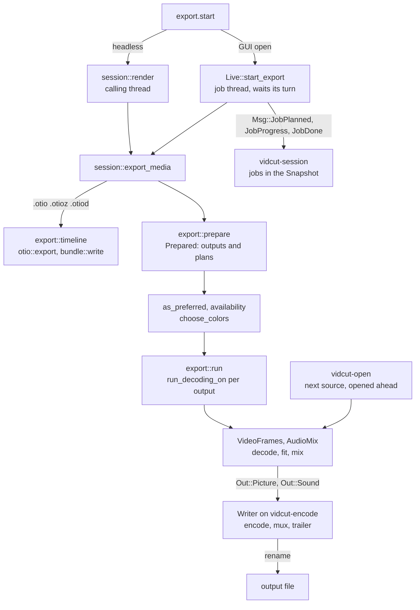
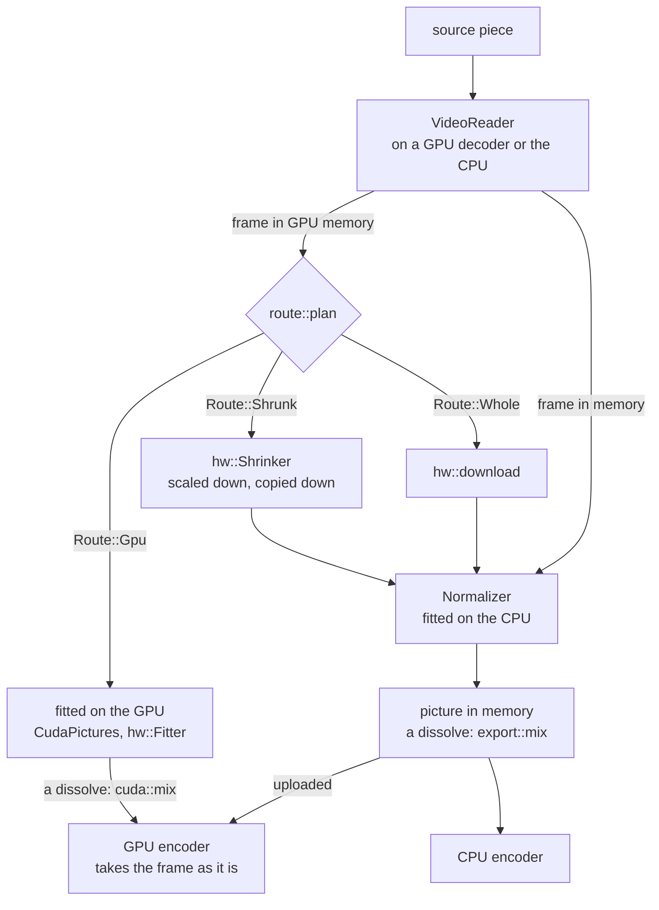

# Export

An export turns the project into files: `export.start` names an output, and vidcut flattens the timeline into a render plan, decodes it with the player's reader, fits each picture to the output, mixes the sound, encodes and muxes. The engine is `crates/vidcut-av/src/export/`; `crates/vidcut/src/export.rs` resolves presets, outputs, GPU preferences and color first. [playback](playback.md) shares the reader and mixer; [gpu](gpu.md) has each GPU's part.

## Where the request runs

Both doors end in `session::export_media`. Headless, `session::run_with` loads the project and calls `session::render` on the calling thread; it refuses `background`, as the export would stop with the process. With a GUI open, `Live::start_export` takes the project as it is now and runs the export on a job thread of its own (vidcut-j1, …). The job reports its planned files (`Msg::JobPlanned`), then waits for its turn: `Turns` lets one job encode at a time, exports ahead of proxy encodes. A `background` request is answered with the job then, any other when the job ends ([live](live.md)).

**Why:** job threads run at the lowest priority and pause decoding while a player plays (`first::as_job`), so an export never holds up the viewer.

## Preparing

`export::prepare` makes a `Prepared`: the settings and the `Output`s, each a plan, a path and its own settings.

- **Settings:** from `settings`, a `preset`, or the extension's default preset. `set` overrides fields (`apply_overrides`), `encoder` the video encoder, the extension the container. Presets are `builtin_presets` plus the user's TOML files (`export::presets`).
- **Range:** the one given, else In–Out when both marks are set, else everything ([spec §10](../cut-page-spec.md#10-quick-export-ch-39-pp-788790-40954096-41044109)).
- **Plans:** `render::flatten` over the range, or with `per_clip` one `render::flatten_clip` per clip. The project is planned at the audio encoder's rate and channels (`resolve_audio`), so sample math matches the encoder.

`export::as_preferred` applies `gpu.acceleration`: off, every video encoder becomes `cpu`; on, one the GPU in use lacks becomes `auto`, with a note (`encoder_changed`). `export::availability` lists the GPU's working encoders.

`export::choose_colors` picks each output's dynamic range and bit depth from the pictures it shows where the settings leave them open (spec D44), then its HDR metadata (spec D46), by the rules in `vidcut_core::export`. A depth that is set, or fixed by the codec or profile, wins. SDR takes 10 bits only from the encoder an 8-bit export would start with, rather than moving to a slower one, and DNxHR HQ in 10 bits becomes HQX (`ColorChoice::apply`). An export first measures light the files don't state (`light::analysis`, cached): the peaks of every pixel, the averages and distribution of at most half a million a frame. `export.plan` measures nothing and returns `export::describe`, with `auto` from `export::auto_picks`: each automatic setting (encoder, passes, bit depth, range, metadata) put back on auto alone and chosen again by the same `choose_output` and `encode::resolve_video`, so the dialog's "auto (…)" names what auto picks, whatever is chosen instead. The plan reads the GPU encoders whenever GPU acceleration is on, as auto may pick one while the CPU is chosen.

## Choosing an encoder

`encode::video_encoders` lists the candidates in order:

| `video.encoder` | Candidates |
|---|---|
| `auto` | the GPU in use's encoders that passed detection, in the platform's order, then the CPU's |
| NVENC, VAAPI, AMF, QSV, VideoToolbox | that one; an error says why it can't |
| `cpu` | the codec's first CPU encoder this FFmpeg has (`parts`) |

The export takes the first that opens; a detected one can still fail (NVENC allows few sessions). `auto` with Dolby Vision is the CPU's alone. Quality or bitrate, profile and depth become each encoder's own options; 10 bits for `bit_depth` 10, `main10` or HDR. A `speed` goes to the first candidate only, since encoders name speeds differently. The encoder records the speed and profile it took (`Chosen`), and `export.plan` returns them with the encoder, so the Export dialog's auto and default choices name what the plan picked.

**Two passes** (spec D45) come with a bitrate, or `passes` set to 2. x264, x265 and libvpx-vp9 encode the range twice (`Passes::TwoRuns`): a first run drops its packets and keeps statistics (in a hidden folder beside the output, `temp::dir`, or in memory for libvpx), then the encoder opens again for the real run. NVENC passes twice inside one encode (`Passes::TwoInside`). Every other encoder, VAAPI, AMF, QSV, VideoToolbox and libsvtav1 among them, makes one pass: given a bitrate alone it encodes in one, and with `passes` set to 2 `encode::passes` refuses it, so `auto` goes on to the next candidate.

## Encoding one output

`export::run` calls `run_decoding_on` for each output in turn, with a GPU decoder of the export's own (`GpuDecoding::own_decoder`) while GPU decoding is on. It writes a hidden file beside the output (`temp::file`) and renames it on success; an error or cancel removes it ([model](model.md#the-vidcut-file)).

`encode` opens the muxer and both encoders and starts the `Writer` on `vidcut-encode` behind a bounded channel. The export's thread loops over the frames: `VideoFrames::next_frame` gives the picture, `AudioMix::read` exactly the samples that frame spans, and both go to the writer in order. The writer encodes, puts HDR metadata into the packets, interleaves them, then flushes the encoders and writes the trailer.

**HDR metadata:** static values go to the encoder (x265 repeats them at every keyframe) and to the container, which MP4, MOV, Matroska and WebM write. `hdr` puts HDR10+ into each HEVC or AV1 frame, which FFmpeg's encoders don't do. Dolby Vision keeps a source profile of 8 or 10, compatibility 1 in PQ and 4 in HLG, written as 8 or as 10 in AV1; only libx265 and libsvtav1 write it, and every frame needs it, so black frames take the one before them, and black before the first picture leaves it out.

**Why:** an encoder waiting on the GPU doesn't hold up decoding the next pictures.

`VideoFrames` reads the pieces in order. A piece of the same file keeps its decoder; the next file opens, seeks and decodes its first frame on `vidcut-open` (`Ahead`) while the current piece encodes. Each layer of a dissolve reads its own file.

The export also says what it is doing to whoever listens on its thread (`vidcut_av::progress::Noting`): the color choice, each video encoder that didn't open and why, the one that did, the audio encoder and loudness gain, and each source file with its `Decoding`. The report keeps the failed encoders (`tried`) and the files (`sources`) for headless runs; [live](live.md#jobs) shows how a job collects the notes.

## Which source frame

Output frame k of a piece shows the first source frame whose time is at least the piece's position plus k frames, less half a frame (`export::video::target`). At the project's rate that is exact; at other rates the half frame is a project frame, so the first source frame at or after that time is kept, and a tie can keep the earlier frame. A piece at another speed steps through its source by `render::Pace`. A reader seeks exactly (`VideoReader::seek`): to a keyframe at or before the target, further back while the first frame it decodes lands after the target (MP4 seeks by decode time, and open GOPs show frames from before their keyframe), then it decodes on and drops the frames before the target, the keyframe too. A reader that only looked for the keyframe (`VideoFrames::keyframe_time`) calls `VideoReader::from_keyframe` to decode on from it instead. A piece played backward is decoded forward from the keyframe before its pictures, as many pictures at a time as fit a memory budget (`VideoFrames::reversed_frames`); the budget counts 3 bytes a pixel, so 10-bit 4:2:2 pictures such as ProRes's, at 4, take a third more. The player reads through the same `VideoFrames`, so the viewer shows the frames an export writes.

`Maker` makes each picture by the route `route::plan` gives its frame. A frame stays on the GPU where its GPU fits it for an encoder there; otherwise it comes down, shrunk first where the output shows it smaller, and `Normalizer` turns, scales, pads and converts it. A GPU route that fails is planned again without it. The encoder that opened sets the destination (`make::Output`): with GPU decoding on, CUDA frames for NVENC, the decoder's device for VAAPI, AMF and VideoToolbox on its GPU, else memory. A dissolve mixes by the same sums on the GPU for NVENC (`cuda::mix`) as on the CPU (`export::mix`).

## Sound

`AudioMix` mixes the lanes sample-exact: clip gains, cross fades, de-click fades at cuts, clips at other speeds stretched with their pitch kept. A piece with Voice Isolation (`AudioPiece`'s `isolation`) goes through an `Isolator` in its lane after the speed stage: DPDFNet on tract's CPU runtime, one model state per channel (one for all when a mono file fills a wider mix), at 48 kHz, with `Resampler::between` on either side when the mix runs at another rate. The model's output lags its input by two of its windows, as its own code trims, so the isolator reads that far ahead and drops as much: the voice stays in sync, and the Amount mixes it with the dry sound sample for sample. A piece the lane starts afresh (another clip, a seek, the start of a range) starts the model fresh; a piece that plays on from the last with the same Amount keeps it running, as through a cross fade. An export checks for the model first (`isolate::check`), and `export.start` downloads it with `download`; in playback, a lane without it plays dry, and `AudioMix::unheard` says why. With `audio.loudness`, `analysis::mix_loudness` first measures the mix as it will be encoded, and `loudness_gain` gives one gain (`AudioMix::set_gain_db`) that reaches the target with the true peak under a ceiling.

## Errors and logs

FFmpeg logs only fatal errors unless `VIDCUT_AV_LOG` asks for more ([tools](../tools.md)): decoders recovering after a seek log harmless errors, and a real failure comes back as a vidcut error that says what failed.

## The GUI's exports

GUI media exports are `background`. Quick Export lists the presets marked `quick_export` and sends one with `overwrite` and no range. The Export dialog ([deviation X3](../deviations.md#x3-export-dialog-beyond-quick-export)) starts from a preset, sends changes as `set` overrides with a range, per-clip names and `overwrite`, and shows `export.plan` as its params change.

`jobs.cancel`, or a foreground client leaving, sets the job's cancel flag, which the frame loop and the light and loudness measuring check. `jobs.cancel` also closes the gate, so a job waiting for its turn leaves the queue; a disconnect does not, and that queued job waits its turn, then stops. A GUI that quits mid-job removes the partial files.

## Timeline exports

An `.otio`, `.otioz` or `.otiod` output (`export::timeline_format`) writes the edit, not pictures ([deviation X9](../deviations.md#x9-opentimelineio-interchange)). `export::timeline` takes only a range, `overwrite` and the subtitle files, and writes `otio::export`'s document through the partial path; a bundle adds the media used (`bundle::plan`, `bundle::write`), with byte progress and cancel. In the GUI an `.otio` runs as a task (`Live::project_task`), a bundle as a job.

## Subtitles

`subtitles_as` says how the tracks `subtitles` names go out with media ([deviation X45](../deviations.md#x45-subtitles-go-into-any-container-and-burn-in-from-any-track)): as files beside it (the default), as streams in it, or burned into the picture. Streams and burning in take the shown track unless `subtitles` names others. `export::prepare` refuses a container without subtitle streams, burning in without video or more than one track to burn, and gives each output the cues of its range, in its own frames (`subtitles::Subtitles`).

**Files.** `subtitles` names the subtitle tracks to write beside the output, as SRT unless `subtitle_format` says otherwise; a timeline export writes every track with cues when it isn't given. `subtitles::beside` names each file after the output, with the track's language, or with its name when there are several, and cuts its cues to the output's range: from zero beside media (`export::subtitles_beside`, one set per output of a `per_clip` export), in the timeline's timecode beside a timeline file ([spec D58](../cut-page-spec.md#12-decisions-on-gaps-and-contradictions)). An existing file stops the export before it starts unless `overwrite` is set (`export::refuse_existing`); `export::write_subtitles` writes them through partial paths after the output is done, and the answer lists them. An IMSC1 file's warnings ([spec D64](../cut-page-spec.md#12-decisions-on-gaps-and-contradictions)), cues with more lines than their region holds, go in each file's entry and in the notes (`export::subtitle_notes`).

**Streams.** `SubtitleOut::add` opens FFmpeg's encoder for the container (mov_text in MP4, MOV and M4A, SubRip in Matroska, WebVTT in WebM), encodes every cue before the header is written, and adds the stream with the track's name and its language as an ISO 639-2 code (`three_letter`); the shown track's stream is the default. `subtitles::dialog` turns a cue's markup into the override codes the encoders read. Overlapping cues become one cue for each stretch of time (`subtitles::segments`): mov_text samples can't overlap, and Matroska's keep one stretch per place. A cue's place reaches SubRip as an alignment tag and WebVTT as a `line` setting; mov_text has none. The `Writer` writes a track's packets as the frames reach their start.

**Burning in** ([spec D61](../cut-page-spec.md#12-decisions-on-gaps-and-contradictions)). `VideoFrames::with_burn` draws the cues over every picture they span, in both runs of a two-pass encode, in the track's `SubtitleStyle`. `subtitles::shown` gives what each cue showing draws at the frame: its pieces, the spoken word in its color, the words not yet spoken hidden or left out, and a pop's size ([spec D69](../cut-page-spec.md#12-decisions-on-gaps-and-contradictions)). `burn::draw` lays them out with cosmic-text (shaping, right-to-left text, the system's fonts for scripts the first lacks), a hidden word without ink, outline or shadow, and draws one picture for each place with ink, a popping word as a picture of its own over it; the last few lines laid out are kept (`laid_line`, an `Lru`), so a pop draws only its word again. A line whose only ink is the popping word keeps its layout, which places the word, and draws no picture of its own. The `Burner` keeps them while the same pieces show, so an animated track is drawn again at each word and pop step; while only a pop's step changes, NVENC's overlay of the lines stays and the popping word goes over it as a second, small one ([todo](../todo/burn-in-ahead.md)). A picture in memory takes it with `burn::blend`, in its own layout, matrix, range and transfer. NVENC's CUDA frames take it on the GPU (`cuda::burn`): the colors and coverage of the area the pictures cover (`burn::bounds`), each place laid over the ones before as `burn::blend` lays them, go up into two frames of the pool (`Overlay`), and a kernel mixes them into a copy of each frame inside that area and copies the rest. Other GPUs' frames come down while a cue shows ([gpu](gpu.md)).

## Titles

A title is in the plan as `VideoPiece::Titled`: a picture (a source, black or a `VideoPiece::Mix`) and the titles over it, in track order ([spec D65](../cut-page-spec.md#12-decisions-on-gaps-and-contradictions)). A clip fading in or out above a title nests the other way, its `Mix` over the titled picture. `VideoPiece::layers` still lists the pictures to decode, and `VideoPiece::titles` how many of them each title goes over. `VideoFrames::next_frame` mixes the layers under a title, draws the title and mixes the rest over it, then burns in the subtitles. `burn::title` lays out a title with the burn-in's code (`lay_out` in `crates/vidcut-av/src/burn.rs`, which holds the fonts only while it shapes and draws the glyphs, on a canvas the size of the text, and outlines them by stroking each glyph's path with zeno, growing the drawn letters only for a glyph with no path): its spans, each with its own face, size, weight, slant, underline and color, aligned by its kind, wrapped at title safe, one box behind the block, placed by its anchor. Each title in the plan carries its clip and where the piece is in it (`ShownTitle`, its `Run`), and a title that moves, a scroll, is placed each frame by `Run::top`; a title in a dissolve at its clip's edge carries the dissolve's `Ramp` as its `fade`, drawn through the dissolve's frames on both sides of the edge, and `ShownTitle::alpha` gives the level it is drawn at with its opacity. It is drawn once for the output's size and kept while it shows, moved and faded by a `Placing` (`burn::blend_at`; the CUDA overlay is made again for each), onto a picture in memory with `burn::blend` and into NVENC's CUDA frames with `cuda::burn`, as the burn-in's cues are (`Drawn`); other GPUs' frames come down while a title shows ([todo](../todo/gpu-burn-in.md)). Titles draw in every export and `frame.render`, whatever the subtitle settings.

## Placed pictures

A placed clip ([spec D75](../cut-page-spec.md#12-decisions-on-gaps-and-contradictions)) is a source piece with `placed` pictures: its clip's, then those of the compound clips it plays inside (`render::Placed`). `render::flatten_lanes` lays it over the tracks below as an `Over` of a `VideoPiece::Mix` without a ramp; in a dissolve with a placed side the incoming side is marked `cross`. A clip at its usual values is laid over the same way where its fitted picture leaves bars and something is below it; where its fitted picture fills the frame (`place::fills`, by the `place::fit` the export and the viewer fit with), it takes the place of the layers below, inside a placed compound clip those of the compound, and with nothing below it is drawn with black bars, which costs less. `VideoFrames` fits a placed layer at the size it shows, up to its source's own (`layer_size`, `Maker::size_layer`), so a punch-in keeps the source's detail, and makes its frames in memory: on a GPU they come down shrunk. `place::Placing` maps each pixel of the frame back to the picture, and `export::place::over` lays the picture over the frame below in its own code values, each component tapped over the pixel's footprint and its edges covered in part, as the viewer's shader does. For NVENC the frame below stays on the GPU: `cuda::burn::Overlay::of` makes the placed picture's colors and coverage in memory, and `cuda::burn` mixes them in, as for a title. A crossing pair lays each side over what was below the first and adds them, taking that away once: `mix::crossed` in memory, `cuda::mix::sum` on the GPU.

## Proxies

`proxy.generate` uses the same machinery (spec D41). `Env::generate_proxy` in `AvEnv` picks encoders (`proxy::encoders`: the codec preference, the detected GPU encoders, for automatic the codecs the GPU plays, `export::plays`) and calls `proxy::write`: one source decoded on a GPU decoder of its own, pictures made by `Maker`, encoded on `vidcut-encode`, renamed into place. The Matroska file keeps each source frame's timestamp, and its `VIDCUT_ORIGIN` tag lets an unchanged source reuse it. Vulkan's ProRes encoder serves proxies only.

Automatic tries DNxHR LB, ProRes Proxy, AV1, HEVC and H.264 in four rounds: made and played on the GPU, played on it, made on it (through Vulkan too), then the rest; the first that opens wins. A proxy is 10-bit from a source of more than 8 bits where its encoder takes them, keeping an HDR source's PQ or HLG and a PQ source's static metadata; an 8-bit one is SDR BT.709. Each has a keyframe every 60 frames (ProRes and DNxHR every frame) and no reordering, so a seek decodes at most 60 frames.

## Code

- `crates/vidcut/src/session.rs`
- `crates/vidcut/src/live/mod.rs`
- `crates/vidcut/src/live/jobs.rs`
- `crates/vidcut/src/export.rs`
- `crates/vidcut/src/bundle.rs`
- `crates/vidcut/src/env.rs`
- `crates/vidcut/src/gui/export.rs`
- `crates/vidcut-core/src/export.rs`
- `crates/vidcut-core/src/export/color.rs`
- `crates/vidcut-core/src/export/metadata.rs`
- `crates/vidcut-core/src/render.rs`
- `crates/vidcut-av/src/isolate.rs`
- `crates/vidcut-core/src/subtitles.rs`
- `crates/vidcut-av/src/export/mod.rs`
- `crates/vidcut-av/src/export/subtitles.rs`
- `crates/vidcut-av/src/burn.rs`
- `crates/vidcut-av/src/cuda/burn.rs`
- `crates/vidcut-av/src/export/encode.rs`
- `crates/vidcut-av/src/export/worker.rs`
- `crates/vidcut-av/src/export/ahead.rs`
- `crates/vidcut-av/src/export/video.rs`
- `crates/vidcut-av/src/export/make.rs`
- `crates/vidcut-av/src/export/normalize.rs`
- `crates/vidcut-av/src/export/mix.rs`
- `crates/vidcut-av/src/export/audio.rs`
- `crates/vidcut-av/src/route.rs`
- `crates/vidcut-av/src/light.rs`
- `crates/vidcut-av/src/proxy.rs`
