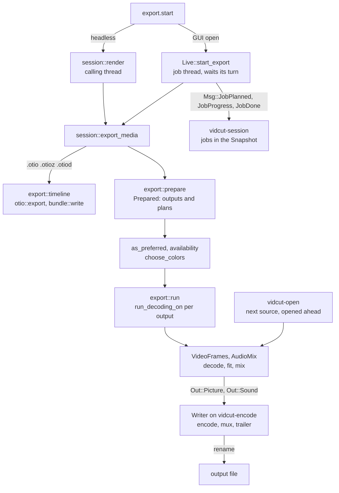
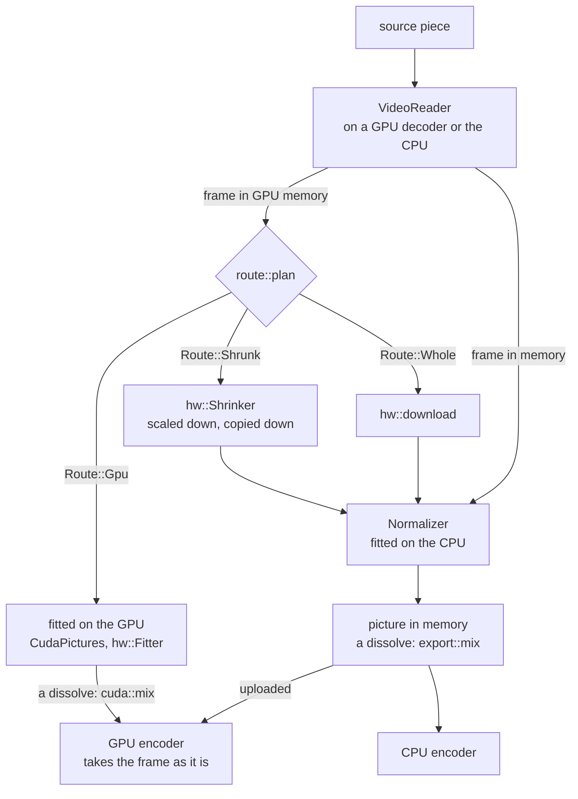

# Export

An export turns the project into files: `export.start` names an output, and vidcut flattens the timeline into a render plan, decodes it with the player's reader, fits each picture to the output, mixes the sound, encodes and muxes. The engine is `crates/vidcut-av/src/export/`; `crates/vidcut/src/export.rs` resolves presets, outputs, GPU preferences and color first. [playback](playback.md) shares the reader and mixer; [gpu](gpu.md) has each GPU's part.

## Where the request runs

Both doors end in `session::export_media`. Headless, `session::run_with` loads the project and calls `session::render` on the calling thread; it refuses `background`, as the export would stop with the process. With a GUI open, `Live::start_export` takes the project as it is now and runs the export on a job thread of its own (vidcut-j1, …). The job reports its planned files (`Msg::JobPlanned`), then waits for its turn: `Turns` lets one job encode at a time, exports ahead of proxy encodes. A `background` request is answered with the job then, any other when the job ends ([live](live.md)).

**Why:** job threads run at the lowest priority and pause decoding while a player plays (`first::as_job`), so an export never holds up the viewer.

## Preparing

`export::prepare` makes a `Prepared`: the settings and the `Output`s, each a plan, a path and its own settings.

- **Settings:** from `settings`, a `preset`, or the extension's default preset. `set` overrides fields (`apply_overrides`), `encoder` the video encoder, the extension the container. Presets are `builtin_presets` plus the user's TOML files (`export::presets`).
- **Range:** the one given, else In–Out when both marks are set, else everything ([spec §10](../cut-page-spec.md#10-quick-export-ch-39-pp-788790-40954096-41044109)).
- **Plans:** `render::flatten` over the range, or with `per_clip` one `render::flatten_clip` per clip. The project is planned at the audio encoder's rate and channels (`resolve_audio`), so sample math matches the encoder.

`export::as_preferred` applies `gpu.acceleration`: off, every video encoder becomes `cpu`; on, one the GPU in use lacks becomes `auto`, with a note (`encoder_changed`). `export::availability` lists the GPU's working encoders.

`export::choose_colors` picks each output's dynamic range and bit depth from the pictures it shows where the settings leave them open (spec D44), then its HDR metadata (spec D46), by the rules in `vidcut_core::export`. A depth that is set, or fixed by the codec or profile, wins. SDR takes 10 bits only from the encoder an 8-bit export would start with, rather than moving to a slower one, and DNxHR HQ in 10 bits becomes HQX (`ColorChoice::apply`). An export first measures light the files don't state (`light::analysis`, cached): the peaks of every pixel, the averages and distribution of at most half a million a frame. `export.plan` measures nothing and returns `export::describe`.

## Choosing an encoder

`encode::video_encoders` lists the candidates in order:

| `video.encoder` | Candidates |
|---|---|
| `auto` | the GPU in use's encoders that passed detection, in the platform's order, then the CPU's |
| NVENC, VAAPI, AMF, QSV, VideoToolbox | that one; an error says why it can't |
| `cpu` | the codec's first CPU encoder this FFmpeg has (`parts`) |

The export takes the first that opens; a detected one can still fail (NVENC allows few sessions). `auto` with Dolby Vision is the CPU's alone. Quality or bitrate, profile and depth become each encoder's own options; 10 bits for `bit_depth` 10, `main10` or HDR. A `speed` goes to the first candidate only, since encoders name speeds differently.

**Two passes** (spec D45) come with a bitrate, or `passes` set to 2. x264, x265 and libvpx-vp9 encode the range twice (`Passes::TwoRuns`): a first run drops its packets and keeps statistics (in a hidden `.passes` folder, `passes_path`, or in memory for libvpx), then the encoder opens again for the real run. NVENC passes twice inside one encode (`Passes::TwoInside`). Every other encoder, VAAPI, AMF, QSV, VideoToolbox and libsvtav1 among them, makes one pass: given a bitrate alone it encodes in one, and with `passes` set to 2 `encode::passes` refuses it, so `auto` goes on to the next candidate.

## Encoding one output

`export::run` calls `run_decoding_on` for each output in turn, with a GPU decoder of the export's own (`GpuDecoding::own_decoder`) while GPU decoding is on. It writes a hidden `.part` file beside the output (`partial_path`) and renames it on success; an error or cancel removes it.

`encode` opens the muxer and both encoders and starts the `Writer` on `vidcut-encode` behind a bounded channel. The export's thread loops over the frames: `VideoFrames::next_frame` gives the picture, `AudioMix::read` exactly the samples that frame spans, and both go to the writer in order. The writer encodes, puts HDR metadata into the packets, interleaves them, then flushes the encoders and writes the trailer.

**HDR metadata:** static values go to the encoder (x265 repeats them at every keyframe) and to the container, which MP4, MOV, Matroska and WebM write. `hdr` puts HDR10+ into each HEVC or AV1 frame, which FFmpeg's encoders don't do. Dolby Vision is profile 8.1 into PQ and 8.4 into HLG (10 in AV1); only libx265 and libsvtav1 write it, and every frame needs it, so black frames take the one before them, and black before the first picture leaves it out.

**Why:** an encoder waiting on the GPU doesn't hold up decoding the next pictures.

`VideoFrames` reads the pieces in order. A piece of the same file keeps its decoder; the next file opens, seeks and decodes its first frame on `vidcut-open` (`Ahead`) while the current piece encodes. Each layer of a dissolve reads its own file.

## Which source frame

Output frame k of a piece shows the first source frame whose time is at least the piece's position plus k frames, less half a frame (`export::video::target`). At the project's rate that is exact; at other rates it is the nearest frame, ties to the later one. A piece at another speed steps through its source by `render::Pace`. The player reads through the same `VideoFrames`, so the viewer shows the frames an export writes.

`Maker` makes each picture by the route `route::plan` gives its frame. A frame stays on the GPU where its GPU fits it for an encoder there; otherwise it comes down, shrunk first where the output shows it smaller, and `Normalizer` turns, scales, pads and converts it. A GPU route that fails is planned again without it. The encoder that opened sets the destination (`make::Output`): with GPU decoding on, CUDA frames for NVENC, the decoder's device for VAAPI, AMF and VideoToolbox on its GPU, else memory. A dissolve mixes by the same sums on the GPU for NVENC (`cuda::mix`) as on the CPU (`export::mix`).

## Sound

`AudioMix` mixes the lanes sample-exact: clip gains, cross fades, de-click fades at cuts, clips at other speeds stretched with their pitch kept. With `audio.loudness`, `analysis::mix_loudness` first measures the mix as it will be encoded, and `loudness_gain` gives one gain (`AudioMix::set_gain_db`) that reaches the target with the true peak under a ceiling.

## Errors and logs

FFmpeg logs only fatal errors unless `VIDCUT_AV_LOG` asks for more ([tools](../tools.md)): decoders recovering after a seek log harmless errors, and a real failure comes back as a vidcut error that says what failed.

## The GUI's exports

GUI exports are `background`. Quick Export lists the presets marked `quick_export` and sends one with `overwrite` and no range. The Export dialog ([deviation X3](../deviations.md#x3-export-dialog-beyond-quick-export)) starts from a preset, sends changes as `set` overrides with a range, per-clip names and `overwrite`, and shows `export.plan` as its params change.

`jobs.cancel`, or a foreground client leaving, sets the job's cancel flag, which the frame loop and the light and loudness measuring check. A job waiting for its turn leaves the queue. A GUI that quits mid-job removes the partial files.

## Timeline exports

An `.otio`, `.otioz` or `.otiod` output (`export::timeline_format`) writes the edit, not pictures ([deviation X9](../deviations.md#x9-opentimelineio-interchange)). `export::timeline` takes only a range and `overwrite`, and writes `otio::export`'s document through the partial path; a bundle adds the media used (`bundle::plan`, `bundle::write`), with byte progress and cancel. In the GUI an `.otio` runs as a task (`Live::project_task`), a bundle as a job.

## Proxies

`proxy.generate` uses the same machinery (spec D41). `Env::generate_proxy` in `AvEnv` picks encoders (`proxy::encoders`: the codec preference, the detected GPU encoders, for automatic the codecs the GPU plays, `export::plays`) and calls `proxy::write`: one source decoded on a GPU decoder of its own, pictures made by `Maker`, encoded on `vidcut-encode`, renamed into place. The Matroska file keeps each source frame's timestamp, and its `VIDCUT_ORIGIN` tag lets an unchanged source reuse it. Vulkan's ProRes encoder serves proxies only.

Automatic tries DNxHR LB, ProRes Proxy, AV1, HEVC and H.264 in four rounds: made and played on the GPU, played on it, made on it (through Vulkan too), then the rest; the first that opens wins. A proxy is 10-bit from a source of more than 8 bits where its encoder takes them, keeping an HDR source's PQ or HLG and a PQ source's static metadata; an 8-bit one is SDR BT.709. Each has a keyframe every 60 frames (ProRes and DNxHR every frame) and no reordering, so a seek decodes at most 60 frames.

## Code

- `crates/vidcut/src/session.rs`
- `crates/vidcut/src/live/mod.rs`
- `crates/vidcut/src/live/jobs.rs`
- `crates/vidcut/src/export.rs`
- `crates/vidcut/src/bundle.rs`
- `crates/vidcut/src/env.rs`
- `crates/vidcut/src/gui/export.rs`
- `crates/vidcut-core/src/export.rs`
- `crates/vidcut-core/src/export/color.rs`
- `crates/vidcut-core/src/export/metadata.rs`
- `crates/vidcut-core/src/render.rs`
- `crates/vidcut-av/src/export/mod.rs`
- `crates/vidcut-av/src/export/encode.rs`
- `crates/vidcut-av/src/export/worker.rs`
- `crates/vidcut-av/src/export/ahead.rs`
- `crates/vidcut-av/src/export/video.rs`
- `crates/vidcut-av/src/export/make.rs`
- `crates/vidcut-av/src/export/normalize.rs`
- `crates/vidcut-av/src/export/mix.rs`
- `crates/vidcut-av/src/export/audio.rs`
- `crates/vidcut-av/src/route.rs`
- `crates/vidcut-av/src/light.rs`
- `crates/vidcut-av/src/proxy.rs`
