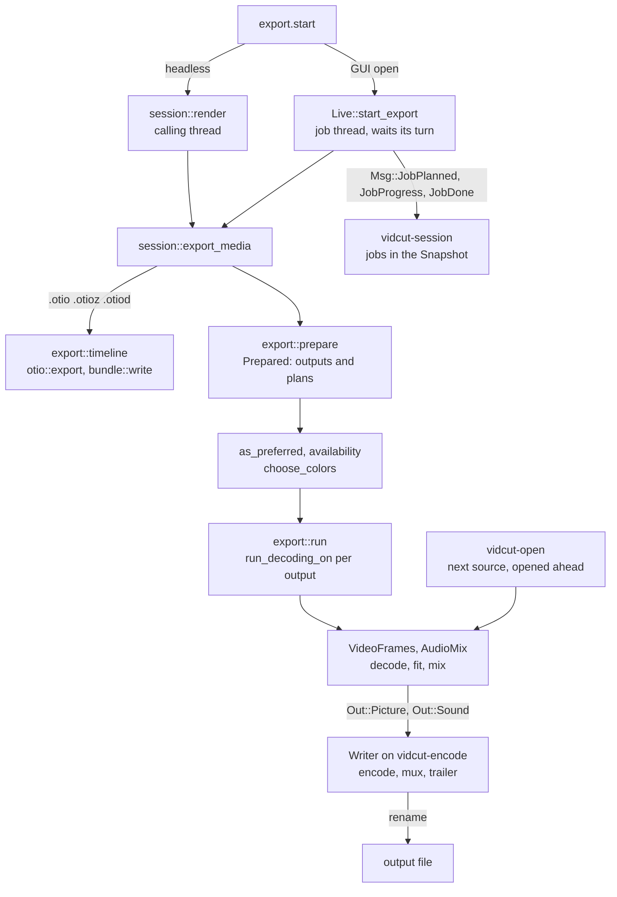

# Export

- An export turns the project into files. `export.start` names an output.
- vidcut flattens the timeline into a render plan, and decodes the plan with the player's reader. It fits each picture to the output, mixes the sound, encodes and muxes.
- `crates/vidcut/src/export.rs` resolves presets, outputs, GPU preferences and colors. The engine is `crates/vidcut-av/src/export/`.
- [playback](playback.md) shares the reader and the mixer. [gpu](gpu.md) tells what each GPU does.

## Where the request runs

- Both paths end in `session::export_media`.
- Headless, `session::run_with` loads the project, and `session::render` runs the export on the calling thread.
- A headless run refuses `background`. Why: the export would stop with the process.
- With a GUI open, `Live::start_export` copies the project and runs the export on a job thread of its own (vidcut-j1, …).
- The job reports its planned files (`Msg::JobPlanned`), and then waits for its turn ([live](live.md#jobs)).
- A job thread runs at the lowest priority, and its decoding waits while a player plays (`first::as_job`). Why: an export never holds up the viewer.

## Preparing

`export::prepare` makes a `Prepared`: the settings and the `Output`s. Each `Output` has a plan, a path and its own settings.

- **Settings:** `settings`, a `preset`, or the default preset of the extension.
  - `set` changes fields (`apply_overrides`). `encoder` sets the video encoder. The extension sets the container.
  - The presets are `builtin_presets` and the user's TOML files (`export::presets`).
- **Range:** the range given, else In to Out when both marks are set, else the whole timeline ([spec §10](../cut-page-spec.md#10-quick-export-ch-39-pp-788790-40954096-41044109)).
- **Plans:** `render::flatten` over the range. With `per_clip`, one `render::flatten_clip` for each clip.
  - The plan uses the sample rate and channels of the audio encoder (`resolve_audio`). Why: the sample math then agrees with the encoder.
- **Models:** `session::export_media` first checks the models of Voice Isolation, Super Scale and Retime Process. A missing model needs `download`.

GPU preferences:

- `export::as_preferred` applies `gpu.acceleration`.
  - Off: each video encoder becomes `cpu`.
  - On: an encoder that the GPU in use does not have becomes `auto`, with a note (`encoder_changed`).
- `export::availability` lists the encoders of the GPU that work ([gpu](gpu.md#encoders)).

Colors:

- `export::choose_colors` picks the dynamic range and the bit depth that the settings leave open (spec D44).
- The dynamic range follows the timeline color space of the plan (`RenderPlan::colors`).
  - With Auto, 8 bits that are set, or that the codec or profile fixes, make the export SDR.
- `render::timeline_colors` resolves the timeline color space. With Auto, the timeline is HDR when most of its picture is HDR.
  - A plan of the whole timeline counts its own pictures. For a plan of a range, `render::auto_colors` counts the pictures of the whole timeline.
- The bit depth:
  - HDR is 10-bit, also when 8 bits are set.
  - Else a depth that is set, or that the codec or profile fixes, wins.
  - SDR is 10-bit when more than half of the picture has 10 bits or more.
  - SDR H.264 is 8-bit. Why: few players play 10-bit H.264.
  - SDR takes 10 bits only from the encoder that an 8-bit export starts with. Why: vidcut does not move to a slower encoder for 10 bits.
  - DNxHR HQ in 10 bits becomes HQX (`ColorChoice::apply`).
- `export::choose_metadata` picks the HDR metadata, by the rules of `vidcut_core::export` (spec D46). With an SDR timeline, each picture counts as SDR.
- An export first measures the light that the files do not state (`light::analysis`), and caches it.

The plan:

- `export.plan` measures nothing. It returns `export::describe`, with `auto` from `export::auto_picks`.
- `export::auto_picks` sets each automatic setting (encoder, passes, bit depth, range, metadata) back to auto, one at a time. `choose_output` and `encode::resolve_video` then choose it again.
  - Why: the "auto (…)" of the Export dialog names what auto picks, whatever the user chose instead.
- The plan reads the GPU encoders whenever GPU acceleration is on. Why: auto can pick one while the CPU is chosen.

## Choosing an encoder

`encode::video_encoders` lists the candidates in order:

| `video.encoder` | Candidates |
|---|---|
| `auto` | the encoders of the GPU in use that passed detection, in the platform's order, then the CPU's |
| NVENC, VAAPI, AMF, QSV, VideoToolbox | that one; an error tells why it cannot encode |
| `cpu` | the first CPU encoder of the codec that this FFmpeg has (`parts`) |

- The export takes the first candidate that opens. Why: a detected encoder can fail, for example when NVENC has no free session.
- With Dolby Vision, `auto` has only the CPU's candidates.
- Quality or bitrate, profile and depth become the options of each encoder. `bit_depth` 10, `main10` or HDR give 10 bits.
- Only the first candidate that vidcut can use gets the `speed`. Why: encoders name their speeds differently.
- The encoder records the speed and profile that it takes (`Chosen`). `export.plan` returns them, and the Export dialog shows them.

**Two passes** (spec D45):

- A bitrate, or `passes` set to 2, asks for two passes.
- x264, x265 and libvpx-vp9 encode the range twice (`Passes::TwoRuns`). The first run keeps statistics and drops its packets. The statistics go in a hidden folder beside the output (`temp::dir`), or in memory for libvpx.
- NVENC makes two passes inside one encode (`Passes::TwoInside`).
- The other encoders make one pass. With a bitrate alone, they encode in one pass. With `passes` set to 2, `encode::passes` refuses them, and `auto` goes on to the next candidate.

## Encoding one output

- `export::run` calls `run_decoding_on` for each output in turn.
- With GPU decoding on, the export has a GPU decoder of its own (`GpuDecoding::own_decoder`).
- The export writes a hidden file beside the output (`temp::file`), and renames it on success. An error or a cancel removes the hidden file ([model](model.md#the-vidcut-file)).
- `encode` opens the muxer and both encoders. It starts the `Writer` on `vidcut-encode`, behind a bounded channel.
  - Why: an encoder that waits on the GPU does not hold up the decoding of the next pictures.
- The export thread loops over the frames. `VideoFrames::next_frame` gives the picture, and `AudioMix::read` gives the samples of that frame.
- The writer encodes, puts the HDR metadata into the packets, and interleaves them. At the end, it flushes the encoders and writes the trailer.

**HDR metadata:**

- Static values go to the encoder and to the container. x265 repeats them at each keyframe.
- `hdr` puts HDR10+ into each HEVC or AV1 frame. Why: the FFmpeg encoders do not do this.
- vidcut keeps Dolby Vision from a source of profile 8 or 10, with compatibility 1 in PQ or 4 in HLG.
  - It writes profile 8, or profile 10 in AV1. Only libx265 and libsvtav1 write it.
  - Each frame needs it. Thus a black frame takes the metadata of the frame before it.
  - Black frames at the start have no frame before them. Then the export has no Dolby Vision.

Sources:

- `VideoFrames` reads the pieces in order. A piece of the same file keeps its decoder.
- While the current piece encodes, `Ahead` opens the next file on `vidcut-open`, seeks, and decodes the first frame.
- Each layer of a dissolve reads its own file.

Notes:

- The export tells its listener on the thread what it does (`vidcut_av::progress::Noting`):
  - the color choice
  - each video encoder that did not open, and why
  - the encoders that opened, and the loudness gain
  - each source file, with its `Decoding`
- The report of a headless run keeps the failed encoders (`tried`) and the files (`sources`).
- [live](live.md#jobs) tells how a job collects the notes.

## Which source frame

- `export::video::target` gives the time of output frame k of a piece: the position of the piece, plus k frames, less half a frame.
- Output frame k shows the first source frame at or after this time.
- At the project's rate, this is exact. At other rates, a tie can show the earlier frame.
- A piece at another speed steps through its source by `render::Pace`.

Retimed frames ([deviation X93](../deviations.md#x93-retime-process-has-ai-models-in-the-place-of-optical-flow)):

- `render::retime_of` gives each source piece its Retime Process (`Retime`): the clip's own, or the project's (`ClipRetime`, `ProjectRetime`).
  - Auto gives an SDR clip slower than 100% the AI of this computer (`Retime::ai_here`), and Nearest to the other clips.
  - A still, and a piece whose frames each land on a source frame, take Nearest.
- With a process other than Nearest, `VideoFrames::retimed_frame` takes the exact source time of the frame (`VideoPiece::exact`, `Pace::exact`).
- The `Source` keeps the two frames before its current frame (`prev`, `prev2`). The frame before the time and the frame after it are the pair.
  - With no decoded frame before the time, the source seeks a second back and decodes again.
- The weight is where the time falls between the two frames.
- At a shot change between the two frames, the nearer frame shows (`Source::cut`).
  - The test is the scene score of Detect Scene Cuts over three frames (`analysis::scene_score`, `SCENE_SCORE`).
  - A pair with no decoded frame before it is not a cut. Why: a false cut holds a frame here, but only marks a shot in Detect Scene Cuts.
- With the frame rate conversion of macOS and two VideoToolbox frames, `interpolate::between_frames` makes a VideoToolbox frame from the pair ([gpu](gpu.md#frame-interpolation)).
- Else the pair becomes RGB, upright, at the size that the picture shows at, at most the source size (`between_size`). `interpolate::between` makes the frame.
  - `Source::rgb_of` keeps the RGB of the last two frames. Thus the later frame of one pair is the earlier frame of the next.
- The made frame then goes through the usual fitting.
- An exact source frame, the first frame of a file, an HDR frame, a piece played backward and a still take the usual path.

Seeks:

- A reader seeks exactly (`VideoReader::seek`). It seeks to a keyframe at or before the target, then decodes on and drops the frames before the target.
- While the first frame lands after the target, it seeks further back. Why: MP4 seeks by decode time, and open GOPs show frames from before their keyframe.
- A reader that only looked for the keyframe (`VideoFrames::keyframe_time`) decodes on from it (`VideoReader::from_keyframe`).
- A piece played backward decodes forward from the keyframe before its pictures, as many pictures at a time as a memory budget holds (`VideoFrames::reversed_frames`).
- The player reads through the same `VideoFrames`. Thus the viewer shows the frames that an export writes.

Pictures:

- `Maker` makes each picture by the route that `route::plan` gives its frame ([gpu](gpu.md#routes)).
- A frame stays on the GPU where its GPU fits it for the encoder. Else it comes down, and `Normalizer` turns, scales, pads and converts it.
- The encoder that opened sets the destination (`make::Output`). With GPU decoding on, NVENC takes CUDA frames, and VAAPI, AMF and VideoToolbox take frames of the decoder's device. Else the destination is memory.
- A dissolve on the GPU uses the sums of the CPU (`export::mix`). `cuda::mix` mixes for NVENC, and `mixing::Mixer` for VideoToolbox.
- On the CPU, the layers of a frame mix in a `Canvas`, as 32-bit floats in the code values of the frame.
  - Why: a color above 1 or below 0 stays between the layers ([spec D75](../cut-page-spec.md#12-decisions-on-gaps-and-contradictions)).
  - After the last layer, `Canvas::frame` rounds the values and clips them to the code range.
  - The layers under a title become a frame before the title is drawn. Thus a title clips the values ([todo](../todo/composite-masks.md)).
  - A wipe in the viewer also mixes in a `Canvas` (`Picture::at_wipe`).

## Timeline colors

Each mix occurs in the timeline color space ([spec D50](../cut-page-spec.md#12-decisions-on-gaps-and-contradictions)). When an output has other colors or is RGB, `VideoFrames::with_timeline` sets up two stages:

1. `Maker` fits each picture to the timeline colors. `VideoFrames` mixes, draws the titles and burns in the subtitles in these colors.
2. `Finish` converts each finished frame to the colors and the format of the encoder.

- For NVENC, the timeline's frames are P010 in a pool of their own. libplacebo converts them on the GPU (`CudaPictures::converting`). When it fails, `Normalizer` converts the frame in memory.
- For the other encoders, the timeline's frames are 12-bit 4:4:4 in memory (`MIXING`), and `Normalizer` converts them.
- `color::tag_frame` gives the timeline's frames and the black frame their color tags. `burn::blend` and `Normalizer` read these tags.
- The conversion keeps the HDR10+ and Dolby Vision metadata of the frame.
- `frame.render` of a timeline frame and the storyboards use the same stages (`renderer::frames`, `FrameReader::rgba`). Their output is RGB. Thus their layers mix in YUV, as in an export.
- `frame.render` of a media and the tiles convert each picture of the file directly to RGB.

## Sound

- `AudioMix` mixes the lanes sample-exact: clip gains, cross fades, de-click fades at cuts, and clips at other speeds, stretched with their pitch kept.
- A piece of a clip with volume keyframes carries them (`Keyed`), and its `gain_db` holds only the fader of the track.
  - `AudioMix` multiplies each sample by `Keyed::gain` at the source time of the sample.
  - Thus the player and the export play the same curve ([spec D81](../cut-page-spec.md#12-decisions-on-gaps-and-contradictions)).
- With `audio.loudness`, `analysis::mix_loudness` first measures the mix with its ducking. `loudness_gain` gives one gain (`AudioMix::set_gain_db`) that reaches the target, with the true peak under a ceiling.

Ducking ([spec D76](../cut-page-spec.md#12-decisions-on-gaps-and-contradictions)):

- `render::flatten_lanes` adds a `Ducking` to the plan for each ducked track with lanes (`duck::planned`).
- A `Ducking` names the lanes of its track, its `Dip`, and a `DuckSource` for each source clip near the range.
- The sources start Hold + Recovery Time before the range, and end Lookahead + Rise Time after it. Why: a range then dips as the whole timeline does.
- `duck::hear` puts the parts where the sources are active into `Dip::active`, in samples of the plan.
  - By speech, it reads the `VoiceActivity` of the file (`analysis::speech_frames`).
  - By level, it reads the `AudioLevels` of the file, with the gain of the clip (`analysis::loud_frames`, `keyframes::Gain`).
- `session::export_media` calls `duck::hear_with`, which measures what is missing. A missing speech detector needs `download`.
- `AudioMix::ducked` gives each lane its `Dip`. `Dip::gain_db` is the lowest gain of the active parts near the sample: their fall, full dip and recovery.

Voice Isolation:

- A piece with Voice Isolation (the `isolation` of an `AudioPiece`) goes through an `Isolator` in its lane, after the speed stage.
- The `Isolator` runs DPDFNet at 48 kHz on the CPU runtime of tract, with one model state for each channel. A mono file in a wider mix has one state.
- At another mix rate, `Resampler::between` converts on each side of the model.
- The model's output lags its input by two of its windows. The isolator reads that far ahead and drops as much. Thus the voice stays in sync.
- The Amount mixes the voice with the dry sound.
- The model starts fresh at another clip, at a seek and at the start of a range.
- A piece that plays on from the last piece with the same Amount keeps the model running, as through a cross fade.
- In playback, a lane without the model plays dry, and `AudioMix::unheard` tells why.

## Errors and logs

- FFmpeg logs only fatal errors, unless `VIDCUT_AV_LOG` asks for more ([tools](../tools.md)). Why: decoders that recover after a seek log harmless errors.
- A real failure comes back as a vidcut error that tells what failed.

## The GUI's exports

- GUI media exports are `background`.
- Quick Export lists the presets marked `quick_export`. It sends one with `overwrite` and no range.
- The Export dialog ([deviation X3](../deviations.md#x3-export-dialog-beyond-quick-export)) starts from a preset. It sends the changes as `set` overrides, with a range, per-clip names and `overwrite`.
- The dialog shows `export.plan` as its params change.

Cancel:

- `jobs.cancel`, or a foreground client that leaves, sets the cancel flag of the job ([live](live.md#jobs)).
- The frame loop and the light and loudness measurements check this flag.
- A GUI that quits during a job removes the partial files (`temp::remove_left`).

## Timeline exports

- An `.otio`, `.otioz` or `.otiod` output (`export::timeline_format`) writes the edit, not pictures ([deviation X9](../deviations.md#x9-opentimelineio-interchange)).
- `export::timeline` takes only a range, `overwrite` and subtitle files. It writes the document of `otio::export` through a partial path.
- A bundle adds the media of the edit (`bundle::plan`, `bundle::write`), with byte progress and cancel.
- In the GUI, an `.otio` runs as a task (`Live::project_task`), and a bundle runs as a job.

## Subtitles

- `subtitles_as` tells how the tracks that `subtitles` names go out with media ([deviation X45](../deviations.md#x45-subtitles-go-into-any-container-and-burn-in-from-any-track)). They go as files beside it (the default), as streams in it, or into the picture.
- Streams and burn-in take the shown track, unless `subtitles` names other tracks.
- `export::prepare` refuses a container without subtitle streams, burn-in without video, and more than one track to burn.
- It gives each output the cues of its range, in its own frames (`subtitles::Subtitles`).

**Files.**

- The files are SRT, unless `subtitle_format` tells otherwise. Without `subtitles`, a timeline export writes each track that has cues.
- `subtitles::beside` names each file after the output, with the language of the track. With several tracks, a track without a language adds its name.
- Beside media, the cues start from zero (`export::subtitles_beside`). Beside a timeline file, they keep the timecode of the timeline ([spec D58](../cut-page-spec.md#12-decisions-on-gaps-and-contradictions)).
- An existing file stops the export before it starts, unless `overwrite` is set (`export::refuse_existing`).
- `export::write_subtitles` writes the files through partial paths after the output is done.
- An IMSC1 file warns of cues with more lines than their region holds ([spec D64](../cut-page-spec.md#12-decisions-on-gaps-and-contradictions)). The warnings go in the notes (`export::subtitle_notes`).

**Streams.**

- `SubtitleOut::add` opens the FFmpeg encoder of the container: mov_text in MP4, MOV and M4A, SubRip in Matroska, and WebVTT in WebM. It encodes each cue before the header is written.
- The stream has the name of the track, and its language as an ISO 639-2 code (`three_letter`). The stream of the shown track is the default.
- `subtitles::dialog` turns the markup of a cue into the override codes that the encoders read.
- Cues that overlap become one cue for each stretch of time (`subtitles::segments`). Why: mov_text samples cannot overlap. Where the muxer allows it, each place keeps its own stretch.
- The place of a cue goes to SubRip as an alignment tag, and to WebVTT as a `line` setting. mov_text has no place.

**Burning in** ([spec D61](../cut-page-spec.md#12-decisions-on-gaps-and-contradictions)).

- `VideoFrames::with_burn` draws the cues over each picture that they span, in both runs of a two-pass encode.
- `SubtitleStyle::for_cue` gives a cue its style, and a word its style on top of that. A field that a style leaves out keeps the style of the level above.
- `subtitles::shown` gives what each cue draws at the frame ([spec D69](../cut-page-spec.md#12-decisions-on-gaps-and-contradictions)). It gives the pieces, the spoken word in its color, the words not yet spoken, and the size of a pop.
- `burn::draw` lays out the cues with cosmic-text: shaping, right-to-left text, and system fonts for the scripts that the first font does not have.
- `burn::paint` draws one picture for each run of cues that share a place and a style. A popping word is a picture of its own over it.
- The last lines laid out stay in an `Lru` (`laid_line`), and the `Burner` keeps the pictures while the same pieces show. Thus a pop draws only its word again.
- A picture in memory takes the drawing with `burn::blend`, in its own layout, matrix, range and transfer.
- NVENC frames take it on the GPU (`cuda::burn`), and VideoToolbox frames on Metal (`Mixer::burn`). The frames of other GPUs come down while a cue shows ([gpu](gpu.md)).
- While only the step of a pop changes, the NVENC overlay of the lines stays. The word goes over it as a second overlay ([todo](../todo/burn-in-ahead.md)).

## Titles

- A title is in the plan as `VideoPiece::Titled`: a picture and the titles over it, in track order ([spec D65](../cut-page-spec.md#12-decisions-on-gaps-and-contradictions)).
  - The picture is a source, black, or a `VideoPiece::Mix`.
  - A clip that fades in or out above a title nests the other way: its `Mix` is over the titled picture.
  - `VideoPiece::titles` tells how many of the `VideoPiece::layers` each title goes over.
- `VideoFrames::next_frame` mixes the layers under a title, draws the title, mixes the layers over it, and then burns in the subtitles.
- `burn::title` lays out a title with the code of the burn-in (`lay_out`).
  - `lay_out` strokes the outlines of the glyphs with zeno. When a glyph has no outline, it grows the drawn letters instead (`dilate`).
  - A title has spans, each with its own face, size, weight, slant, underline and color.
  - Its kind aligns it, and title safe wraps it. It has one box behind the block, and its anchor places it.
- Each title in the plan carries its clip, and where the piece is in that clip (`ShownTitle`, its `Run`). `Run::top` places a scrolling title on each frame.
- A title in a dissolve at the edge of its clip fades by the `Ramp` of the dissolve (`fade`), on both sides of the edge. `ShownTitle::alpha` gives its level, with its opacity.
- A title is drawn once for the size of the output, and kept while it shows. A `Placing` moves and fades it (`burn::blend_at`).
- A title goes onto the frame as the cues of the burn-in do (`Drawn`). The frames of other GPUs come down while a title shows ([todo](../todo/gpu-burn-in.md)).
- Titles draw in each export and in `frame.render`, whatever the subtitle settings are.

Titles in a placed compound clip:

- `render::flatten_lanes` gives a title the pictures of the compound clips that it plays inside (`ShownTitle::placed`).
- `export::place::title` maps each pixel of the frame back to the drawing with one affine map. The map goes through the compound clips (`Placing::inner`), then through the scroll, turn and zoom of the title (`place::lettered`).
- It covers the edges of each compound clip in part (`Placing::at`). Thus the frame and the crop of each compound clip cut the title.
- `VideoFrames` makes the result again only when the pictures or the scroll change.
- The CPU makes this map ([todo](../todo/gpu-placement.md)). For NVENC, the mix into the frame stays on the GPU.

## Placed pictures

The plan:

- A placed clip ([spec D75](../cut-page-spec.md#12-decisions-on-gaps-and-contradictions)) is a source piece with `placed` pictures (`render::Placed`). They are the picture of its clip, then the pictures of the compound clips around it.
- `render::flatten_lanes` lays it over the tracks below, as an `Over` of a `VideoPiece::Mix` without a ramp. In a dissolve with a placed side, the incoming side is marked `cross`.
- A clip at its usual values goes over the same way where its fitted picture leaves bars and something is below it.
- Where its fitted picture fills the frame, it takes the place of the layers below (`place::fills`). Inside a placed compound clip, it takes the place of the layers of the compound.
- A picture with an alpha channel (`VideoInfo::alpha`) never fills the frame. It goes over the layers below by its straight alpha ([todo](../todo/clip-alpha.md)).
- `Normalizer` keeps the alpha through the conversion to the timeline colors. zscale converts only the color planes, and `mergeplanes` puts the alpha back ([gotchas](../gotchas.md#ffmpeg-filters-and-colors)).
- With nothing below it, it is drawn with black bars. Why: this costs less.

The pictures:

- `VideoFrames` fits a placed layer at the size that it shows, up to the size of its source (`layer_size`, `Maker::size_layer`). Why: a punch-in keeps the detail of the source.
- `VideoFrames` makes the frames of a placed layer in memory. On a GPU, they come down shrunk.
- `place::Placing` maps each pixel of the frame back to the picture. `export::place::over` lays the picture over the `Canvas` of the layers below.
- The coverage of a pixel is the product of `place::Placing::at` over the levels: smoothed edges, soft crop edges and opacity. The viewer's shader (`picture.wgsl`) does the same sums.
- A level of a clip in a compound clip is left out where the clip fills the frame at its usual values. Thus the edges of the compound clip are covered once.
- A composite mode (`Placing::mode`) mixes in R'G'B' by `blend::mixed` (D75).
  - Each sample of the frame takes all three components of the picture at its place.
  - It averages the components of the frame below over the same place. Thus a chroma sample takes the mean of the luma under it.
  - `place::Placing` takes the first mode other than Normal, from the picture out through its compound clips.
- For NVENC and VideoToolbox, the frame below stays on the GPU. The CPU makes the colors and coverage of the picture (`cuda::burn::Overlay::of`, `mixing::Overlay::of`), and the GPU mixes them in, as for a title.
  - A frame with a composite mode or a wipe mixes on the CPU.
- A crossing pair lays each side over the layers below, adds the two, and takes away the layers below once (`mix::crossed`, `cuda::mix::sum`, `Mixer::sum`).

Dynamic Zoom and keyframes (D75):

- The `render::Placed` of a piece has a `Run`: where the piece starts in its clip. `VideoPiece::part` and `Placed::after` move the `Run` with the piece.
- `VideoFrames` gives `place::Placing` the `Run` of the frame. `Placed::zoomed` gives the Dynamic Zoom box of that frame.
- A clip inside a compound clip keeps the `Run` of its own frames (`render::inside`). In a reversed compound clip, the `Run` goes backward. In a frozen one, it holds its frame (`Run::held`).
- `Placed` also holds the source frame of the piece and its `Pace`. `Picture::sampled` reads each keyed value of the picture at that source frame.
- `layer_size` fits the layer for the closer Dynamic Zoom box (`DynamicZoom::closest`) and the largest zoom key (`place::detail`).
- The viewer and the export both take this `Placing`. Thus there is one draw path.

Soft crop edges:

- `place::Level` holds the crop (`shown`), the hard edges that it draws (`edge`), its soft edges (`place::Soft`) and its `opacity`.
- The crop softness and the width of the fitted picture give the length of the fade. A softness above 0 grows `edge` past the crop by the fade.
- `place::Placing::bounds` and `place::Placing::share` use `edge`. The handles in the viewer use `shown`.

## Proxies

- `proxy.generate` uses the same machinery (spec D41).
- `Env::generate_proxy` in `AvEnv` picks the encoders (`proxy::encoders`), from the codec preference and the detected GPU encoders. Automatic uses the codecs that the GPU plays (`export::plays`).
- `proxy::write` decodes one source on a GPU decoder of its own. `Maker` makes the pictures, `vidcut-encode` encodes them, and the file is renamed into place.
- The Matroska file keeps the timestamp of each source frame. Its `VIDCUT_ORIGIN` tag lets an unchanged source use the proxy again.
- The ProRes encoder of Vulkan makes only proxies.
- Automatic tries DNxHR LB, ProRes Proxy, AV1, HEVC and H.264 in four rounds. The first codec that opens wins.
  1. made and played on the GPU
  2. played on the GPU
  3. made on the GPU, Vulkan too
  4. the rest
- A proxy is 10-bit from a source of more than 8 bits, where its encoder takes 10 bits.
- It keeps the PQ or HLG of an HDR source, and the static metadata of a PQ source. An 8-bit proxy is SDR BT.709.
- A proxy has frequent keyframes (ProRes and DNxHR: each frame), and no reordering. Why: a seek then decodes few frames.

## Code

- `crates/vidcut/src/session.rs`, `crates/vidcut/src/export.rs`, `crates/vidcut/src/bundle.rs`, `crates/vidcut/src/env.rs`
- `crates/vidcut/src/live/`
- `crates/vidcut/src/gui/export.rs`
- `crates/vidcut-core/src/export/`, `crates/vidcut-core/src/export.rs`
- `crates/vidcut-core/src/render.rs`, `crates/vidcut-core/src/place.rs`, `crates/vidcut-core/src/duck.rs`, `crates/vidcut-core/src/subtitles.rs`
- `crates/vidcut-av/src/export/`
- `crates/vidcut-av/src/isolate.rs`, `crates/vidcut-av/src/burn.rs`, `crates/vidcut-av/src/cuda/burn.rs`
- `crates/vidcut-av/src/route.rs`, `crates/vidcut-av/src/light.rs`, `crates/vidcut-av/src/proxy.rs`
