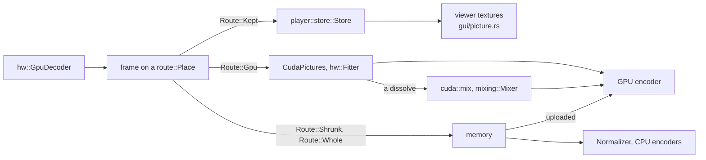

# GPU

- vidcut decodes, scales, mixes, shows and encodes on the GPU where the GPU gives the same results as the CPU.
- One GPU does all of this work.
- A frame stays in GPU memory as far as the next step can take it. Then it comes down to memory.
- [playback](playback.md) and [export](export.md) tell about the pipelines around this. [gotchas](../gotchas.md) tells about the drivers.

## The GPU and the decoder

- `gpus::list` lists the GPUs once, by PCI ids and slot (`Gpu::id`). A Mac lists no GPUs.
- `gpus::in_use` is the GPU that `gpu.device` names. Else it is `gpus::automatic`: CUDA device 0, else the first GPU that is not NVIDIA's.
- `Gpu::memory_mb` comes from DXGI on Windows, and from the largest device-local Vulkan heap on Linux. Integrated GPUs on Linux have no value.
- `GpuDecoder::best` opens the decoder of the GPU in use:
  - NVDEC on NVIDIA, with Vulkan for ProRes.
  - Direct3D 11 on other GPUs on Windows. VA-API on other GPUs on Linux.
  - VideoToolbox on a Mac.
- `VIDCUT_HWDEC` sets the decoder for tests.
- The player uses that decoder. Exports, proxies, renders and tiles use `GpuDecoder::own`, a stream or a device of their own on the same GPU.
  - Why: on the player's decoder, their work waits behind playback.
- `gpu.acceleration` lets the GPU decode, scale and encode. `gpu.decoding` lets it decode. Both are on by default.
- `GpuDecoder::why_not` names the streams that the CPU decodes. Stills and image sequences decode on the CPU.
- A stream that the GPU's decoder refuses decodes on the CPU (`VideoReader::open_gpu_or_cpu`).

## Routes

- `route::Place` is where a picture is: `Memory`, or one of the GPU places of `hw::Kind`.
- `route::Facts` holds what the planner knows of a frame and its `route::Dest`:
  - `hw::can_fit`: its GPU fits it for that encoder.
  - `hw::reaches`: its GPU hands it to the place of the encoder. CUDA and Vulkan reach each other.
  - `hw::can_mix`: its GPU mixes dissolves. CUDA and VideoToolbox do.
  - What failed before.
- `route::plan` gives the `Route`. A GPU route wins.

| `Route` | The picture is |
|---|---|
| `Route::Gpu` | fitted on the GPU and handed on there |
| `Route::Kept` | kept as decoded, for the viewer |
| `Route::Shrunk` | scaled down on the GPU, then copied down |
| `Route::Whole` | copied down whole |
| `Route::Cpu` | already in memory |

- A GPU route that fails becomes a fact. The planner then plans that file again without it.

## Each decoder's frames

In playback:

| Decoder | Kept in the player | Shown by the viewer |
|---|---|---|
| NVDEC (CUDA) | `cuda::keep`: a copy | through a buffer shared with wgpu (`SharedBuffer`) |
| Vulkan | `vulkan::keep`: as decoded | images imported into wgpu |
| VA-API | `vaapi::Keeper`: a copy (`vaCopy`) | DMA-BUFs imported into wgpu |
| Direct3D 11 | `d3d11::Keeper`: a copy in shareable textures | a few shared textures, each imported once (`d3d11::Shared`) |
| VideoToolbox | as decoded | IOSurface planes as Metal textures; AYUV64 as one RGBA texture |

- The viewer imports VA-API pictures only from its own GPU (`player::set_viewer_gpu`). From another GPU, the pictures come down.
  - Why: the viewer cannot import the pictures of another GPU.
- vidcut keeps facts of each VA-API device. `NO_COPY` and `WAYS` are kept by the address of the display. `SIZES` is kept by the device, the layout and the size.

In exports:

| Decoder | Fitted for | With | Dissolves | Comes down for |
|---|---|---|---|---|
| NVDEC (CUDA) | NVENC; Vulkan's ProRes | `CudaPictures`: `scale_cuda`, `pad_cuda`, libplacebo | `cuda::mix` | other encoders |
| Vulkan | NVENC; Vulkan's ProRes | libplacebo (`CudaPictures`) | `cuda::mix` | other encoders; alpha |
| VA-API | VAAPI | `scale_vaapi`, `pad_vaapi`, `transpose_vaapi` | in memory | other encoders; color changes; dissolves |
| Direct3D 11 | AMF | the video processor | in memory | other encoders; color changes; 8-bit into 10-bit; dissolves |
| VideoToolbox | its own encoders | `vt::Fit` | `mixing::Mixer` | wipes; composite modes; timeline colors other than the output's |

VideoToolbox (`vt::Fit`) fits a frame in these steps. It skips a step that the frame does not need.

1. `transpose_vt` turns the frame.
2. Lanczos on Metal scales it (`lanczos::Lanczos`). A render pass clears the bars to black.
   - Why: the scaler of VideoToolbox keeps less detail.
3. A pixel transfer changes the layout (`Transfer`).
4. A Metal kernel changes the colors (`recolor::Recolor`). It also writes P416, in the place of step 3.
   - It uses the math of the CPU (`color::recoloring`, `CpuColors`).
   - Why P416: the pixel transfer gives wrong levels in P416 ([gotchas](../gotchas.md#gpu-drivers)).

- ProRes 4444 on VideoToolbox takes P416, which has no alpha plane ([todo](../todo/clip-alpha.md)).
- Metal mixes dissolves (`mixing::Mixer`) with the sums of `cuda::mix`.
- Metal draws subtitles, titles and placed pictures into the frame (`Mixer::burn`) with the sums of `cuda::burn`.
- A VideoToolbox frame that comes down is mapped, not copied (`hw::to_read`).

Mixing and overlays:

- CUDA and VideoToolbox mix dissolves on the GPU. The other GPUs mix them in memory.
- When the driver refuses the kernel of `cuda::mix`, the CPU mixes for the rest of the export. The result tells why.
- CUDA and VideoToolbox draw subtitles, titles and placed pictures into the frame on the GPU (`cuda::burn`, `Mixer::burn`). The CPU draws the overlay.
- For the other GPUs, a frame comes down while an overlay shows.
- A wipe, a composite mode and a layer with alpha and nothing below mix in memory.
- A layer with alpha over other layers is a placed picture. The CPU draws its overlay with its alpha, and the GPU mixes it in.
- A frame with alpha does not fit on the GPU (`hw::can_fit`). It comes down with its alpha.

Frames that come down:

- Where the output shows a frame smaller, the GPU shrinks it first (`hw::Shrinker`).
- CPU encoders, renders and tiles take frames in memory.
- The player brings a frame down when the viewer cannot show its kind, when an import fails, or when its pool leaves the budget.
- A picture in memory goes up into the frames of a GPU encoder (`Upload`, `CudaFrames::upload`).

## Encoders

| Encoder | GPUs | Codecs |
|---|---|---|
| NVENC | NVIDIA | H.264, HEVC, AV1 |
| VAAPI | Linux, not NVIDIA | H.264, HEVC, AV1, VP9 |
| AMF | Windows, AMD | H.264, HEVC, AV1 |
| QSV | Intel, from memory | H.264, HEVC, AV1; VP9 at a bitrate |
| VideoToolbox | macOS | H.264, HEVC, ProRes |
| Vulkan | any listed GPU | ProRes, for proxies only |

- `encode::detect` test-encodes each encoder, layout and GPU that `encode::probes` lists.
- `export::detected` keeps the results in `encoders.json`, for the FFmpeg versions, the system and the GPUs.
- It tests again when the file lacks a test of `encode::probes`, and on `encoders.list` with `refresh`.
- `encoders.testing` names the process that tests. When that process dies, the next test skips Vulkan.
- Jobs use the encoders of the GPU in use (`Availability::in_use`).

## Super Scale

Super Scale (`SuperScale`) sets the upscaler of a picture that is enlarged.

- `render::super_scale_of` gives each piece its upscaler: its own, or the project's (`MediaUpscaler`, `ProjectUpscaler`). Auto is the scaler of macOS on macOS, and AI Best elsewhere.
- For NVENC, libplacebo enlarges with the upscaler of the picture's `Sharpness` (`CudaPictures`). It scales in linear light with sigmoid, unless the picture has a color shader.
- On the CPU, `Normalizer::upscaling` uses `spline` or `lanczos`.
- `layer_size` lets a placed layer grow past its source size.
- The result of an AI upscaler is its own. It is not meant to match the CPU.

The AI upscalers share one path in the reader:

- `Source::ai_picture` finds the size to make (`super_scale::made_size`).
- A picture has a key (`PictureId`). It comes from a run of the upscaler (`Session`, `super_scale::Run`), which starts at `super_scale::first_frame`.
- A run takes frames in order. It reads them from the reader's queue, or with a second `VideoReader` (`Source::seek_ahead`).
- The run gives each picture once, and keeps the last one for a change of size.
- The reader drops a run for a frame that the run does not give (`RUN_JUMP`).
- `super_scale::report` tells what the upscaler makes. The stats panel shows it (`SuperScaleStats`).

GPU memory:

- Each `Source` that uses an AI upscaler holds a `super_scale::User`.
- When the last user goes, `super_scale::Slot::release` frees the GPU memory of that upscaler.
  - Why: two AI upscalers do not hold memory at the same time.
- An AI upscaler borrows the GPU memory of the viewer's kept pictures (`player::lend_on`, `player::room_on`, `store::Lent`).
  - Why: if they do not fit together, the driver moves GPU memory to main memory, and a picture can take minutes.
- AI Best also borrows main memory for its caches (`player::lend_memory`, `store::LentMemory`).

AI Fast (`nanovsr`):

- NanoVSR 5.4M in WGSL shaders on a wgpu device of its own.
- It works in chunks on a fixed grid of the file's frames (`nanovsr::FRAMES`). Thus the viewer and an export get the same pictures.
- It gives the asked frame first. A thread (`vidcut-upscale-rest`) makes the rest of the chunk.
  - Why: the viewer shows the frame after about half the work.
- Its 3×3 convolutions use Winograd (`wino_shader`). Why: they do most of the work.
- While the GPU makes a frame, the CPU reads the frame before it. Why: other GPU work fills the waits.

AI Best (`flashvsr`):

- FlashVSR+ Turbo on a wgpu device of its own. A run is a `flashvsr::Stream` with no last frame.
- `flashvsr::check` refuses media that it cannot take, and sizes that do not fit (`run::plan`).
- It looks at the stop flag (`cancel::stop`) before each block. Why: a picture that the viewer no longer needs stops soon.
- Its KV caches stay on the GPU while they fit in the room (`run::plan`). Else some stay in main memory between chunks (`Keys::Host`).
  - `Stream::fit` measures the room before each chunk. Why: the encoder takes GPU memory after the plan.
- One matrix multiply shader runs its linear layers and most convolutions (`gemm::run`).

The scaler of macOS (`macos`):

- It is a `VTFrameProcessor` session with a `VTSuperResolutionScalerConfiguration`, on macOS 26 and later.
- `macos::check` refuses HDR media and pictures over `macos::MOST`.
- `macos::needed` and `macos::get_ready` let macOS download its models.
- A VideoToolbox frame reaches it on the GPU (`Run::push_frame`). A turned frame turns first (`hw::Turner`).
- Its buffers lose the color labels of the transfers. Why: with labels, it makes less detail.
- AI Fast and AI Best are off on macOS (`super_scale::off_here`).

## Frame interpolation

`interpolate` makes the frames of Retime Process ([export](export.md#which-source-frame), [deviation X93](../deviations.md#x93-retime-process-has-ai-models-in-the-place-of-optical-flow)).

- `interpolate::between` takes two RGB frames and a weight. It gives an RGB frame.
- It runs on a wgpu device of its own (`compute::Gpu`), with kernels of its own (`interpolate::ops`).
  - The device goes when the last `interpolate::User` goes.
- The last pair stays on the GPU with its features. Why: the frames between one pair share them.
- AI Fast is RIFE 4.25 (`rife`). AI Best is EMA-VFI (`ema`). Frame Blend mixes on the same device (`Ops::combine`).
- EMA-VFI plans its work buffers in a pool (`ops::arena`), and refines in bands of rows (`ema::Pair`).
- The weights come from the authors' PyTorch files (`weights::Torch`).

On macOS (`interpolate::macos`):

- The frame rate conversion of macOS makes the frame, in a `VTFrameProcessor` session.
- Two VideoToolbox frames reach it on the GPU (`interpolate::takes_frames`). Turned frames turn first (`hw::Turner`).
- The made frame stays a VideoToolbox frame (`interpolate::between_frames`).
- Frames that the CPU decoded go through RGB.

`interpolate::report` tells what each process makes. The stats panel shows it (`RetimeStats`).

## Deinterlacing and HDR

- CUDA frames use `bwdif_cuda`, and Vulkan frames use `bwdif_vulkan`.
  - `hw::deinterlace` first checks that the filter gives the frames of `bwdif`. Else the frames come down for `bwdif`.
- libplacebo converts HDR for NVENC and the ProRes of Vulkan (`CudaPictures`), with the math of the CPU (`color::gpu_color`).
- VideoToolbox converts colors on Metal (`recolor::Recolor`).
- The other GPUs fit pictures only where the colors stay (`color::kept`).
- The viewer's shader converts each picture into the timeline color space (`color::shader_colors`).

## Why

- The GPU goes first wherever it gives correct results (AGENTS.md rule 9).
- `GpuDecoder::why_not` names the GPUs that give wrong results:
  - AMD's Direct3D 11 and VideoToolbox go wrong after a seek into H.264 with open GOPs.
  - vidcut trusts Vulkan on NVIDIA only.
- vidcut checks GPU deinterlacers and some scalers against test pictures first.
- A GPU step that fails leaves its file to the CPU.

## Code

- `crates/vidcut-av/src/gpus.rs`
- `crates/vidcut-av/src/hw/`
- `crates/vidcut-av/src/cuda/`
- `crates/vidcut-av/src/lanczos.rs`
- `crates/vidcut-av/src/recolor.rs`
- `crates/vidcut-av/src/mixing/`
- `crates/vidcut-av/src/metal.rs`
- `crates/vidcut-av/src/super_scale/`
- `crates/vidcut-av/src/interpolate/`
- `crates/vidcut-av/src/route.rs`
- `crates/vidcut-av/src/decode.rs`
- `crates/vidcut-av/src/color.rs`
- `crates/vidcut-av/src/export/make.rs`
- `crates/vidcut-av/src/export/encode.rs`
- `crates/vidcut/src/gui/picture.rs`
