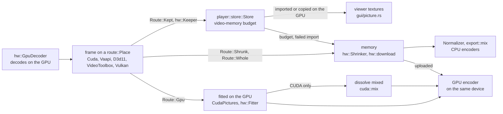

# GPU

- vidcut decodes, scales, mixes, shows and encodes on the GPU wherever the GPU gives the same results as the CPU.
- One GPU does all of this work.
- A decoded frame stays in GPU memory as far as the next step can take it. Where the next step cannot take it, the frame comes down to memory.
- [playback](playback.md) and [export](export.md) cover the pipelines around this.
- [gotchas](../gotchas.md) has the driver quirks and their workarounds.

## Choosing the GPU and the decoder

The GPU:

- `gpus::list` lists the GPUs of the computer once. It names each GPU by its PCI ids and slot (`Gpu::id`), with its CUDA device, Direct3D 11 adapter or render node.
- The memory of a GPU (`Gpu::memory_mb`) comes from one source per system, for every vendor:
  - On Windows, the source is the dedicated video memory that DXGI reports.
  - On Linux, the source is the largest device-local heap of the Vulkan device on the same PCI bus (`vulkan_memory`). This leaves the Vulkan loader loaded for the viewer.
- On Linux, integrated GPUs get no memory value, because their Vulkan heap is system memory.
- A GPU that this source cannot size also gets no memory value.
- `gpus::in_use` is the GPU that `gpu.device` names (`gpus::choose`). Else it is `gpus::automatic`: the first CUDA device of NVIDIA, else the first other GPU.
- A Mac lists no GPUs.

Speech is transcribed on that GPU too ([analysis](analysis.md#transcription)).

The decoder:

- `GpuDecoder::best` opens the decoder on the GPU in use, once per GPU:
  - NVDEC on an NVIDIA GPU, with Vulkan beside it for ProRes.
  - Direct3D 11 on the other GPUs on Windows.
  - VA-API on the other GPUs on Linux.
  - VideoToolbox on a Mac.
- `VIDCUT_HWDEC` overrides this choice for tests.
- The player decodes on this decoder.
- Exports, proxies, renders and the timeline's tiles use `GpuDecoder::own`. NVDEC gets a CUDA stream of its own. The other kinds get a device of their own on the same GPU.

**Why:** on the player's decoder, their work would wait in line with the work of playback.

The settings:

- `gpu.acceleration` (on by default) lets the GPU decode, scale and encode. When it is off, the CPU does everything, even for a preset that names a GPU encoder.
- `gpu.decoding` (on by default) lets the GPU decode. When it is off, the CPU decodes and scales, and the GPU still encodes.
- The app reads both settings through `preferences::gpu_decoding`.

The decoder of a stream:

- `GpuDecoder::kind_for` picks the decoder kind of a stream.
- `decode::gpu_decoder` picks the FFmpeg decoder, with a hardware configuration for that device. It never picks a wrapper of the GPU's own decoder.
- `GpuDecoder::why_not` names what is left to the CPU.
- A stream that the GPU's decoder refuses decodes on the CPU (`VideoReader::open_gpu_or_cpu`). Stills and image sequences also decode on the CPU.

## Where a frame lives

- `route::Place` is where a picture is: `Memory`, or one of the five GPU places of `hw::Kind`. The pixel format of the picture tells which.
- `route::Facts` holds what the planner knows of a frame that goes to a `route::Dest` (memory, an encoder, the viewer):
  - whether its GPU fits it for that encoder (`hw::can_fit`)
  - whether its GPU hands pictures to the place of the encoder (`hw::reaches`: CUDA and Vulkan to each other)
  - whether its GPU mixes dissolves (`hw::can_mix`: CUDA only)
  - what failed before
- `route::plan` is a pure function. It gives the `Route`:

| `Route` | The picture is |
|---|---|
| `Route::Gpu` | fitted on the GPU and handed on there |
| `Route::Kept` | kept as decoded, for the viewer |
| `Route::Shrunk` | scaled down on the GPU, copied down, finished on the CPU |
| `Route::Whole` | copied down whole |
| `Route::Cpu` | already in memory |

- A GPU route wins.
- A GPU route that fails becomes a fact. Then the planner plans the frame and the later frames of its file again, without that route.

## Each decoder's frames

In playback:

| Decoder | Where | Codecs | Kept in the player | Shown by the viewer |
|---|---|---|---|---|
| NVDEC (CUDA) | NVIDIA, Linux and Windows | FFmpeg's CUDA decoders, not ProRes | `cuda::keep`: copied into memory of its own | copied by CUDA into a buffer shared with wgpu (`SharedBuffer`) |
| Vulkan | NVIDIA, beside NVDEC | ProRes, where FFmpeg decodes it on Vulkan | `vulkan::keep`: kept as decoded | images imported into wgpu |
| VA-API | Linux, not NVIDIA | FFmpeg's VA-API decoders | `vaapi::Keeper`: `vaCopy` into surfaces of its own | exported as DMA-BUFs and imported |
| Direct3D 11 | Windows, not NVIDIA | FFmpeg's D3D11VA decoders; on AMD not open-GOP H.264 | `d3d11::Keeper`: copied into shareable textures | copied on its GPU into a few shared textures (`d3d11::Shared`), each imported once |
| VideoToolbox | macOS | FFmpeg's VideoToolbox decoders; not open-GOP H.264 | as decoded | IOSurface planes as Metal textures |

The facts of a VA-API device:

- vidcut learns these facts of a VA-API device, all in `crates/vidcut-av/src/hw/vaapi.rs`:
  - `NO_COPY`: its driver cannot copy surfaces.
  - `WAYS`: which way its frames come down.
  - `SIZES`: the size of its surfaces.
- vidcut keeps these facts by the address of the VA display or device, with no reference to either.
- Thus a device that opens where a freed device was gets the facts of the freed device. This is also true for a device on another GPU.

In exports:

| Decoder | Fitted on the GPU for | With | Dissolves mixed | Comes down for |
|---|---|---|---|---|
| NVDEC (CUDA) | NVENC; Vulkan's ProRes for proxies | `CudaPictures`: `scale_cuda`, `pad_cuda`, libplacebo for turns, colors and HDR | `cuda::mix` | other encoders |
| Vulkan | NVENC, copied into CUDA on the GPU; Vulkan's ProRes | libplacebo (`CudaPictures`) | `cuda::mix` | other encoders; alpha |
| VA-API | VAAPI on its device | `transpose_vaapi`, `scale_vaapi`, `pad_vaapi`; colors unchanged | in memory | other encoders, QSV too; color changes; dissolves |
| Direct3D 11 | AMF on its adapter | the video processor; colors unchanged, not 8-bit into 10-bit | in memory | other encoders, QSV too; color changes; dissolves |
| VideoToolbox | its own encoders | `transpose_vt`, `scale_vt`, where colors and layout stay | in memory | padding, layout or color changes; dissolves |

Dissolves and overlays:

- Where the driver does not take the kernel of `cuda::mix`, the export mixes its dissolves on the CPU for the rest of the export. Its result says why.
- Burned-in subtitles, titles and placed pictures go the same ways:
  - On the GPU, they go into CUDA frames (`cuda::burn`).
  - For the other decoders, they go in memory. These frames come down and go back up only while a cue, a title or a placed picture shows.
  - The frames of a placed picture come down shrunk to the size that it shows ([export](export.md#placed-pictures)).
- The viewer blends the layers of a dissolve wherever each layer is.

Frames that come down:

- Where a frame comes down and the output shows it smaller, the decoder's GPU shrinks it first.
  - It uses `scale_cuda`, `scale_vulkan`, `scale_vaapi`, the video processor or `scale_vt`.
- The frames of any decoder come down for CPU encoders, renders and tiles.
- In the player, frames come down in these cases:
  - The viewer cannot show that kind (`Gpu::gpu_pictures`).
  - An import fails.
  - The pictures are shown shrunk.
  - Their pool leaves the video-memory budget.
- Pictures made in memory go up into the frames of a GPU encoder (`Upload`, `CudaFrames::upload`).

## Encoders

| Encoder | GPUs | Codecs |
|---|---|---|
| NVENC | NVIDIA | H.264, HEVC, AV1 |
| VAAPI | Linux, not NVIDIA | H.264, HEVC, AV1, VP9 |
| AMF | Windows, AMD | H.264, HEVC, AV1 |
| QSV | Intel; frames from memory only | H.264, HEVC, AV1, VP9 at a bitrate |
| VideoToolbox | macOS | H.264, HEVC; ProRes for proxies |
| Vulkan | any listed GPU | ProRes (`prores_ks_vulkan`), proxies only |

- `encode::detect` test-encodes with each encoder, pixel format and GPU.
- `export::detected` keeps the result in `encoders.json`. The key is the FFmpeg versions, the system, and the GPUs and drivers.
- `encoders.list` with `refresh` tests again.
- `encoders.testing` names the process that tests. When a process dies during a test, it leaves this file. Then the next test skips the encoders of Vulkan.
- Jobs take the encoders of the GPU in use (`Availability::in_use`).

## Super Scale

Super Scale (`SuperScale`) changes the upscaler of a picture that an export enlarges. It does not change a picture that is made smaller.

- **NVENC:** `CudaPictures` sends the picture through libplacebo (`Layout::Placed`), with the upscaler of its `Sharpness`.
  - libplacebo then scales in linear light, with sigmoid upscaling. Without Super Scale, it scales in the code values, as the CPU does.
  - A picture with a color shader still scales in the code values.
- **The CPU:** `Normalizer::upscaling` uses `spline` or `lanczos` in place of `bicubic`.
- **Placed pictures:** `layer_size` lets a layer grow to the factor times its source size (`ScaleFactor`). Auto lets it grow to four times.
- A `Source` is used again only for a piece with the same Super Scale.
- **AI** (`upscale`):
  - Before an export starts, `upscale::check` refuses media that AI cannot take (`upscale::unfit`). It also refuses AI without the weights or without a GPU that can run it.
  - In an export, `Source::ai_picture` finds the chunk of 15 frames that holds the source picture (`upscale::FRAMES`).
    - The chunks lie on a fixed grid of the file's frames. Thus the viewer and an export get the same pictures.
    - `Source::read_chunk` reads the chunk with a second `VideoReader` on the same file. It uses the same GPU decoder.
    - Each frame becomes RGB at its shown size, upright.
    - The 15 pictures that come out go into a shared cache of chunks (`Chunk`), the newest kept within a share of the computer's memory.
    - Thus a chunk is computed once, also when another reader, a replay or another clip of the same file needs it.
  - `upscale::upscale` runs NanoVSR 5.4M with WGSL compute shaders on wgpu. It gives each picture four times as large.
    - At load, the batch norms of each block fold into one 3×3 convolution, as in the model's own deploy mode.
    - A convolution shader runs each layer. It reads its block of pixels and its weights into workgroup memory. Each thread makes 4 pixels of 16 channels, with 32-bit sums.
    - A forward chain of 30 blocks runs from the first frame to the last, and a backward chain from the last to the first. The forward results of all frames are kept.
    - As the backward chain reaches a frame, a 1×1 convolution joins the two results.
    - Two convolutions with pixel shuffles and a last convolution then make the large picture, in tiles. A bilinear copy of the input is added.
    - The values between the layers are 16-bit floats. The output is within 2 of 255 levels of the model's PyTorch output.
  - The usual fitting then makes that picture the size it shows at.
  - The frames go through memory, also from a GPU decoder.
  - `upscale` has a wgpu device of its own, on the GPU that wgpu prefers. Its pipelines and weights stay. The buffers of a chunk are freed after it.
  - `Note::Upscaled` names each file that AI enlarged in the export's report.
- The other GPUs fit pictures as before ([todo](../todo/super-scale.md)).

Why: the result of Super Scale is the upscaler's own. It is not meant to match the CPU.

## Deinterlacing and HDR

Deinterlacing:

- The reader deinterlaces as the CPU's `bwdif` does. CUDA frames use `bwdif_cuda`, and Vulkan frames use `bwdif_vulkan`.
- This applies only where `hw::deinterlace` finds that the filter gives the same frames as `bwdif` for their layout. It checks once per process.
- Other interlaced frames come down for `bwdif`, and go to an encoder from memory.

HDR:

- libplacebo (`CudaPictures`) converts HDR to SDR, or into PQ or HLG, for NVENC and the ProRes encoder of Vulkan.
- It uses the math of the CPU in a shader (`color::gpu_color`).
- The other GPUs fit pictures only where their colors stay (`color::kept`). Thus a conversion comes down to `Normalizer`.
- The viewer's shader converts and tone-maps each picture with the math of the export (`color::shader_colors`).

## Why

- The rule is the GPU first wherever it works right (AGENTS.md rule 9). vidcut never moves work to the CPU because the CPU is faster.
- The only exceptions are GPUs that give wrong results. `GpuDecoder::why_not` names them:
  - AMD's Direct3D 11 and VideoToolbox go wrong after a seek into H.264 with open GOPs.
  - vidcut trusts Vulkan on NVIDIA's GPUs only.
- vidcut first checks GPU deinterlacers and some scalers against test pictures. These scalers are Vulkan's and the video processor of Direct3D 11.
- A GPU step that fails leaves its file to the CPU.

## Code

- `crates/vidcut-av/src/gpus.rs`
- `crates/vidcut-av/src/hw/mod.rs`
- `crates/vidcut-av/src/hw/vaapi.rs`
- `crates/vidcut-av/src/hw/d3d11.rs`
- `crates/vidcut-av/src/hw/vt.rs`
- `crates/vidcut-av/src/hw/vulkan.rs`
- `crates/vidcut-av/src/hw/vulkan_scale.rs`
- `crates/vidcut-av/src/hw/deinterlace.rs`
- `crates/vidcut-av/src/cuda.rs`
- `crates/vidcut-av/src/cuda/keep.rs`
- `crates/vidcut-av/src/cuda/mix.rs`
- `crates/vidcut-av/src/cuda/burn.rs`
- `crates/vidcut-av/src/cuda/share.rs`
- `crates/vidcut-av/src/route.rs`
- `crates/vidcut-av/src/decode.rs`
- `crates/vidcut-av/src/color.rs`
- `crates/vidcut-av/src/export/make.rs`
- `crates/vidcut-av/src/export/encode.rs`
- `crates/vidcut/src/preferences.rs`
- `crates/vidcut/src/export.rs`
- `crates/vidcut/src/gui/picture.rs`
- `crates/vidcut/src/gui/shared.rs`
- `crates/vidcut/src/gui/vulkan.rs`
