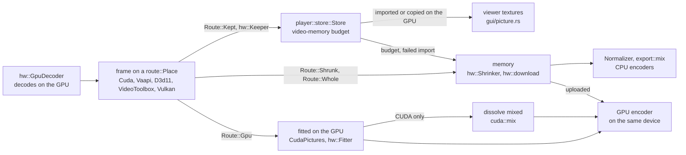

# GPU

- vidcut decodes, scales, mixes, shows and encodes on the GPU wherever the GPU gives the same results as the CPU.
- One GPU does all of this work.
- A decoded frame stays in GPU memory as far as the next step can take it. Where the next step cannot take it, the frame comes down to memory.
- [playback](playback.md) and [export](export.md) cover the pipelines around this.
- [gotchas](../gotchas.md) has the driver quirks and their workarounds.

## Choosing the GPU and the decoder

The GPU:

- `gpus::list` lists the GPUs of the computer once. It names each GPU by its PCI ids and slot (`Gpu::id`), with its CUDA device, Direct3D 11 adapter or render node.
- The memory of a GPU (`Gpu::memory_mb`) comes from one source per system, for every vendor:
  - On Windows, the source is the dedicated video memory that DXGI reports.
  - On Linux, the source is the largest device-local heap of the Vulkan device on the same PCI bus (`vulkan_memory`). This leaves the Vulkan loader loaded for the viewer.
- On Linux, integrated GPUs get no memory value, because their Vulkan heap is system memory.
- A GPU that this source cannot size also gets no memory value.
- `gpus::in_use` is the GPU that `gpu.device` names (`gpus::choose`). Else it is `gpus::automatic`: the first CUDA device of NVIDIA, else the first other GPU.
- A Mac lists no GPUs.

Speech is transcribed on that GPU too ([analysis](analysis.md#transcription)).

The decoder:

- `GpuDecoder::best` opens the decoder on the GPU in use, once per GPU:
  - NVDEC on an NVIDIA GPU, with Vulkan beside it for ProRes.
  - Direct3D 11 on the other GPUs on Windows.
  - VA-API on the other GPUs on Linux.
  - VideoToolbox on a Mac.
- `VIDCUT_HWDEC` overrides this choice for tests.
- The player decodes on this decoder.
- Exports, proxies, renders and the timeline's tiles use `GpuDecoder::own`. NVDEC gets a CUDA stream of its own. The other kinds get a device of their own on the same GPU.

**Why:** on the player's decoder, their work would wait in line with the work of playback.

The settings:

- `gpu.acceleration` (on by default) lets the GPU decode, scale and encode. When it is off, the CPU does everything, even for a preset that names a GPU encoder.
- `gpu.decoding` (on by default) lets the GPU decode. When it is off, the CPU decodes and scales, and the GPU still encodes.
- The app reads both settings through `preferences::gpu_decoding`.

The decoder of a stream:

- `GpuDecoder::kind_for` picks the decoder kind of a stream.
- `decode::gpu_decoder` picks the FFmpeg decoder, with a hardware configuration for that device. It never picks a wrapper of the GPU's own decoder.
- `GpuDecoder::why_not` names what is left to the CPU.
- A stream that the GPU's decoder refuses decodes on the CPU (`VideoReader::open_gpu_or_cpu`). Stills and image sequences also decode on the CPU.

## Where a frame lives

- `route::Place` is where a picture is: `Memory`, or one of the five GPU places of `hw::Kind`. The pixel format of the picture tells which.
- `route::Facts` holds what the planner knows of a frame that goes to a `route::Dest` (memory, an encoder, the viewer):
  - whether its GPU fits it for that encoder (`hw::can_fit`)
  - whether its GPU hands pictures to the place of the encoder (`hw::reaches`: CUDA and Vulkan to each other)
  - whether its GPU mixes dissolves (`hw::can_mix`: CUDA only)
  - what failed before
- `route::plan` is a pure function. It gives the `Route`:

| `Route` | The picture is |
|---|---|
| `Route::Gpu` | fitted on the GPU and handed on there |
| `Route::Kept` | kept as decoded, for the viewer |
| `Route::Shrunk` | scaled down on the GPU, copied down, finished on the CPU |
| `Route::Whole` | copied down whole |
| `Route::Cpu` | already in memory |

- A GPU route wins.
- A GPU route that fails becomes a fact. Then the planner plans the frame and the later frames of its file again, without that route.

## Each decoder's frames

In playback:

| Decoder | Where | Codecs | Kept in the player | Shown by the viewer |
|---|---|---|---|---|
| NVDEC (CUDA) | NVIDIA, Linux and Windows | FFmpeg's CUDA decoders, not ProRes | `cuda::keep`: copied into memory of its own | copied by CUDA into a buffer shared with wgpu (`SharedBuffer`) |
| Vulkan | NVIDIA, beside NVDEC | ProRes, where FFmpeg decodes it on Vulkan | `vulkan::keep`: kept as decoded | images imported into wgpu |
| VA-API | Linux, not NVIDIA | FFmpeg's VA-API decoders | `vaapi::Keeper`: `vaCopy` into surfaces of its own | exported as DMA-BUFs and imported |
| Direct3D 11 | Windows, not NVIDIA | FFmpeg's D3D11VA decoders; on AMD not open-GOP H.264 | `d3d11::Keeper`: copied into shareable textures | copied on its GPU into a few shared textures (`d3d11::Shared`), each imported once |
| VideoToolbox | macOS | FFmpeg's VideoToolbox decoders; not open-GOP H.264 | as decoded | IOSurface planes as Metal textures |

- The viewer shows VA-API pictures from GPU memory only when VA-API decodes on the viewer's own GPU (`player::set_viewer_gpu`, `gpus::adapter_id`).
  - The reader checks this when it opens, so it also holds after a change of the GPU in use.
  - On another GPU, the reader brings the pictures down to memory, and the viewer uploads them.
  - Why: the viewer cannot import the pictures of another GPU. It then copies each one down while it draws, and shows few frames.

The facts of a VA-API device:

- vidcut learns these facts of a VA-API device, all in `crates/vidcut-av/src/hw/vaapi.rs`:
  - `NO_COPY`: its driver cannot copy surfaces.
  - `WAYS`: which way its frames come down.
  - `SIZES`: the size of its surfaces.
- vidcut keeps these facts by the address of the VA display or device, with no reference to either.
- Thus a device that opens where a freed device was gets the facts of the freed device. This is also true for a device on another GPU.

In exports:

| Decoder | Fitted on the GPU for | With | Dissolves mixed | Comes down for |
|---|---|---|---|---|
| NVDEC (CUDA) | NVENC; Vulkan's ProRes for proxies | `CudaPictures`: `scale_cuda`, `pad_cuda`, libplacebo for turns, colors and HDR | `cuda::mix` | other encoders |
| Vulkan | NVENC, copied into CUDA on the GPU; Vulkan's ProRes | libplacebo (`CudaPictures`) | `cuda::mix` | other encoders; alpha |
| VA-API | VAAPI on its device | `transpose_vaapi`, `scale_vaapi`, `pad_vaapi`; colors unchanged | in memory | other encoders, QSV too; color changes; dissolves |
| Direct3D 11 | AMF on its adapter | the video processor; colors unchanged, not 8-bit into 10-bit | in memory | other encoders, QSV too; color changes; dissolves |
| VideoToolbox | its own encoders | `transpose_vt`, `scale_vt`, where colors and layout stay | in memory | padding, layout or color changes; dissolves |

- A VideoToolbox frame that comes down is not copied. `hw::to_read` maps its pixel buffer (`av_hwframe_map`), and the CPU reads it in place.
  - The map is read-only. A step that writes into the picture copies it first (`av_frame_make_writable`).
  - The player still copies pictures down where it moves them out of video memory (`Picture::copied_down`).

Dissolves and overlays:

- Where the driver does not take the kernel of `cuda::mix`, the export mixes its dissolves on the CPU for the rest of the export. Its result says why.
- Burned-in subtitles, titles and placed pictures go the same ways:
  - On the GPU, they go into CUDA frames (`cuda::burn`).
  - For the other decoders, they go in memory. These frames come down and go back up only while a cue, a title or a placed picture shows.
  - The frames of a placed picture come down shrunk to the size that it shows ([export](export.md#placed-pictures)).
- The viewer blends the layers of a dissolve wherever each layer is.

Frames that come down:

- Where a frame comes down and the output shows it smaller, the decoder's GPU shrinks it first.
  - It uses `scale_cuda`, `scale_vulkan`, `scale_vaapi`, the video processor or `scale_vt`.
- The frames of any decoder come down for CPU encoders, renders and tiles.
- In the player, frames come down in these cases:
  - The viewer cannot show that kind (`Gpu::gpu_pictures`).
  - An import fails.
  - The pictures are shown shrunk.
  - Their pool leaves the video-memory budget.
- Pictures made in memory go up into the frames of a GPU encoder (`Upload`, `CudaFrames::upload`).

## Encoders

| Encoder | GPUs | Codecs |
|---|---|---|
| NVENC | NVIDIA | H.264, HEVC, AV1 |
| VAAPI | Linux, not NVIDIA | H.264, HEVC, AV1, VP9 |
| AMF | Windows, AMD | H.264, HEVC, AV1 |
| QSV | Intel; frames from memory only | H.264, HEVC, AV1, VP9 at a bitrate |
| VideoToolbox | macOS | H.264, HEVC; ProRes for proxies |
| Vulkan | any listed GPU | ProRes (`prores_ks_vulkan`), proxies only |

- `encode::detect` test-encodes with each encoder, pixel format and GPU.
- `export::detected` keeps the result in `encoders.json`. The key is the FFmpeg versions, the system, and the GPUs and drivers.
- `encoders.list` with `refresh` tests again.
- `encoders.testing` names the process that tests. When a process dies during a test, it leaves this file. Then the next test skips the encoders of Vulkan.
- Jobs take the encoders of the GPU in use (`Availability::in_use`).

## Super Scale

Super Scale (`SuperScale`) changes the upscaler of a picture that an export enlarges. It does not change a picture that is made smaller.

- **NVENC:** `CudaPictures` sends the picture through libplacebo (`Layout::Placed`), with the upscaler of its `Sharpness`.
  - libplacebo then scales in linear light, with sigmoid upscaling. Without Super Scale, it scales in the code values, as the CPU does.
  - A picture with a color shader still scales in the code values.
- **The CPU:** `Normalizer::upscaling` uses `spline` or `lanczos` in place of `bicubic`.
- **The upscaler:** `render::super_scale_of` gives each piece the upscaler that runs on this computer. It is the media's own, or the project's (`MediaUpscaler`, `ProjectUpscaler`).
  - Auto is the scaler of macOS on macOS, and AI Best elsewhere.
- **Placed pictures:** `layer_size` lets a layer with Super Scale grow to four times its source size.
- A `Source` is used again only for a piece with the same Super Scale.
- **The work report** (`super_scale::report`):
  - `Source::ai_picture` reports what the AI upscaler makes now and its last finished work (`super_scale::Work`).
  - `super_scale::Making` clears a report when the work fails or stops.
  - Each AI upscaler reports the GPU that runs it when it starts.
  - The Super Scale group of the stats panel shows the report (`SuperScaleStats`).
  - When the clip under the playhead uses another upscaler, State names the AI upscaler that is at work.
  - When the clip under the playhead has no Super Scale, the group shows while an AI upscaler is at work.
- **One path for the AI upscalers:** AI Fast, AI Best and the scaler of macOS use the same code in the reader. Only the parameters of the upscalers are different.
  - `Source::ai_picture` finds the shown source size and the size that the upscaler makes (`super_scale::made_size`).
    - AI Fast makes 4 times the source size.
    - AI Best makes the shown size, but not more than 4 times the source size (`flashvsr::SCALE`).
    - The scaler of macOS makes the smallest factor of macOS that reaches the shown size (`macos::made_size`).
  - Each picture has a key (`PictureId`): the file, the color space, the reading, the rotation, the upscaler, the made size and the frame.
  - A picture comes from a run of the upscaler (`Session`). The run starts at the first frame that the upscaler needs (`super_scale::first_frame`).
  - A run holds the pictures that it made and that the reader did not take yet. A picture leaves the run when the reader takes it.
  - When the reader asks for a frame, the run drops the pictures before that frame. Thus frames that an export skips do not stay in memory.
  - The run also keeps the last picture that it gave. The reader asks for it again when the size of its layer changes.
  - The held pictures go when the run goes. Thus an AI picture stays in main memory only while its run needs it.
  - The viewer keeps the pictures that it shows with its other kept pictures ([playback](playback.md)).
  - A run takes the frames in order and gives the pictures (`super_scale::Run`). `super_scale::open` opens the run of the upscaler.
    - When the reader is at the first frame of the run, the run takes the frames that the reader decodes. The reader then takes them from its queue.
    - It keeps these frames in main memory. The copies leave the GPU decoder's surfaces free.
    - Thus each frame is decoded once.
    - Else the run reads the frames with a second `VideoReader` on the same file (`Source::seek_ahead`). It uses the same GPU decoder. This also occurs when the run needs another reading of the frames than the reader.
    - When the reader reads past the run, the run gets those frames later (`Source::miss`).
    - Each frame becomes RGB at its shown size, upright. The GPU takes these 3 bytes for each pixel as they are.
  - A run ends at its last frame (`super_scale::last_frame`) or at the end of the file.
  - The reader drops its run for a frame that the run does not give. This is a frame before the run, after its last frame, or more than 48 frames after the last frame read (`RUN_JUMP`).
  - A new run then starts at that frame.
  - A GPU error from too little memory gives the message "not enough GPU memory" (`compute::checked`).
- **GPU memory of the AI upscalers** (`super_scale::User`):
  - Each reader (`Source`) that uses an AI upscaler holds an `super_scale::User` of it.
  - A reader gives its `super_scale::User` back when the viewer or the export stops using it. This occurs at the end of its clip, at a change of Super Scale and when it closes.
  - It then drops its run too.
  - Each AI upscaler keeps its GPU work in an `super_scale::Slot`. The slot starts the upscaler for its first picture (`super_scale::Network`).
  - When the last `super_scale::User` of an upscaler goes, its slot frees the GPU memory of that upscaler (`super_scale::Slot::release`). AI Fast frees its buffers. AI Best frees its model.
  - If the upscaler is at work at that time, the slot frees the memory when that work ends.
  - Thus the two AI upscalers do not hold their memory at the same time when the user switches from one to the other.
- **The kept pictures give way to AI work** (`player::lend_on`):
  - An AI upscaler takes the GPU memory that it needs from the viewer's kept pictures. It can use all of the GPU.
  - Before it makes its buffers, it gets its room (`player::room_on`). The room is the free memory of the GPU and the GPU memory of the kept pictures.
  - The free memory comes from the system (`gpus::spare`):
    - On Windows, it is the DXGI budget of the process less its current use.
    - On Linux, it is the Vulkan memory budget of the GPU's largest heap less its use.
  - Without the free memory, the room is the GPU's memory less 1 GB for other programs, and less the memory of the other loans.
  - While a viewer is open, the room leaves 1 GB of the free memory for it. Its decoders and its pictures on the screen take memory while the AI work runs.
    - A headless export has no player, so its AI work can use all of the free memory.
  - Each loan (`store::Lent`) caps the video budget of the kept pictures at its room less its need.
  - The cap is also true below a video budget that the user sets.
  - AI Best has a loan for its model and one for each stream. AI Fast has one for its buffers.
  - Stats for Nerds and Preferences show the smaller budget while a loan holds.
  - A loan is only for the GPU of the viewer (`gpus::in_use`). An AI upscaler on another GPU takes no pictures.
  - Why: the AI work and the kept pictures must fit on the GPU together. Otherwise the driver moves GPU memory to main memory, and one picture can take minutes.
  - AI Best also borrows main memory for its caches in main memory (`player::lend_memory`).
    - Each loan (`store::LentMemory`) makes the main-memory budget of the kept pictures smaller by the size of those caches. The oldest pictures go first.
    - The stream renews its loan when `Stream::fit` moves a cache to main memory. The loan ends with the stream.
    - Why: the AI caches and the kept pictures must fit in main memory together.
- **AI Fast** (`nanovsr`):
  - Before an export starts, `nanovsr::check` refuses media that AI Fast cannot take (`nanovsr::unfit`). It also refuses AI Fast without the weights or without a GPU that can run it.
  - A run is a chunk of 15 frames (`nanovsr::FRAMES`). The chunks lie on a fixed grid of the file's frames. Thus the viewer and an export get the same pictures.
  - `nanovsr::upscale` returns the asked picture first. A thread (`vidcut-upscale-rest`) then makes the other 14 pictures, and puts them into the run.
  - When the run of the reader can give the asked picture, `Source::ai_picture` first waits for the rest of the chunk (`super_scale::settle`). Then it looks in the run again.
  - When a reader drops its run, that thread stops before its next picture. Thus a jump does not wait for the rest of the old chunk.
  - `nanovsr::upscale` runs NanoVSR 5.4M with WGSL compute shaders on wgpu. It gives each picture four times as large.
    - At load, the batch norms of each block fold into one 3×3 convolution, as in the model's own deploy mode.
    - The 3×3 convolutions with 96 input channels use Winograd F(2×2, 3×3) (`wino_shader`). These are the 60 blocks and the first two convolutions of the 4× stage.
      - Each 2×2 block of output then needs 16 products for each pair of channels, in place of 36.
      - At load, `winograd` transforms the weights. They are kept as 16-bit floats.
      - Each workgroup transforms its block of input in workgroup memory. The transformed values are 16-bit floats, and the sums are 32-bit floats.
      - At the end, the threads exchange their sums through workgroup memory. Each output pixel then comes from 9 of the 16 sums of its block. Each thread makes one pixel.
    - The first convolution and the 1×1 join use a direct convolution shader (`conv_shader`). It reads its block of pixels and its weights into workgroup memory, with 32-bit sums.
    - A forward chain of 30 blocks runs from the first frame to the last, and a backward chain from the last to the first. The forward results of all frames are kept.
    - The first block of each chain adds the features of the frame to the previous result as it reads them.
    - As the backward chain reaches a frame, a 1×1 convolution joins the two results.
    - For the asked frame, the forward chain runs up to it and the backward chain runs down to it. The other frames then complete both chains.
      - Each frame gets the same chains and the same order of math. Thus its picture does not depend on which frame was asked.
      - The backward results above the asked frame go into the buffers of the forward results that are not made yet. Thus the order needs no more GPU memory.
    - Why: the viewer shows the asked frame after about half the work of a chunk.
    - Two convolutions then make the picture four times as large, in tiles. They write their output in the order of the pixel shuffle. The first one reads its tile from the joined frame, at the place of the tile.
    - One shader (`last_shader`) runs the last convolution, adds a bilinear copy of the input and makes RGB. Its weights are in a uniform buffer.
    - The chains, the join and all tiles of a frame go to the GPU in one submission. The frame comes back in one read.
    - While the GPU runs a frame, the CPU reads the result of the frame before it. Thus the GPU does not wait for the CPU between frames.
    - Why: in an export, other GPU work can fill such waits. In a 1080p test, some frames then took 30 times as long.
    - The values between the layers are 16-bit floats. The output is within 2 of 255 levels of the model's PyTorch output.
    - Why Winograd: the 3×3 convolutions do most of the work. Winograd needs fewer products, and fewer reads of workgroup memory for each product.
  - The usual fitting then makes that picture the size it shows at.
  - The frames go through memory, also from a GPU decoder.
  - `nanovsr` has a wgpu device of its own, on the GPU that wgpu prefers. Its pipelines and weights stay.
    - Its buffers stay for the next chunk of the same size. They go when the size changes, when the last `super_scale::User` of AI Fast goes, or when the process ends.
    - Its bind groups stay with the buffers, and each pass takes them from a cache.
  - `Note::Upscaled` names each file that an AI upscaler enlarged in the export's report (`super_scale::name`).
- **AI Best** (`flashvsr`):
  - Before an export starts, `flashvsr::check` refuses media that AI Best cannot take (`flashvsr::unfit`). It also refuses AI Best without the weights or without a GPU that can run it. It loads the model then.
  - It also refuses a size that does not fit (`run::plan`). It takes the size from the media and the output size (`flashvsr::enlarged`). A zoomed picture can be larger; then `flashvsr::Stream::open` refuses it when the export reaches it.
  - A run is a `flashvsr::Stream`. It starts at the asked frame, and has no last frame.
  - At the end of the file, the stream repeats the last frame, as the official code does.
  - AI Best looks at the stop flag of its thread (`cancel::stop`) before each block and before each step of its decoder. Thus a picture that the viewer no longer needs stops soon.
  - The stream works in chunks of 16 frames (`run::Stream`). The first chunk reads 17 frames and gives 13. Each later chunk reads 16 and gives 16. Thus the output is 4 frames behind the input.
    - Each frame first gets PIL's bicubic enlargement, with PIL's fixed-point weights (`resize::coefficients`). The edges are repeated up to a multiple of 128.
    - The frames go to the GPU and come back as packed RGB24, 3 bytes for each pixel, with no conversion on the CPU.
    - The LQ projection (16× pixel unshuffle, two causal 3-D convolutions, a linear layer) makes one token frame from each 4 frames. Its convolutions keep the last 2 frames of each clip.
    - The 30 DiT blocks run one step at the fixed time 1000. The adaLN values for that time are computed once, at load.
    - A block is 128 tokens, and a window is 2 latent frames.
    - Blocks 0, 6, 12, 18 and 24 attend to 11×11 blocks in the current chunk and in the last 3 windows.
    - The other blocks attend to 3×3 blocks in the current chunk and in the last window.
    - Pooled scores choose the blocks when the candidate blocks are more than the top-k count. A softmax per query block comes first.
      - `scores.wgsl` keeps the scores of each thread in registers through the softmax. A row takes at most 1024 key blocks.
    - Then a radix select finds the threshold on the bits of the 32-bit values (`hist.wgsl`, `pick.wgsl`). It keeps the official rule: the value at place k+1, and strictly greater.
      - `pick.wgsl` finds the bin with a suffix sum on 256 threads, one bin for each thread.
    - `attend.wgsl` is a flash attention over the chosen key blocks, with an online softmax in 32-bit floats. Cross-attention to the fixed prompt uses it too.
      - Four threads share a query row. Each keeps the row's query in registers and does 8 keys and 32 output values. The partial sums keep the same groups, so the results do not depend on the layout.
    - The KV cache of each block is a ring of windows (`Cache`).
    - `run::plan` keeps the caches on the GPU while all of the work fits in the room of AI work (`player::room_on`). The caches of the other blocks stay in main memory between chunks (`Keys::Host`). Each comes back to the GPU just before its block runs, and its new windows go back after it.
      - The new windows go to a mapped buffer in the first submission of the block. The block reads them at its end, while the GPU runs its feed-forward part.
      - A cache comes back through `queue.write_buffer`. wgpu first copies the data into upload buffers. With resizable BAR, these buffers are in GPU memory.
      - Thus the plan counts the upload buffers of one cache, in addition to the GPU buffers that the cache comes back into.
      - A block with a cache in main memory first waits for the upload of the block before it. Thus the upload buffers of only one cache are in use at a time.
    - Before each chunk, `Stream::fit` measures the room again. When the work of the chunk and its uploads do not fit, more caches go to main memory, from the last block back.
      - Why: other work takes GPU memory after the plan. An example is the encoder, which opens after the first frames.
    - The results are the same in both places.
    - The device of AI Best uses the `MemoryUsage` hint of wgpu. Its memory blocks are small, so the free parts of the blocks stay small.
      - Why: the plan can fill the room. With larger blocks, the free parts of the blocks went past the room by gigabytes at 4K output.
      - On Windows, the driver then moves GPU memory to main memory. On Linux, the allocation fails.
    - Without a room, all caches stay on the GPU. This occurs when the system gives neither the GPU's free memory nor its size.
    - A size that does not fit even with every cache in main memory is refused. So is a size whose caches need more than half of main memory.
    - The TC decoder gives 4 frames for each latent frame. Its memory blocks keep the features of the previous frame. Its full-size stage runs in bands of 64 rows.
      - A memory block works in three buffers: its input, its memory and one work buffer. The third stage makes its buffers once for the 4 frames of a latent frame.
    - The other 3×3 convolutions of the decoder use Winograd F(2×2, 3×3). At load, `wino` transforms their weights into 16 matrices of 16-bit floats.
      - For each band of 32 rows, `winoin.wgsl` transforms each 4×4 block of input into 16 values, as 16-bit floats.
      - 16 matrix multiplies (`gemm::run`) make the products, with 32-bit sums. Then `winoout.wgsl` makes each 2×2 block of output, with the bias and the ReLU or the skip add.
      - The rounding is not the rounding of a direct convolution. Thus the pictures are a little different.
    - The decoder's last convolution (128 to 3 channels) has a shader of its own (`last.wgsl`), which also writes the picture. It sums in the order of the matrix multiply, so the pictures are the same.
  - One matrix multiply shader (`gemm::run`) runs every linear layer and every other convolution. It splits its work into dispatches of at most 150 G multiply-adds. Its loaders gather the convolution taps, and its stores join bias, activation and residual adds.
    - Each thread finds the place of its rows once, before the loop over k (`a_row`). It then steps the tap and the channel as k grows.
    - The tiles wait in workgroup memory as 32-bit floats. The 16-bit pairs of the buffers are unpacked once, when a tile is loaded (`a_word`, `b_word`).
      - Tiles of 16-bit pairs take half the workgroup memory, but they unpack each value again in the inner loop.
      - With 32-bit tiles, a 4K export of 30 frames takes 290-293 s in place of 300 s. A 1920×1024 export of 89 frames takes 88-94 s in place of 83 s.
      - AI Best is mostly for 4K output, so the 32-bit tiles are kept.
    - The weights are 16-bit floats on the GPU. The files hold 32-bit floats; they are rounded at load, on all cores (`compute::halves`).
    - The residual stream of the DiT stays in 32-bit floats. The other values between the steps are 16-bit floats, with 32-bit sums.
  - Each dispatch takes its parameters from a slot of 256 bytes in one uniform buffer, at a dynamic offset. `Gpu::flush` writes the new slots once, before each submission.
    - When the buffer is full, a new buffer takes its place. Thus the work in flight keeps its slots.
    - Each pipeline has a layout from the bindings of its shader. `Gpu::set` keeps the bind groups until the submission, so dispatches with the same buffers share one.
    - The full-size stage of the decoder sends all of its bands in one submission. The feed-forward part of a DiT block does the same with its slabs.
  - `flashvsr` has a wgpu device of its own. Its pipelines and weights stay. The work buffers of a chunk are freed after it.
- The other GPUs fit pictures as before ([todo](../todo/super-scale.md)).

Why: the result of Super Scale is the upscaler's own. It is not meant to match the CPU.

- **The scaler of macOS** (`macos`), called AI in the app, on macOS 26 and later:
  - It is the super-resolution scaler of VideoToolbox: a `VTFrameProcessor` session with a `VTSuperResolutionScalerConfiguration` for video.
  - vidcut first checks that the class exists and that macOS supports it. Older macOS has no such class.
  - The factors come from macOS (`supportedScaleFactors`, `macos::factors`).
  - Each run has a session of its own, for its source size and factor.
  - Each frame goes into a CoreVideo pixel buffer, with the attributes that the configuration asks for.
    - The buffers come from two pools of the run (`CVPixelBufferPool`), one for the source and one for the output. A pool reuses a buffer when no frame uses it.
    - The buffer is the first of these that the scaler takes: BGRA; 8-bit 4:2:0 in video range, converted with the BT.709 matrix; 16-bit float RGBA (`RGHA`), the code values over 255.
    - On the owner's M4 with macOS 27, the scaler takes only 16-bit float RGBA.
    - The scaler gets the frame before and its output too. The frames go in order (`Sequential`).
  - The output comes back to RGB in the same way. For 16-bit float, a table of all 65,536 values gives the 8-bit codes.
  - `macos::check` refuses HDR media and pictures over 1920×1080 (`macos::MOST`), the limit of macOS for video.
  - A run does not download. It stops with an error when macOS does not have the model of its factor.
  - `macos::needed` reports the models while macOS lacks the model of a factor that it lists. Thus the GUI asks first, with the size unknown.
  - With `download`, `macos::get_ready` has macOS download each missing model, and waits. Without it, an export stops with an error.
  - Elsewhere, the same calls give the error that it needs macOS 26 or later.
- **AI Fast and AI Best on macOS:** off for now (`super_scale::off_here`). `super_scale::check` and `super_scale::open` refuse them, and the Inspector and the pool do not offer them.

## Frame interpolation

`interpolate` makes the frames of Retime Process ([export](export.md#which-source-frame), [deviation X93](../deviations.md#x93-retime-process-has-ai-models-in-the-place-of-optical-flow)).

- `interpolate::between` takes the two frames as RGB, their size and the weight of the later frame. It gives the made frame as RGB.
- `interpolate` has a wgpu device of its own (`compute::Gpu`), on the GPU that wgpu prefers. Its pipelines (`ops::Kernels`) and the weights of each model stay.
  - The device goes when the last `interpolate::User` goes. Each `Source` with a process other than Nearest is a user.
- The last pair stays on the GPU with its features. The next frame of the same pair uses them again. Thus the frames between one pair of a slow clip share the features.
- A new pair of the same size and process uses the buffers of the last pair again.
- **Work buffers** (`ops::arena`): the work buffers of an EMA-VFI pair come from one pool.
  - The plan of the pool runs two times. The first run lists each buffer and the time that it is in use. The second run takes the planned buffers.
  - Two buffers that are never in use at the same time can share a pool buffer. The largest buffers go first, each into the smallest free pool buffer that is large enough.
  - Each buffer of one dispatch is a different pool buffer. wgpu refuses a buffer that one dispatch reads and also writes.
- Frame Blend mixes the two frames on the same device (`Ops::combine`).
- The networks run on kernels of vidcut's own (`interpolate::ops`), in 32-bit floats:
  - `Ops::conv` runs a convolution as a matrix multiply that gathers its taps. It also runs the linear layers, as 1×1 convolutions.
  - `Ops::deconv` runs a transposed 4×4 convolution with stride 2 as four 2×2 convolutions, one for each output parity. Its output can go through a pixel shuffle.
  - `Ops::resize` is bilinear, as PyTorch's interpolate without corner alignment.
  - `Ops::warp` is the backward warp of the models, as PyTorch's grid sample with border padding and corner alignment.
  - `Ops::norm` is a layer norm over the channels of each pixel.
  - `Ops::windows`, `Ops::attend` and `Ops::cor` are EMA-VFI's shifted and padded 7×7 windows, its attention between the frames, and its coordinate embedding.
  - A tensor is a `View`: channels last, with a channel offset and a stride. Thus a layer writes into its part of a concatenation, and no copy joins the parts.
- The weights come from the authors' PyTorch files (`weights::Torch`).
- **AI Fast: RIFE 4.25** (`rife`):
  - The frames pad with zeros at the right and the bottom to a multiple of 128, as in the official code.
  - The encoder runs once for a pair. The five flow blocks run for each frame.
  - It finds the motion at half size for UHD, as its README says.
- **AI Best: EMA-VFI** (`ema`):
  - The frames pad with their edges, centered, as in the official padder. The multiple is 32 divided by the scale of the motion.
  - The motion is found at half size for frames of 1080 lines and at a quarter for UHD (`motion_scale`). The refinement runs at full size. These are the scales of the authors' tests.
  - The pair also runs turned by 180 degrees, and the two results are averaged, as in the authors' tests.
  - The backbone runs once for a pair, at each size and each turn. The flow and the refinement run for each frame.
  - A pair keeps only the two deepest levels of the full-size features (`ema::Deep`). At full size, the backbone does not make the motion features, because only the flow uses them.
  - The three shallow levels run again for each frame and each turn (`ema::Shallow`). They are only convolutions, but they are the largest buffers.
  - The refinement runs in bands of rows (`ema::Pair`). Each band has extra rows above and below it, more than the reach of the refinement.
  - Thus the bands give the same frame as one pass over the whole frame. A memory budget sets the height of the bands. A frame within the budget is one band.
  - The refinement uses three buffers in turn, as its layers finish with them.
- PyTorch versions of the two networks, written from the official code, give the same frames within 1 of 255 levels, on 1080p frames.
- **AI on macOS** (`interpolate::macos`): the frame rate conversion of macOS makes the frame, not wgpu.
  - It keeps one session of `VTFrameProcessor` for each frame size. The session goes when the last `interpolate::User` goes.
  - The pair stays in the session. The frames between one pair tell macOS that the pair is the same, and the next pair tells it that the frames follow.
  - It shares the picture buffers and the pixel formats with the scaler of macOS (`frame_processor`).
  - Two VideoToolbox frames that need no turn go to macOS without the CPU (`interpolate::takes_frames`). A pixel transfer of VideoToolbox scales and converts them on the GPU (`Transfer`).
    - The transfer takes the matrix that vidcut finds for the frame, and keeps the primaries and the transfer function of BT.709.
    - The made frame goes back into a VideoToolbox frame on the GPU, with the layout and the range of the source (`interpolate::between_frames`). It then goes on as a decoded frame does.
    - `hw::Fitter` keeps a filter graph for the frames of the decoder and one for the made frames. Thus it does not make a graph again for each frame.
  - Other frames come as RGB from the CPU, and the CPU converts them.
- **The work report** (`interpolate::report`):
  - The device reports its GPU when it starts. The session of macOS reports macOS.
  - `interpolate::between` reports each made frame (`interpolate::Made`): the process, the size, the weight and the time.
  - A shot change reports the kept source frame, without a time.
  - The Retime Process group of the stats panel shows the report (`RetimeStats`). It shows when the piece under the playhead has a process other than Nearest ([export](export.md#which-source-frame)).

## Deinterlacing and HDR

Deinterlacing:

- The reader deinterlaces as the CPU's `bwdif` does. CUDA frames use `bwdif_cuda`, and Vulkan frames use `bwdif_vulkan`.
- This applies only where `hw::deinterlace` finds that the filter gives the same frames as `bwdif` for their layout. It checks once per process.
- Other interlaced frames come down for `bwdif`, and go to an encoder from memory.

HDR:

- libplacebo (`CudaPictures`) converts HDR to SDR, or into PQ or HLG, for NVENC and the ProRes encoder of Vulkan.
- It uses the math of the CPU in a shader (`color::gpu_color`).
- For NVENC, it also converts mixed frames from the timeline color space to the output's colors ([export](export.md#timeline-colors)).
- The other GPUs fit pictures only where their colors stay (`color::kept`). Thus a conversion comes down to `Normalizer`.
- The viewer's shader converts each picture into the timeline color space with the math of the export (`color::shader_colors`). It tone-maps HDR for the screen.

## Why

- The rule is the GPU first wherever it works right (AGENTS.md rule 9). vidcut never moves work to the CPU because the CPU is faster.
- The only exceptions are GPUs that give wrong results. `GpuDecoder::why_not` names them:
  - AMD's Direct3D 11 and VideoToolbox go wrong after a seek into H.264 with open GOPs.
  - vidcut trusts Vulkan on NVIDIA's GPUs only.
- vidcut first checks GPU deinterlacers and some scalers against test pictures. These scalers are Vulkan's and the video processor of Direct3D 11.
- A GPU step that fails leaves its file to the CPU.

## Code

- `crates/vidcut-av/src/gpus.rs`
- `crates/vidcut-av/src/hw/mod.rs`
- `crates/vidcut-av/src/hw/vaapi.rs`
- `crates/vidcut-av/src/hw/d3d11.rs`
- `crates/vidcut-av/src/hw/vt.rs`
- `crates/vidcut-av/src/hw/vulkan.rs`
- `crates/vidcut-av/src/hw/vulkan_scale.rs`
- `crates/vidcut-av/src/hw/deinterlace.rs`
- `crates/vidcut-av/src/cuda.rs`
- `crates/vidcut-av/src/cuda/keep.rs`
- `crates/vidcut-av/src/cuda/mix.rs`
- `crates/vidcut-av/src/cuda/burn.rs`
- `crates/vidcut-av/src/cuda/share.rs`
- `crates/vidcut-av/src/interpolate.rs`
- `crates/vidcut-av/src/interpolate/ops.rs`
- `crates/vidcut-av/src/route.rs`
- `crates/vidcut-av/src/decode.rs`
- `crates/vidcut-av/src/color.rs`
- `crates/vidcut-av/src/export/make.rs`
- `crates/vidcut-av/src/export/encode.rs`
- `crates/vidcut/src/preferences.rs`
- `crates/vidcut/src/export.rs`
- `crates/vidcut/src/gui/picture.rs`
- `crates/vidcut/src/gui/shared.rs`
- `crates/vidcut/src/gui/vulkan.rs`
