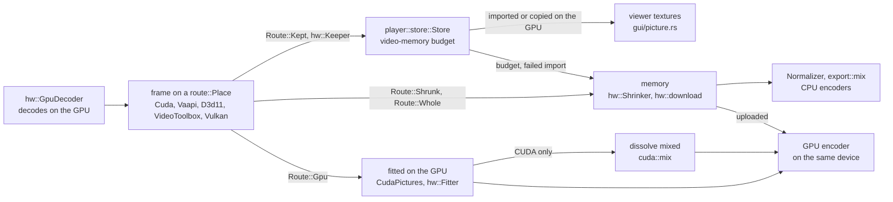

# GPU

vidcut decodes, scales, mixes, shows and encodes on the GPU wherever the GPU gives the CPU's results. One GPU does it all. A decoded frame stays in GPU memory as far as the next step can take it, and comes down to memory where it can't. [playback](playback.md) and [export](export.md) cover the pipelines around this; driver quirks and workarounds are in [gotchas](../gotchas.md).

## Choosing the GPU and the decoder

`gpus::list` lists the computer's GPUs once, each by its PCI ids and slot (`Gpu::id`), with its CUDA device, Direct3D 11 adapter or render node. `gpus::in_use` is the one `gpu.device` names (`gpus::choose`), else `gpus::automatic`: NVIDIA's first CUDA device, else the first other. A Mac lists none.

`GpuDecoder::best` opens the decoder on the GPU in use, once per GPU: NVDEC on NVIDIA's (Vulkan beside it for ProRes), Direct3D 11 on Windows' others, VA-API on Linux's, VideoToolbox on a Mac. `VIDCUT_HWDEC` overrides it for tests. The player decodes on it. Exports, proxies, renders and the timeline's tiles use `GpuDecoder::own`: NVDEC on a CUDA stream of its own, the others on a device of their own on the same GPU.

**Why:** on the player's decoder their work would wait in line with playback's.

`gpu.acceleration` (on by default) lets the GPU decode, scale and encode; off, the CPU does everything, even for a preset naming a GPU encoder. `gpu.decoding` (on) lets it decode; off, the CPU decodes and scales and the GPU still encodes. The app reads both through `preferences::gpu_decoding`.

`GpuDecoder::kind_for` picks a stream's decoder kind, and `decode::gpu_decoder` FFmpeg's decoder with a hardware configuration for that device, never a wrapper of a GPU's own. `GpuDecoder::why_not` names what is left to the CPU. A stream the GPU's decoder refuses decodes on the CPU (`VideoReader::open_gpu_or_cpu`), as stills and image sequences do.

## Where a frame lives

`route::Place` is where a picture is: `Memory` or one of the five GPU places of `hw::Kind`, by its pixel format. `route::Facts` holds what the planner knows of a frame bound for a `route::Dest` (memory, an encoder, the viewer): whether its GPU fits it for that encoder (`hw::can_fit`), hands pictures to the encoder's place (`hw::reaches`: CUDA and Vulkan to each other), mixes dissolves (`hw::can_mix`: CUDA only), and what failed before. `route::plan`, a pure function, gives the `Route`:

| `Route` | The picture is |
|---|---|
| `Route::Gpu` | fitted on the GPU and handed on there |
| `Route::Kept` | kept as decoded, for the viewer |
| `Route::Shrunk` | scaled down on the GPU, copied down, finished on the CPU |
| `Route::Whole` | copied down whole |
| `Route::Cpu` | already in memory |

A GPU route wins. One that fails becomes a fact, and the frame and its file's later frames are planned again without it.

## Each decoder's frames

In playback:

| Decoder | Where | Codecs | Kept in the player | Shown by the viewer |
|---|---|---|---|---|
| NVDEC (CUDA) | NVIDIA, Linux and Windows | FFmpeg's CUDA decoders, not ProRes | `cuda::keep`: copied into memory of its own | copied by CUDA into a buffer shared with wgpu (`SharedBuffer`) |
| Vulkan | NVIDIA, beside NVDEC | ProRes, where FFmpeg decodes it on Vulkan | `vulkan::keep`: kept as decoded | images imported into wgpu |
| VA-API | Linux, not NVIDIA | FFmpeg's VA-API decoders | `vaapi::Keeper`: `vaCopy` into surfaces of its own | exported as DMA-BUFs and imported |
| Direct3D 11 | Windows, not NVIDIA | FFmpeg's D3D11VA decoders; on AMD not open-GOP H.264 | `d3d11::Keeper`: copied into shareable textures | shared textures imported |
| VideoToolbox | macOS | FFmpeg's VideoToolbox decoders; not open-GOP H.264 | as decoded | IOSurface planes as Metal textures |

In exports:

| Decoder | Fitted on the GPU for | With | Dissolves mixed | Comes down for |
|---|---|---|---|---|
| NVDEC (CUDA) | NVENC; Vulkan's ProRes for proxies | `CudaPictures`: `scale_cuda`, `pad_cuda`, libplacebo for turns, colors and HDR | `cuda::mix` | other encoders |
| Vulkan | NVENC, copied into CUDA on the GPU; Vulkan's ProRes | libplacebo (`CudaPictures`) | `cuda::mix` | other encoders; alpha |
| VA-API | VAAPI on its device | `transpose_vaapi`, `scale_vaapi`, `pad_vaapi`; colors unchanged | in memory | other encoders, QSV too; color changes; dissolves |
| Direct3D 11 | AMF on its adapter | the video processor; colors unchanged, not 8-bit into 10-bit | in memory | other encoders, QSV too; color changes; dissolves |
| VideoToolbox | its own encoders | `transpose_vt`, `scale_vt`, where colors and layout stay | in memory | padding, layout or color changes; dissolves |

Where the driver won't take `cuda::mix`'s kernel, the export mixes its dissolves on the CPU from then on, and its result says why. Where a frame comes down and the output shows it smaller, the decoder's GPU shrinks it first (`scale_cuda`, `scale_vulkan`, `scale_vaapi`, the video processor, `scale_vt`). The viewer blends a dissolve's layers wherever each is. Any decoder's frames come down for CPU encoders, renders and tiles, and in the player where the viewer can't show that kind (`Gpu::gpu_pictures`), an import fails, pictures are shown shrunk, or their pool leaves the video-memory budget. Pictures made in memory go up into a GPU encoder's frames (`Upload`, `CudaFrames::upload`).

## Encoders

| Encoder | GPUs | Codecs |
|---|---|---|
| NVENC | NVIDIA | H.264, HEVC, AV1 |
| VAAPI | Linux, not NVIDIA | H.264, HEVC, AV1, VP9 |
| AMF | Windows, AMD | H.264, HEVC, AV1 |
| QSV | Intel; frames from memory only | H.264, HEVC, AV1, VP9 at a bitrate |
| VideoToolbox | macOS | H.264, HEVC; ProRes for proxies |
| Vulkan | any listed GPU | ProRes (`prores_ks_vulkan`), proxies only |

`encode::detect` test-encodes with each encoder, pixel format and GPU. `export::detected` keeps the result in `encoders.json`, keyed by the FFmpeg versions, the system and the GPUs and drivers; `encoders.list` with `refresh` tests again. `encoders.testing` names the process testing: one left by a process that died makes the next test skip Vulkan's encoders. Jobs take the GPU in use's encoders (`Availability::in_use`).

## Deinterlacing and HDR

The reader deinterlaces as the CPU's `bwdif` does: CUDA frames with `bwdif_cuda`, Vulkan's with `bwdif_vulkan`, where `hw::deinterlace` finds, once per process, that the filter gives `bwdif`'s frames of their layout. Other interlaced frames come down for `bwdif` and reach an encoder from memory.

libplacebo (`CudaPictures`) converts HDR to SDR, or into PQ or HLG, with the CPU's math in a shader (`color::gpu_color`), for NVENC and Vulkan's ProRes encoder. The other GPUs fit pictures only where their colors stay (`color::kept`), so a conversion comes down to `Normalizer`. The viewer's shader converts and tone-maps each picture with the export's math (`color::shader_colors`).

## Why

The rule is the GPU first wherever it works right (AGENTS.md rule 9), never the CPU because it is faster. The only exceptions are GPUs that give wrong results, named in `GpuDecoder::why_not`: AMD's Direct3D 11 and VideoToolbox go wrong after a seek into H.264 with open GOPs, and Vulkan is trusted on NVIDIA's GPUs only. GPU deinterlacers and some scalers (Vulkan's, Direct3D 11's video processor) are checked against test pictures first, and a GPU step that fails leaves its file to the CPU.

## Code

- `crates/vidcut-av/src/gpus.rs`
- `crates/vidcut-av/src/hw/mod.rs`
- `crates/vidcut-av/src/hw/vaapi.rs`
- `crates/vidcut-av/src/hw/d3d11.rs`
- `crates/vidcut-av/src/hw/vt.rs`
- `crates/vidcut-av/src/hw/vulkan.rs`
- `crates/vidcut-av/src/hw/vulkan_scale.rs`
- `crates/vidcut-av/src/hw/deinterlace.rs`
- `crates/vidcut-av/src/cuda.rs`
- `crates/vidcut-av/src/cuda/keep.rs`
- `crates/vidcut-av/src/cuda/mix.rs`
- `crates/vidcut-av/src/cuda/share.rs`
- `crates/vidcut-av/src/route.rs`
- `crates/vidcut-av/src/decode.rs`
- `crates/vidcut-av/src/color.rs`
- `crates/vidcut-av/src/export/make.rs`
- `crates/vidcut-av/src/export/encode.rs`
- `crates/vidcut/src/preferences.rs`
- `crates/vidcut/src/export.rs`
- `crates/vidcut/src/gui/picture.rs`
- `crates/vidcut/src/gui/shared.rs`
- `crates/vidcut/src/gui/vulkan.rs`
