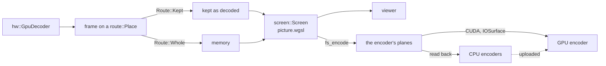

# GPU

- vidcut decodes, scales, mixes, shows and encodes on the GPU where the GPU gives the same results as the CPU.
- One GPU does all of this work.
- A frame stays in GPU memory as far as the next step can take it. Then it comes down to memory.
- [playback](playback.md) and [export](export.md) tell about the pipelines around this. [gotchas](../gotchas.md) tells about the drivers.

## The GPU and the decoder

- `gpus::list` lists the GPUs once, by PCI ids and slot (`Gpu::id`). A Mac lists no GPUs.
- `gpus::in_use` is the GPU that `gpu.device` names. Else it is `gpus::automatic`: CUDA device 0, else the first GPU that is not NVIDIA's.
- `Gpu::memory_mb` comes from DXGI on Windows, and from the largest device-local Vulkan heap on Linux. Integrated GPUs on Linux have no value.
- `GpuDecoder::best` opens the decoder of the GPU in use:
  - NVDEC on NVIDIA, with Vulkan for ProRes.
  - Direct3D 11 on other GPUs on Windows. VA-API on other GPUs on Linux.
  - VideoToolbox on a Mac.
- `VIDCUT_HWDEC` sets the decoder for tests.
- The player uses that decoder. Exports, proxies, renders and tiles use `GpuDecoder::own`, a stream or a device of their own on the same GPU.
  - Why: on the player's decoder, their work waits behind playback.
- `gpu.acceleration` lets the GPU decode, scale and encode. `gpu.decoding` lets it decode. Both are on by default.
- `GpuDecoder::why_not` names the streams that the CPU decodes. Stills and image sequences decode on the CPU.
- A stream that the GPU's decoder refuses decodes on the CPU (`VideoReader::open_gpu_or_cpu`).

## Routes

- `route::Place` is where a picture is: `Memory`, or one of the GPU places of `hw::Kind`.
- `route::Facts` holds what the planner knows of a frame:
  - Its place.
  - The draw takes the frames of that place in that layout (`Gpu::gpu_pictures`).
    - Each import has its layout rules in one function, which the import and `gpu_pictures` both use (`nvdec_bytes`, `vulkan_layout`).
    - Why: a frame that the draw cannot import comes down whole. The keeper does not copy it first.
  - The draw reads its layout (`normalize::displayable`).
  - Keeping the frames failed before.
- `route::plan` gives the `Route`. `Route::Kept` wins.

| `Route` | The picture is |
|---|---|
| `Route::Kept` | kept as decoded, for the draw |
| `Route::Whole` | copied down whole |
| `Route::Cpu` | already in memory |

- `export::make::Maker` follows the plan. The viewer, exports, proxies, thumbnails and the AI inputs use it.
- A keep that fails becomes a fact. After that, the frames of that layer come down.

## Each decoder's frames

In the viewer, exports, proxies and thumbnails:

| Decoder | Kept | Read by the draw |
|---|---|---|
| NVDEC (CUDA) | `cuda::keep`: a copy, or as decoded for a draw at once | through a buffer shared with wgpu (`SharedBuffer`) |
| Vulkan | `vulkan::keep`: as decoded | images imported into wgpu |
| VA-API | `vaapi::Keeper`: a copy (`vaCopy`) | DMA-BUFs imported into wgpu |
| Direct3D 11 | `d3d11::Keeper`: a copy in shareable textures | a few shared textures, each imported once (`d3d11::Shared`) |
| VideoToolbox | as decoded | IOSurface planes as Metal textures; AYUV64 as one RGBA texture |

- Exports, proxies and thumbnails draw each frame at once. They take NVDEC's frames as decoded (`Maker::drawing`).
  - They first wait for the stream of the decoder, as the copy does (`wait_for`).
  - Why: the copy packs the pictures that the viewer keeps. A picture that is drawn at once is not kept.
- The viewer imports VA-API pictures only from its own GPU (`player::set_viewer_gpu`). From another GPU, the pictures come down.
  - Why: the viewer cannot import the pictures of another GPU.
- The draw takes NVDEC pictures only when its wgpu device is on CUDA's GPU, as it does for Vulkan pictures. On another GPU, the pictures come down.
  - Why: the buffer that Vulkan shares with CUDA is on one GPU.
- vidcut keeps facts of each VA-API device. `NO_COPY` and `WAYS` are kept by the address of the display. `SIZES` is kept by the device, the layout and the size.

- ProRes 4444 on VideoToolbox takes P416, which has no alpha plane ([todo](../todo/clip-alpha.md)).
- A VideoToolbox frame that comes down is mapped, not copied (`hw::to_read`).
- A layer keeps the picture that its planes hold: from memory, from NVDEC, or brought down. A redraw of the same picture copies nothing.
- A Direct3D 11 texture of the viewer keeps the picture that it holds (`D3d11Shared`). A redraw of the same picture does not fill it again.
- A layer that brings its picture down brings down only its own frame (`alone_copied_down`).
- `hw::Turner` turns VideoToolbox frames for the scalers of macOS (`vt::Turn`, `transpose_vt`).
- Lanczos on Metal scales the input of the scaler and the frame interpolation of macOS to the size of their session (`lanczos::sized`). It also scales the output of the scaler to the size that it shows at.
  - Why Lanczos: the scaler of VideoToolbox keeps less detail.

The draw:

- The viewer, exports, proxies and thumbnails draw each frame with one shader (`screen::Screen`, `picture.wgsl`).
  - The AI upscalers and the frame interpolation take their RGB input from the same draw (`export::video::Single`).
  - That input stays on the GPU (`Sink::Held`).
- The draw writes an RGB plane as RGBA. `held::Pipes` packs it to three bytes a pixel (`rgb.wgsl`). An RGB frame in memory is packed the same way.
  - Why: a plane of one byte a texel is three times as wide as the picture. A wide picture then goes past the texture size limit of the GPU.
- It mixes the dissolves, the wipes, the composite modes, the placed pictures, the titles and the subtitles.
- `export::video::Drawer` draws for the export, proxies, thumbnails and the AI inputs.
  - All of them share one wgpu device (`screen::offscreen`). It is on the GPU in use (`gpus::in_use`).
    - Why: the frames of the decoder stay on the GPU only when the draw is on the same GPU.
    - vidcut makes the device at the first draw on that GPU.
    - When wgpu has no adapter on that GPU, the device opens on the adapter that wgpu picks. vidcut prints which.
    - After a change of `gpu.device`, the AI upscalers and the frame interpolation start again on the new device (`start_on_offscreen`).
    - The draw that makes their input starts again on the new device too, with an empty cache of its pictures (`Single::on_offscreen`).
    - A GPU can stop, for example after a reset by Windows. Then wgpu marks the device lost (`Offscreen::watch`).
      - After the loss, `screen::offscreen` gives an error for that device. Thus no new work goes to it.
      - The AI frames fail with that error, and the viewer shows it. The frames without AI play on.
      - Play, seek, step, an export and a frame render make a new device (`screen::retry_lost`).
      - After a loss, the next play, seek or step of a player clears its error. It also drops the pictures that a GPU held (`Store::forget_held`). The lost device cannot give them back.
      - Why: the cause can be gone, for example another program that used much of the GPU.
      - After `RETRIES` losses in one minute, vidcut makes no new device until that minute ends. Why: Windows stops the computer after more than five resets in one minute ([gotchas](../gotchas.md#wgpu-and-egui)).
  - The viewer's frame render, the AI upscalers and the frame interpolation use that device too (`compute::Gpu`).
  - It opens with all the limits of the GPU. Why: the AI kernels need large buffers and much workgroup memory.
  - It is not the device of the viewer: a submit from another thread can make the viewer's surface fail ([gotchas](../gotchas.md#wgpu-and-egui)).
- There, `fs_encode` writes the planes of the encoder ([export](export.md#timeline-colors)).
  - NVENC takes them through memory that Vulkan shares with CUDA (`Shared::out`).
  - VideoToolbox takes them in the IOSurfaces of its own frames (`Sink::Surface`).
  - The other encoders take them from memory (`Sink::Memory`).
- The pictures of the AI upscalers and the frame interpolation can stay on the GPU for the viewer (`held::shared`). The viewer must be on the same GPU.
  - The player copies each picture into memory that Vulkan can share with another device (`shared::held_buffer`). It waits for the copy.
  - The viewer's device imports that memory and draws from it (`shared::held_on`). Nothing comes down.
  - A held picture keeps the id of its `Gpu`. Only that `Gpu` draws from its buffer directly (`Held::on`, [gotchas](../gotchas.md#wgpu-and-egui)).
  - The stats panel shows a held picture in GPU memory (`Picture::held`). It tells whether the viewer drew it from GPU memory (`Screen::held_shared`).
  - The player's cache counts these pictures in video memory. When the cache brings one down, it becomes RGB24 in memory.
  - This occurs on Linux and Windows, where Vulkan on both devices has the extension for external memory.
  - Why: each picture went down to memory and up again before the viewer could show it.

Frames that come down:

- CPU encoders take frames in memory.
- The player brings a frame down when the viewer cannot show its kind, when an import fails, or when its pool leaves the budget.
  - After an import or a copy into the shared buffer fails, that layer's frames come down. When a new decoder opens for the layer, the draw tries again (`Decoding`).
  - Why: a failure can be for a short time only, for example when an AI model holds the video memory.
- A picture in memory goes up into the frames of a GPU encoder (`Upload`, `CudaFrames::upload`).
- In the other cases, the player brings the pictures of the AI upscalers and the frame interpolation down (`held::in_memory`).
  - After a share fails, these pictures come down (`held::stop_sharing`). When a clip starts to use an AI model again, the player tries to share again (`held::share_again`).
  - Why: a failure can be for a short time only, for example when an AI model holds the video memory.
  - They go to the viewer as RGB24, with no conversion on the CPU (`normalize::displayable`). An RGB24 still goes to the draw as it is too.
- The cut test of a retime brings down a 96×54 luma picture of each frame, not the frame (`held::small_luma`, [export](export.md)).
- The light meter brings SDR pictures down ([the light meter](#the-light-meter)).

## Encoders

| Encoder | GPUs | Codecs |
|---|---|---|
| NVENC | NVIDIA | H.264, HEVC, AV1 |
| VAAPI | Linux, not NVIDIA | H.264, HEVC, AV1, VP9 |
| AMF | Windows, AMD | H.264, HEVC, AV1 |
| QSV | Intel, from memory | H.264, HEVC, AV1; VP9 at a bitrate |
| VideoToolbox | macOS | H.264, HEVC, ProRes |
| Vulkan | any listed GPU | ProRes, for proxies only |

- `encode::detect` test-encodes each encoder, layout and GPU that `encode::probes` lists.
- `export::detected` keeps the results in `encoders.json`, for the FFmpeg versions, the system and the GPUs.
- It tests again when the file lacks a test of `encode::probes`, and on `encoders.list` with `refresh`.
- `encoders.testing` names the process that tests. When that process dies, the next test skips Vulkan.
- Jobs use the encoders of the GPU in use (`Availability::in_use`).

## Super Scale

Super Scale (`SuperScale`) sets the upscaler of a picture that is enlarged.

- `render::super_scale_of` gives each piece its upscaler: its own, or the project's (`MediaUpscaler`, `ProjectUpscaler`). Auto is the scaler of macOS on macOS, and AI Best elsewhere.
- Classic enlarges in the shader of the viewer and the export, with the kernel of the picture's `Sharpness` (`screen::kernel`).
- `layer_size` lets the picture of an AI upscaler grow past its source size.
- The result of an AI upscaler is its own. It is not meant to match the CPU.

The AI upscalers share one path in the reader:

- `Source::ai_picture` finds the size to make (`super_scale::made_size`).
- A picture has a key (`PictureId`). It comes from a run of the upscaler (`Session`, `super_scale::Run`), which starts at `super_scale::first_frame`.
- A run takes frames in order. It reads them from the reader's queue, or with a second `VideoReader` (`Source::seek_ahead`).
- The run gives each picture once, and keeps the last one for a change of size.
- A picture of AI Fast or AI Best stays on the GPU as RGB (`held::Held`). The export draws it there (`Layout::Rgb`).
- The reader drops a run for a frame that the run does not give (`RUN_JUMP`).
- `super_scale::report` tells what the upscaler makes. The stats panel shows it (`SuperScaleStats`).

GPU memory:

- Each `Source` that uses an AI upscaler holds a `super_scale::User`.
- When the last user goes, `super_scale::Slot::release` frees the GPU memory of that upscaler.
  - Why: two AI upscalers do not hold memory at the same time.
- An AI upscaler borrows the GPU memory of the viewer's kept pictures (`player::lend_on`, `player::room_on`, `store::Lent`).
  - Why: if they do not fit together, the driver moves GPU memory to main memory, and a picture can take minutes.
- AI Best also borrows main memory for its caches (`player::lend_memory`, `store::LentMemory`).

AI Fast (`nanovsr`):

- NanoVSR 5.4M in WGSL shaders on the shared off-screen device.
- It works in chunks on a fixed grid of the file's frames (`nanovsr::FRAMES`). Thus the viewer and an export get the same pictures.
- It gives the asked frame first. A thread (`vidcut-upscale-rest`) makes the rest of the chunk.
  - Why: the viewer shows the frame after about half the work.
- Its 3×3 convolutions use Winograd (`wino_shader`). Why: they do most of the work.
- While the GPU makes a frame, the CPU reads the frame before it. Why: other GPU work fills the waits.

AI Best (`flashvsr`):

- FlashVSR+ Turbo on the shared off-screen device. A run is a `flashvsr::Stream` with no last frame.
- `flashvsr::check` refuses media that it cannot take, and sizes that do not fit (`run::plan`).
- It looks at the stop flag (`cancel::stop`) before each block. Why: a picture that the viewer no longer needs stops soon.
- Its KV caches stay on the GPU while they fit in the room (`run::plan`). Else some stay in main memory between chunks (`Keys::Host`).
  - `Stream::fit` measures the room before each chunk. Why: the encoder takes GPU memory after the plan.
- One matrix multiply shader runs its linear layers and most convolutions (`gemm::run`).

The scaler of macOS (`macos`):

- It is a `VTFrameProcessor` session with a `VTSuperResolutionScalerConfiguration`, on macOS 26 and later.
- `macos::check` refuses HDR media in an HDR timeline, and pictures over `macos::MOST`.
- `macos::needed` and `macos::get_ready` let macOS download its models.
- An SDR VideoToolbox frame reaches it on the GPU (`Run::push_frame`). A turned frame turns first (`hw::Turner`).
  - An HDR frame in an SDR timeline reaches it as tone-mapped RGB (`Run::push`).
- It enlarges only by the factors of macOS. Then Lanczos makes the picture at the size that it shows at (`super_scale::made_size`).
  - Why: a picture of 4 times the source fills the cache of the viewer.
  - A picture of a layout that Lanczos cannot take comes out as P416 (`lanczos::takes`).
- Its buffers lose the color labels of the transfers. Why: with labels, it makes less detail.
- AI Fast and AI Best are off on macOS (`super_scale::off_here`).

## Frame interpolation

`interpolate` makes the frames of Retime Process ([export](export.md#which-source-frame), [deviation X93](../deviations.md#x93-retime-process-has-ai-models-in-the-place-of-optical-flow)).

- `interpolate::between` takes two RGB pictures on the GPU and a weight. It gives an RGB picture on the GPU.
- It runs on the shared off-screen device (`compute::Gpu`), with kernels of its own (`interpolate::ops`).
  - Its kernels and memory go when the last `interpolate::User` goes.
- The last pair stays on the GPU with its features. Why: the frames between one pair share them.
- AI Fast is RIFE 4.25 (`rife`). AI Best is EMA-VFI (`ema`). Frame Blend mixes on the same device (`Ops::combine`).
- EMA-VFI plans its work buffers in a pool (`ops::arena`), and refines in bands of rows (`ema::Pair`).
- The weights come from the authors' PyTorch files (`weights::Torch`).

On macOS (`interpolate::macos`):

- The frame rate conversion of macOS makes the frame, in a `VTFrameProcessor` session.
- Two SDR VideoToolbox frames of a clip with no placed picture reach it on the GPU (`interpolate::takes_frames`). Turned frames turn first (`hw::Turner`).
- Lanczos sizes them to the size that the picture fills in the frame, before the frame is made.
- The made frame stays a VideoToolbox frame (`interpolate::between_frames`).
- Frames that the CPU decoded, and the frames of a placed clip, go through RGB.
  - The session reads a held picture down from the GPU only for a new pair (`Input::Held`).
  - The next frame between the same pair uses the pair that the session has (`SequentialReferencesUnchanged`).

`interpolate::report` tells what each process makes. The stats panel shows it (`RetimeStats`).

## Deinterlacing and HDR

- CUDA frames use `bwdif_cuda`, and Vulkan frames use `bwdif_vulkan`.
  - `hw::deinterlace` first checks that the filter gives the frames of `bwdif`. Else the frames come down for `bwdif`.
- `route::Facts::deinterlacing` gives the facts of a frame for the deinterlacer, and `route::plan` gives its route:
  - `Route::Kept`: the GPU filter deinterlaces the frame.
  - `Route::Whole`: the frame comes down for `bwdif`.
  - `Route::Cpu`: `bwdif` deinterlaces the frame in memory.
  - A GPU filter that does not build becomes a fact. After that, the frames come down.
- The shader of the draw converts each picture into the timeline color space (`color::shader_colors`).
- `fs_encode` converts the timeline color space into the color space of the output.

## The light meter

- An HDR export measures the light of its pictures for HDR10+ and MaxCLL ([export](export.md)).
- The GPU measures HDR pictures that stay on the GPU (`screen::light::Meter`). It uses the shared off-screen device (`screen::offscreen`).
  - It takes NV12 and P010 pictures of the kinds that the draw imports (`Gpu::gpu_pictures`).
  - The measurement before an export uses it (`light::analysis`).
  - The meter in the export uses it too, for a file with no measured light (`light::Meter`).
- The GPU gives the values of the CPU, bit for bit. Thus the GPU does no color math.
  - Why: f32 on the GPU does not round as f64 on the CPU. Some codes then give a different light.
- The shader (`light.wgsl`) gives only codes:
  - `peak`: for each Cr code, the highest luma code with it. The same for each Cb code.
  - `peak`: for each luma code, the Cb and Cr pair that gives the most green.
  - The CPU ranks all the Cb and Cr pairs by their green once (`light::ranks`).
  - The luma of each 2×2 block is its highest luma, as on the CPU.
  - `sample`: the luma and chroma codes of each point of the sample grid.
- Then the CPU computes the light of these codes, with the code that measures frames in memory (`Spread`).
- The CPU measures SDR pictures, other layouts and pictures in memory.
  - Why: the matrix of an SDR picture to BT.2020 mixes the three channels. Thus the highest code of each channel does not give the peak.
- After an error on the GPU, the CPU measures the rest of the file. vidcut prints the error.
  - A picture that the meter's import or copy brings down is such an error. Why: the GPU meter then copies it down, up and back. The CPU meter only copies it down.
- `VIDCUT_DEBUG` tells whether the GPU or the CPU measures.

## Why

- The GPU goes first wherever it gives correct results (AGENTS.md rule 9).
- `GpuDecoder::why_not` names the GPUs that give wrong results:
  - AMD's Direct3D 11 and VideoToolbox go wrong after a seek into H.264 with open GOPs.
  - vidcut trusts Vulkan on NVIDIA only.
- vidcut checks GPU deinterlacers against test pictures first.
- A GPU step that fails leaves its file to the CPU.

## Code

- `crates/vidcut-av/src/gpus.rs`
- `crates/vidcut-av/src/hw/`
- `crates/vidcut-av/src/cuda/`
- `crates/vidcut-av/src/lanczos.rs`
- `crates/vidcut-av/src/screen/`
- `crates/vidcut-av/src/metal.rs`
- `crates/vidcut-av/src/super_scale/`
- `crates/vidcut-av/src/interpolate/`
- `crates/vidcut-av/src/route.rs`
- `crates/vidcut-av/src/decode.rs`
- `crates/vidcut-av/src/color.rs`
- `crates/vidcut-av/src/light.rs`
- `crates/vidcut-av/src/export/make.rs`
- `crates/vidcut-av/src/export/encode.rs`
