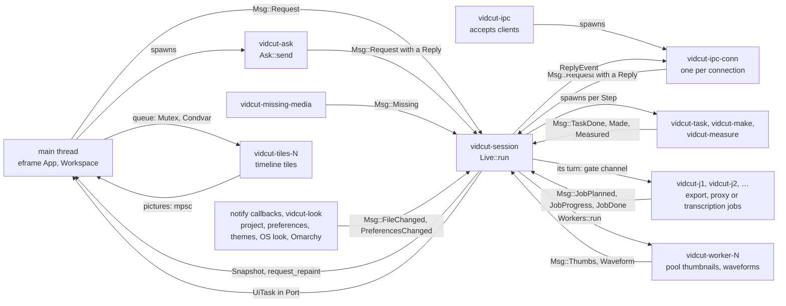
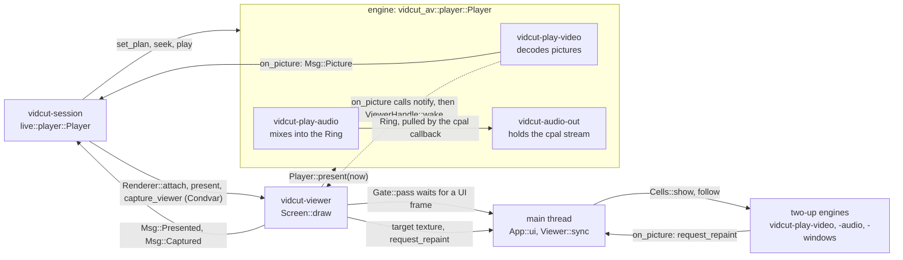
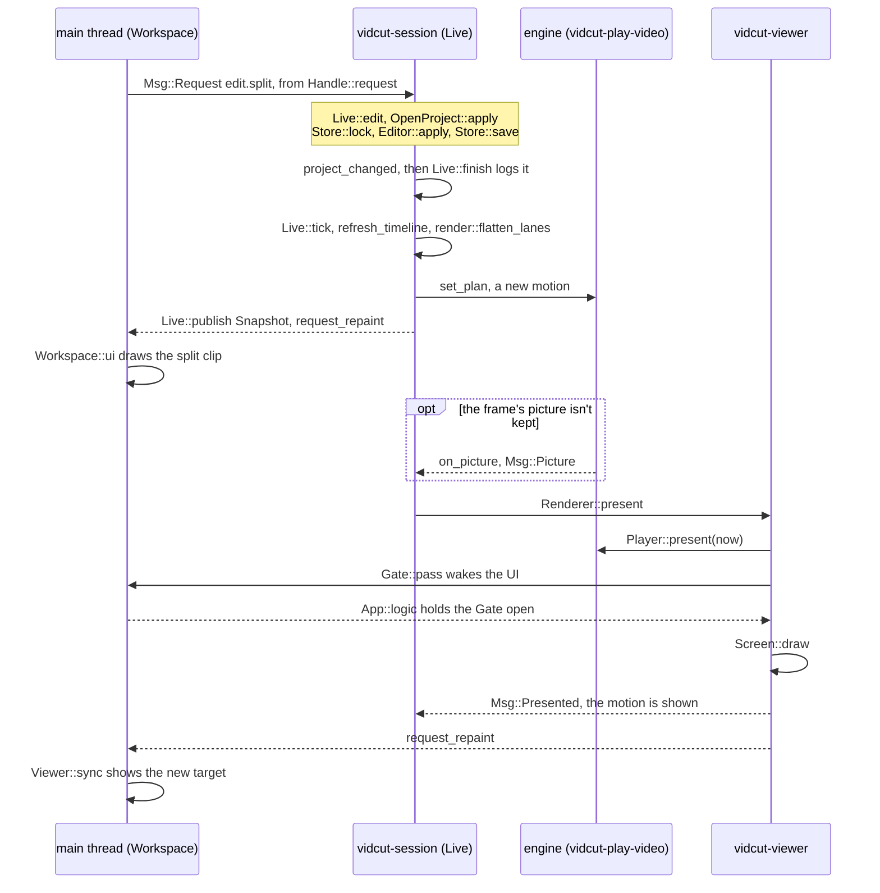

# The running GUI

- With a window open, the UI thread draws egui and turns gestures into requests.
- The `vidcut-session` thread is the live core. It owns the open project, the viewer's player and all that the viewer shows.
- The UI never waits for the core. It sends messages and reads the latest snapshot.
- [requests](requests.md) has the routing and the editor. [playback](playback.md) has the player and the viewer's drawing. [threads](threads.md) has the priorities.

The core and the threads around it:

The viewer and the players:

## The UI thread

- `gui::run` runs eframe with `App` on the main thread.
- `App::new` starts the viewer thread, the core (`live::start`) with `Port` as its `Renderer`, and the IPC server.
- In each frame, `App::logic` runs the `UiTask`s that the core queued in `Port`: captures, window and GUI changes, trims, quit.
- `App::ui` takes the viewer's target (`Viewer::sync`) and calls `Workspace::ui`, which reads `Handle::snapshot` once and draws from it.
- Both hold the `Gate` open for the viewer's GPU submissions. After each frame, the UI leaves its `GuiState` in `Port`.

Redraws:

- The window presents with vsync (`PresentMode::AutoVsync`). It redraws on demand: input, a new snapshot, a new viewer picture.
- While the timeline plays, its playhead moves between whole frames. With Fixed Playhead, the strip under the playhead does too.
  - The engine gives the fraction of the frame on the audio clock, and the rate (`Status::glide`). The snapshot carries it (`PlayerSnap::glide`).
  - `Workspace::glided_playhead` runs it on to the moment of drawing.
  - `Workspace::glide_repaint` asks for the next redraw when the timeline moves a physical pixel. It does not ask while the window is minimized or covered.
- Why: in whole frames, the timeline jumps a frame's width at a time. Vsync puts each redraw on a refresh, so the steps are even.
- When playback stops, nothing redraws on its own.

Requests:

- A gesture is one request. `Workspace::send` calls `Handle::request`: a `Msg::Request` with `Origin::Gui` and no reply. A failure comes back as a notice.
- Where the UI needs the answer (presets, export plans, preferences), `Ask::send` calls `Handle::call` on a `vidcut-ask` thread. It leaves the result in a slot.
- Where the UI needs to know that its edit went in, `Handle::request_answered` sends the request from the UI thread and gives an `Answer`. Why: the request keeps its place among the other gestures.

Looks:

- The Subtitle Track and Title sections of the Inspector share their style rows (`TextFields`) and one look picker (`Workspace::look_picker`, `Picker`).
- The GUI reads the looks itself (`Looks`, `looks::all`), again after a short time and after a save or a delete.
- A pick of a look fills the fields of the section. Save as Look… and Delete send `looks.save` and `looks.delete`.
- Apply Look on a track (`track.set`), Create Subtitles from Audio (`subtitles.transcribe`) and the Titles tab (`titles.add`) send the name of the look.

Ducking:

- `Workspace::ducking_controls` puts Ducking, its sources and its Amount on each strip of the Mixer.
- Each change is one `track.set` with `duck`, thus one undo step. The Amount goes when its drag ends.
- Advanced opens the Ducking window (`Workspace::ducking_windows`). Apply sends its values in one `track.set`.
- The graph of that window sends `analyze.ducking` with the values of the window (`Workspace::ask_graph`). It asks again when the values or the project change, or when the playhead leaves the frames that it has.
- Alt+D turns ducking on or off for the track of the selected clip (`Workspace::toggle_duck`).
- Before a change that needs the speech detector, the GUI asks to download it (`Workspace::duck`).

AI models:

- Before a change that makes the timeline use an AI model that this computer does not have, the GUI asks to download it (`Workspace::send_asking`).
- `editor::models_after` applies the change to a copy of the project. It gives the models that the timeline uses only after the change.
- The change then goes with `download`. The core downloads the models in a `Measure` step before the change (`fetches`).

## The core

- `live::start` runs `Live::run` on `vidcut-session`.
- Each input reaches the core as a `Msg` on one channel.
- `Handle` is cheap to clone. It holds the sender and the latest snapshot.

Each pass:

1. `Live::tick`: a due timeline reload, a due present, the playhead while playing, the waits.
2. `Live::publish`: a new immutable `Snapshot` if anything changed, swapped into the mutex of the `Handle`. Then `notify` repaints the UI and wakes the viewer.
3. The answers of the pass go out, after the snapshot that shows them.
4. The core waits for messages, at most until the next timer.

**Why:**

- The project, the player and the selection change on one thread. Thus nothing locks them.
- The UI only reads finished snapshots.
- A client that looks right after its answer sees the result.

The snapshot:

- The `Snapshot` carries the project, players, selection, notices, waveforms, missing media and jobs. It also lists the media whose pool thumbnails are on disk.
- It also carries the timecode count (`TimecodeDisplay`) and the Timer 1 zeros (`Timer1Origin`) of this session.
- Each change of the project calls `Live::forget_removed`. The waveforms, the thumbnail list and the ducking measurements of removed media leave memory.
- An undo that brings the media back makes them again.
- `Port` passes `Renderer::attach`, `Renderer::present` and `Renderer::capture_viewer` to the viewer thread, and the rest to the UI.

## Steps and waits

`Live::request` checks the expected project and `if_rev`, and starts media exports as jobs. Then `Live::dispatch` returns a `Step`:

| Step | Runs | Then |
|---|---|---|
| `Now` | here: edits (`Live::edit`), queries, play, pause | the answer |
| `Wait` | nothing: seeks, steps, screenshots and `jobs.wait` join the waits | `Live::tick` finds its `Until` met |
| `Task` | `vidcut-task`, at its `Work`: plans, frames, storyboards, analyses, project-less requests, UI answers | `Msg::TaskDone` |
| `Make` | `vidcut-make`: a project from an OpenTimelineIO file | `Msg::Made`; the core opens it |
| `Measure` | `vidcut-measure`, at job priority: measures for Ripple Delete Silence, Detect Scene Cuts, `motion.find`, Normalize Audio Levels and ducking; model downloads; `.otioz` unpacking | `Msg::Measured`; the edit runs here |
| `Encode` | a job: proxies, transcriptions, word timings, Re-time to Speech | `Msg::Measured`; the edit uses the result |

Work off the core uses a copy of the project from the time that the request arrived.

`Until` names what a request waits for:

- `Shown`: a seek, step, load or switch is on screen at its frame. A seek elsewhere first fails it with CONFLICT. A wait that the GUI itself asked for only ends.
- `Settled`, then `Capture`: a viewer screenshot waits for the latest motion, then for the picture (`Msg::Captured`).
- `Job`: `jobs.wait`, until the job ends.

Each wait has a deadline, except an untimed `jobs.wait`.

## The open project

- `OpenProject` keeps the `Store`, the `Editor`, and the text and stamp of the file as last read or written.
- `OpenProject::apply` first reads the file again if its stamp moved.
- A mutation does this under `Store::lock`, and saves with `Store::save` before the reply. History compaction (`Store::compact`) runs on `vidcut-history`.
- A `notify` watcher on the folder of the file sends `Msg::FileChanged`. Then `OpenProject::reload` reads the file under the lock.
- The file is the source of truth. [requests](requests.md) tells about outside changes and undo.

## Jobs

- These requests are jobs:
  - `export.start` to a media file
  - `proxy.generate`
  - `subtitles.transcribe`, `media.transcribe`, and `analyze.words` when it hears the timeline
  - `subtitles.retime` and `subtitles.time_words`
- A job is a `JobInfo` in the snapshot, a cancel flag and a thread (vidcut-j1, vidcut-j2, …).
- `jobs::Turns` lets one job run at a time. An export goes before the proxies and transcriptions that wait.
- A job waits at its gate channel for its turn. An export waits after its files are planned (`Msg::JobPlanned`). The other jobs wait before they start.
- A `background` request has its answer when the files are planned. Other requests have it when the job ends. The GUI's requests are `background`.
- Automatic proxies are the core's own `proxy.generate` (`Origin::Session`).
- An `apply` with a request that runs long (`runs_long`) runs first on a copy, on a thread. Then the core applies it. It takes what the copy measured and made. Both runs use the playhead of the request's start.
  - The copy runs every command of the batch with the full environment. Thus a command that writes a file also writes it during the copy.

Transcriptions:

- A transcription hears the timeline on a copy. A re-timing also measures its speech there.
- Then the edit adds the cues with `AvEnv::heard_only`. It takes what the job heard, and does not transcribe on the core's thread ([analysis](analysis.md#transcription)).
- If the sound of the timeline changed in the meantime, the edit fails with CONFLICT.
- While a job that hears speech waits or runs (`HEARS`), `Live::follow_budget` lowers the GPU budget of the kept pictures. The rest comes down to memory. Why: a speech model then has the GPU memory.
  - On Apple silicon, the budget stays.
- The budget of the preference comes back when the last such job ends.

Cancel:

- `jobs.cancel` sets the flag, and closes the gate of a waiting job. Thus the job wakes, cancelled.
- A client that disconnects sets the flag of its foreground job, but does not close the gate. Thus a waiting job waits for its turn, and then stops.

Notes and progress:

- The job thread installs a `vidcut_av::progress::Noting`, which turns each note of the engine into a `Msg::JobNote`.
- The notes tell the encoders that opened or failed, the colors, the source files and their decoders, the upscaling and the downloads.
- For a transcription, they also tell its model, device, language and speaker model, as each becomes known.
- The progress of a job carries the frames made and decoded on the GPU, and the copies between GPU and memory. Only a job that encodes has a frame rate.
- `JobDetails` collects the notes in the `JobInfo`. Thus `jobs.get` and the Jobs window show the same.

The bar and the Jobs button:

- The bar fills from `JobInfo::fraction` when the step counts its work: a download, an upload, listening, transcribing, frames, light measurement.
- Loading a model (`Stage::Loading`), a speaker pass (`Stage::Speakers`) and waiting for a reply (`Stage::Waiting`) have no fraction.
  - For these, the bar runs a light from end to end and shows the time elapsed, and `eta` is null. A terminal prints a spinner.
- The Jobs window never opens by itself.
- The Jobs button in the top bar counts the running jobs. It glows a moment when a job starts or ends. After a failure, it keeps the error color until Jobs opens.
- The details of a job copy as text, or as the `vidcut` command that runs it again.
- A finished job opens. A failed or cancelled job runs again as the same request.

## Missing media

- `MissingWatch` runs `vidcut-missing-media`. It looks at the paths of the media and of their proxies after each project change, and at a fixed interval.
  - Why a thread: a stalled network drive can hold a file check for long.
- It sends `Msg::Missing` when either set changes. The end of a proxy job makes it look again at once.
- Missing means absent, or a path from another system.
- The UI marks missing media in the pool and the timeline. It offers Relink Media (`media.relink`), and the viewer shows Media Offline ([spec §3](../spec.md#3-media-pool-ch-34-pp-653675)).
- The pool marks a lost proxy LOST PROXY.
- While proxies play, a proxy that is lost or back reloads the plans of the viewers. Thus they play the original or the proxy again.
- `Live::make_proxies` makes a lost proxy again when the automatic rules pick its media ([spec D41](../spec.md#12-decisions-on-gaps-and-contradictions)).

## IPC and the registry

- `App::new` calls `ipc::server::start` on `ipc::registry::socket_path`.
- Each JSON-RPC line goes to `Handle::call` with `Origin::Ipc`. Progress goes back as notifications.
- `Live::register` writes the entry of this GUI (pid, socket, open project) at start and at each project open. `Live::shutdown` removes it.
- The CLI and MCP find the GUI there ([requests](requests.md#routing)).

## The command log

- `Live::finish` ends each request. It adds a `LogEntry`, except for quiet requests: state queries, the GUI's lookups, dry runs, scrubbing, drags, search as typed.
- A `LogEntry` holds the origin, the method and params, a summary, success or error, the revision, and whether the project changed.
- The summary (`vidcut_core::describe::describe`) comes from the project before the edit runs.
- The log is capped. `gui.log` gives it to scripts.

## What the GUI computes itself

**Trims in progress.**

- The UI runs `vidcut_core::ops` on a clone of the snapshot's project. It does this to draw Dynamic Trim and its two-up frames (`dynamic_preview`), and to try a trim before it sends it.
- `Workspace::trim_sent` shows that copy until the revision of the core catches up (`Workspace::shown_project`).
- The timeline draws the playhead where the seek of a trim goes (`landing`), until the playhead moves. Why: a Dynamic Trim run that stops does not scroll back.
- Meanwhile, Space, Up/Down, ruler drags and swipes start from the playhead as drawn (`drawn_playhead`).

**The window.**

- `window.json` in the state folder keeps the window as each system keeps a window (`Window::watch`). Windows keeps the placement, macOS the saved frame of AppKit, and Linux the size and the maximized state.
- The placement goes back in the first frame, while eframe still hides the window.
- The file is written only after the window changes and stays still, and when the GUI closes. Thus a reset that deletes the file stays done.
- `gui.window` sets the size, position (not on Wayland), maximized, minimized and fullscreen state of a running GUI.

**Separate windows.**

- The Transcription, Jobs, History, Keyboard Customization and Sync Clips windows are system windows of their own (`dialog::separate_window`). Thus they can go to another screen.
- They are immediate viewports of egui. Thus eframe draws them each time that it draws the main window.
  - Why: they use the state of the `Workspace`, which a deferred viewport cannot borrow.
- A window opens without the keyboard focus. With no kept place, it opens at the center of the main window.
- On Windows, `Tool::watch` finds the window by its title among the windows of the UI thread ([gotchas](../gotchas.md#wgpu-and-egui)).
- The main window then owns it. Thus it stays above the main window and has no taskbar button.
- `window-transcription.json`, `window-jobs.json`, `window-history.json`, `window-keys.json` and `window-sync-clips.json` keep the windows as `window.json` keeps the main window.
  - Windows keeps the placement.
  - macOS and Linux keep the size, the maximized state, and the position that egui reports. Wayland reports no position.
- The keys that a separate window does not use go to the main window in the next frame (`dialog::take_forwarded_keys`). Thus the shortcuts work there too.
  - Held keys do not go. Thus K with J or L works only in the main window.

**The Effects page** ([spec §8.19](../spec.md#819-compositions-pp-1332-1385-1403-1420-21082111-2472-2480-2483-24902492-2500)).

- `EffectsPage` holds the page that shows, the selected nodes, and the state of the Node Editor and of a mask drag.
- `Workspace::effects_clip` finds the clip of the page: the topmost visible clip at the playhead (`placing::topmost`).
- The viewer renders that clip alone through `render::composition_alone` and `Cells::show_plan`, at the size of its own picture.
- The Inspector of the page is `Workspace::node_inspector`. It shows each selected node with the rows of its tool.
  - A drag holds the value (`Inspector::held`) and sends one `comp.set` when it stops. `Workspace::node_preview` shows the held value until then.
  - Each value has its Keyframe button. It sends `comp.key` with the `value`.
- A drag of a mask handle in the viewer changes a copy of the composition. It sends one `comp.set` when it stops.
- A tool from the Effects Library goes in with `comp.add`. The new node then becomes the selection through `gui.nodes`.
- On the page, the keys go to `Workspace::effects_keys`: play, stop, J, K, L and the steps of a frame and a second.

**View state.**

- The view state is the selected edit points (`TimelineView::edit`, `TimelineView::edits`) and the selected dissolve (`TimelineView::transition`). It is also the target track, the zoom, the Timeline Options and the open windows.
- It is also the page and the selected nodes of the Effects page.
- `timeline.json` keeps the target track, the zoom and the Timeline Options. Requests reach the view state through `Renderer::gui`.
- When another project opens, `TimelineView::switch_project` clears the view state. It keeps the Timeline Options and the choices that are not about one project. The open windows of the timeline close.
- `LeftTab::Hidden` is the left area with no tab open. Each place that opens a tab sets `Workspace::left`, thus it also shows the area.
  - The tabs then are a row above the viewer (`Workspace::left_tick`). Thus the tab that hid the pool stays in reach.
- The Trim Editor shows the selected edit while the player is stopped (`Workspace::trim_editor_edit`). A drag of its handles holds the trim (`TimelineView::strip_drag`), shows it (`Workspace::strip_drawn`), and sends it on release.

**Trims of the selected edits.**

- `edits::Cut` is the trim of one edit: a roll, an audio roll, or a trim of one side. `edits::Plan` holds the cuts of the selected edits, and refuses a mix of rolls and trims.
- A side that faces the side of the edit clicked last gets the opposite amount.
- `Plan::each` gives each edit the same amount, for the comma and period keys (`Workspace::nudge_edits`) and Dynamic Trim (`DynamicTarget::Edits`).
- `Plan::shared` is for a drag (`Gesture::Edits`). The ripple trims on one track share the amount, and the other trims get all of it.
- Several trims go as one `apply`. Thus one undo step takes them back.

**Track rows** ([deviation X57](../deviations.md#x57-the-lower-timeline-keeps-its-height-and-its-tracks-scroll)).

- `Rows::layout` lays out the rows of the lower timeline from the bottom, and shrinks them to fit, down to a minimum.
- When they still overflow, the wheel (`scroll_rows`) and the scrollbar (`row_scrollbar`) lift them (`TimelineView::rows_lift`, `Rows::overflow`).

**Clip volume** ([spec D77](../spec.md#12-decisions-on-gaps-and-contradictions), [deviation X73](../deviations.md#x73-the-volume-line-takes-the-keyframe-controls-of-the-edit-page)).

- `paint::volume_line` draws the volume line of each clip with sound. With volume keyframes, the line is the curve (`geometry::curve_y`), with a mark on each keyframe.
- `geometry::volume_target` finds the handle, keyframe or line under the pointer (`OnVolume`).
- The drags are `Gesture::Volume`, `Gesture::Key` and `Gesture::KeyHandle`. They send `keyframes.set` and `keyframes.move`, in one `apply`.
- `Preview::gains` draws the dragged gains. On release, `Workspace::trim_sent` shows them until the project has them.

**Speed keyframes** ([spec D48](../spec.md#12-decisions-on-gaps-and-contradictions)).

- `paint::speed_marks` draws the strip of a clip with speed keyframes (`geometry::speed_strip`): a line at each speed keyframe and the speed of each section.
- `geometry::speed_labels` places the speeds. The paint, the pointer and the clicks use the same places (`geometry::speed_label_at`).
  - Why: a click on a speed then opens the list of the speed that the user sees.
- A click on the speed of a forward section keeps it in `TimelineView::section_list`. `Workspace::section_list` shows the list as a popup there.
- Set opens `Workspace::section_window`. Both send `speed.set` at the first frame of the section (`SectionSpeed`).
- The slip handle starts under the strip (`geometry::slip_handle`). Thus it does not cover the speeds.

**Subtitles.**

- `cues::placed` places the cues of a subtitle track, at half height where cues overlap. `cues::paint_track` draws them, and `cues::hit` finds the cue or edge under the pointer.
- A cue drag is `Gesture::CueMove` (`subtitles.move`) or `Gesture::CueTrim` (`subtitles.set`). A subtitle item dragged from the pool is `Gesture::Subtitles`, which drops as `subtitles.import`.
- `Workspace::sync_subtitles` hands the shown track to the core (`Handle::show_subtitles`), with the text being typed and the style being set. Thus the viewer draws the cues as an export burns them in.
- The Subtitle Track section (`TrackDialog`) works out the style of its fields (`style_of`). The viewer draws it, and `track.set` sends it when the user leaves the field.
- The Subtitle section (`CueDialog`) sends its changes with `Handle::request_answered`. It keeps what it sent until each `Answer` comes and the project has that revision.
  - Why: a refused change goes away, and the field does not jump back while a change is on its way.
  - A section that closes while it waits leaves a `Landing`, which it takes back when it opens again on the cue.
- The selected cues are part of the session's `Selection`, as clips are.
  - Its `order` holds the clips and the cues in the order of selection, because the two lists hold no order between them.
  - `Selection::keep_order` removes each item that left the selection and adds each new item at the end. Items that come in one request count clips first.
  - Its `first` is the first item of `order`.

**Titles** ([deviation X52](../deviations.md#x52-titles-come-from-a-titles-tab-and-are-edited-in-the-inspector)).

- The Title section (`TitleDialog`) works out the title of its fields (`title_of`). When the user leaves a field, the changes go as one `titles.set`. A change on each line of a lower third goes as one `titles.set` for each line.
- The onscreen controls (`onscreen::Grab`, `Workspace::title_controls`) box each title from one upright drawing of `burn::title`. They send one `titles.set` when a drag ends.
  - A title that follows a motion path has its box where the plan draws it.
    - `lead_at` gives the move of the frame (`Lead::spot`), and `drawn_at` adds it.
    - A drag stores the own position of the title: the place under the pointer less that move.
- `Workspace::title_wanted` gives the one title to preview: the dragged title, else the changed title of the Title section, else a title just sent (`tools::landing`).
- `Workspace::sync_title_preview` hands the preview to the core (`Handle::preview_title`), and the core to the player. Thus the viewer draws it as an export does, without a new plan.
  - The core first loads a plan that it still owes. Why: the player does not show an older title.
- The Titles tab (`title_browser::Browser`) draws its cards with `burn::title`. A dragged card (`Gesture::Title`) drops as `titles.add`.
- The Inspector shows a selected transition with `Workspace::transition_form`. A change of length or alignment sends the type again (`fades::kind`), as `edit.dissolve` makes a new transition.
  - The Transition Curve row edits the curve at the playhead with `transitions::put_progress`, `toggle_key` and `reset_curve`. The row sends the whole type with `edit.transition`.
  - `keyframes::split` adds a key between two keys. On a curved part, it cuts the Bezier curve at the key, and the shape stays.
- The Transitions tab (`transition_browser::GROUPS`) draws its cards. A dragged card (`Gesture::Transition`) drops as `edit.dissolve` on an edit, and as `edit.transition` on a transition.
- The Effects tab (`effect_browser::GROUPS`) draws its cards. A dragged card (`Gesture::Effect`) drops as `effects.add` on the clip under the pointer.
- A hovered card previews with `Handle::preview_free_title`: the core adds the title at the playhead to its copy of the project (`FreeTitle`).
- The Generators page of the Effects tab (`EffectsTab`, `generator_browser::CARDS`) draws its cards. A dragged card (`Gesture::Generator`) drops as `generators.add`.
  - Each card shows the picture of its kind with the default values, through `generators::draw`.
  - A card draws at the size of a full frame, and then shows a part of its pixels. Why: the layout of a bar pattern depends on the size, and a small SMPTE Color Bar shows only its left side.
  - A double-click on a card sends `viewer.load` with `generator`. `Live::load_generator` holds the source in `Live.source_generator`. `SourceContent::Generator` loads `render::generator_tape` in the source player.
  - `SourceGenerator` holds the kind, its settings, the length and the marks, for this session. Why: a generator is not a file of the project, so it has no `Media.marks`.
  - `Snapshot::viewer_marks` gives the marks of the grid or of the open generator. The scroll area, the Duration field and the keys of the viewer use it, with `viewer.marks.set`.
  - `SourceGenerator::params` gives the source of an edit (`Workspace::edit_sources`). A drag from the viewer starts a `Gesture::Generator` with the marked length.

**Pictures.**

- T, Shift+T, Alt+T, the clip menu, the Tools row (`Workspace::picture_tools_row`) and `gui.show` set the viewer's tool (`placing::Grab`).
- `Guides::overlay` builds the framing and safe-area guides in egui, not `Screen::draw`. Thus an export leaves them out ([deviation X80](../deviations.md#x80-safe-area-guides-skip-the-trim-editor-and-dynamic-trim)).
- `viewer.guides` changes `ViewerPrefs`. The snapshot carries `guides` and `show_super_scale`.
- `viewer.scopes` changes `ViewerPrefs` too, and the snapshot carries `scopes`.
  - `Workspace::scopes_menu` is in the View menu and in the header of the viewer. Each button sends `viewer.scopes`.
  - `Workspace::scope_column` takes a column at the right of the viewer's area. `Workspace::paint_scopes` paints each scope with its marks in egui ([gpu](gpu.md#the-scopes)).
- `Workspace::picture_controls` boxes the handles through the `place::Placing` of the picture ([spec §8.15](../spec.md#815-transform-and-crop-pp-766768)).
  - The handles work about the anchor point (`Shown::pivot`, from `place::anchored`).
  - A move snaps the middle of the picture as drawn, not its `position`.
- A drag, or a run of wheel notches (`Wheeled`, `Workspace::settle_picture_wheel`), ends in one `picture.set`.
- The dragged picture goes to the core with `Handle::preview_pictures`. After it, the sent picture goes there until the project has it (`tools::landing`).
- The boxes of a Dynamic Zoom are the picture placed with the start box and with the end box (`Shown::ends`). Thus they stay in place while the clip plays.
- `Workspace::area_controls` draws the handles of the area of one effect (`AreaShown`), before `Workspace::picture_controls`.
  - The effect is the picked effect of the Inspector, while Effects of the Tools row is on (`Grab::effects`, `Workspace::effects_tool`).
  - `Workspace::sync_effect_area` sets the effect each frame. With Effects off, the viewer shows no area.
  - `AreaShown::grip` gives what a press holds (`AreaHold`). `area_moved` gives the area of a drag, and `Workspace::land_area` sends one `effects.set`.
  - The handles show the area at the playhead (`Effect::adopted`). An effect with keyframes sends `at`, as the Inspector does.
  - `AreaShown::cursor` gives the pointer of a hold. `paint_area` puts a ring on the handle under the pointer.
  - On a polygon, `Workspace::area_points` adds a point on a click on a side. It removes a point on a middle-click, or on a click with Alt.
- The Blur tool (`Workspace::blur_tool`, `Grab::blurring`) draws a new area in the viewer (`Workspace::blur_controls`).
  - A drag holds `AreaHold::Draw` (`Workspace::blur_drag`). `area_drawn` makes the area from the two ends of the drag. The picture with the new effect is the preview.
  - With Free Shape, `Workspace::blur_points` keeps the clicked points. `area_through` makes the polygon when the shape closes.
  - `drawn_request` is the `apply` of the new blur. `Workspace::land_drawn` sends it, picks the new effect (`Workspace::pick_effect`) and sets Effects on.
  - A press on the shown area goes to `Workspace::area_controls`.
  - With a picture tool on (`Grab::tool`), `Workspace::blur_controls` takes no pointer. Thus `Workspace::picture_controls` gets each press.
  - `Grab::blurring` tells whether a drag draws a new area.
- The Find tool (`Workspace::find_tool`, `Grab::find`) shows a box on each motion path of the selected clip (`Workspace::paint_motion`).
  - Its buttons send `motion.find` for one subject (`Workspace::find_things`). They take the Quality and the Advanced values of the Motion section.
  - A click on a box picks its path (`Grab::found`). The smallest box under the pointer wins (`within`).
    - The click also picks the first effect that follows that path (`Workspace::pick_effect`).
  - Blur and Other Effect add an effect that follows the picked path (`Workspace::effect_on`). Then the left panel shows the Inspector.
    - The area is a box for text, a person or a vehicle, and an ellipse for a face (`boxed`). The Blur of a subject uses the same shapes.
  - Transform, Crop, Dynamic Zoom, Effects and Blur set Find off, and Find sets them off.
  - `Workspace::blur_tools` is the row of the tool: the shapes, and one button for each subject of `inspector::SUBJECTS` (`Workspace::subject_blur`).
    - `SUBJECTS` lists the subjects that the app shows: `Subject::Face` and `Subject::Text`. The other subjects of `Subject::ALL` have no button.
  - `Workspace::area_tools` has Track and Delete for the shown area. The row shows them also with the Tools row off (`Grab::rowed`).
  - The Area rows of each effect in the Inspector have Track too (`Act::AreaTrack`).
    - Track sends `motion.track` for the area (`Workspace::track`): both ways when the area follows no path.
    - When the area follows a path, it goes forward from the playhead. On the first frame of that path, it goes backward.
    - It asks before the download of the model, as Find does (`Finding`, `model_needs`).

**The Inspector** (`inspector::Inspector`, `Workspace::inspector_panel`).

- It is a tab of the left panel (`LeftTab`). It draws the open Title, Subtitle and Subtitle Track sections (`Workspace::title_form`, `Workspace::cue_form`, `Workspace::track_form`).
  - Follow in the Title section lists the motion paths of the clips that play under the title (`leads`, `follow_row`). A choice sends `motion.follow`, and the title goes onto the thing.
- With a clip selected, it has three tabs (`Tab`): Video, Audio and Effects. The name of the clip and the tabs stay above the sections when they scroll.
  - Video shows the Title, Generator and picture sections, the Motion section and the Speed section.
  - Audio shows the sound sections and the Speed section.
  - Effects shows the effect sections.
  - A tab without sections is disabled (`tab_has`). Thus the Effects tab is disabled for a clip with no effects.
    - Resolve 21.2 shows that tab dim for such a clip. Its manual says that the panel is dimmed (p. 1150).
    - The Effects tab is also disabled while more than one clip with a picture is selected.
  - The Inspector stays on its tab while the selection has sections for it (`Workspace::settle_tabs`). Otherwise it goes to Video, or to Audio without a picture, and stays there.
    - An empty selection does not change the tab.
    - `Workspace::watch_inspector` applies these rules while the Inspector is not shown. It works only when the selection or the project changes.
  - One effect is the picked effect of the Inspector. Its name has the accent color, and only its section can be open.
    - After the name, the title shows what the area of the effect follows: the name of a path, or all of a subject (`all_of`).
    - A click on the name or the arrow of another effect picks and opens it (`Act::EffectOpen`). A click on the picked effect closes or opens its section.
    - A double-click acts as one click. Thus it opens a closed section, and does not close it again.
    - `Workspace::settle_effects` picks the first effect when the selection changes, and when the picked effect goes.
    - It picks an effect that comes to the clip, from an add or an undo. Then the Inspector also goes to the Effects tab.
    - The picked effect stays picked when its place in the order changes (`shuffled`).
    - An effect that comes to a clip that is not selected changes nothing in the Inspector.
- `Workspace::follow_selection` shows the section of the selected title or subtitle. With only several titles selected, it shows no section. A section that closes puts its changes in first.
- The In and Out fields of a cue (`Workspace::cue_times`) send one `apply`. It sets the cue, and sets or removes the cues that it overwrites. A value inside the cue next to it sends nothing (`enters_neighbor`).
- The picture fields convert between the picture and their own unit (`Field::read`, `Field::put`). The fitted size comes from `place::fitted`, as in an export.
  - A picture from the handles, the wheel or the Inspector goes first (`Workspace::picture_wanted`). Thus the fields follow a drag in the viewer.
  - Each change is one undo step: one `picture.set`, or an `apply` of one `picture.set` for each clip. Reset sends `picture.clear`.
  - Why the `apply`: a `position` holds X and Y, so Position X goes with the Y of each clip. A crop in pixels is a different fraction of each picture.
- The Generator section (`Workspace::generator_section`) shows the rows of the first selected clip's generator.
  - A color row sends one `generators.set` when the pointer is up. Then `Recolored` shows the sent color until the project has it (`tools::landing`).
  - The Center rows of a Four Color Gradient act as the other keyed rows. A value goes with `generators.set`, and its keyframes go with `keyframes.add`. Reset removes the keyframes and sets 0.
  - The Level row of an EBU Color Bar sends one `generators.set` for each choice.
- The Equalizer section (`Workspace::equalizer_section`) shows the equalizer of the first selected clip with sound. A clip with none shows `equalizer::usual`.
  - Its header is the one of the other sections with a switch (`switched_fold`).
  - A drag on a handle of the graph or on a field keeps the changed equalizer in a `Draft`. The pointer up sends one `clip.set` with the changed values.
  - Then the `Draft` shows the sent values until the project has them (`tools::landing`).
  - While the switch is off, the graph and the bands are disabled. The curve shows the bands as with the switch on.
- The effect sections show the effects of the first selected clip (`effect_block`). Each change is one `effects.set` for that clip.
  - A dragged value previews as a picture with the changed effect (`knob_picture`). `Picture::preview` puts a keyframe on each changed value that has keyframes (`Effect::previewed`).
  - On a value with keyframes, `knob_picture` puts a keyframe on the frame of the playhead (`Knob::keyed_value`). `effects.set` then has `at`.
  - The section shows the values of the playhead's frame (`Effect::adopted`).
  - On, Move Up, Move Down, Reset and Delete send `effects.set`, `effects.move`, `effects.reset` and `effects.remove`.
  - The Keyframe button and its ease menu send `effects.key`. Previous and Next seek (`step_effect`).
    - The button and the seeks leave out the keyframes of the area (`effect_marks`, `effect_key_times`). Why: `effects.key` without `area` does not change them.
  - Each effect has the same Area rows (`area_rows`). Each change is one `effects.set` with `area`. Off sends a null `area`.
    - The numbers of the area are knobs (`AreaKnob`), so a drag previews and lands as the other values do.
    - The Follow menu lists None, one entry for each subject of `SUBJECTS` (`all_of`) and the motion paths of the clip (`follow_row`, `PathRow`).
    - A subject entry sends the name of the subject in `follows`. It is there also when the clip has no path of that subject.
    - The menu shows the name of each `Subject` that an area follows (`Subject::named`), also of one that it does not list.
- `Workspace::motion_section` shows for the first selected clip that takes motion paths (`ops::motion::takes`), below the picture sections of the Video tab.
  - Its first row has a menu of the subjects (`Subject::ALL`), Find, Blur and Advanced.
    - Quality is Faster or Better, as the Quality of Magic Mask in Resolve (p. 3286). Better gives `motion.find` the size `BETTER_SIDE`, unless the size field has a number.
    - Advanced shows a field for the size of the picture and for each value of the path rules (`FIND_VALUES`). An empty field keeps the usual value, which the field shows.
    - Each field tells on hover what it sets, and what a lower or a higher number does.
    - Find and Blur send the filled fields with `motion.find` (`find_extra`). A field that is not a number stops the request, and a line tells so.
  - Find sends `motion.find` (`find_request`), with `replace` when the clip has paths of that subject.
  - Blur sends one `apply` (`blur_request`). It has `motion.find` when the clip has no such path.
    - Then it has `effects.add` of a Mosaic Blur, and `effects.set` with an `area` that follows the subject.
    - It leaves the blur out when an effect of the clip follows the subject. With nothing to send, the button is off.
    - The live core runs an `apply` with `motion.find` as a long edit (`runs_long`): it measures on a job thread first.
  - A `motion.find` and a `motion.track` of their own run as jobs (`start_encode`, kinds `find` and `track`). The Jobs window shows each with its progress, and Cancel stops it.
    - The `apply` of Blur measures with no job, and shows no progress.
  - `Workspace::find` asks before a download when the model of the subject is not there (`subjects::needed`, `Finding`). `Workspace::motion_prompt` shows the question that the other local models use (`ask_download`), and `with_model` then sets `download` on `motion.find`.
  - The rows below list the motion paths of the clip.
  - A name goes with `motion.set` when its field loses the focus (`Naming`). Escape drops the typed name. Delete sends `motion.remove`.
  - The rows read the paths from the shared project of the snapshot. The snapshot holds no copy of the samples.
- `Workspace::input_lut_section` shows the Input LUT row of the media of the selected clips, with a file pick and Reset. Each change is one `media.set`.
  - The Input LUT submenu of the pool's right-click menu sends the same request (`Workspace::pool_item_menu`, `Workspace::ask_input_lut`).
- `speed_section` sends what the Change Clip Speed window sends (`SpeedDialog::params`). `Workspace::audio_section` sends `clip.set`.
  - On a clip with speed keyframes, it shows the section under the playhead (`Paced`). `section_speed` sends `speed.set`, `speed.freeze` or `speed.reverse` there.
  - A Speed value under `Speed::RANGE` on clips with no speed keyframes goes to `Workspace::send_freeze`, which sends `speed.set` at the playhead.
  - The range of the Speed field has no bottom, so that a typed value comes through. `SpeedDialog::set_percent` limits the other values.
  - `Act::Drag` stops a drag at the start of `SpeedDialog::PERCENT`.
  - The Ease row shows `ops::speed::section_eases` and sends `speed.ease` for each clip (`Workspace::ease_sections`).
  - `speed_keys` draws the diamond and the arrows of the header. They act as the keyframe buttons of the picture and volume fields.
- With several clips, `number`, `speed_section` and `Workspace::audio_section` draw no keyframe buttons. `keyed_look` turns off a value with keyframes on one of the clips.
- `key_diamond` draws each Keyframe button. It has the color `KEY_ON` when the playhead is on a keyframe. The mark on a clip with keyframes has this color too, and the clip's name starts after the mark.

**The Keyframes tab** (`keyframe_editor::Editor`, `Workspace::keyframe_panel`).

- The selection is a list of `Mark`s: a value and a source frame.
- Each row records where it drew each keyframe (`Editor::seen`). A box drag (`Boxing`) selects the marks inside it on release.
- A drag shows the moved keyframes (`Shift`) and sends one `apply` on release. The selection follows the moved frames (`Pending`).
- Mark > Move Selected Keyframes (`Nudge`, `Workspace::nudge_keys`) sends what a drag of one frame or one step sends.
- A drag finds its keyframe at the point of the press (`pressed_at`). The pointer can already be past that keyframe when the drag starts.
- Shift holds a drag on a curve point to one direction (`Lock`, `locked`). The first movement selects the direction.
- `Editor::snap_off` turns off snapping. `snapped` finds the nearest target of a drag. `Shift::snap` is the time of the white line.
- A right-click on a selected keyframe keeps the selection. `marks_eases` gives the eases of the selection. `ease_parts` makes one `keyframes.set` for each value.
- `Editor::graph` turns on the large graph (`Workspace::curve_graph`). `graphed` gives its lines, without those in `Editor::graph_off`.
  - `Editor::graph_active` is the curve with the points. Without one that the graph shows, the first line is active.
  - `paint_curve` draws a curve with its points. `use_curve` takes its clicks and drags. The rows under the tracks use both too.
  - `dim_curve` draws a dimmed line and returns its points. `dim_at` finds the line at a click.
  - `Editor::graph_h` is the height, from the drag in `graph_grip`.
- A drag on a handle also sets the other handle of the keyframe (`HandleFix`, `lined_up`). `Drag::apart` is true while Alt is down.
- A drag on the line between two keyframes is `Kind::Line`. `CurveSpots::part_at` finds the part of the curve. The drag moves the values of its two keyframes, and `shift_of` keeps their frames.
- `Workspace::add_on_line` adds a keyframe at an Alt-press on the line.
- `Drag::frozen` keeps the value scale of the curve during a drag of a handle or of the line. Why: the point under the pointer stays under it.
- The selected rows are a list of values (`Editor::rows`). A click on a row's name or on a keyframe changes them.
- Mark > Add Keyframe, Delete Keyframe and Delete All Keyframes (`KeyCmd`, `Workspace::key_cmd`) act on the selected marks or the selected rows.
  - `Workspace::key_target` takes only the rows that the open tab or tray shows.
  - `Workspace::tray_adds_speed` sends Add Keyframe to the speed keyframes when the tray is open, the Keyframes tab is closed, and no row or keyframe is selected.
  - `Workspace::key_cmd_why` gives the next step for an item that is off. The menu shows it as the tooltip.
  - `Workspace::key_menu_why` gives the step that the three items share. The menu shows it as a line under them.
  - Delete All Keyframes keeps its question in `Editor::deleting` until the user answers (`Workspace::delete_all_window`).
  - With the tab and the tray closed, `Workspace::speed_cmd` acts on the speed keyframes of the selected clips (`Workspace::speed_clips`).
  - `Workspace::speed_cmd_why` then gives the next steps.
- The Speed row shows `Speed::keyframes`: the first frame of each section after the first, with its speed.
  - `keyframes.add` and `keyframes.remove` with the `param` `speed` edit them in `ops::speed`.
  - A speed keyframe does not move or copy (`fixed`). A change of its value sends `speed.set`.
  - Its ease menu has Linear and Ease In and Out (`key_eases`, `ops::speed::key_ease`). It sends `keyframes.set`.
  - The value field is off when the section is frozen or plays backward. Why: `speed.set` changes only a forward section.
  - Why: a speed keyframe is a cut between two sections. Its frame and its value come from the sections.
- A press in the tab or the tray gives them the keys. A press in another place takes the keys away (`Workspace::key_focus`, `Editor::focused`).
- With the keys, Ctrl+C and Ctrl+X send `keyframes.copy` or `keyframes.cut`. The core keeps the keyframes that come back as its clipboard, in place of the clips.
- With the keys, Ctrl+V sends `keyframes.paste` with the selected clips while the clipboard holds keyframes (`Snapshot::key_clipboard`). It never pastes clips there.
- Without the keys, Ctrl+V pastes no keyframes.
- The keyframe tray (`Workspace::keyframe_tray`) draws the same track rows under the lower timeline, on its `Scale`.
  - The tray and the tab share one `Editor`. Thus a selection in one shows in the other.
  - `Editor::tray` tells which of the two draws. A box and the ease menu stay in the one where they started.

**Silence stripes** ([spec §9](../spec.md#9-audio-pp-642-649650-743744-771-773-778779)).

- `SilenceDialog` keeps the dry run of Ripple Delete Silence as `Stripe`s, and the user's edits to them (`stripe_press`, `stripe_drag`, `silence_keys`).
- A changed setting runs the dry run again, and replaces the stripes and their edits.
- A change to what the dry run reads does the same (`SilenceDialog::forget_found`), because the stripes hold timeline frames.
  - `silence_reads` tells what it reads: the place, speed and sound of the dialog's clips, their media and the frame rate.
  - Other edits keep the stripes, their edits and their undo list.
- Each change keeps the state before it (`Shot`). Ctrl+Z and Ctrl+Shift+Z step through these states (`SilenceDialog::undo`). The project's history stays as it is until Remove.
- The dialog keeps the newest states (`SHOTS_KEPT`). Why: each state holds a copy of the stripes.
- While the dialog is open, `Handle::skip` hands the stripes to the session. The session plays the timeline as Remove would leave it.

**Timeline tiles.**

- `Tiles` decodes them on `vidcut-tiles-N`. Each tile shows the source frame under its left edge (`tile_frame`), by the clip's pace (`Clip::pace`).
- A tile that is not decoded yet shows the nearest kept tile of its height (`Tiles::nearest`), else of any height (`Tiles::nearest_any_height`). Why: the filmstrip stays full while a zoom or a scroll decodes new tiles.
- The tile that shows in place of another counts as shown. Thus it does not leave memory while it shows.
- The filmstrips of the Trim Editor use the same tiles (`vidcut_core::ops::filmstrip`, `TrimAnchor`).
- The pictures of the pool use the same tiles and the same limit (`Workspace::pool_picture`). Why: pictures of media share one `Lru`.
- The aspect of a tile comes from the media's probe (`media_aspect`). Thus a thumbnail has its shape before its first picture is decoded.
- A change of the file, the input color space, the Alpha Mode or the subclip range of a media removes its tiles from memory (`Seen`).
- The names of the tile files on disk hold the input color space and the Alpha Mode (`thumbcache::tile_block`). Thus a media does not read tiles of an earlier color space or Alpha Mode.
- The pool asks for some pictures ahead (`Workspace::preload`, `Workspace::preload_strip`):
  - Each media that shows, or is within one screen of the view, asks for its small pictures (`Tiles::thumbs`, in the next item).
  - A thumbnail within one screen of the visible ones asks for its poster (`poster_frame`).
  - A row of the Filmstrip view within one screen asks for all pictures of that row.
  - Why: the number of pictures follows the screen, not the number of media.
- The pool asks for these pictures with `Tiles::prefetch`, and for the pictures that it shows with `Tiles::want`.
  - `Tiles::prefetch` does not mark a tile as shown. Thus a tile that is only ahead can leave first.
  - `Tiles::prefetch` asks for nothing while the tiles use more than `AHEAD_MEMORY`.
  - Why: the pictures ahead never push the tiles over their limit, and a tile that left is not asked for again at once.
- Each video media has a file of 24 small pictures on disk (`thumbcache::thumbs_file`, `THUMBS`, `THUMB_SIZE`):
  - `vidcut-worker-N` makes the file once for each version of the media (`make_thumbs`). It does this only while `thumbnails.disk_cache` is on.
  - A fast decode makes the pictures (`vidcut_av::thumbs::filmstrip`). It decodes only reference frames.
  - The pictures follow the input color space and the Alpha Mode of the media, as the viewer does.
  - The Alpha Mode counts only for a file with an alpha channel (`thumbcache::drawn_alpha`). Why: the other Alpha Modes give the same picture without alpha.
  - The file keeps the time of the frame that each picture shows. The first picture is the first reference frame at or after the poster frame.
  - The `Snapshot` lists the media whose file is on disk (`Snapshot::thumbs`).
  - A tile worker reads the file before the tiles that wait. Its pictures go into the tiles as stand-ins at the frames of their times (`STAND_INS`).
  - A subclip uses the file of its source. Only the pictures in its range go into the tiles.
  - The stand-ins use the same `Lru` and limit as the other tiles. Thus they can leave memory.
  - `Tiles::thumbs` reads the file only when no stand-in of the media is kept.
  - A media that shows, with no kept picture, reads it at any use of memory. Thus a thumbnail shows at once also when the tiles are full.
  - Other media read it only while the tiles use less than `AHEAD_MEMORY`.
  - Why: a read cannot loop. A media that shows keeps the picture that it shows, so it reads its file once.
  - Why: a thumbnail shows its poster and the pictures of a hover at once. A decoded tile then replaces each stand-in.
- A hover over a thumbnail shows the kept picture nearest in time, of any height, until its frame is decoded.
- An `Lru` keeps the order in which the tiles were used. `Tiles::evict` removes the oldest tile until the cache is under its budget, and stops at a tile that the last paint showed. Why: each step of an eviction is one operation, with no scan of the kept tiles.
- Another `Lru` keeps the tiles that did not decode (`FAILED_KEPT`). A tile that leaves it is tried once more when it shows again.
- All workers share one `Lru` of the blocks that they read from disk (`Blocks`, `BLOCKS_KEPT`). A worker that writes a block removes it from this `Lru`.

**Imports** ([deviation X66](../deviations.md#x66-files-and-folders-dropped-on-the-window-go-into-the-open-bin)).

- Import Media, Import Media Folder and dropped files each queue a `Pick`. `Workspace::import_window` takes the picks in order.
- The paths of a drop gather until a frame brings no more. Why: winit sends each file as its own event, and a split run of numbered images would ask twice.
- `vidcut-import-drop` queues the files as one pick, and each folder as another (`PickedFolder::read`).
- A drop goes into the open bin. Why: winit does not report where files drop, and does not report drops on Wayland.

**The pool's box.**

- `Workspace::pool_box` draws the box from a drag on the background of the pool. `paint::marquee` draws it, as on the timeline.
- `BinsUi::places` holds the place of each media item that the view shows. Why: a view draws only the rows in view, and a box can reach past them.
- `Boxing` keeps the start of the box from the top of the content. Thus the start stays on its clip when the wheel scrolls the pool.
- On release, one `selection.set` carries the new selection (`boxed`).

**The pool's cards** ([spec §3](../spec.md#3-media-pool-ch-34-pp-653675)).

- `Workspace::cards` draws the Metadata view. `cluster` gives the heading of each card, and `main_description` gives its first line. `card_row` draws each other line. Each run of one heading is a block of rows, and only the rows in view are drawn.
- `Workspace::tile_picture` draws the picture of a tile and of a card.
- `PoolView::media` gives the order. With `PoolMode::Metadata` and `PoolSort::Name`, it goes by `first_letter` and then by timecode. With `PoolMode::Metadata` and `PoolSort::Timecode`, it goes by `created` and then by timecode. `named_order` puts a clip with no value first.
  - Why: Source Tape reads the same order. Thus `pool.set` refreshes the tape when the view goes to or from the cards.

**Media details.**

- The metadata strip of the pool (`Workspace::metadata_strip`) shows what the project keeps of the chosen media (`clip_info::glance`). `pool.json` in the config folder keeps it on or off.
- Clip Info (`Workspace::clip_info_window`) adds what `media.details` reads from the file (`probe::details`).
- Its Date Created, Camera, Scene, Shot, Take and Comment rows are text fields (`Workspace::note_field`). Enter or a click elsewhere sends `media.set`, and Escape cancels.

**The Transcription window** (`TranscriptionUi`, `Workspace::transcription_window`).

- It asks the core for `analyze.words` through an `Ask`. It asks again when the `rev` of the project or the `transcribed` set changes.
- Each paragraph between pauses is one galley. On the timeline, each gap between clips is a pause too (`holes`). While playing, only the paragraphs whose current word changed are laid out again.
- `Searches`, an `Lru`, keeps the matches of the last searches. A longer search filters the matches of a shorter search that it contains.
- While the window has the keyboard focus, `TranscriptionUi::take_keys` takes its keys before the timeline's shortcuts.
- The Filler Words window opens in the Transcription window.
- Its changes go as requests, for example `media.leave_out`, `edit.ripple_delete_words` and `media.words.set`. Its cuts on the timeline ask for `quiet` edges.
- On the timeline, Cut, Copy and Paste send `edit.cut`, `edit.copy` and `edit.paste` with the range of the words. The core keeps the clips that come back as its clipboard.

**Rows that do not fit** ([spec D72](../spec.md#12-decisions-on-gaps-and-contradictions)).

- The bars of the window are each a `Row` that `Workspace::fit_row` lays out.
- It draws the items once a frame in an invisible sizing pass, to measure them. Why: the font and padding of the theme count, and a label like Jobs (2) counts.
- `hidden` finds the fewest items that go to the ⋯ menu. The `fill` of a row gets the width left, and truncates.
- The sizing pass changes nothing. `Workspace::watch_jobs` keeps the glow of the Jobs button apart from its drawing.

**Dialogs.**

- `dialog::window`, `dialog::form`, `dialog::row`, `dialog::switch`, `dialog::advanced` and `dialog::footer` build the windows (AGENTS.md, rule 12).
- `dialog::tall_row` puts the label at the top of a tall row. Why: the content does not cover the next row.
- `dialog::form_width` gives the width of a window whose fields have one width.
- The looks of Create Subtitles from Audio are tiles (`look_tiles::Tiles`). `burn::draw` draws a sample in each look. The window keeps only the textures of the looks that it shows.

**The two-up and Multi Source**: `Cells` owns their players on the UI thread. `Screens` draws them.

**Multi Source** ([spec §4.1](../spec.md#41-modes)).

- `multicam::source_grid` works out the cameras of the pool's files and closes the gaps between the files.
- `SourceContent::Multi` loads `render::camera_tape` in the source player. The plan has the active camera's files at their places and black around them. Thus the transport and the sound work as in the other source modes.
- `Live.tape` then holds the active camera's files. `Snapshot::source_at` is empty when the playhead is outside them.
- `source_media` holds the active file. `Live::sync_camera` changes it when the playhead moves.
- `Live.multi_media` keeps the active file while another source mode is open. Why: a clip open in Source Clip does not change the active camera.
- `Live.multi_marks` holds the marks of the grid, for this session. Why: a change of bin clears them, and they are not on a file.
- `Live.multi_alone` tells that one camera is open. `Live::open_camera` gives the file the marks with `SourceGrid::file_marks`. Then the ordinary source clip code draws the picture, the marks and the edits.
- `SourceGrid::part` gives the frames of an edit in the grid. `SourceParams.lead` keeps the part before the file empty.
- `SourceLining::Grid` is the reference rule of Source Overwrite in the grid. Why: it is not the rule of the Media Pool view.
- `Workspace::multi_view` gives each cell the frame of its file. `Workspace::camera_grid` draws the grid.

**The Sync Bin** ([spec §7.4](../spec.md#74-sync-bin-pp-708710-measured-in-resolve-studio-2112)).

- `LeftTab::SyncBin` is only a state of the GUI. Live has no Sync Bin mode. Thus the grid runs on `ViewerMode::Timeline`, and the transport and the sound stay the timeline's.
- `multicam::sync_rows` works out the rows at a time, from the stored rows of a group or by `ruled_rows` on the timecodes. A `SyncRow` holds its files, and `media` and `frame` name the file at that time.
- `multicam::group_of_bin` chooses the group. With two groups or more, it takes the group of the clip at the playhead.
- `ops::file_start_at` gives the place of a file by the clip at the playhead, because the rows follow that clip's source timecode. It takes the group of the rows, because a file of those rows can have a newer group.
- `multicam::pick` sets the source marks. The GUI then sends `viewer.load`, so the chosen camera is an ordinary source clip: its marks, scroll area and edits need nothing more.
- The player stops at the end of its plan. Thus `SyncBin` holds a playhead past the timeline's end for the GUI, and the requests take it as `at`.
- `Workspace::sync_overwrite` waits for the answer of the edit with `Ask`, because only a done edit returns to the grid.

**The Sync Clips window** ([spec §7.5](../spec.md#75-sync-clips-window-pp-706708-measured-in-resolve-studio-2112)).

- `SyncClips` holds the rows in the GUI, as `GroupRow` values. Only Save Sync writes to the project, so Cancel has nothing to undo and the history has one entry.
- Auto Sync sends `multicam.layout` with `Ask`, because a sync by sound can take long and must not hold the window. `SyncClips` keeps `files`, all files at open, so a file that a drag dropped comes back.
- The pictures come from `Workspace::camera_cells`, the code of the grid. They use `Cells`, so the viewer draws no grid while the window is open. `Cells` and `Screens` grow with the number of cells.
- A file with no picture has no engine. `sync_film` draws its waveform with `wave_columns`, the code of the timeline and the pool. `camera_cells` draws a waveform symbol.
- `multicam::sync_clips_files` gives what the icon opens, a `SyncOpen`: one saved group, or the files of a new sync. It works out the rows, because fewer than two files left give no window.
- Save Sync sends all `files` to `multicam.create`. A file that no row holds thus goes on `SyncGroup.dropped`.
- `multicam::settle` is the one place for the rules of far gaps and of the earliest row. The window calls it at each change, and `multicam.set` and `multicam.create` call it on what they store.
- A clip keeps `hidden` beside `at`. A drag or a nudge works on their sum, the real time, so a closed gap can open again and the ruler keeps its labels.
- `multicam::shift_clip` moves a clip and `multicam::drop_clip` cuts the other clips of its row. The window and `multicam.place` call both. A drag works on a copy of the rows from its start, so a clip that it passes does not lose frames.
- `multicam::ruler_start` gives the base of the ruler. It reads only the timecodes of the files, so it does not change when rows move. The start of the group is a separate value.
- The sound has its own `Player`, made at the first Play, on the real output. `render::places_sound` gives it a black picture and one sound lane for each row.
- That `Player` reuses the engine's mix, which adds lanes with no scaling. `Player::set_lane_gain` silences the other lanes under Solo. Each new plan clears the gains, so `SyncClips::hear` sets them again.
- The clock of that `Player` is the window's playhead. Live does not know it, so the transport and the timeline's playhead do not move.
- `nudge_of` finds the action of each key event with `owner`, as the other shortcuts do.

**J and L with K held** ([spec D54](../spec.md#12-decisions-on-gaps-and-contradictions)). `Shuttle` tells a tap from a hold by the time between the press and the release of a key. It gives a frame step, slow play or its stop, for the player or for Dynamic Trim.

## Themes and keys

Theme files:

- A theme is a TOML file. The built-in themes are compiled in from `crates/vidcut/themes/`.
- The user's themes are in the `themes` folder of the config dir (`themes::dir`). A user theme replaces the built-in theme of the same name.
- The `light_mode` table of a theme applies while the system is in light mode (`look::current`, watched on `vidcut-look`).

Omarchy:

- A theme with `colors_from = "omarchy"` takes `light` and its colors from the palette that Omarchy stages in `~/.local/state/omarchy/current/theme/colors.toml` (`omarchy::apply`).
- It decides light or dark as Omarchy does: `mode`, then `theme_type`, then a `light.mode` file, then the brightness of the background.
- A palette that cannot be read, or that has no background or foreground, makes the theme fail to load.
- While the chosen theme takes its colors from Omarchy, `Live` watches `~/.local/state/omarchy/current`, or its nearest parent until it exists (`omarchy::watched`).
- A change there is `Msg::OmarchyChanged`. The theme loads again when the files are quiet. Why: a theme switch is read only after it finishes.

Loading:

- The core loads the theme that `appearance.theme` names into the snapshot. It loads it again when the preferences, the themes folder or the look of the system change.
- A theme that does not load shows the default, with a notice.
- The UI applies a new theme at its next frame.

Fonts:

- The `ui` and `mono` lists of the theme each put one face first in the families of egui (`font_definitions`): the first name that loads.
- UI text then falls back to Ubuntu-Light, the Phosphor icons (`add_phosphor`), the icon and emoji fonts of egui, Geist and Hack (`add_fallback`).
- Thus a character that the face of the theme does not have comes from the first of these fonts that has it.

Keys:

- The default keys are one table, `SHORTCUTS` in `vidcut_core::shortcuts`. Each `Keys::Own` row names an `Action` and its default keys.
- `Bindings` joins the table and `Preferences.keys`. It gives the keys of an action and the owner of a key (`Combo`).
- `Snapshot.bindings` holds the `Bindings`. `Live` reads them again at `Msg::PreferencesChanged`. Thus a change from the CLI reaches a running GUI.
- Help (`crates/vidcut/src/gui/help.rs`), the menus and `keys.list` show the keys in force.

From an event to an action (`crates/vidcut/src/gui/shortcuts.rs`):

- `owner` gives the action of one event. `Fired` holds the actions of the events of one frame, and `Workspace::keys` reads it.
- The modifiers must be equal to the modifiers of the `Combo`.
- A modifier that a sign needs on the layout does not count. Why: Shift+0 makes the equals sign on a Nordic layout, and the binding is that sign.
- The two brackets, the comma, the period and the backslash also match by the place of the key. Why: on a Nordic layout these places make other signs, and the keys stay at the same place.
- The other signs fire from `Event::Text`. Why: a dead key on a Nordic layout reports `Equals` and types nothing.
- Ctrl+C, Ctrl+X and Ctrl+V reach egui as `Event::Copy`, `Event::Cut` and `Event::Paste`. `owner` reads them as those three keys. On Windows, Ctrl+Insert, Shift+Delete and Shift+Insert make the same events.

Order:

- The windows and panels take their keys first: `TranscriptionUi::take_keys`, `Workspace::sync_clips_keys`, `Workspace::history_keys`, `Workspace::sync_numbers` and `Workspace::multi_numbers`.
- `TranscriptionUi::take_keys` also reads `Panel::Transcription`. Thus a key can have one action in that window and another action in the main window.
- `Workspace::viewer_keys` takes the viewer frame keys with `take`, after the windows that ask for an answer. Why: Esc closes the question first.
- `Shuttle` and the skim use `held`, because they need a key that stays down.

The Keyboard Customization window:

- It is a system window of its own (`dialog::separate_window`). Its keys go to the main window in the next frame, as for the other separate windows.
- `Workspace::capture_key` runs at the start of `Workspace::keys`. While the window waits for a key, it removes every key event of the frame. Thus the key fires no action.
- `caught` gives the `Combo` of the event and its owner. A key that another action uses stays unset, and the window names that action.
- The window sends `keys.set` and `keys.reset`, as the CLI does.

## From a key press to a frame

Ctrl+B splits at the playhead ([spec §8.5](../spec.md#85-split-pp-646-723-950)):

## Code

- `crates/vidcut/src/gui/app.rs`, `crates/vidcut/src/gui/workspace.rs`, `crates/vidcut/src/gui/export.rs`
- `crates/vidcut/src/gui/video.rs`, `crates/vidcut-av/src/screen/gate.rs`, `crates/vidcut/src/gui/cells.rs`, `crates/vidcut/src/gui/tiles.rs`
- `crates/vidcut/src/gui/trim_strips.rs`, `crates/vidcut/src/gui/timeline/`
- `crates/vidcut/src/gui/subtitles.rs`, `crates/vidcut/src/gui/titles.rs`
- `crates/vidcut/src/gui/speech.rs`, `crates/vidcut/src/gui/retime.rs`
- `crates/vidcut/src/gui/mixer.rs`, `crates/vidcut/src/gui/ducking.rs`
- `crates/vidcut/src/gui/dialog.rs`, `crates/vidcut/src/gui/look_tiles.rs`
- `crates/vidcut/src/gui/placing.rs`, `crates/vidcut/src/gui/inspector.rs`, `crates/vidcut/src/gui/equalizer.rs`, `crates/vidcut/src/gui/window.rs`
- `crates/vidcut/src/live/`
- `crates/vidcut/src/ipc/server.rs`, `crates/vidcut/src/ipc/registry.rs`
- `crates/vidcut/src/omarchy.rs`, `crates/vidcut/src/themes.rs`
