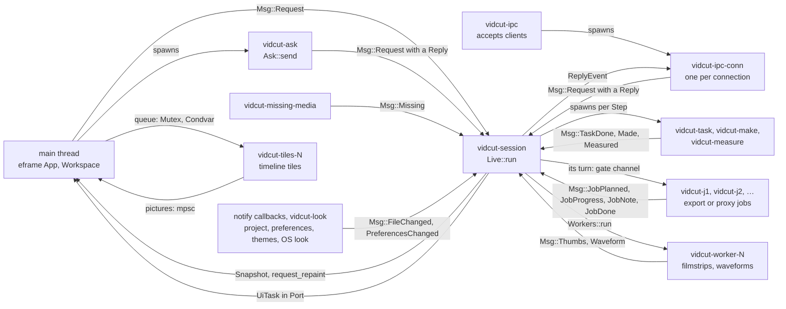
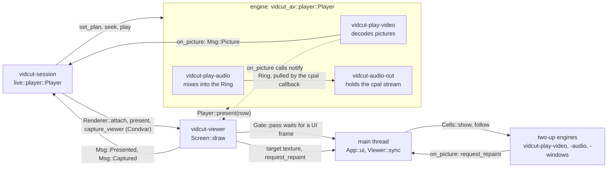
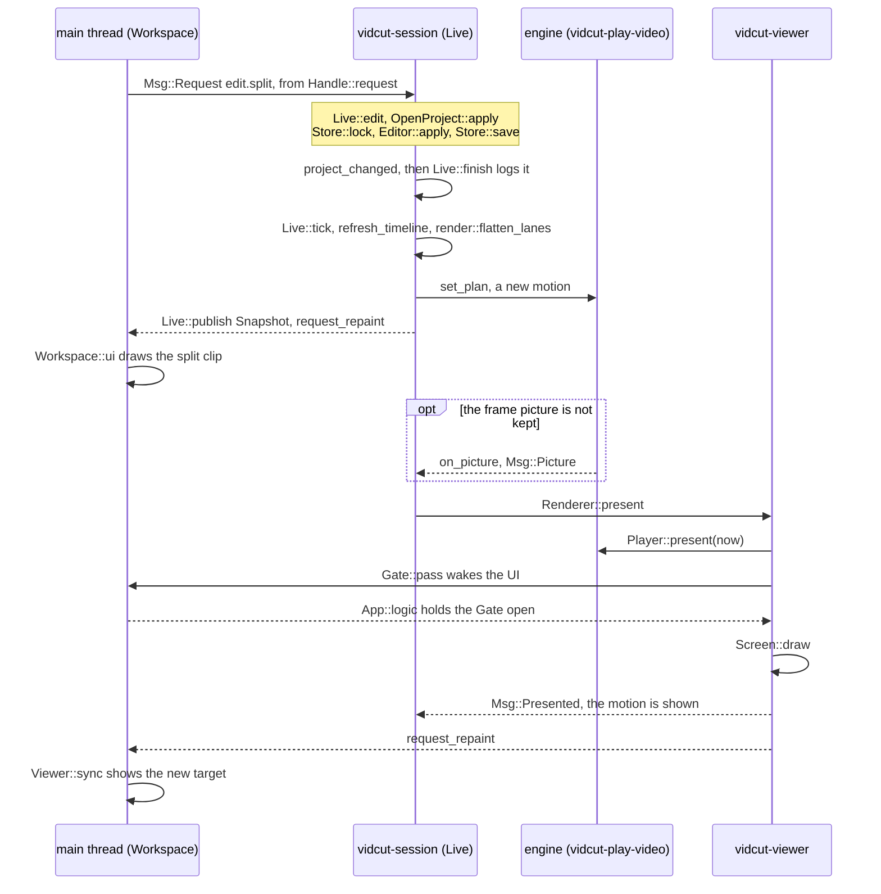

# The running GUI

The UI thread draws egui.
It turns a gesture into a request.
The `vidcut-session` thread is the live core.
That thread owns the open project, the viewer player, and the values that the viewer shows.
The UI does not wait for the core.
The UI sends messages and reads the latest snapshot.
Routing and the editor are in [requests](requests.md).
The player and the viewer drawing are in [playback](playback.md).
Priorities are in [threads](threads.md).

The core and the threads around it:

The viewer and the players:

`live::start` installs `on_picture`.
The closure sends `Msg::Picture`.
It then calls `notify`.
`App::new` sets `notify` to request a repaint and to call `ViewerHandle::wake`.

## The UI thread

`gui::run` runs eframe with `App` on the main thread.
`App::new` starts the viewer thread.
It starts the core (`live::start`) with `Port` as its `Renderer`.
It starts the IPC server.
Each frame, `App::logic` runs the `UiTask` values that the core queued in `Port`.
Those tasks are captures, window changes, GUI changes, trims, and quit.
`App::ui` takes the viewer target (`Viewer::sync`).
It calls `Workspace::ui`.
`Workspace::ui` reads `Handle::snapshot` once and draws from it.
`App::logic` and `App::ui` hold the `Gate` open for the GPU submissions of the viewer.
After each frame, the UI leaves its `GuiState` in `Port`.

A gesture is one request.
`Workspace::send` calls `Handle::request`.
The message is `Msg::Request` with `Origin::Gui` and no reply.
A failure comes back as a notice.
When the UI needs the answer, `Ask::send` calls `Handle::call` on a `vidcut-ask` thread.
The result is left in a slot.
Presets, export plans, and preferences use that path.

## The core

`live::start` runs `Live::run` on `vidcut-session`.
Everything reaches the core as a `Msg` on one channel.
`Handle` is cheap to clone.
It holds the sender and the latest snapshot.
Each pass does these steps:

1. Call `Live::tick`.
   Tick a due timeline reload, a due present, the playhead during play, and the waits.
2. Call `Live::publish`.
   If anything changed, publish a new immutable `Snapshot` into the mutex of the `Handle`.
   Then `notify` repaints the UI and wakes the viewer.
3. Send the answers for this pass.
   Send them after the snapshot that shows them.
4. Wait for messages.
   Wait at most until the next timer.

The project, the player, and the selection change on one thread.
Nothing else locks them.
The UI reads only a finished snapshot.
A client that looks immediately after its answer sees the result.

The `Snapshot` carries the project, the players, the selection, the log, notices, filmstrips, waveforms, missing media, and jobs.
`Port` passes `Renderer::attach`, `Renderer::present`, and `Renderer::capture_viewer` to the viewer thread.
`Port` passes the other renderer calls to the UI.

## Steps and waits

`Live::request` checks the expected project and `if_rev`.
It starts a media export as a job.
It calls `Live::dispatch`.
`Live::dispatch` returns a `Step`.

| Step | Where it runs | What happens next |
|---|---|---|
| `Now` | On `vidcut-session`. Edits (`Live::edit`), queries, play, and pause. | The answer. |
| `Wait` | It does not run work. A seek, a step, a screenshot, and `jobs.wait` join the waits. | `Live::tick` finds that its `Until` is met. |
| `Task` | `vidcut-task`, at the `Work` of the step. Plans, frames, storyboards, analyses, projectless requests, and UI answers. | `Msg::TaskDone` |
| `Make` | `vidcut-make`. It builds a project from an OpenTimelineIO file. | `Msg::Made`. The core then opens the project. |
| `Measure` | `vidcut-measure`, at job priority. It measures for Ripple Delete Silence or Detect Scene Cuts, or it unpacks an `.otioz`. | `Msg::Measured`. The edit then runs on `vidcut-session`. |
| `Encode` | A job thread. It encodes proxies. | `Msg::Measured`. The edit records the proxies. |

Work off the core uses a copy of the project.
The copy is taken when the request arrives.

`Until` names the condition that a request waits for:

- `Shown`: a seek, a step, a load, or a switch is on screen at its frame.
  A seek to another place fails the wait with `CONFLICT`.
  The GUI seek ends with no error.
- `Settled`, then `Capture`: a viewer screenshot waits for the latest motion, then for the picture (`Msg::Captured`).
- `Job`: `jobs.wait`, until the job ends.

Every wait has a deadline, except an untimed `jobs.wait`.

## The open project

`OpenProject` keeps the `Store` and the `Editor`.
It also keeps the file text and the file stamp from the last read or the last write.
`OpenProject::apply` reads the file again when the stamp moved.
A mutation does that under `Store::lock`.
It saves with `Store::save` before the reply.
History compaction (`Store::compact`) runs on `vidcut-history`.
A `notify` watcher on the file folder sends `Msg::FileChanged`.
`OpenProject::reload` reads the file under the lock.
The file is the source of truth ([deviation X1](../deviations.md#x1-projects-are-always-saved-standalone-json-files)).
[requests](requests.md) covers an outside change and undo.

## Jobs

`export.start` to a media file is a job.
`proxy.generate` is a job.
A job has a `JobInfo` in the snapshot, a cancel flag, and a thread.
The thread name is vidcut- plus the job id.
The id is the letter j and a number.
`jobs::Turns` lets one job encode at a time.
An export encodes before a proxy that is waiting.
A job waits on its gate channel for its turn.
An export waits after its files are planned (`Msg::JobPlanned`).
A proxy job waits before it starts.
`jobs.cancel` sets the cancel flag.
It also closes the gate of a queued job, so the job wakes and stops.
A client that disconnects sets the cancel flag of its foreground job.
The disconnect does not close the gate.
A queued foreground job stays in the queue until its turn.
It then sees the flag and stops.
A `background` request is answered when the files are planned.
The GUI media exports and the GUI bundle exports set `background`.
Any other job request is answered when the job ends.
An automatic proxy is the core's own `proxy.generate` (`Origin::Session`).

The export thread and the proxy thread call `Noting::set`.
The listener sends each `Note` as `Msg::JobNote`.
`JobDetails::note` stores the note on the `JobInfo`.
`Note::Video` replaces the previous video note.
`Note::Audio` replaces the previous audio note.
`Note::Color` sets the color choice and the metadata choice.
`Note::Tried` is stored once for each distinct failure.
`Note::Source` replaces the note for the same path.
`Msg::JobProgress` carries a `Progress` value.
`Progress` includes `gpu_frames`, `gpu_decoded`, and `copied`.
`JobDetails::counted` adds those counts across the outputs of the job.
`jobs.get` and `jobs.list` return `details` through `JobInfo::to_json`.
The Jobs window reads the same `JobInfo`.
The Jobs window does not open by itself.
The Jobs button shows the count of unfinished jobs.
When a job first appears, the button glows in the accent color for 1.5 seconds.
When a job becomes done, failed, or cancelled, the button glows for 1.5 seconds.
After a failure, the button uses the error color until the Jobs window opens.
Copy Details and Copy as Command sit at the top of the Details section.
Copy Details copies the text from `detail_rows`.
The first line has the job title, the job id, and the state.
The second line has the vidcut version and the FFmpeg version from `vidcut_av::ffmpeg_version`.
The text includes the error when the job has one.
Copy as Command copies the text from `vidcut_command`.
An export job uses `export.start`.
A proxy job uses `proxy.generate`.
`command_params` removes `background` from the parameters.
The copied command waits and shows progress.
When a finished job has an output path, the window shows Open next to Show in Folder.
Open calls `file_manager::open` on that path.
A per-clip export uses the `output` folder.
Any other finished job uses the first output file.
`file_manager::open` starts `vidcut-open-file`.
On Linux that thread runs `xdg-open`.
On macOS that thread runs `open`.
On Windows that thread calls `ShellExecuteW` with the open verb.
A failed job shows Run Again.
A cancelled job shows Run Again.
Run Again sends the same method and the stored parameters.
Those parameters still include `background` when the first request had it.

## Missing media

`MissingWatch` runs `vidcut-missing-media`.
The thread checks the media paths after each project change.
It also checks every few seconds.
It sends `Msg::Missing` when the set of missing files changes.
Missing means absent, or a path from another system.
The UI marks those files in the pool and on the timeline.
It offers Relink Media (`media.relink`).
It shows Media Offline ([spec §3](../cut-page-spec.md#3-media-pool-ch-34-pp-653675)).

A stalled network drive can hold a file check for a long time.
The check runs on `vidcut-missing-media`, not on `vidcut-session`.

## IPC and the registry

`App::new` calls `ipc::server::start` on `ipc::registry::socket_path`.
`vidcut-ipc` starts a `vidcut-ipc-conn` thread for each connection.
Each JSON-RPC line goes to `Handle::call` with `Origin::Ipc`.
Progress goes back as a notification.
A closed connection cancels the call.
`Live::register` writes the entry for this GUI at start.
It writes the entry again on each project open.
The entry has the pid, the socket, and the open project.
`Live::shutdown` removes the entry.
The CLI and MCP find the GUI there ([requests](requests.md)).

## The command log

`Live::finish` ends every request.
A quiet request is not logged.
Quiet requests are state queries, the GUI lookups, dry runs, scrubbing, drags, and search as the user types.
Every other request adds a `LogEntry`.
The entry has the origin, the method, the parameters, and a summary in words (`vidcut_core::describe::describe`).
It has success or the error, the revision, and whether the project changed.
The log has a cap.
It shows in the GUI and in `gui.log`.

## What the GUI computes itself

- Trims in progress.
  The UI runs `vidcut_core::ops` on a clone of the project in the snapshot.
  The clone feeds the drawing of Dynamic Trim and the two-up frames (`dynamic_preview`).
  The UI also tries a trim on the clone before it sends the trim.
  `Workspace::trim_sent` shows that copy until the core revision catches up (`Workspace::shown_project`).
- View state.
  The selected edit point, the target track, the zoom, and Timeline Options live in `timeline.json`.
  The open windows are view state too.
  Requests reach this state through `Renderer::gui`.
- Timeline tiles.
  `Tiles` decodes them on `vidcut-tiles-N`.
- The two-up.
  `Cells` owns its players on the UI thread.
  `Screens` draws them.

## Themes and keys

A theme is a TOML file.
The built-in themes are compiled in from `crates/vidcut/themes/`.
The user themes live in the `themes` folder of the config directory (`themes::dir`).
A user theme with the same name as a built-in theme replaces that built-in theme.
The `light_mode` table of a theme applies when the system is in light mode (`look::current`).
`look::watch` watches that mode on `vidcut-look`.
On Windows, `look::watch` starts two `vidcut-look` threads.
One thread watches the personalize key.
The other watches the accent key.
On Linux and on macOS, `look::watch` starts one `vidcut-look` thread.
The core loads the theme named by `appearance.theme` into the snapshot.
It loads the theme again when the preferences change, when the themes folder changes, or when the system look changes (`Msg::PreferencesChanged`).
A theme that does not load shows the default theme, with a notice.
The UI applies a new theme on its next frame.

The keys are one table, `vidcut_core::shortcuts`.
The Help window (`crates/vidcut/src/gui/help.rs`) reads that table.
`keys.list` reads the same table.

## From a key press to a frame

Ctrl+B splits at the playhead ([spec §8.5](../cut-page-spec.md#85-split-pp-646-723-950)):

## Code

- `crates/vidcut/src/gui/app.rs`, `crates/vidcut/src/gui/workspace.rs`, `crates/vidcut/src/gui/export.rs`
- `crates/vidcut/src/gui/video.rs`, `crates/vidcut/src/gui/gate.rs`, `crates/vidcut/src/gui/cells.rs`, `crates/vidcut/src/gui/tiles.rs`, `crates/vidcut/src/gui/timeline/`
- `crates/vidcut/src/live/mod.rs`, `crates/vidcut/src/live/snapshot.rs`, `crates/vidcut/src/live/project.rs`, `crates/vidcut/src/live/jobs.rs`
- `crates/vidcut/src/live/missing.rs`, `crates/vidcut/src/live/workers.rs`, `crates/vidcut/src/live/player.rs`
- `crates/vidcut/src/ipc/server.rs`, `crates/vidcut/src/ipc/registry.rs`
