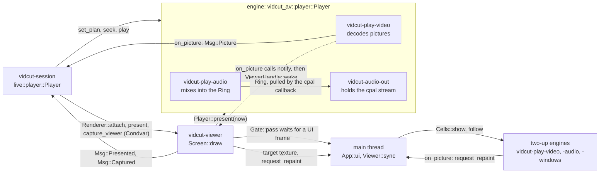

# The running GUI

- With a window open, the UI thread draws egui and turns gestures into requests.
- The `vidcut-session` thread is the live core. It owns the open project, the viewer's player and all that the viewer shows.
- The UI never waits for the core. It sends messages and reads the latest snapshot.
- Routing and the editor are in [requests](requests.md). The player and the viewer's drawing are in [playback](playback.md). Priorities are in [threads](threads.md).

The core and the threads around it:

The viewer and the players:

## The UI thread

- `gui::run` runs eframe with `App` on the main thread.
- `App::new` starts the viewer thread, the core (`live::start`) with `Port` as its `Renderer`, and the IPC server.
- In each frame, `App::logic` runs the `UiTask`s that the core queued in `Port`: captures, window and GUI changes, trims, quit.
- `App::ui` takes the viewer's target (`Viewer::sync`) and calls `Workspace::ui`. `Workspace::ui` reads `Handle::snapshot` once and draws from it.
- Both hold the `Gate` open for the viewer's GPU submissions.
- After each frame, the UI leaves its `GuiState` in `Port`.

Redraws:

- The window presents with vsync (`PresentMode::AutoVsync`). It redraws on demand: input, a new snapshot, a new viewer picture.
- While the timeline plays, its playhead is drawn between whole frames. With Fixed Playhead, the strip under the playhead is too.
  - The engine's `Status::glide` gives the fraction of the frame on the audio clock, and the rate.
  - The snapshot carries it (`PlayerSnap::glide`).
  - `Workspace::glided_playhead` runs it on to the moment of drawing, within the frame that the snapshot shows.
- `Workspace::glide_repaint` asks for the next redraw when either timeline would move a physical pixel.
- It asks at most once a refresh, and not while the window is minimized or covered.
- When playback stops, nothing redraws on its own.

**Why:**

- In whole frames, the timeline jumps the width of a frame at a time: 15 times a second in a 15 fps project.
- Vsync puts each redraw on a refresh. Thus the steps between redraws are even.

Requests:

- A gesture is one request. `Workspace::send` calls `Handle::request`: a `Msg::Request` with `Origin::Gui` and no reply.
- A failure comes back as a notice.
- Where the UI needs the answer (presets, export plans, preferences), `Ask::send` calls `Handle::call` on a `vidcut-ask` thread. It leaves the result in a slot.
- Where the UI needs to know that its edit went in, `Handle::request_answered` sends the request from the UI thread and gives an `Answer`.
  - Thus the request keeps its place among the other gestures.
  - A failure still comes back as a notice.

Looks:

- The Subtitle Track and Title sections of the Inspector share their style rows (`TextFields`) and one look picker (`Workspace::look_picker`). The state of the picker is a `Picker`.
- The GUI reads the looks itself (`Looks`, `looks::all`). It reads them again two seconds after the last read, and after a save or delete.
- A pick of a look fills the fields of the section. The viewer shows them as for any edit.
- Save as Look… and Delete send `looks.save` and `looks.delete` with `Ask::send`.
- These controls send the name of the look:
  - Apply Look in the menu of a subtitle track header, in `track.set`
  - the Look of Create Subtitles from Audio, in `subtitles.transcribe`
  - the look cards of the Titles tab, in `titles.add`

Ducking:

- `Workspace::ducking_controls` puts Ducking, its sources and its Amount on each strip of the Mixer.
- Each change is one `track.set` with `duck`, so one undo step. The Amount goes when its drag ends.
- Advanced opens the Ducking window (`Workspace::ducking_windows`). Apply sends its values in one `track.set`.
- Alt+D sends a `track.set` for the track of the selected clip (`Workspace::toggle_duck`).
- Before a change that needs the speech detector, the GUI asks to download it (`Workspace::duck`).

## The core

- `live::start` runs `Live::run` on `vidcut-session`.
- Everything reaches the core as a `Msg` on one channel.
- `Handle` is cheap to clone. It holds the sender and the latest snapshot.

Each pass:

1. `Live::tick`: a due timeline reload, a due present, the playhead while playing, the waits.
2. `Live::publish`: a new immutable `Snapshot` if anything changed, swapped into the mutex of the `Handle`. Then `notify` repaints the UI and wakes the viewer.
3. The answers of the pass go out, after the snapshot that shows them.
4. The core waits for messages, at most until the next timer.

**Why:**

- The project, player and selection change on one thread, so nothing locks them.
- The UI only reads finished snapshots.
- A client that looks right after its answer sees the result.

The snapshot:

- The `Snapshot` carries the project, players, selection, notices, filmstrips, waveforms, missing media and jobs.
- The snapshot carries the timecode count (`TimecodeDisplay`) and the Timer 1 zeros (`Timer1Origin`) for this session.
- `Port` passes `Renderer::attach`, `Renderer::present` and `Renderer::capture_viewer` to the viewer thread. It passes the rest to the UI.

## Steps and waits

`Live::request` checks the expected project and `if_rev`, and starts media exports as jobs. Then it calls `Live::dispatch`, which returns a `Step`:

| Step | Runs | Then |
|---|---|---|
| `Now` | here: edits (`Live::edit`), queries, play, pause | the answer |
| `Wait` | nothing: seeks, steps, screenshots, `jobs.wait` join the waits | `Live::tick` finds its `Until` met |
| `Task` | `vidcut-task`, at its `Work`: plans, frames, storyboards, analyses, project-less requests, UI answers | `Msg::TaskDone` |
| `Make` | `vidcut-make`: a project from an OpenTimelineIO file | `Msg::Made`; the core opens it |
| `Measure` | `vidcut-measure`, a job: measuring for Ripple Delete Silence, Detect Scene Cuts, Normalize Audio Levels or ducking, unpacking an `.otioz` | `Msg::Measured`; the edit runs here |
| `Encode` | a job thread: proxies; Create Subtitles from Audio; Re-time to Speech | `Msg::Measured`; the edit records them, adds the cues, or moves them |

Work off the core uses a copy of the project from the time that the request arrived.

`Until` names what a request waits for:

- `Shown`: a seek, step, load or switch is on screen at its frame. A seek elsewhere first fails it with CONFLICT. A wait that the GUI itself asked for only ends.
- `Settled`, then `Capture`: a viewer screenshot waits for the latest motion, then for the picture (`Msg::Captured`).
- `Job`: `jobs.wait`, until the job ends.

All waits have a deadline, except an untimed `jobs.wait`.

## The open project

- `OpenProject` keeps the `Store`, the `Editor`, and the text and stamp of the file as last read or written.
- `OpenProject::apply` first reads the file again if its stamp moved.
- A mutation does this under `Store::lock`, and saves with `Store::save` before the reply.
- History compaction (`Store::compact`) runs on `vidcut-history`.
- A `notify` watcher on the folder of the file sends `Msg::FileChanged`. Then `OpenProject::reload` reads the file under the lock.
- The file is the source of truth ([deviation X1](../deviations.md#x1-projects-are-always-saved-standalone-json-files)).
- [requests](requests.md) covers outside changes and undo.

## Jobs

- These requests are jobs: `export.start` to a media file, `proxy.generate`, `subtitles.transcribe`, `media.transcribe`, `analyze.words` when it hears the timeline, and `subtitles.retime`.
- A job is a `JobInfo` in the snapshot, a cancel flag and a thread (vidcut-j1, vidcut-j2, …).
- `jobs::Turns` lets one job run at a time. Exports go before waiting proxies and transcriptions.
- A job waits at its gate channel for its turn. An export waits after its files are planned (`Msg::JobPlanned`). The other jobs wait before they start.
- A `background` request is answered when the files are planned. Other requests are answered when the job ends. The GUI's requests are `background`.
- Automatic proxies are the core's own `proxy.generate` (`Origin::Session`).

Transcriptions:

- A transcription hears the timeline on a copy. A re-timing also measures its speech there.
- Then the edit adds the cues with `AvEnv::heard_only`. It takes what the job heard, and does not transcribe on the core's thread ([analysis](analysis.md#transcription)).
- If the sound of the timeline changed in the meantime, the edit fails with CONFLICT.
- While a job that hears speech is queued or runs (`HEARS`), the viewer keeps at most 1 GB of pictures on the GPU (`Live::follow_budget`). It brings the rest down to memory.
- Thus a model such as MOSS has the memory of the GPU.
- The budget of the preference comes back when the last such job ends.

Cancel:

- `jobs.cancel` sets the flag, and closes the gate of a queued job. Thus the job wakes, cancelled.
- A client that disconnects sets that flag on its foreground job, and does not close the gate. Thus a queued job waits for its turn, and then stops.

Notes and progress:

- While a job runs, the engine says what it does.
- The job thread installs a `vidcut_av::progress::Noting`. It turns each note into a `Msg::JobNote`. The notes are:
  - the encoder that opened, and the encoders that did not
  - the audio encoder
  - the color choice
  - each source file and its decoder
  - the file that a transcription downloads
  - what a transcription uses, as each becomes known: its model, device, language and speaker model
- The progress of a job carries the frames made and decoded on the GPU, and the copies between GPU and memory.
- Only a job that encodes gets a frame rate.
- `JobDetails` collects the notes in the `JobInfo`. Thus `jobs.get` and the Jobs window show the same.

The bar and the Jobs button:

- The bar fills from `JobInfo::fraction` when the step counts its work: a download, an upload, listening, transcribing, frames, measuring light.
- These steps have no fraction:
  - loading a model (`Stage::Loading`)
  - a speaker pass, which stays at zero until it finishes (`Stage::Speakers`)
  - waiting for a reply (`Stage::Waiting`)
- For these steps, the bar runs a light from end to end and shows the time elapsed, and `eta` is null. A terminal prints a spinner.
- The window never opens by itself.
- The Jobs button in the top bar counts the running jobs. It glows a moment when a job starts or ends.
- After a failure, the button stays in the error color until Jobs is opened.
- The details of a job copy as text, or as the `vidcut` command that runs it again.
- A finished job opens. A failed or cancelled job runs again as the same request.

## Missing media

- `MissingWatch` runs `vidcut-missing-media`. It looks at the paths of the media and of their proxies, after each project change and every few seconds.
- It sends `Msg::Missing` when either set changes.
- Missing means absent, or a path from another system.
- The UI marks missing media in the pool and timeline. It offers Relink Media (`media.relink`) and shows Media Offline ([spec §3](../cut-page-spec.md#3-media-pool-ch-34-pp-653675)).
- It marks a lost proxy LOST PROXY in the pool.
- While proxies play, a proxy that is lost or back reloads the plans of the viewers. Thus they play the original or the proxy again.
- The end of a proxy job makes the watch look again at once.
- `Live::make_proxies` makes a lost proxy again when the automatic rules pick its media ([spec D41](../cut-page-spec.md#12-decisions-on-gaps-and-contradictions)).

**Why:** a stalled network drive can hold a file check for long.

## IPC and the registry

- `App::new` calls `ipc::server::start` on `ipc::registry::socket_path`. The threads are in the chart above.
- Each JSON-RPC line goes to `Handle::call` with `Origin::Ipc`. Progress goes back as notifications.
- `Live::register` writes the entry of this GUI (pid, socket, open project) at start and at each project open.
- `Live::shutdown` removes the entry.
- The CLI and MCP find the GUI there. [requests](requests.md#routing) has the routing and the client side.

## The command log

- `Live::finish` ends every request.
- It adds a `LogEntry` for each request, except quiet ones: state queries, the GUI's lookups, dry runs, scrubbing, drags, search as typed.
- A `LogEntry` holds:
  - the origin
  - the method and params
  - a summary in words (`vidcut_core::describe::describe`), made from the project before an edit runs (`Job`)
  - success or error
  - the revision
  - whether the project changed
- The log is capped. `gui.log` gives it to scripts.

## What the GUI computes itself

- **Trims in progress.**
  - The UI runs `vidcut_core::ops` on a clone of the snapshot's project, for the drawing and two-up frames of Dynamic Trim (`dynamic_preview`).
  - It also does this to try a trim before it sends it.
  - `Workspace::trim_sent` shows that copy until the revision of the core catches up (`Workspace::shown_project`).
  - The timeline also draws the playhead where the seek of a trim goes (`landing`). It does this until the playhead moves, to the cut or anywhere else.
  - Thus a Dynamic Trim run that stops does not scroll back to where it started.
  - In the meantime, Space, Up/Down, ruler drags and swipes start from the playhead as drawn (`drawn_playhead`).
- **The window.**
  - `window.json` in the state folder keeps the window (`Window::watch`), as each system keeps a window.
  - On Windows, it keeps the placement (`GetWindowPlacement`): the restore rectangle in physical pixels, and whether the window is maximized.
  - `SetWindowPlacement` puts the placement back. It moves a window that no monitor would show onto a monitor.
  - On macOS, it keeps the saved frame of AppKit (`stringWithSavedFrame`, `setFrameFromString`), and whether the window is zoomed. Both are read from the window.
  - On Linux, it keeps the size, and whether the window is maximized.
  - The placement is applied in the first frame, while eframe still hides the window.
  - It is written when the window has stayed in place for half a second, and when the GUI closes. Thus a reset that deletes the file stays done.
  - Fullscreen is not kept.
  - `gui.window` sets the size, position (not on Wayland), maximized, minimized and fullscreen of a running GUI.
- **View state.**
  - The view state is:
    - the selected edit point, and whether its dissolve is selected (`TimelineView::transition`)
    - the target track, the zoom and the Timeline Options (in `timeline.json`, Minimize Subtitle Track too)
    - the open windows
  - Requests reach the view state through `Renderer::gui`.
  - The Trim Editor shows the selected edit while the player is stopped (`Workspace::trim_editor_edit`).
  - While one of its handles is dragged, `TimelineView::strip_drag` holds the trim.
  - Then the timeline and the two frames of the editor show the project with the trim applied (`Workspace::strip_drawn`), as for a Dynamic Trim run.
  - The trim is sent on release.
  - The selected edit pulses (`paint::pulse`). The UI repaints for this only while an edit is selected.
- **Track rows.**
  - `Rows::layout` shrinks the rows of the lower timeline to fit its height, down to a minimum. It lays them out from the bottom.
  - When they still overflow, `TimelineView::rows_lift` lifts them by up to `Rows::overflow`.
  - The wheel over the rows (`scroll_rows`) and the scrollbar (`row_scrollbar`) set the lift.
  - Rows, their headers and drag previews are clipped to the area of the rows. `Rows::at` finds no row outside it ([deviation X57](../deviations.md#x57-the-lower-timeline-keeps-its-height-and-its-tracks-scroll)).
- **Clip volume.**
  - `paint::track` draws the volume line of each clip with sound (`paint::volume_line`), at `geometry::volume_y`.
  - With volume keyframes, the line is the curve (`geometry::curve_y`), with a mark on each keyframe (`geometry::key_point`). A selected keyframe shows its handles (`geometry::handle_point`).
  - `geometry::volume_target` finds what is under the pointer: a handle of a selected keyframe, a keyframe, or the line (`OnVolume`).
  - A drag on the line is a `Gesture::Volume`. On a curve, it raises the two keyframes around the pointer (`keyframes.set` with `by`).
  - A drag on a keyframe is a `Gesture::Key`. It moves the selected keyframes with `keyframes.set` and `keyframes.move` in one `apply`.
  - A drag on a handle is a `Gesture::KeyHandle` (`keyframes.set` with `in` or `out`).
  - The timeline draws the dragged gains and curves (`Preview::gains`). On release, `Workspace::trim_sent` shows them until the project has them ([deviation X71](../deviations.md#x71-clip-volume-is-a-line-on-the-clip)).
  - `TimelineView::keys` holds the selected keyframes, as clips and source frames. `TimelineView::key_menu` is the ease menu of a keyframe ([deviation X73](../deviations.md#x73-the-volume-line-takes-the-keyframe-controls-of-the-edit-page)).

- **Subtitles.**
  - `Rows::layout` puts the rows of the subtitle tracks above the video tracks.
  - `cues::paint_track` draws their cues, with a stripe in the color of the cue.
  - `cues::hit` finds the cue or edge under the pointer.
  - Both go through `cues::placed`, which halves the height of the row where cues overlap.
  - A cue drag is `Gesture::CueMove` (`subtitles.move`) or `Gesture::CueTrim` (`subtitles.set`).
  - A subtitle item dragged from the pool is `Gesture::Subtitles`. Its cues are read from the file as the drag starts (`start_subtitle_drag`).
  - They are drawn where they would go: onto the subtitle track under the pointer, or onto a new track anywhere else (`Rows::subtitle_target`).
  - The drop sends `subtitles.import` with `media` and `at`.
  - `Workspace::sync_subtitles` hands the shown track to the core (`Handle::show_subtitles`). It does this when the track, the text being typed or the style being set changes.
  - The typed text and the style go in place of those of the cue and the track.
  - The core hands the track to the player while the timeline plays. Thus the viewer draws the cues as an export burns them in ([playback](playback.md)).
  - The Subtitle Track section (`TrackDialog`) keeps the style that its fields give. `style_of` works it out as a field changes. While the fields are not valid, there is no style.
  - The viewer draws this style in place of the track's style until the user leaves the field. Then `track.set` sends it ([deviation X51](../deviations.md#x51-a-subtitle-tracks-style-goes-in-when-the-user-leaves-a-field)).
  - Its color fields have the color picker of egui beside them.
  - Its font field has a list of the installed fonts, read once when the section opens (`burn::families`).
  - The Subtitle section (`CueDialog`) keeps the text being typed. While the section is open, the timeline and the viewer draw its text in place of the cue's text. The viewer also draws its position, person and color.
  - The Subtitle section sends its changes with `Handle::request_answered`. It keeps what it sent until each `Answer` comes and the project has that revision.
  - Then, while the user does not edit it, it shows the cue of the project. Thus a change that the project refuses goes away. The field does not jump back while a change is on its way.
  - When the section closes while it waits, its text stays as a `Landing`. The timeline and the viewer draw it until the same answers and revision come.
  - When the cue opens again before that, its section takes back the `Landing`: the sent text and the wait. Thus the field does not show the old text.
  - The selected cues are part of the session's `Selection`, as clips are.
- **Titles.**
  - The Title section (`TitleDialog`) works out the title that its fields give (`title_of`). While the fields are not valid, there is no title.
  - When the user leaves a field, the changes go as one `titles.set` ([deviation X52](../deviations.md#x52-titles-come-from-a-titles-tab-or-add-title-and-are-edited-in-the-inspector)).
  - Add Title asks `titles.add`, and opens the Title section on the clip of the answer.
  - The onscreen controls of the viewer (`onscreen::Grab`, `Workspace::title_controls`) find the titles at the playhead.
  - They box each title from one upright drawing by `burn::title`, moved and scaled to its place and zoom. The drawings used last are kept in an `Lru`.
  - They send one `titles.set` when a drag ends. When the Title section is open on the title, it takes this as its place.
  - One title is previewed at a time: the title that `Workspace::title_wanted` gives. In order:
    1. the title that is dragged
    2. else the title of the Title section, while it differs from the stored title
    3. else a title just sent with `titles.set`, until the project that the GUI holds has it: at most a second, as for the playhead's `tools::landing`
  - The preview is boxed in its place.
  - `Workspace::sync_title_preview` hands the preview to the core as it changes (`Handle::preview_title`). The core hands it to the player.
  - Thus the viewer draws the preview as an export would, without a new plan.
  - The core loads a plan that it still owes before it changes the preview. Thus the player does not show an older title.
  - The Titles tab (`title_browser::Browser`) draws its cards with `burn::title`. A card starts a `Gesture::Title`, which drops as `titles.add`.
  - The tab previews a hovered card with `Handle::preview_free_title`. The core adds the title at the playhead to its copy of the project (`FreeTitle`).
  - The core moves the `Run` of a scroll in the plan, so that the playhead is the hovered way through it.
  - `title_browser::Thumbs` keeps the pictures that title clips show on the timeline: the pictures used last (an `Lru`).
- **Pictures.**
  - These set the viewer's tool (`placing::Grab`):
    - T, Shift+T and Alt+T
    - the right-click menu of the clip
    - the Tools row (`Workspace::picture_tools_row`, shown by `Grab::row`)
    - `gui.show transform`, `crop` or `dynamic_zoom`
  - Framing and safe-area guides (`Guides`, `GuideOverlay`) draw in egui over the picture after the texture and before the handles (`paint_guides`).
  - `Guides::overlay` builds the boxes. `Screen::draw` does not, so an export leaves them out ([deviation X80](../deviations.md#x80-safe-area-guides-skip-the-trim-editor-and-dynamic-trim)).
  - `viewer.guides` and `preferences.set` change `ViewerPrefs` (`Preferences.viewer`). The snapshot carries `guides`.
  - `viewer.guides` on a running GUI copies `guides` onto the snapshot at once.
  - `Workspace::safe_area_control` and View > Safe Area send `viewer.guides`.
  - `Workspace::picture_controls` draws the handles of the tool on the selected clip at the playhead. It boxes them through the same `place::Placing` as the picture ([deviation X65](../deviations.md#x65-transform-and-crop-are-keys-and-viewer-handles-in-fractions-of-the-frame)).
  - The corners, the sides and the turn handle work about the anchor point (`Shown::pivot`, from `place::anchored`). A cross marks that point.
  - A move snaps the middle of the picture as drawn, not its `position`. The two differ by the zoom and the turn about the anchor point.
  - While the handles are under the pointer, the title controls wait.
  - A drag works on the picture that it started from, and ends in one `picture.set`.
  - A run of wheel notches over the picture (`Wheeled`) also ends in one `picture.set`. `Workspace::settle_picture_wheel` sends it when the wheel is still.
  - The picture that is dragged or wheeled goes to the core with `Handle::preview_pictures`.
  - After the drag or the wheel, the picture that was sent goes to the core until the project has it (`tools::landing`).
  - The viewer draws a clip with its Dynamic Zoom, also while its boxes show.
  - The boxes are the picture placed with the start box and with the end box (`Shown::ends`). Thus they stay in place while the clip plays.
- **The Inspector** (`inspector::Inspector`, `Workspace::inspector_panel`)
  - It is a tab of the left panel, as the Titles tab is (`LeftTab`). `gui.show` and `gui.close` take `inspector`.
  - At its top, `Workspace::title_form`, `Workspace::cue_form` and `Workspace::track_form` draw the open Title, Subtitle and Subtitle Track sections.
  - `Workspace::open_title`, `Workspace::open_cue` and `Workspace::open_track_dialog` open them and show the tab.
  - `Workspace::follow_selection` shows the section of the selected title or subtitle. A section that closes puts its changes in first.
  - Previous and Next in the Subtitle section open the cue before or after with `Workspace::inspect_cue`. Then they send `selection.set` and a `player.seek` to its start.
  - The list of the Subtitle section (`Workspace::cue_list`) draws only its visible rows (`show_rows`). A click on a row does what Next does (`Workspace::step_cue`).
  - Add New above the list calls `Workspace::add_subtitle` with the track of the open cue, as the right-click menu of the track does.
  - The In and Out fields (`Workspace::cue_times`) send one `apply`: a `subtitles.set` for the cue, then `subtitles.set` and `subtitles.remove` for the cues that it overwrites. Until the project has it, the fields show the times that they sent.
  - Below them, it shows the selected clips that can have a picture. It reads their pictures from the snapshot in each frame.
  - A picture that the handles, the wheel or the Inspector preview goes first (`Workspace::picture_wanted`). Thus the fields follow a drag in the viewer.
  - Each field changes between the picture and its own unit (`Field::read`, `Field::put`). The fitted size comes from `place::upright_fit`, as in an export.
  - The `Shape` of each clip holds the size of the frame and the fitted size of its picture.
  - While the user drags or types in a field, the field shows its own value (`Held`).
  - A drag previews the pictures of all the clips with `Handle::preview_pictures`. The request follows on release.
  - Each change sends one request:
    - one `picture.set`, when all the clips get the same parameters
    - else an `apply` with one `picture.set` for each clip
    - `picture.clear` for the Reset of a section
  - Thus each change is one undo step.
  - An `apply` is necessary because a `position` holds X and Y. Thus Position X goes with the Y of each clip.
  - Also, a crop in pixels is a different fraction of each picture.
  - After the request, the sent pictures go to the core until the project has them (`tools::landing`).
  - `speed_section` shows the selected clips that can change speed (`Workspace::paced`), above the Audio section.
    - Each change sends what the Change Clip Speed window sends (`SpeedDialog::params`).
    - That is one `edit.change_speed`, or an `apply` with one `edit.change_speed` for each speed.
    - Until the project has the change, the section shows the speed and the length that it sent (`Retimed`).
  - `Workspace::audio_section` shows the selected clips with sound below the picture sections. Volume and Mute each send one `clip.set`. Voice Isolation uses `Workspace::isolation_controls`, as the right-click menu does.
- **Silence stripes.**
  - `SilenceDialog` keeps the dry run of Ripple Delete Silence as `Stripe`s, and the person's edits to them:
    - A click keeps or cuts a stripe (`stripe_press`).
    - An edge drag moves within the clip, and short of the neighbors (`stripe_drag`).
    - The bracket keys and X act at the playhead (`silence_keys`).
  - A changed setting runs the dry run again. This replaces the stripes and their edits.
  - Each change keeps the state of the dialog before it (`Shot`: the settings, the stripes, and what was found for which settings). A change of a setting counts too.
  - Thus Ctrl+Z and Ctrl+Shift+Z step back and forth through the states while the dialog is open (`SilenceDialog::undo`).
  - A typed number counts when it is entered, with Enter or by leaving the field. Thus typing does not find the stripes again at every digit.
  - The project's own history is not touched until Remove.
  - Remove sends the stripes still cut as `parts`.
  - While the dialog is open, `Handle::skip` hands these stripes to the session. The session plays the timeline as Remove would leave it ([deviation X48](../deviations.md#x48-ripple-delete-silences-stripes-can-be-edited-before-remove)).
- **Timeline tiles**
  - `Tiles` decodes them on `vidcut-tiles-N`.
  - The filmstrips of the Trim Editor use the same tiles. Their frames and handle reach come from `vidcut_core::ops::filmstrip`.
  - Their numbers come from the lengths of the clips when the editor opened (`TrimAnchor`).
- **Imports.**
  - Import Media, Import Media Folder and files dropped on the window each queue a `Pick`.
  - `Workspace::import_window` takes the picks in order. It takes none while its question about numbered images (`Choice`) is open.
  - Files become `media.add`, and a folder becomes `media.add_folder`.
  - The paths of a drop (egui's `dropped_files`) gather until a frame brings no more.
  - This is necessary because winit sends each file as its own event. A run of numbered images split over two picks would ask twice.
  - Then `vidcut-import-drop` queues the files as one pick, and each folder as another pick.
  - The numbered images of a folder are read by `PickedFolder::read`, as for the folder dialog. All go into the bin that is open at the drop.
  - `Workspace::drop_hint` covers the pool while egui has files over the window.
  - winit 0.30 reports files dragged over and dropped on Windows, macOS and X11, but not on Wayland. It never reports where.
  - Thus a drop cannot aim at a bin ([deviation X66](../deviations.md#x66-files-and-folders-dropped-on-the-window-go-into-the-open-bin)).
- **Media details.**
  - The metadata strip of the pool (`Workspace::metadata_strip`) is on or off in `pool.json` in the config folder.
  - It shows the media clicked last while that media is selected, else the last media selected (`Workspace::chosen_media`). A shift-click selects in pool order.
  - It shows what the project keeps (`clip_info::glance`).
  - Clip Info (`Workspace::clip_info_window`) adds what `media.details` reads from the file again when the window opens on it (`probe::details`).
  - `GuiPanel` opens both from scripts.
- **The Transcription window** (`TranscriptionUi`, `Workspace::transcription_window`)
  - It asks the core for `analyze.words` through an `Ask`. It asks for the media of the source clip, or for the timeline's clips whose media are transcribed.
  - It asks again when the `rev` of the project or the `transcribed` set changes.
  - Each paragraph between pauses is one galley. The word under the pointer is found from its cursor.
  - While playing, only the paragraphs whose word under the playhead changed are laid out again.
  - Its cuts on the timeline ask for `quiet` edges.
  - Delete clears the In and Out that it set over the words that it deletes (`clear_marks`), in the same step.
  - Follow scrolls to the word under the playhead while playing.
  - Search lowercases each word once, when the words arrive.
  - It keeps the matches of the last searches in `Searches`, an `Lru`. A new transcript empties it.
  - A longer search filters the matches of a shorter search that it contains. The highlight reads the same matches.
  - While the pointer is over the window, `TranscriptionUi::take_keys` takes Delete, X, Ctrl+A, Ctrl+C and Esc before the timeline's shortcuts.
  - What it changes goes as requests: `media.marks.set` or `marks.set`, `media.leave_out`, `edit.ripple_delete_words` and `markers.add`.
  - It also sends an `apply` of one edit for each part that `model::uncovered` leaves of the selection.
- **Rows that do not fit.**
  - These are each a `Row` that `Workspace::fit_row` lays out:
    - the top bar
    - the viewer's header and transport
    - the line of the Trim Editor
    - the bin bar of the pool
    - the timeline's bar
    - the status bar
  - It draws their items once a frame in an invisible sizing pass, to measure them. Thus the font and padding of the theme count, and a label like Jobs (2) counts.
  - `hidden` finds the fewest items that must go to the ⋯ menu, in the order of the row ([spec D72](../cut-page-spec.md#12-decisions-on-gaps-and-contradictions)).
  - The `fill` of a row, such as the name of the clip or a notice, gets the width left. It truncates, clipped to that width.
  - When even the items that stay do not fit, the right items follow the left ones, and the panel clips them.
  - Items are also drawn in the sizing pass. Thus they change nothing there:
    - `Workspace::watch_jobs` keeps the glow of the Jobs button apart from its drawing.
    - The timecode and duration fields take focus only outside the sizing pass.
    - The bin bar registers its drop targets only outside the sizing pass.
- **Dialogs.**
  - `dialog::window` gives a window its width and spacing.
  - `dialog::form` and `dialog::row` give its labeled rows.
  - `dialog::switch` gives a choice of two or three.
  - `dialog::advanced` gives the settings that are rarely needed.
  - `dialog::footer` gives Cancel and the one main button (`dialog::main_button`, in the selection color of the theme).
  - The looks of Create Subtitles from Audio are tiles (`look_tiles::Tiles`).
  - `burn::draw` draws a sample in each look, at a size that fills its tile, with its first word spoken. The sample is kept until the look changes.
- **The two-up**: `Cells` owns its players on the UI thread. `Screens` draws them.
- **J and L with K held.**
  - `Shuttle` tells a tap from a hold by the time between the press and release of a key. It ignores key repeats.
  - It asks for a frame when a hold turns slow (`Shuttle::due`).
  - It gives a frame step, slow play or its stop, for the player or for Dynamic Trim ([spec D54](../cut-page-spec.md#12-decisions-on-gaps-and-contradictions)).

## Themes and keys

Theme files:

- A theme is a TOML file.
- The built-in themes are compiled in from `crates/vidcut/themes/`.
- The user's themes are in the `themes` folder of the config dir (`themes::dir`). A user theme with the name of a built-in theme replaces it.
- The `light_mode` table of a theme applies while the system is in light mode (`look::current`, watched on `vidcut-look`).

Omarchy:

- A theme with `colors_from = "omarchy"` takes `light` and its colors from the palette that Omarchy stages in `~/.local/state/omarchy/current/theme/colors.toml` (`omarchy::apply`).
- It decides light or dark as Omarchy does: `mode`, then `theme_type`, then a `light.mode` file, then the brightness of the background.
- A palette that cannot be read, or that has no background or foreground, makes the theme fail to load.
- While the chosen theme takes its colors from Omarchy, `Live` watches `~/.local/state/omarchy/current`. Until that folder exists, `Live` watches its nearest parent (`omarchy::watched`).
- A change there is `Msg::OmarchyChanged`. The theme reloads when the files have been quiet for a moment. Thus a theme switch is read only after it has finished.

Loading:

- The core loads the theme that `appearance.theme` names into the snapshot.
- The core loads it again when the preferences, the themes folder or the look of the system change.
- A theme that does not load shows the default, with a notice.
- The UI applies a new theme at its next frame.

Fonts:

- The `ui` and `mono` lists of the theme each put one face first in the families of egui (`font_definitions`): the first name that loads.
- UI text then falls back to Ubuntu-Light, the Phosphor icons (`add_phosphor`), the icon and emoji fonts of egui, Geist and Hack (`add_fallback`).
- Thus a character that the face of the theme lacks comes from the first of these fonts that has it. Examples are the cap of an arrow key, and the viewer's ◧ and ◨.

Keys:

- The keys are one table, `vidcut_core::shortcuts`.
- The Help window (`crates/vidcut/src/gui/help.rs`) and `keys.list` both read it.

## From a key press to a frame

Ctrl+B splits at the playhead ([spec §8.5](../cut-page-spec.md#85-split-pp-646-723-950)):

## Code

- `crates/vidcut/src/gui/app.rs`, `crates/vidcut/src/gui/workspace.rs`, `crates/vidcut/src/gui/export.rs`
- `crates/vidcut/src/gui/video.rs`, `crates/vidcut/src/gui/gate.rs`, `crates/vidcut/src/gui/cells.rs`, `crates/vidcut/src/gui/tiles.rs`
- `crates/vidcut/src/gui/trim_strips.rs`, `crates/vidcut/src/gui/timeline/`
- `crates/vidcut/src/gui/subtitles.rs`, `crates/vidcut/src/gui/titles.rs`
- `crates/vidcut/src/gui/speech.rs`, `crates/vidcut/src/gui/retime.rs`
- `crates/vidcut/src/gui/mixer.rs`, `crates/vidcut/src/gui/ducking.rs`
- `crates/vidcut/src/gui/dialog.rs`, `crates/vidcut/src/gui/look_tiles.rs`
- `crates/vidcut/src/gui/placing.rs`, `crates/vidcut/src/gui/inspector.rs`
- `crates/vidcut/src/live/mod.rs`, `crates/vidcut/src/live/snapshot.rs`, `crates/vidcut/src/live/project.rs`, `crates/vidcut/src/live/jobs.rs`
- `crates/vidcut/src/live/missing.rs`, `crates/vidcut/src/live/workers.rs`, `crates/vidcut/src/live/player.rs`
- `crates/vidcut/src/ipc/server.rs`, `crates/vidcut/src/ipc/registry.rs`
