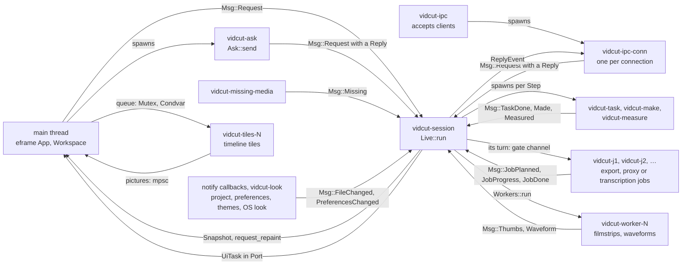
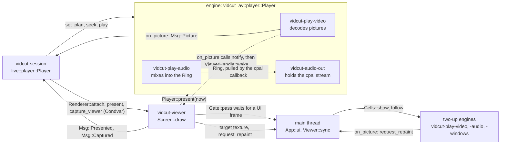

# The running GUI

With a window open, the UI thread draws egui and turns gestures into requests, and the `vidcut-session` thread, the live core, owns the open project, the viewer's player and all the viewer shows. The UI never waits for the core: it sends messages and reads the latest snapshot. Routing and the editor are in [requests](requests.md), the player and the viewer's drawing in [playback](playback.md), priorities in [threads](threads.md).

The core and the threads around it:

The viewer and the players:

## The UI thread

`gui::run` runs eframe with `App` on the main thread. `App::new` starts the viewer thread, the core (`live::start`) with `Port` as its `Renderer`, and the IPC server. Each frame, `App::logic` runs the `UiTask`s the core queued in `Port` (captures, window and GUI changes, trims, quit); `App::ui` takes the viewer's target (`Viewer::sync`) and calls `Workspace::ui`, which reads `Handle::snapshot` once and draws from it. Both hold the `Gate` open for the viewer's GPU submissions. After each frame the UI leaves its `GuiState` in `Port`.

A gesture is one request: `Workspace::send` calls `Handle::request`, a `Msg::Request` with `Origin::Gui` and no reply; a failure comes back as a notice. Where the UI needs the answer (presets, export plans, preferences), `Ask::send` calls `Handle::call` on a `vidcut-ask` thread and leaves the result in a slot.

## The core

`live::start` runs `Live::run` on `vidcut-session`. Everything reaches it as a `Msg` on one channel; `Handle`, cheap to clone, holds the sender and the latest snapshot. Each pass:

1. `Live::tick`: a due timeline reload, a due present, the playhead while playing, the waits.
2. `Live::publish`: a new immutable `Snapshot` if anything changed, swapped into the `Handle`'s mutex; then `notify` repaints the UI and wakes the viewer.
3. The pass's answers go out, after the snapshot that shows them.
4. It waits for messages, at most until the next timer.

**Why:** the project, player and selection change on one thread, so nothing locks them, and the UI only reads finished snapshots. A client that looks right after its answer sees the result.

The `Snapshot` carries the project, players, selection, log, notices, filmstrips, waveforms, missing media and jobs. `Port` passes `Renderer::attach`, `Renderer::present` and `Renderer::capture_viewer` to the viewer thread, the rest to the UI.

## Steps and waits

`Live::request` checks the expected project and `if_rev`, starts media exports as jobs, and calls `Live::dispatch`, which returns a `Step`:

| Step | Runs | Then |
|---|---|---|
| `Now` | here: edits (`Live::edit`), queries, play, pause | the answer |
| `Wait` | nothing: seeks, steps, screenshots, `jobs.wait` join the waits | `Live::tick` finds its `Until` met |
| `Task` | `vidcut-task`, at its `Work`: plans, frames, storyboards, analyses, project-less requests, UI answers | `Msg::TaskDone` |
| `Make` | `vidcut-make`: a project from an OpenTimelineIO file | `Msg::Made`; the core opens it |
| `Measure` | `vidcut-measure`, a job: measuring for Ripple Delete Silence or Detect Scene Cuts, unpacking an `.otioz` | `Msg::Measured`; the edit runs here |
| `Encode` | a job thread: proxies; Create Subtitles from Audio | `Msg::Measured`; the edit records them, or adds the cues |

Work off the core uses a copy of the project from the request's arrival.

`Until` names what a request waits for:
- `Shown`: a seek, step, load or switch is on screen at its frame. A seek elsewhere first fails it with CONFLICT; the GUI's own just ends.
- `Settled`, then `Capture`: a viewer screenshot waits for the latest motion, then the picture (`Msg::Captured`).
- `Job`: `jobs.wait`, until the job ends.

All but an untimed `jobs.wait` have a deadline.

## The open project

`OpenProject` keeps the `Store`, the `Editor`, and the file's text and stamp as last read or written. `OpenProject::apply` reads the file again first if its stamp moved; a mutation does that under `Store::lock` and saves with `Store::save` before the reply. History compaction (`Store::compact`) runs on `vidcut-history`. A `notify` watcher on the file's folder sends `Msg::FileChanged`, and `OpenProject::reload` reads the file under the lock. The file is the source of truth ([deviation X1](../deviations.md#x1-projects-are-always-saved-standalone-json-files)); [requests](requests.md) covers outside changes and undo.

## Jobs

`export.start` to a media file, `proxy.generate` and `subtitles.transcribe` are jobs: a `JobInfo` in the snapshot, a cancel flag and a thread (vidcut-j1, vidcut-j2, …). `jobs::Turns` lets one job run at a time, exports ahead of waiting proxies and transcriptions. A job waits at its gate channel for its turn: an export once its files are planned (`Msg::JobPlanned`), the others before they start. A transcription hears the timeline on a copy, and the edit then adds the cues with `AvEnv::heard_only`: it takes what the job heard, and fails with CONFLICT if the timeline's sound changed meanwhile, rather than transcribe on the core's thread ([analysis](analysis.md#transcription)). `jobs.cancel` sets the flag and closes a queued job's gate, so it wakes, cancelled. A client that disconnects sets that flag on its foreground job and does not close the gate, so a queued job waits its turn and then stops. A `background` request, as the GUI's are, is answered once the files are planned, others when the job ends. Automatic proxies are the core's own `proxy.generate` (`Origin::Session`).

While a job runs, the engine says what it is doing: the job thread installs a `vidcut_av::progress::Noting` that turns each note (the encoder that opened, those that didn't, the audio encoder, the color choice, each source file and its decoder) into a `Msg::JobNote`, and its progress carries the frames made and decoded on the GPU and the copies between GPU and memory. `JobDetails` collects them in the `JobInfo`, so `jobs.get` and the Jobs window show the same. The window never opens by itself: the Jobs button in the top bar counts the running jobs, glows a moment when one starts or ends, and stays in the error color after a failure until Jobs is opened. A job's details copy as text or as the `vidcut` command that runs it again; a finished one opens, and a failed or cancelled one runs again as the same request.

## Missing media

`MissingWatch` runs `vidcut-missing-media`, which looks at the media's and their proxies' paths after each project change and every few seconds, and sends `Msg::Missing` when either set changes. Missing means absent, or a path from another system. The UI marks missing media in the pool and timeline, offers Relink Media (`media.relink`) and shows Media Offline ([spec §3](../cut-page-spec.md#3-media-pool-ch-34-pp-653675)). It marks a lost proxy LOST PROXY in the pool. While proxies play, a proxy lost or back reloads the viewers' plans, so they play the original or the proxy again; a proxy job's end makes it look again at once. `Live::make_proxies` makes a lost proxy again when the automatic rules pick its media ([spec D41](../cut-page-spec.md#12-decisions-on-gaps-and-contradictions)).

**Why:** a stalled network drive can hold a file check for long.

## IPC and the registry

`App::new` calls `ipc::server::start` on `ipc::registry::socket_path`. `vidcut-ipc` starts a `vidcut-ipc-conn` thread per connection. Each JSON-RPC line goes to `Handle::call` with `Origin::Ipc`; progress goes back as notifications, and a closed connection cancels. `Live::register` writes this GUI's entry (pid, socket, open project) at start and on each project open; `Live::shutdown` removes it. The CLI and MCP find the GUI there ([requests](requests.md)).

## The command log

`Live::finish` ends every request. Except quiet ones (state queries, the GUI's lookups, dry runs, scrubbing, drags, search as typed), it adds a `LogEntry`: origin, method and params, a summary in words (`vidcut_core::describe::describe`), success or error, the revision, and whether the project changed. The capped log shows in the GUI and in `gui.log`.

## What the GUI computes itself

- **Trims in progress.** The UI runs `vidcut_core::ops` on a clone of the snapshot's project for Dynamic Trim's drawing and two-up frames (`dynamic_preview`), and to try a trim before sending it. `Workspace::trim_sent` shows that copy until the core's revision catches up (`Workspace::shown_project`). Likewise the timeline draws the playhead where a trim's seek is going until the playhead moves, to the cut or anywhere else (`landing`), so a Dynamic Trim run that stops doesn't scroll back to where it started; meanwhile Space, Up/Down, ruler drags and swipes start from the playhead as drawn (`drawn_playhead`).
- **The window.** It is kept in `window.json` in the state folder (`Window::watch`) as each system keeps a window: on Windows its placement (`GetWindowPlacement`: the restore rectangle in physical pixels and whether it is maximized), put back with `SetWindowPlacement`, which moves a window no monitor would show onto one; on macOS AppKit's saved frame (`stringWithSavedFrame`, `setFrameFromString`) and whether it is zoomed, both read from the window; on Linux the size and whether it is maximized. The placement is applied in the first frame, while eframe still hides the window. It is written once it has stayed put for half a second and when the GUI closes, so a reset that deletes the file stays done. Fullscreen isn't kept. `gui.window` sets a running GUI's size, position (not on Wayland), maximized, minimized and fullscreen.
- **View state.** The edit point selected, and whether its dissolve is (`TimelineView::transition`), the target track, zoom and Timeline Options (in `timeline.json`, Minimize Subtitle Track too), the windows open. Requests reach it through `Renderer::gui`. The Trim Editor shows the selected edit while the player is stopped (`Workspace::trim_editor_edit`). The selected edit pulses (`paint::pulse`), the UI repainting only while one is selected.
- **Subtitles.** `Rows::layout` puts the subtitle tracks' rows above the video tracks; `cues::paint_track` draws their cues and `cues::hit` finds the cue or edge under the pointer, both through `cues::placed`, which halves the row's height where cues overlap. A cue drag is `Gesture::CueMove` (`subtitles.move`) or `Gesture::CueTrim` (`subtitles.set`). The viewer draws the shown track's cues at the timeline player's frame (`subtitles::paint_cues`), laid out as a burn-in lays them out ([spec D61](../cut-page-spec.md#12-decisions-on-gaps-and-contradictions)), italic, underline and colors from the markup, bold as the same layout drawn again a little to the right. The Subtitle window (`CueDialog`) keeps the text being typed, which the timeline and the viewer draw in place of the cue's until Done sends it. The cues selected are part of the session's `Selection`, as clips are.
- **Silence stripes.** `SilenceDialog` keeps Ripple Delete Silence's dry run as `Stripe`s and the person's edits to them: a click keeps or cuts one (`stripe_press`), an edge drag moves within the clip and short of its neighbors (`stripe_drag`), and the bracket keys and X act at the playhead (`silence_keys`). A changed setting runs the dry run again, which replaces the stripes and their edits. Remove sends the stripes still cut as `parts`; while the dialog is open, `Handle::skip` hands them to the session, which plays the timeline as Remove would leave it ([deviation X48](../deviations.md#x48-ripple-delete-silences-stripes-can-be-edited-before-remove)).
- **Timeline tiles**, decoded by `Tiles` on `vidcut-tiles-N`; the Trim Editor's filmstrips use the same tiles, their frames and handle reach from `vidcut_core::ops::filmstrip`, their numbers from the clips' lengths when the editor opened (`TrimAnchor`).
- **The two-up**: `Cells` owns its players on the UI thread; `Screens` draws them.
- **J and L with K held.** `Shuttle` tells a tap from a hold by the time between a key's press and release, ignoring key repeats, asking for a frame when a hold turns slow (`Shuttle::due`), and gives a frame step, slow play or its stop, for the player or for Dynamic Trim ([spec D54](../cut-page-spec.md#12-decisions-on-gaps-and-contradictions)).

## Themes and keys

A theme is a TOML file: the built-in ones are compiled in from `crates/vidcut/themes/`, and the user's live in the config dir's `themes` folder (`themes::dir`), where one named like a built-in replaces it. A theme's `light_mode` table applies while the system is in light mode (`look::current`, watched on `vidcut-look`). The core loads the theme `appearance.theme` names into the snapshot, and loads it again when the preferences, the themes folder or the system's look change (`Msg::PreferencesChanged`); one that doesn't load shows the default, with a notice. The UI applies a new theme at its next frame.

The keys are one table, `vidcut_core::shortcuts`: the Help window (`crates/vidcut/src/gui/help.rs`) and `keys.list` both read it.

## From a key press to a frame

Ctrl+B splits at the playhead ([spec §8.5](../cut-page-spec.md#85-split-pp-646-723-950)):

## Code

- `crates/vidcut/src/gui/app.rs`, `crates/vidcut/src/gui/workspace.rs`, `crates/vidcut/src/gui/export.rs`
- `crates/vidcut/src/gui/video.rs`, `crates/vidcut/src/gui/gate.rs`, `crates/vidcut/src/gui/cells.rs`, `crates/vidcut/src/gui/tiles.rs`, `crates/vidcut/src/gui/trim_strips.rs`, `crates/vidcut/src/gui/timeline/`, `crates/vidcut/src/gui/subtitles.rs`, `crates/vidcut/src/gui/speech.rs`
- `crates/vidcut/src/live/mod.rs`, `crates/vidcut/src/live/snapshot.rs`, `crates/vidcut/src/live/project.rs`, `crates/vidcut/src/live/jobs.rs`
- `crates/vidcut/src/live/missing.rs`, `crates/vidcut/src/live/workers.rs`, `crates/vidcut/src/live/player.rs`
- `crates/vidcut/src/ipc/server.rs`, `crates/vidcut/src/ipc/registry.rs`
