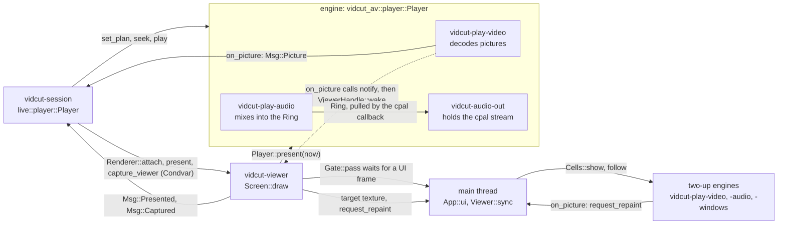

# The running GUI

- With a window open, the UI thread draws egui and turns gestures into requests.
- The `vidcut-session` thread is the live core. It owns the open project, the viewer's player and all that the viewer shows.
- The UI never waits for the core. It sends messages and reads the latest snapshot.
- [requests](requests.md) has the routing and the editor. [playback](playback.md) has the player and the viewer's drawing. [threads](threads.md) has the priorities.

The core and the threads around it:

The viewer and the players:

## The UI thread

- `gui::run` runs eframe with `App` on the main thread.
- `App::new` starts the viewer thread, the core (`live::start`) with `Port` as its `Renderer`, and the IPC server.
- In each frame, `App::logic` runs the `UiTask`s that the core queued in `Port`: captures, window and GUI changes, trims, quit.
- `App::ui` takes the viewer's target (`Viewer::sync`) and calls `Workspace::ui`, which reads `Handle::snapshot` once and draws from it.
- Both hold the `Gate` open for the viewer's GPU submissions. After each frame, the UI leaves its `GuiState` in `Port`.

Redraws:

- The window presents with vsync (`PresentMode::AutoVsync`). It redraws on demand: input, a new snapshot, a new viewer picture.
- While the timeline plays, its playhead moves between whole frames. With Fixed Playhead, the strip under the playhead does too.
  - The engine gives the fraction of the frame on the audio clock, and the rate (`Status::glide`). The snapshot carries it (`PlayerSnap::glide`).
  - `Workspace::glided_playhead` runs it on to the moment of drawing.
  - `Workspace::glide_repaint` asks for the next redraw when the timeline moves a physical pixel. It does not ask while the window is minimized or covered.
- Why: in whole frames, the timeline jumps a frame's width at a time. Vsync puts each redraw on a refresh, so the steps are even.
- When playback stops, nothing redraws on its own.

Requests:

- A gesture is one request. `Workspace::send` calls `Handle::request`: a `Msg::Request` with `Origin::Gui` and no reply. A failure comes back as a notice.
- Where the UI needs the answer (presets, export plans, preferences), `Ask::send` calls `Handle::call` on a `vidcut-ask` thread. It leaves the result in a slot.
- Where the UI needs to know that its edit went in, `Handle::request_answered` sends the request from the UI thread and gives an `Answer`. Why: the request keeps its place among the other gestures.

Looks:

- The Subtitle Track and Title sections of the Inspector share their style rows (`TextFields`) and one look picker (`Workspace::look_picker`, `Picker`).
- The GUI reads the looks itself (`Looks`, `looks::all`), again after a short time and after a save or a delete.
- A pick of a look fills the fields of the section. Save as Look… and Delete send `looks.save` and `looks.delete`.
- Apply Look on a track (`track.set`), Create Subtitles from Audio (`subtitles.transcribe`) and the Titles tab (`titles.add`) send the name of the look.

Ducking:

- `Workspace::ducking_controls` puts Ducking, its sources and its Amount on each strip of the Mixer.
- Each change is one `track.set` with `duck`, thus one undo step. The Amount goes when its drag ends.
- Advanced opens the Ducking window (`Workspace::ducking_windows`). Apply sends its values in one `track.set`.
- Alt+D turns ducking on or off for the track of the selected clip (`Workspace::toggle_duck`).
- Before a change that needs the speech detector, the GUI asks to download it (`Workspace::duck`).

AI models:

- Before a change that makes the timeline use an AI model that this computer does not have, the GUI asks to download it (`Workspace::send_asking`).
- `editor::models_after` applies the change to a copy of the project. It gives the models that the timeline uses only after the change.
- The change then goes with `download`. The core downloads the models in a `Measure` step before the change (`fetches`).

## The core

- `live::start` runs `Live::run` on `vidcut-session`.
- Each input reaches the core as a `Msg` on one channel.
- `Handle` is cheap to clone. It holds the sender and the latest snapshot.

Each pass:

1. `Live::tick`: a due timeline reload, a due present, the playhead while playing, the waits.
2. `Live::publish`: a new immutable `Snapshot` if anything changed, swapped into the mutex of the `Handle`. Then `notify` repaints the UI and wakes the viewer.
3. The answers of the pass go out, after the snapshot that shows them.
4. The core waits for messages, at most until the next timer.

**Why:**

- The project, the player and the selection change on one thread. Thus nothing locks them.
- The UI only reads finished snapshots.
- A client that looks right after its answer sees the result.

The snapshot:

- The `Snapshot` carries the project, players, selection, notices, filmstrips, waveforms, missing media and jobs.
- It also carries the timecode count (`TimecodeDisplay`) and the Timer 1 zeros (`Timer1Origin`) of this session.
- `Port` passes `Renderer::attach`, `Renderer::present` and `Renderer::capture_viewer` to the viewer thread, and the rest to the UI.

## Steps and waits

`Live::request` checks the expected project and `if_rev`, and starts media exports as jobs. Then `Live::dispatch` returns a `Step`:

| Step | Runs | Then |
|---|---|---|
| `Now` | here: edits (`Live::edit`), queries, play, pause | the answer |
| `Wait` | nothing: seeks, steps, screenshots and `jobs.wait` join the waits | `Live::tick` finds its `Until` met |
| `Task` | `vidcut-task`, at its `Work`: plans, frames, storyboards, analyses, project-less requests, UI answers | `Msg::TaskDone` |
| `Make` | `vidcut-make`: a project from an OpenTimelineIO file | `Msg::Made`; the core opens it |
| `Measure` | `vidcut-measure`, at job priority: measures for Ripple Delete Silence, Detect Scene Cuts, Normalize Audio Levels and ducking; model downloads; `.otioz` unpacking | `Msg::Measured`; the edit runs here |
| `Encode` | a job: proxies, transcriptions, word timings, Re-time to Speech | `Msg::Measured`; the edit uses the result |

Work off the core uses a copy of the project from the time that the request arrived.

`Until` names what a request waits for:

- `Shown`: a seek, step, load or switch is on screen at its frame. A seek elsewhere first fails it with CONFLICT. A wait that the GUI itself asked for only ends.
- `Settled`, then `Capture`: a viewer screenshot waits for the latest motion, then for the picture (`Msg::Captured`).
- `Job`: `jobs.wait`, until the job ends.

Each wait has a deadline, except an untimed `jobs.wait`.

## The open project

- `OpenProject` keeps the `Store`, the `Editor`, and the text and stamp of the file as last read or written.
- `OpenProject::apply` first reads the file again if its stamp moved.
- A mutation does this under `Store::lock`, and saves with `Store::save` before the reply. History compaction (`Store::compact`) runs on `vidcut-history`.
- A `notify` watcher on the folder of the file sends `Msg::FileChanged`. Then `OpenProject::reload` reads the file under the lock.
- The file is the source of truth ([deviation X1](../deviations.md#x1-projects-are-always-saved-standalone-json-files)). [requests](requests.md) tells about outside changes and undo.

## Jobs

- These requests are jobs:
  - `export.start` to a media file
  - `proxy.generate`
  - `subtitles.transcribe`, `media.transcribe`, and `analyze.words` when it hears the timeline
  - `subtitles.retime` and `subtitles.time_words`
- A job is a `JobInfo` in the snapshot, a cancel flag and a thread (vidcut-j1, vidcut-j2, …).
- `jobs::Turns` lets one job run at a time. An export goes before the proxies and transcriptions that wait.
- A job waits at its gate channel for its turn. An export waits after its files are planned (`Msg::JobPlanned`). The other jobs wait before they start.
- A `background` request has its answer when the files are planned. Other requests have it when the job ends. The GUI's requests are `background`.
- Automatic proxies are the core's own `proxy.generate` (`Origin::Session`).

Transcriptions:

- A transcription hears the timeline on a copy. A re-timing also measures its speech there.
- Then the edit adds the cues with `AvEnv::heard_only`. It takes what the job heard, and does not transcribe on the core's thread ([analysis](analysis.md#transcription)).
- If the sound of the timeline changed in the meantime, the edit fails with CONFLICT.
- While a job that hears speech waits or runs (`HEARS`), `Live::follow_budget` lowers the GPU budget of the kept pictures. The rest comes down to memory. Why: a speech model then has the GPU memory.
  - On Apple silicon, the budget stays.
- The budget of the preference comes back when the last such job ends.

Cancel:

- `jobs.cancel` sets the flag, and closes the gate of a waiting job. Thus the job wakes, cancelled.
- A client that disconnects sets the flag of its foreground job, but does not close the gate. Thus a waiting job waits for its turn, and then stops.

Notes and progress:

- The job thread installs a `vidcut_av::progress::Noting`, which turns each note of the engine into a `Msg::JobNote`.
- The notes tell the encoders that opened or failed, the colors, the source files and their decoders, the upscaling and the downloads.
- For a transcription, they also tell its model, device, language and speaker model, as each becomes known.
- The progress of a job carries the frames made and decoded on the GPU, and the copies between GPU and memory. Only a job that encodes has a frame rate.
- `JobDetails` collects the notes in the `JobInfo`. Thus `jobs.get` and the Jobs window show the same.

The bar and the Jobs button:

- The bar fills from `JobInfo::fraction` when the step counts its work: a download, an upload, listening, transcribing, frames, light measurement.
- Loading a model (`Stage::Loading`), a speaker pass (`Stage::Speakers`) and waiting for a reply (`Stage::Waiting`) have no fraction.
  - For these, the bar runs a light from end to end and shows the time elapsed, and `eta` is null. A terminal prints a spinner.
- The Jobs window never opens by itself.
- The Jobs button in the top bar counts the running jobs. It glows a moment when a job starts or ends. After a failure, it keeps the error color until Jobs opens.
- The details of a job copy as text, or as the `vidcut` command that runs it again.
- A finished job opens. A failed or cancelled job runs again as the same request.

## Missing media

- `MissingWatch` runs `vidcut-missing-media`. It looks at the paths of the media and of their proxies after each project change, and at a fixed interval.
  - Why a thread: a stalled network drive can hold a file check for long.
- It sends `Msg::Missing` when either set changes. The end of a proxy job makes it look again at once.
- Missing means absent, or a path from another system.
- The UI marks missing media in the pool and the timeline. It offers Relink Media (`media.relink`), and the viewer shows Media Offline ([spec §3](../cut-page-spec.md#3-media-pool-ch-34-pp-653675)).
- The pool marks a lost proxy LOST PROXY.
- While proxies play, a proxy that is lost or back reloads the plans of the viewers. Thus they play the original or the proxy again.
- `Live::make_proxies` makes a lost proxy again when the automatic rules pick its media ([spec D41](../cut-page-spec.md#12-decisions-on-gaps-and-contradictions)).

## IPC and the registry

- `App::new` calls `ipc::server::start` on `ipc::registry::socket_path`.
- Each JSON-RPC line goes to `Handle::call` with `Origin::Ipc`. Progress goes back as notifications.
- `Live::register` writes the entry of this GUI (pid, socket, open project) at start and at each project open. `Live::shutdown` removes it.
- The CLI and MCP find the GUI there ([requests](requests.md#routing)).

## The command log

- `Live::finish` ends each request. It adds a `LogEntry`, except for quiet requests: state queries, the GUI's lookups, dry runs, scrubbing, drags, search as typed.
- A `LogEntry` holds the origin, the method and params, a summary, success or error, the revision, and whether the project changed.
- The summary (`vidcut_core::describe::describe`) comes from the project before the edit runs.
- The log is capped. `gui.log` gives it to scripts.

## What the GUI computes itself

**Trims in progress.**

- The UI runs `vidcut_core::ops` on a clone of the snapshot's project. It does this to draw Dynamic Trim and its two-up frames (`dynamic_preview`), and to try a trim before it sends it.
- `Workspace::trim_sent` shows that copy until the revision of the core catches up (`Workspace::shown_project`).
- The timeline draws the playhead where the seek of a trim goes (`landing`), until the playhead moves. Why: a Dynamic Trim run that stops does not scroll back.
- Meanwhile, Space, Up/Down, ruler drags and swipes start from the playhead as drawn (`drawn_playhead`).

**The window.**

- `window.json` in the state folder keeps the window as each system keeps a window (`Window::watch`). Windows keeps the placement, macOS the saved frame of AppKit, and Linux the size and the maximized state.
- The placement goes back in the first frame, while eframe still hides the window.
- The file is written only after the window changes and stays still, and when the GUI closes. Thus a reset that deletes the file stays done.
- `gui.window` sets the size, position (not on Wayland), maximized, minimized and fullscreen state of a running GUI.

**View state.**

- The view state is the selected edit points (`TimelineView::edit`, `TimelineView::edits`) and the selected dissolve (`TimelineView::transition`). It is also the target track, the zoom, the Timeline Options and the open windows.
- `timeline.json` keeps the target track, the zoom and the Timeline Options. Requests reach the view state through `Renderer::gui`.
- The Trim Editor shows the selected edit while the player is stopped (`Workspace::trim_editor_edit`). A drag of its handles holds the trim (`TimelineView::strip_drag`), shows it (`Workspace::strip_drawn`), and sends it on release.

**Trims of the selected edits.**

- `edits::Cut` is the trim of one edit: a roll, an audio roll, or a trim of one side. `edits::Plan` holds the cuts of the selected edits, and refuses a mix of rolls and trims.
- A side that faces the side of the edit clicked last gets the opposite amount.
- `Plan::each` gives each edit the same amount, for the comma and period keys (`Workspace::nudge_edits`) and Dynamic Trim (`DynamicTarget::Edits`).
- `Plan::shared` is for a drag (`Gesture::Edits`). The ripple trims on one track share the amount, and the other trims get all of it.
- Several trims go as one `apply`. Thus one undo step takes them back.

**Track rows** ([deviation X57](../deviations.md#x57-the-lower-timeline-keeps-its-height-and-its-tracks-scroll)).

- `Rows::layout` lays out the rows of the lower timeline from the bottom, and shrinks them to fit, down to a minimum.
- When they still overflow, the wheel (`scroll_rows`) and the scrollbar (`row_scrollbar`) lift them (`TimelineView::rows_lift`, `Rows::overflow`).

**Clip volume** ([deviation X71](../deviations.md#x71-clip-volume-is-a-line-on-the-clip), [deviation X73](../deviations.md#x73-the-volume-line-takes-the-keyframe-controls-of-the-edit-page)).

- `paint::volume_line` draws the volume line of each clip with sound. With volume keyframes, the line is the curve (`geometry::curve_y`), with a mark on each keyframe.
- `geometry::volume_target` finds the handle, keyframe or line under the pointer (`OnVolume`).
- The drags are `Gesture::Volume`, `Gesture::Key` and `Gesture::KeyHandle`. They send `keyframes.set` and `keyframes.move`, in one `apply`.
- `Preview::gains` draws the dragged gains. On release, `Workspace::trim_sent` shows them until the project has them.

**Speed keyframes** ([spec D48](../cut-page-spec.md#12-decisions-on-gaps-and-contradictions)).

- `paint::speed_marks` draws the strip of a clip with speed keyframes (`geometry::speed_strip`): a line at each speed keyframe and the speed of each section.
- `geometry::speed_labels` places the speeds. The paint, the pointer and the clicks use the same places (`geometry::speed_label_at`).
  - Why: a click on a speed then opens the list of the speed that the user sees.
- A click on the speed of a forward section keeps it in `TimelineView::section_list`. `Workspace::section_list` shows the list as a popup there.
- Set opens `Workspace::section_window`. Both send `speed.set` at the first frame of the section (`SectionSpeed`).
- The slip handle starts under the strip (`geometry::slip_handle`). Thus it does not cover the speeds.

**Subtitles.**

- `cues::placed` places the cues of a subtitle track, at half height where cues overlap. `cues::paint_track` draws them, and `cues::hit` finds the cue or edge under the pointer.
- A cue drag is `Gesture::CueMove` (`subtitles.move`) or `Gesture::CueTrim` (`subtitles.set`). A subtitle item dragged from the pool is `Gesture::Subtitles`, which drops as `subtitles.import`.
- `Workspace::sync_subtitles` hands the shown track to the core (`Handle::show_subtitles`), with the text being typed and the style being set. Thus the viewer draws the cues as an export burns them in.
- The Subtitle Track section (`TrackDialog`) works out the style of its fields (`style_of`). The viewer draws it, and `track.set` sends it when the user leaves the field ([deviation X51](../deviations.md#x51-a-subtitle-tracks-style-goes-in-when-the-user-leaves-a-field)).
- The Subtitle section (`CueDialog`) sends its changes with `Handle::request_answered`. It keeps what it sent until each `Answer` comes and the project has that revision.
  - Why: a refused change goes away, and the field does not jump back while a change is on its way.
  - A section that closes while it waits leaves a `Landing`, which it takes back when it opens again on the cue.
- The selected cues are part of the session's `Selection`, as clips are.

**Titles** ([deviation X52](../deviations.md#x52-titles-come-from-a-titles-tab-or-add-title-and-are-edited-in-the-inspector)).

- The Title section (`TitleDialog`) works out the title of its fields (`title_of`). When the user leaves a field, the changes go as one `titles.set`.
- The onscreen controls (`onscreen::Grab`, `Workspace::title_controls`) box each title from one upright drawing of `burn::title`. They send one `titles.set` when a drag ends.
- `Workspace::title_wanted` gives the one title to preview: the dragged title, else the changed title of the Title section, else a title just sent (`tools::landing`).
- `Workspace::sync_title_preview` hands the preview to the core (`Handle::preview_title`), and the core to the player. Thus the viewer draws it as an export does, without a new plan.
  - The core first loads a plan that it still owes. Why: the player does not show an older title.
- The Titles tab (`title_browser::Browser`) draws its cards with `burn::title`. A dragged card (`Gesture::Title`) drops as `titles.add`.
- The Transitions tab (`transition_browser::GROUPS`) draws its cards. A dragged card (`Gesture::Transition`) drops as `edit.dissolve` on an edit, and as `edit.transition` on a transition.
- A hovered card previews with `Handle::preview_free_title`: the core adds the title at the playhead to its copy of the project (`FreeTitle`).

**Pictures.**

- T, Shift+T, Alt+T, the clip menu, the Tools row (`Workspace::picture_tools_row`) and `gui.show` set the viewer's tool (`placing::Grab`).
- `Guides::overlay` builds the framing and safe-area guides in egui, not `Screen::draw`. Thus an export leaves them out ([deviation X80](../deviations.md#x80-safe-area-guides-skip-the-trim-editor-and-dynamic-trim)).
- `viewer.guides` changes `ViewerPrefs`. The snapshot carries `guides` and `show_super_scale`.
- `Workspace::picture_controls` boxes the handles through the `place::Placing` of the picture ([deviation X65](../deviations.md#x65-transform-and-crop-are-keys-and-viewer-handles-in-fractions-of-the-frame)).
  - The handles work about the anchor point (`Shown::pivot`, from `place::anchored`).
  - A move snaps the middle of the picture as drawn, not its `position`.
- A drag, or a run of wheel notches (`Wheeled`, `Workspace::settle_picture_wheel`), ends in one `picture.set`.
- The dragged picture goes to the core with `Handle::preview_pictures`. After it, the sent picture goes there until the project has it (`tools::landing`).
- The boxes of a Dynamic Zoom are the picture placed with the start box and with the end box (`Shown::ends`). Thus they stay in place while the clip plays.

**The Inspector** (`inspector::Inspector`, `Workspace::inspector_panel`).

- It is a tab of the left panel (`LeftTab`). It draws the open Title, Subtitle and Subtitle Track sections (`Workspace::title_form`, `Workspace::cue_form`, `Workspace::track_form`).
- `Workspace::follow_selection` shows the section of the selected title or subtitle. A section that closes puts its changes in first.
- The In and Out fields of a cue (`Workspace::cue_times`) send one `apply`. It sets the cue, and sets or removes the cues that it overwrites.
- The picture fields convert between the picture and their own unit (`Field::read`, `Field::put`). The fitted size comes from `place::upright_fit`, as in an export.
  - A picture from the handles, the wheel or the Inspector goes first (`Workspace::picture_wanted`). Thus the fields follow a drag in the viewer.
  - Each change is one undo step: one `picture.set`, or an `apply` of one `picture.set` for each clip. Reset sends `picture.clear`.
  - Why the `apply`: a `position` holds X and Y, so Position X goes with the Y of each clip. A crop in pixels is a different fraction of each picture.
- `speed_section` sends what the Change Clip Speed window sends (`SpeedDialog::params`). `Workspace::audio_section` sends `clip.set`.
  - On a clip with speed keyframes, it shows the section under the playhead (`Paced`). `section_speed` sends `speed.set`, `speed.freeze` or `speed.reverse` there.
  - The Ease row shows `ops::speed::section_eases` and sends `speed.ease` for each clip (`Workspace::ease_sections`).
  - `speed_keys` draws the diamond and the arrows of the header. They act as the keyframe buttons of the picture and volume fields.

**The Keyframes tab** (`keyframe_editor::Editor`, `Workspace::keyframe_panel`).

- The selection is a list of `Mark`s: a value and a source frame.
- Each row records where it drew each keyframe (`Editor::seen`). A box drag (`Boxing`) selects the marks inside it on release.
- A drag shows the moved keyframes (`Shift`) and sends one `apply` on release. The selection follows the moved frames (`Pending`).
- Mark > Move Selected Keyframes (`Nudge`, `Workspace::nudge_keys`) sends what a drag of one frame or one step sends.
- The selected rows are a list of values (`Editor::rows`). A click on a row's name or on a keyframe changes them.
- Mark > Add Keyframe, Delete Keyframe and Delete All Keyframes (`KeyCmd`, `Workspace::key_cmd`) act on the selected marks or the selected rows.
  - `Workspace::key_target` takes only the rows that the open tab or tray shows.
  - `Workspace::key_cmd_why` gives the next step for an item that is off. The menu shows it as the tooltip.
  - `Workspace::key_menu_why` gives the step that the three items share. The menu shows it as a line under them.
  - Delete All Keyframes keeps its question in `Editor::deleting` until the user answers (`Workspace::delete_all_window`).
  - With the tab and the tray closed, `Workspace::speed_cmd` acts on the speed keyframes of the selected clips (`Workspace::speed_clips`).
  - `Workspace::speed_cmd_why` then gives the next steps.
- The Speed row shows `Speed::keyframes`: the first frame of each section after the first, with its speed.
  - `keyframes.add` and `keyframes.remove` with the `param` `speed` edit them in `ops::speed`.
  - A speed keyframe does not move or copy (`fixed`). A change of its value sends `speed.set`.
  - Its ease menu has Linear and Ease In and Out (`key_eases`, `ops::speed::key_ease`). It sends `keyframes.set`.
  - The value field is off when the section is frozen or plays backward. Why: `speed.set` changes only a forward section.
  - Why: a speed keyframe is a cut between two sections. Its frame and its value come from the sections.
- A press in the tab or the tray gives them the keys. A press in another place takes the keys away (`Workspace::key_focus`, `Editor::focused`).
- With the keys, Ctrl+C and Ctrl+X send `keyframes.copy` or `keyframes.cut`. The core keeps the keyframes that come back as its clipboard, in place of the clips.
- With the keys, Ctrl+V sends `keyframes.paste` with the selected clips while the clipboard holds keyframes (`Snapshot::key_clipboard`). It never pastes clips there.
- Without the keys, Ctrl+V pastes no keyframes.
- The keyframe tray (`Workspace::keyframe_tray`) draws the same track rows under the lower timeline, on its `Scale`.
  - The tray and the tab share one `Editor`. Thus a selection in one shows in the other.
  - `Editor::tray` tells which of the two draws. A box and the ease menu stay in the one where they started.

**Silence stripes** ([deviation X48](../deviations.md#x48-ripple-delete-silences-stripes-can-be-edited-before-remove)).

- `SilenceDialog` keeps the dry run of Ripple Delete Silence as `Stripe`s, and the user's edits to them (`stripe_press`, `stripe_drag`, `silence_keys`).
- A changed setting runs the dry run again, and replaces the stripes and their edits.
- Each change keeps the state before it (`Shot`). Ctrl+Z and Ctrl+Shift+Z step through these states (`SilenceDialog::undo`). The project's history stays as it is until Remove.
- While the dialog is open, `Handle::skip` hands the stripes to the session. The session plays the timeline as Remove would leave it.

**Timeline tiles.**

- `Tiles` decodes them on `vidcut-tiles-N`. Each tile shows the source frame under its left edge (`tile_frame`), by the clip's pace (`Clip::pace`).
- A tile that is not decoded yet shows the nearest kept tile (`Tiles::nearest`), else the nearest pool thumbnail. Why: the filmstrip stays full while a zoom or a scroll decodes new tiles.
- The filmstrips of the Trim Editor use the same tiles (`vidcut_core::ops::filmstrip`, `TrimAnchor`).

**Imports** ([deviation X66](../deviations.md#x66-files-and-folders-dropped-on-the-window-go-into-the-open-bin)).

- Import Media, Import Media Folder and dropped files each queue a `Pick`. `Workspace::import_window` takes the picks in order.
- The paths of a drop gather until a frame brings no more. Why: winit sends each file as its own event, and a split run of numbered images would ask twice.
- `vidcut-import-drop` queues the files as one pick, and each folder as another (`PickedFolder::read`).
- A drop goes into the open bin. Why: winit does not report where files drop, and does not report drops on Wayland.

**Media details.**

- The metadata strip of the pool (`Workspace::metadata_strip`) shows what the project keeps of the chosen media (`clip_info::glance`). `pool.json` in the config folder keeps it on or off.
- Clip Info (`Workspace::clip_info_window`) adds what `media.details` reads from the file (`probe::details`).

**The Transcription window** (`TranscriptionUi`, `Workspace::transcription_window`).

- It asks the core for `analyze.words` through an `Ask`. It asks again when the `rev` of the project or the `transcribed` set changes.
- Each paragraph between pauses is one galley. On the timeline, each gap between clips is a pause too (`holes`). While playing, only the paragraphs whose current word changed are laid out again.
- `Searches`, an `Lru`, keeps the matches of the last searches. A longer search filters the matches of a shorter search that it contains.
- While the pointer is over the window, `TranscriptionUi::take_keys` takes its keys before the timeline's shortcuts.
- Its changes go as requests, for example `media.leave_out`, `edit.ripple_delete_words` and `media.words.set`. Its cuts on the timeline ask for `quiet` edges.
- On the timeline, Cut, Copy and Paste send `edit.cut`, `edit.copy` and `edit.paste` with the range of the words. The core keeps the clips that come back as its clipboard.

**Rows that do not fit** ([spec D72](../cut-page-spec.md#12-decisions-on-gaps-and-contradictions)).

- The bars of the window are each a `Row` that `Workspace::fit_row` lays out.
- It draws the items once a frame in an invisible sizing pass, to measure them. Why: the font and padding of the theme count, and a label like Jobs (2) counts.
- `hidden` finds the fewest items that go to the ⋯ menu. The `fill` of a row gets the width left, and truncates.
- The sizing pass changes nothing. `Workspace::watch_jobs` keeps the glow of the Jobs button apart from its drawing.

**Dialogs.**

- `dialog::window`, `dialog::form`, `dialog::row`, `dialog::switch`, `dialog::advanced` and `dialog::footer` build the windows (AGENTS.md, rule 12).
- `dialog::tall_row` puts the label at the top of a tall row. Why: the content does not cover the next row.
- `dialog::form_width` gives the width of a window whose fields have one width.
- The looks of Create Subtitles from Audio are tiles (`look_tiles::Tiles`). `burn::draw` draws a sample in each look.

**The two-up**: `Cells` owns its players on the UI thread. `Screens` draws them.

**J and L with K held** ([spec D54](../cut-page-spec.md#12-decisions-on-gaps-and-contradictions)). `Shuttle` tells a tap from a hold by the time between the press and the release of a key. It gives a frame step, slow play or its stop, for the player or for Dynamic Trim.

## Themes and keys

Theme files:

- A theme is a TOML file. The built-in themes are compiled in from `crates/vidcut/themes/`.
- The user's themes are in the `themes` folder of the config dir (`themes::dir`). A user theme replaces the built-in theme of the same name.
- The `light_mode` table of a theme applies while the system is in light mode (`look::current`, watched on `vidcut-look`).

Omarchy:

- A theme with `colors_from = "omarchy"` takes `light` and its colors from the palette that Omarchy stages in `~/.local/state/omarchy/current/theme/colors.toml` (`omarchy::apply`).
- It decides light or dark as Omarchy does: `mode`, then `theme_type`, then a `light.mode` file, then the brightness of the background.
- A palette that cannot be read, or that has no background or foreground, makes the theme fail to load.
- While the chosen theme takes its colors from Omarchy, `Live` watches `~/.local/state/omarchy/current`, or its nearest parent until it exists (`omarchy::watched`).
- A change there is `Msg::OmarchyChanged`. The theme loads again when the files are quiet. Why: a theme switch is read only after it finishes.

Loading:

- The core loads the theme that `appearance.theme` names into the snapshot. It loads it again when the preferences, the themes folder or the look of the system change.
- A theme that does not load shows the default, with a notice.
- The UI applies a new theme at its next frame.

Fonts:

- The `ui` and `mono` lists of the theme each put one face first in the families of egui (`font_definitions`): the first name that loads.
- UI text then falls back to Ubuntu-Light, the Phosphor icons (`add_phosphor`), the icon and emoji fonts of egui, Geist and Hack (`add_fallback`).
- Thus a character that the face of the theme does not have comes from the first of these fonts that has it.

Keys:

- The keys are one table, `vidcut_core::shortcuts`. The Help window (`crates/vidcut/src/gui/help.rs`) and `keys.list` both read it.

## From a key press to a frame

Ctrl+B splits at the playhead ([spec §8.5](../cut-page-spec.md#85-split-pp-646-723-950)):

## Code

- `crates/vidcut/src/gui/app.rs`, `crates/vidcut/src/gui/workspace.rs`, `crates/vidcut/src/gui/export.rs`
- `crates/vidcut/src/gui/video.rs`, `crates/vidcut-av/src/screen/gate.rs`, `crates/vidcut/src/gui/cells.rs`, `crates/vidcut/src/gui/tiles.rs`
- `crates/vidcut/src/gui/trim_strips.rs`, `crates/vidcut/src/gui/timeline/`
- `crates/vidcut/src/gui/subtitles.rs`, `crates/vidcut/src/gui/titles.rs`
- `crates/vidcut/src/gui/speech.rs`, `crates/vidcut/src/gui/retime.rs`
- `crates/vidcut/src/gui/mixer.rs`, `crates/vidcut/src/gui/ducking.rs`
- `crates/vidcut/src/gui/dialog.rs`, `crates/vidcut/src/gui/look_tiles.rs`
- `crates/vidcut/src/gui/placing.rs`, `crates/vidcut/src/gui/inspector.rs`, `crates/vidcut/src/gui/window.rs`
- `crates/vidcut/src/live/`
- `crates/vidcut/src/ipc/server.rs`, `crates/vidcut/src/ipc/registry.rs`
- `crates/vidcut/src/omarchy.rs`, `crates/vidcut/src/themes.rs`
