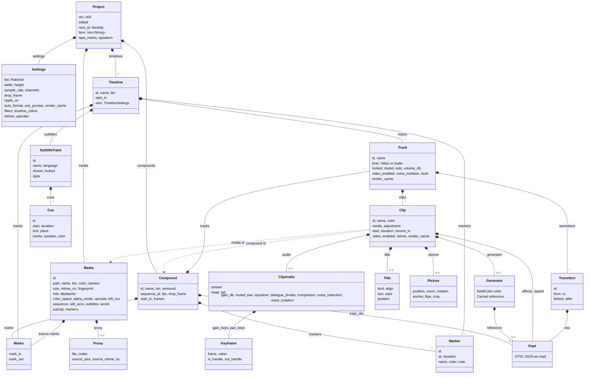
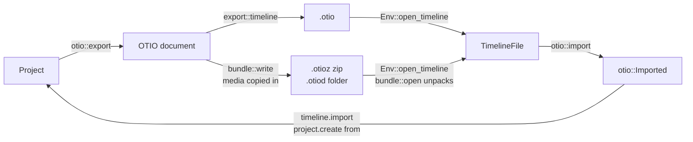

# Project model

- A project is one `Project` value in vidcut-core: settings, its media, bins and timelines. A timeline holds tracks of clips, subtitle tracks of cues, marks and markers.
- It is saved as one `.vidcut` JSON file. Only the editor changes it ([requests](requests.md)).
- This page tells about the types, time, ids, the file, OpenTimelineIO and the preferences.

## The project

- `Project` holds `rev`, one more for each change, and `edited`: when.
- `media` is the pool, in pool order. `bins` are slash-separated paths, and each `Media` names its `bin` (spec §3).
- `media` also keeps the items that `media.remove` took out while clips or compound clips use them (`Media::removed`, with no `bin`).
  - `Project::pool_media` and `Project::pooled` give only the pool. The pool, the requests that name media, and the lists of the GUI use them.
  - `Project::media` finds each item. The code that plays, draws or writes clips uses it.
  - The plans play the clips of removed media with no sound. Their picture is `Generated::Offline`, with only their opacity and composite mode.
  - `render::flatten` makes them so in a copy of the project.
  - `drop_unused_removed` runs after each change (`Editor::apply`, `history.revert`). It deletes each removed item that no clip and no compound clip uses (`Project::is_used`).
  - `add_media` puts each removed item of the same file back in the pool, with its id, its subclips too (`bring_back`).
    - It does so only when the project stays valid with the file as it is now. Else the file comes in as a new item, and the clips stay offline.
    - Why: a file can change at the same path, and the clips can then need frames that it no longer has.
  - `join_pool` puts a removed item of the same file back in the pool, with its id.
- `tracks` are the video tracks, then the audio tracks. Audio tracks hold sound-only clips.
- A clip on a video track carries its picture. Its `ClipAudio` carries its sound, with J/L offsets (`head`, `tail`).
- `tape_marks` holds the In and Out of the source tape.
- `MediaInfo` keeps what the probe found: streams, duration, start timecode.

Timelines (spec §3):

- `timelines` holds the timelines in the order they were made. Each `Timeline` has an `id` (`t<N>`, never reused), a `name`, a `bin` and a `start_tc`.
- `recent` lists the ids, the last opened first. Its first id is the open timeline. The Timeline Selection menu shows `ops::timelines::RECENT_SHOWN` of them.
- In memory, the open timeline is checked out: its `tracks`, `marks`, `markers` and `subtitles` are the fields of `Project` with these names. Its entry in `timelines` has empty lists.
  - Why: the code that edits, plays and exports a timeline reads these fields. It does not change for many timelines.
  - `Project::check_in` puts them back into the entry, and `Project::check_out` takes them out. `Project::open_timeline` does both.
  - `Project::compounds` holds canonical compound clip definitions (`Compound`). `Compound::removed` keeps a removed item while clips still use it (`drop_unused_removed`).
  - `Project::clip_name` gives the name that a clip shows: its own `name`, else the name of its `Compound`, else the name of its media.
    - Why: a rename of the compound clip then shows on each clip that has no name of its own.
  - `Project::compound_path` holds open compound clips (`OpenCompound`, outermost first) with their `CompoundTarget`.
    - Each `OpenCompound` refers by id to a `Compound` in `Project::compounds`.
    - While one is open, `Project::checked_out_compound` names it. `Project::format` uses its `fps` and `drop_frame`, and `Project::start_tc` gives `Compound::start_tc`.
  - `Project::checked_out_timeline` and `Project::sheet_key` name what is checked out. Exports while open export that compound clip with no `project` metadata, and `steps::since` reads `sheets_of` including open compounds.
  - The file and the history hold each timeline and compound with its contents (`Project::whole_timeline`, `Project::sheets`, `Project::take_sheets`). Thus a diff names the sheet that changed.
- `TimelineSettings` (`own`) gives a timeline its own frame rate, size, drop-frame and color space. Without it, the timeline uses the project's.
  - `Project::fps`, `width`, `height`, `start_tc` and `counts_drop_frame` give the values of the open timeline. `Settings` holds the project's own values.
  - `Project::flat_settings` gives `Settings` with the format of the open timeline. The export, the render cache and ducking use it.
- A timeline in the project locks the project's frame rate and drop-frame (`project_set`). A timeline with its own settings changes them only while it has no clips (`ops::timelines::set`).
  - Its markers, cues and In/Out marks then keep their time (`ops::conform`).
- `ops::timelines` holds the requests: `new`, `open`, `rename`, `duplicate`, `delete` and `set`, and `list`.
  - `duplicate` gives the copy new ids for its clips, transitions, markers and cues.
  - `delete` opens the timeline made before the deleted one, else the one after. A project can have no timeline.
  - An edit into a project with no timeline makes one first (`Editor::apply`).
    - `Project::keep_sheet` makes "Timeline 1" from the open tracks.
    - `need_timeline` applies the rule after the request, and after each command of a batch. Thus a batch gives the same result as its commands one by one.
- A pool item counts at the project's rate: a sound file and a still count `Settings::fps` (`Media::rate`). A compound clip keeps its own `Compound::fps` and `Compound::drop_frame`.
- `ops::conform` converts clips by time from one frame rate to another. `render::expanded`, `ops::compound::unnest` and `edit.paste` use it, and `edit.copy` returns the rate of its clips.
- Synced groups and the Sync Clips window count frames at the project's rate.
  - The Sync Bin, `multicam.pick` and Source Overwrite line up the files on the frame grid of the project (`ops::synced_at`).
  - `multicam::timeline_frames` converts a frame of a group to the open timeline's rate by time, for the strips of the rows.
- Source Tape (`render::tape`) and Multi Source (`multicam::source_grid`, `render::camera_tape`) count frames at the open timeline's rate. The source viewer of one clip (`render::clip_tape`) counts frames at the clip's own rate.

Volume and Pan keyframes ([spec D81](../spec.md#12-decisions-on-gaps-and-contradictions)):

- `ClipAudio::gain_keys` holds the volume keyframes, and `ClipAudio::pan_keys` holds the pan keyframes, in order on whole source frames.
- On a clip with a speed, they are on its retimed source.
- With volume keyframes, the volume is their curve (`keyframes::value_at`), and `gain_db` is not heard.
- With pan keyframes and `pan_on`, the pan is their curve (`ClipAudio::pan_at`), and `pan` is not heard.
- `keyframes::reshape` makes each change. It keeps the order, one keyframe on a frame, and the ease of each keyframe.
- `ops::keyframes` holds the requests. `ops::change_speed` moves the keyframes with `keyframes::retimed`.

Speeds ([spec D48](../spec.md#12-decisions-on-gaps-and-contradictions)):

- `Speed` holds the `sections` of a clip's speed, and `skip`.
- A `Section` starts at a frame of the clip's retimed source (`at`), at a source position (`from`). It has one `speed`.
  - Its `ease` holds the handles of the speed keyframe at its start, in frames before and after it.
- `Pace::position` gives the source position on the curve. `Pace::bend` gives the handles that an ease uses, kept inside the sections.
  - `ops::speed` and the OTIO import stop a new ease at the clip's edges. `Pace::bend` stops it at the speed keyframes, at each render and export.
- With speed keyframes, each frame shows `source_frame` of the curve, also backward. A clip with one backward speed shows the bottom of each stretch.
  - `source_frame` rounds down with the small amount that the spec gives.
  - `ops::speed` works on the curve form. `sections` and `with` change a clip with one backward speed to that form and back.
- The retimed source has one frame for each timeline frame. `skip` is its frame at the clip's first frame.
- `render::Pace` gives the source frame at each frame of the retimed source. `source_in` is the first source frame that the clip shows.
- A trim or a split moves only `skip` and `source_in` (`Clip::walk`). Thus all the speed keyframes stay.
- The keyframes of a clip with a speed are on its retimed source (`Clip::content_at`). Thus they stay on their frames of the clip.
- `ops::speed` adds and removes speed keyframes, and holds `speed.set`, `speed.freeze`, `speed.reverse` and `speed.ease`. `ops::change_speed` gives a clip one speed.
- `freeze_from` makes the freeze frame of a speed under `Speed::RANGE`. `ops::split_clip` cuts the clip, and `ops::change_speed` freezes the right part.
  - Why two clips: the spec gives two clips, one after the other. `speed.freeze` gives one clip with a freeze section.
- A compound clip takes speed keyframes as a plain clip does. `linked::with_ties` gives the edit to its picture block and its sound block.
  - A speed edit gives each block its new speed first. Then `ops::trim` changes both lengths once, through the block on the main track. Thus the clips after it move once.
  - `render::stretches` cuts the compound clip for `render::expanded`, and each stretch plays its inner tracks.
  - A picture track has one stretch for each run of one speed. Thus each stretch is at one speed, and a title and a Dynamic Zoom follow it.
  - A sound track has one stretch for each direction. Thus the sound stays one lane through a change of speed.
  - `render::paced` gives an inner clip the sections of the compound clip. `composed_over` multiplies them with the speed of the inner clip.
  - `paced_keys` moves the keyframes of an inner clip through the sections. Each keyframe stays on its frame of the inner timeline.
  - It adds a keyframe where a section ends, between two keyframes (`Picture::split_keys`). Thus the value follows each change of speed.
  - A freeze section gets a keyframe at each end with the same value (`Picture::hold_keys`).
  - A stretch with no motion keeps the value of its frame.

Stills ([D38](../spec.md#12-decisions-on-gaps-and-contradictions)):

- A file is a still when an image demuxer reads it (`image2`, the `_pipe` demuxers).
- A GIF or animated WebP (`gif`, `webp_anim`) of one frame is also a still.
- `still_secs` is the length of a still. The import takes it from the preference `editing.still_duration`, through `Env::still_duration`. A later change of the preference keeps it.
- An animated WebP of more frames lasts as long as its frames do. Why: `webp_anim` reports no duration.
- `probe` refuses an animated WebP that `webp_pipe` reads ([gotchas](../gotchas.md#ffmpeg-reading-and-decoding)).

Multicam layout:

- `multicam::layout` works out where the files of a multicam clip lie (spec §3).
- It works in frames at the project's rate. A start timecode at another rate rounds down (`StartTimecode::frames_at`).
- `Layout` is the answer to `multicam.layout`. `ruled_rows` makes its rows: `camera_row` for each camera name by the row rule, then `rows_with_no_name`.
- `by_sound` joins the files by the best `SoundMatch` first, while the score reaches `SOUND_MATCH_SCORE`.
  - `Env::sound_match` compares two files by the levels that `Env::audio_levels` keeps. Thus a sync decodes a file once.
  - `vidcut_av::analysis::sound_match` correlates the rises of the level, because a rise does not depend on the microphone's level.
  - The score grows with the length that the two files have in common, so a short overlap does not match by chance.
  - A triangle over the lags (`SMEAR`) finds the middle of a broad peak, which is what drift gives.
- `Project.groups` stores `SyncGroup`, the result of `multicam.create`. It is a list beside `Project.media`, because a group has no file.
- A `SyncGroup` stores `GroupRow` values. The row is stored because a camera name that changes later must not move a file until Auto Sync.
- `Project::group_of` takes the newest group that holds a file, the last in `Project.groups`. A file can be in more than one group, because the Sync Clips window makes a new group from files of two groups.
- `SyncGroup.dropped` lists the files that the row rule or a drag took off its rows. The Sync Clips icon needs the list, because such a file is still in the bin and is not a new file. The file leaves out `dropped` when it is empty.
- A `GroupRow` has its `camera`, `locked` and its `clips`. The file leaves out `camera` for a file with no camera name, and `locked` when it is off.
- `multicam::row_camera` gives the name of a row. A row with no name takes its number among those rows.
- `locked` is the sync lock of the Sync Clips window. It is for each row.
- A `GroupClip` stores the media, `at`, `hidden`, `head` and `tail`. `multicam.list` works out `frames` from the media.
- `at` is the place of the first visible frame in the group, with far gaps closed. `hidden` holds the closed frames before it, so `at` plus `hidden` is the place in real time.
- `head` and `tail` are the frames that the file loses at each end. The file leaves `hidden`, `head` and `tail` out at 0.
- `GroupClip::start` is the place of the file's own first frame. `SyncGroup::at_of` gives it. It can be below 0 when the earliest clip has a head.
- `multicam::row_file_at` gives the file of a row at a frame of the group.
- `start`, `at`, `hidden`, `head` and `tail` are in frames at the project's rate. `groups_to_rate` converts them when the rate changes.

Media fields:

- `camera` is the name of the camera, as text (spec §3). The file does not give it, and `media.set` sets it.
- `created`, `scene`, `shot`, `take` and `comment` are text (spec §3). The file does not give them, and `media.set` sets them. The project leaves out an empty one.
- `color_space` (`ColorSpace`, spec §3) reads a file whose color tags are wrong as another space.
  - `Media::video_as_read` is the `VideoInfo` of the file, read in that space. Render pieces carry it.
  - `VideoReader` retags each decoded frame with it (`color::retag`). This drops the HDR side data.
  - A proxy is made from the pictures as read in that space. Thus its own tags are right.
- `input_lut` is the `.cube` file that the pictures of each clip of the media go through (spec §3, [the LUT files](README.md#lut-files)). It replaces the `input_lut` of the settings.
- `alpha_mode` (`AlphaMode`, spec §3) tells how to read the alpha channel of the pictures.
  - `VideoPiece::Source` carries it. `Picture::alpha_mode` gives it to the draw ([playback](playback.md#gpu-pictures)).
  - `Media::opaque` is true for a picture with no alpha channel, or with the mode None.
- `upscale` (`Upscale`, spec §3) enlarges the pictures with a better upscaler before they are fitted.
  - `upscaler` (`Upscaler`) is AI Fast, AI Slow or Classic. [gpu](gpu.md#upscale) tells which upscaler each path uses.
  - Proxies do not use it. The viewer uses it only with `viewer.upscale` ([playback](playback.md)).
- `left_out` holds the source frames that the Delete of the Transcription window left out (`media.leave_out`, `ops::leave_out`).
  - Each edit of the media leaves these frames out. `resolve_sources` cuts each source range around them (`model::uncovered`).
  - An edit that fills the timeline In to Out can need more frames than the range. Then the frames after the range also skip them (`fit_to`).
- `words` holds the words that the project takes from the transcripts of each sound stream (`ChosenWords`, [analysis](analysis.md)).
- `subclip` (`Subclip`) makes the item one part of its file (`media.subclip`, `ops::create_subclip`).
  - `info` still tells about the whole file. `Project::file_frames` gives its length, and `Project::media_frames` gives the length of the part.
  - The source frames of a subclip count from the start of the part. `Media::origin` adds `Media::skipped`, thus the render pieces and the measurements find the right part of the file.
  - `Subclip` holds the first frame of the part, the frame after its last frame, and the frame rate that they count.
    - For video, this is the rate of the video. Thus the part is always whole source frames, and no reader rounds a time to find a frame.
    - A still or a sound file counts frames of the project. Its part keeps the project's rate from when the part was set.
    - Thus a change of the project rate and an OTIO import from a project at another rate keep the part at the same time.
    - After such a change, `Project::subclip_span` gives the part at the new rate, to the nearest frame (`Subclip::at`).
    - A length at the rate of the item comes from these frames (`Project::frames_of`).
    - For a still or a sound file, the item's rate is the project's rate. Thus `Project::media_frames` and `Project::clip_frames` agree, and an edit can reach the last frame.
  - An OTIO import finds a subclip that is already in the pool by its file and its part (`Subclip::same_part`). The part counts as the same at any rate.
  - The measurements, transcripts, proxies and waveforms belong to the file. A subclip uses them as they are.
  - Word times are in seconds of the file. `analysis::words_in` takes the skipped seconds to place them.
  - `Media::timecode_at` gives the source timecode of its first frame.
  - `Tiles::job` keeps no blocks on disk for a subclip, because the blocks count the frames of the whole file.
  - `PoolFiles` and `otio::same_media` never take a subclip for its file.
  - An OTIO file gives a clip of a subclip as a clip of the whole file, at the right time. `Media::skipped_at` gives the start of the subclip from its first frame, in exact steps between the two rates. Thus media at the rate of the project starts on a whole frame.
  - An import takes the start of the subclip off a source start that counts in the whole file (`otio::Counted`, `at_project_rate`). The `vidcut` metadata of a clip counts in the subclip.
  - An import finds the pool item of a clip by its file and its `vidcut` media id (`media_key`). Thus the clips of two items of one file keep their own items.
  - `Speakers::share` gives a new subclip the people of its parent.
  - `ops::set_subclip_limits` changes the part (`media.subclip_set`). `Project::subclip_span` gives the part in frames of the file.
    - The source frames count from the start of the part. Thus a new start moves each frame that counts from it by the same amount.
    - `ops::shift_source` moves `source_in`, the `phase`, the keyframes and the `from` of the effects of each clip. A clip with a `Speed` keeps its keyframes, because they count on the retimed source.
    - `ops::shift_source` counts the `phase` in whole steps between the two rates. Thus the parts of one split clip keep the same `phase`.
    - The `head` and `tail` of a `GroupClip` take the change, so that its visible part stays.
    - `validate` refuses a clip outside its media, so `ops::set_subclip_limits` refuses the change first and names the clip.
    - A `Marker` can be outside the part for this reason. Nothing shows it there, and a later change can bring it back.
    - `Tiles` forgets the pictures of the item, because their frames count from the start of the part.
- `markers` holds the markers on the source clip, at its source frames (`ops::add_source_marker`). `Project::marker` finds a marker by id in the timeline or in a source clip.

Folders:

- `media.add_folder` lists the folder with `Env::read_folder` (`folder::read`).
  - It sorts the files and folders by name, without case, as the pool does.
  - It leaves out names that start with a dot.
  - It skips a link to a folder. A link to a file is added.
  - It skips a folder that is the same folder as one above it, for example a bind mount (`folder::LOOPS`).
- It adds the media in that order, each into the bin of its folder. Each folder that it reads gets its bin.
- A file is media by its extension (`folder::MEDIA_TYPES`, `folder::IMAGE_TYPES`). Why:
  - A probe of each sidecar and document in the folders of a camera card is slow.
  - FFmpeg opens some of these files as streams, for example subtitles.
- It lists the files that it skips, and the files that do not probe. A run of numbered images shows as the run (`ImageSequence::display`).
- With `sequence`, `Folder::runs_here` finds the runs of numbered images of each folder (`sequence::find_among`).
- It is one request, thus one undo step.

## Time

- Each timeline position and length is a whole frame at the rate of its timeline (`Project::fps`). Below, "project frames" are these frames.
- The rate is an exact `Rational` (30000/1001, not 29.97).
- The `source_in` of a clip also counts project frames, from the first frame of its media.
- `Clip::phase` is the part of a project frame from `source_in` to the exact start of the clip.
  - An edit of media at another frame rate starts on a frame of that media. This start can fall between two project frames.
  - The sound of the clip starts at the same exact time.
  - The clip of Source Overwrite starts on a frame of its file, as each edit does.
- A position on a pool item counts its source frames: the frames of its video, at the frame rate of the video (`Media::rate`).
  - A still or a sound file counts frames at the project's own rate, `Settings::fps`.
  - The marks, the markers, the left-out spans and the subclip limits of an item count source frames.
  - `media_context` resolves times on an item at its frame rate, with the drop-frame count of its file (`Project::clip_rate`).
- Conversions between the two counts:
  - `Project::on_timeline` gives the project frames and the `phase` of a marked range, for an edit.
  - `Project::clip_frame_at` gives the source frame that a frame of the Source Tape shows. `Project::tape_frame` gives the first frame of the tape that shows a source frame.
  - `Project::left_out_frames` gives the left-out spans in project frames, for the `phase` of an edit.

Requests take times as strings that parse into a `TimeSpec`:

- frames: "450f", or a JSON integer
- seconds: "15s", "1m30s", "250ms"
- timecode: "HH:MM:SS:FF", with ";" for drop-frame. FF has three digits where the rate has more than 100 frames in a second (`Rational::frame_digits`).
- a keyword: start, end, in, out, playhead
- an offset: "+5s"

Ranges and resolution:

- A `RangeSpec` is half-open: "A..B" or "A..+D".
- The editor resolves times with a `TimeContext` from the project:
  - "15s" is the nearest frame (`Rational::secs_to_frames`).
  - Timecode counts from the `start_tc` of the open timeline ([spec §4.3](../spec.md#43-timecode-pp-640-688-713714)).
  - The playhead keyword resolves only when the caller gives a frame. The live core gives the frame of the timeline. Thus a command that the GUI runs can use the playhead, and a headless command cannot.
- A clip reference is an id, or "V1@15s": the clip under that frame on V1 (`resolve_clip`).

## Source Overwrite

`ops::source_overwrite` holds `edit.source_overwrite`. The behavior is in [spec §7.2](../spec.md#72-edit-functions).

- `origin` turns `MediaInfo.timecode` into frames of the open timeline with `StartTimecode::frames_at`. A file with no tag counts as 0.
  - `origin` and `shown` choose the reference clip.
- `Grid` and `Spot` line up the files on the frame grid of the project ([spec §7.4](../spec.md#74-sync-bin-pp-708710-measured-in-resolve-studio-2112)).
  - `Grid::place` gives the project frame of a timeline frame: the first project frame that is not before it.
    - Its time is the exact source time of the reference clip.
  - `Spot` holds the start of a file as a whole project frame, rounded down. With a group, it is the place of the file in the group.
  - `Spot::frame` gives the frame of the file at a project frame, rounded down.
  - `synced_at` gives the frame that the Sync Bin shows at a timeline frame. `multicam::pick` and the rows use it.
  - The clip starts at the playhead when the playhead shows the source In. Else it starts at the first timeline frame that shows the source In or a later frame.
  - The clip starts with the frame In. With timeline marks, it starts with the frame that `Spot::frame` gives at its first timeline frame.
- A generator as the source has `origin` 0 and the length of `ops::titles::default_length`.
- A compound clip as the source starts at `Compound::timecode_at` and has the length `compound_frames`.
  - `compound::with_sound` adds its sound, as in the other edits.
- `Lining::start` gives the start of a clip in frames of the open timeline. `Lining::placed` gives it in frames of the project.
  - A file starts at `origin`. A compound clip starts at its own start timecode (`Compound::timecode_at`).
  - With a group, a compound clip has no start. Why: a compound clip is in no synced group.
- `shown` gives the timecode range that a clip shows, from `Clip::source_at`.
  - A still, a generator and a title have no such range. Thus they do not count.
- `first_where` takes clips by the order of the tracks: video from the lowest, then audio.
  - `by_marks` and `by_playhead` choose the reference clip with it.
  - A video clip and an audio clip that give different positions under one rule make the edit fail (`disagree`). No measurement tells which of them wins.
- `track_above` gives the track. `place_on_top` uses it too.
- The result names the clip, its track, the `reference` and the `playhead`. `playhead_after_edit` seeks to this `playhead`.
- The GUI sends no `range` for media (`edit_from`). The core then reads `Media.marks`, and it can tell source marks from no marks.
- The GUI sends `range` for a generator with marks. Why: its marks are in the live session, not in the project.

## Ids

| Thing | Id | Made by |
|---|---|---|
| media | m1, m2 … | `Project::alloc_media_id` |
| clip | c1, c2 … | `Project::alloc_clip_id` |
| marker | k1, k2 … | `Project::alloc_marker_id` |
| carried transition | t1, t2 … | `Project::alloc_transition_id` |
| cue | q1, q2 … | `Project::alloc_cue_id` |
| track | V1 … then A1 …, by place | `ops::tracks`; removing one renumbers the rest |
| subtitle track | S1 …, by place | `ops::subtitles::add_track`; removing one renumbers the rest |

- The counters are in `NextIds`. Each alloc call adds one.
- Undo restores `next_id` with the project. Thus an id of an undone edit can come again.
- `ops::MAIN`, V1, always exists.

## The `.vidcut` file

- `Store` reads and writes the `Project` as pretty JSON (serde).
- A media path in or under the folder of the project is stored relative to it. Other paths are stored absolute. In memory, media paths are absolute.
  - The same rule holds for the `input_lut` of a media item, and for the `input_lut`, `output_lut`, `video_monitor_lut`, `color_viewer_lut` and `scopes_lut` of the settings.
  - Why: a project folder that moves, to another computer too, keeps its media ([deviation X1](../deviations.md#x1-a-project-is-one-file-and-its-media-paths-are-relative)).
- A proxy is stored by its file name (`Proxy::file`), and found in the proxy folder of this computer (`Proxy::path_in`, `Env::proxy_dir`).
- A save writes a temporary file and renames it over the project (`temp::write`). Thus readers see the old file or the new one, never part of one.
- `Store::transact`, `Store::compact` and `OpenProject::apply` hold the lock file of the project (`Store::lock`). `Store::create` and `Store::replace` write a new file without the lock.
- A load runs `validate::violations`, and refuses an inconsistent file.
- The undo history is kept apart, in the state dir ([requests](requests.md#undo-history)).

Temporary files:

- Each file that vidcut writes whole goes through `temp`.
- `temp::file` and `temp::dir` make a hidden file beside the target. Its name is the target's, a random number and a part piece. The extension is last, for FFmpeg.
- It is created exclusive (`create_new`). Thus nothing that is already there, a link included, opens.
- `Temp::keep` renames it over the target. A `Temp` that is dropped and not kept is removed.
- `temp::remove_left` removes the temporary files of a GUI as it closes.
- When two processes write one target, each writes its own file, and the last rename wins.
- Windows can refuse a rename over a file that is open elsewhere. This is an error, never dropped.
- A model download keeps one `.part` to continue from ([analysis](analysis.md#transcription)).

## Fingerprints and relinking

Stamps:

- `Media::size` and `Media::mtime_ns`, read at the probe, make the `Origin` of the file (`fingerprint::origin`).
- The origin names and stamps each cache file made from the media ([analysis](analysis.md)).
- A proxy made from another size or time, or with another `color_space`, is stale (`Media::fresh_proxy`).
- The file of a proxy is named by the content of the source (`paths::proxy_origin`). Thus it has the same name on each computer.
- A proxy whose file is gone is lost (`Env::proxy_present`). Automatic proxies make it again, as the project names it.
- `Media::fingerprint` is a SHA-256 of the content (`fingerprint::file`). It reads a small file whole (`WHOLE`), else one `PIECE` from the start, the middle and the end. An image sequence uses three pictures (`fingerprint::pictures`).

Relinking:

- A file is missing when `Env::present` says so. A path that is absolute only on the other kind of system is missing.
- `media.relink` looks for missing files by name in `search` folders. A candidate in more of the same parent folders comes first.
- It relinks a candidate only when its size, pictures, sound streams, duration, timecode and fingerprint match.
- A file given as `path` is used either way. The answer tells what differs.

## Subtitles

- `Project::subtitles` holds the subtitle tracks. S1 is nearest the video. One track is `shown` at a time.
- A `Cue` spans whole frames, as a clip does. The cues of a track are sorted by start, and can overlap.
- Its `text` is lines, with `<i>`, `<b>`, `<u>` and `` around words. `Place` tells where on the picture it goes.
- `speaker` is the person who says it. `color` is its own color, over the color of the person (`Speakers::color_of`, [spec §8.12](../spec.md#812-subtitles-pp-645646-702-12271248)).
- `picture` is a `Picture` for a picture as large as the frame.
  - Its keyframes count frames from the start of the cue. Thus `Cue::as_clip` makes a `Clip` with `source_in` 0, and the keyframe code uses that clip for the time.
  - `Project::key_holder` finds a clip or a cue by id for the `keyframes.*` requests.
  - `Cue::move_keys` keeps keyframes on their timeline frames when the start of the cue changes. A timeline edit moves them with the frames of each part (`remap`).
- `words` holds a `CueWord` for each word of the text, in order. The cue leaves `words` out when no word has a start frame or a style.
  - The `at` of a word is its start frame, from the start of the cue ([spec D70](../spec.md#12-decisions-on-gaps-and-contradictions)).
- Styles nest: the track style, then the `style` of a cue, then the `style` of a word. `SubtitleStyle::for_cue` merges each over the one under it. A field left out keeps the style under it.
- The `SubtitleStyle` of a track holds:
  - its font, size, color, outline, background and margin ([spec D61](../spec.md#12-decisions-on-gaps-and-contradictions))
  - its bold face, letter case and shadow
  - `SubtitleWords`: how its words show as they are spoken ([spec D69](../spec.md#12-decisions-on-gaps-and-contradictions))
  - `SpeakerPaint`: what the color of a cue paints (`SubtitleStyle::paints`)
  - `SubtitleAlign`: `left`, `center` or `right`. It lines up the lines with the longest line. Left out, the lines are centered.
  - `position`: `[x, y]` as fractions of the picture from the top left. It is the point that `anchor` names, else the middle of the longest line. Left out, the block stays in the place of the cue.
  - `anchor`: a `TitleAnchor`, the point of the block that goes to the position. `SubtitleStyle::anchor` gives the point down, and `SubtitleStyle::anchor_across` the point across.
- `ops::subtitles` holds the edits. `editor::resolve_cue` reads a cue reference: its id, or a track and a time (S1@15s).

**Cues follow Track 1** ([spec D57](../spec.md#12-decisions-on-gaps-and-contradictions)).

- `follow::follow` moves the clips of the other tracks after an edit on Track 1. It also calls `ops::subtitles::remap` with its frame mapping. `ops::delete_range` calls `remap` with the mapping of its range.
- `remap` maps each frame of a cue. A frame survives when it has a place, and the next frame does not land on the same place.
- The surviving frames, in runs, are the new spans of the cue. The first span keeps the id of the cue, and the other spans get new ids.
- The frame of each word goes through the same mapping. A word on a removed frame starts on the next kept frame. Each span counts its words from its own start.
- A locked subtitle track stays as it is.

**Files.**

- A subtitle file in the pool is a `Media` with `subtitles` (`SubtitleFile`: its format, encoding, cue count, language, first cue and warnings).
- `subtitles::pool_item` makes it when `Env::probe` meets a subtitle extension.
- It has no streams. Thus `Project::media_frames` gives it no frames, and `ops::make_clip` refuses it.
- `subtitles.import` reads its cues from the file again when it places it.

Reading:

- `subtitles::parse` decodes the bytes (`Encoding`): a BOM, else UTF-8, else UTF-16 by its zero bytes, else Windows-1252.
- It tells the format by the first lines, then by the extension.
- It reads SRT and WebVTT line by line, the `::cue` colors of a WebVTT STYLE block too.
- It reads TTML with roxmltree:
  - its styles and regions, down to each span
  - its time base: media, or smpte with its drop mode, as appendix N.3 of TTML1 counts
  - its language (xml:lang), which the new track takes
- A WebVTT `position` or percent `line`, and a TTML region, give `Timed::style` a position and an anchor. The `align` of WebVTT and the `multiRowAlign` or `textAlign` of TTML give its alignment ([deviation X40](../deviations.md#x40-subtitle-files-are-read-as-they-are-written)).
- The markup of each format becomes the cue markup. Other tags go.

Placing:

- `ops::subtitles::import` turns each time into the nearest frame in the time base of the file (`SubtitleTimeBase`). The time base is real time, or timecode labels when the times sit on their grid.
- A file in timecode then loses the start timecode of the timeline, or 01:00:00:00 ([deviation X41](../deviations.md#x41-subtitle-files-placed-by-their-timecode-or-from-the-timelines-start)).
- It keeps the position, the anchor and the alignment of a cue only where they differ from the style of the track.
- A new track takes the alignment that all the cues of the file share.

Writing:

- `ops::subtitles::collect` gives the cues of a track in a range, in seconds: from zero, or in timecode. `subtitles::origin` gives the frames of the start timecode ([spec D58](../spec.md#12-decisions-on-gaps-and-contradictions)).
- `subtitles::write` writes the cues as SRT, WebVTT or IMSC1.
  - WebVTT writes colors other than its eight named colors as STYLE classes.
  - The IMSC1 file carries the `SubtitleStyle` of the track, and regions sized from its cues ([spec D64](../spec.md#12-decisions-on-gaps-and-contradictions)). What does not fit goes in `Written::warnings`.
- `subtitles.export` writes the file through a partial file beside it (`Env::write_file`).
- `subtitles::beside` makes the files that an export writes beside its output ([export](export.md#subtitles)).

## Titles

- A clip with a `title` is a title ([spec §8.14](../spec.md#814-titles-pp-762764-11761178)): no media, no audio, no speed, any length, on a video track.
- `Clip::is_generator` and `Clip::is_block` count it. Thus edits treat it as a generator.
- Its `Title` holds:
  - a `TitleKind`: `text`, `lower_third` or `scroll`
  - the `TitleAlign` of its lines
  - an optional `TitleAnchor`. Without one, the block takes the usual anchor of its kind, alignment and part (`Title::usual_anchor`). `Title::anchor_of` gives the anchor in force.
  - its lines, with markup that `rich::spans` reads into `Span`s
  - a `TitleStyle`
  - an optional `position`: the point that its anchor goes to (`Title::place`, [spec D65](../spec.md#12-decisions-on-gaps-and-contradictions))
  - `position_keys` with `position_y`, `zoom_keys`, `rotation_keys` and `opacity_keys`: `Keyframe`s on source frames, beside the plain values
  - `position_handles`: the `PositionHandles` of the position keys that have any, each with the frame of its key
- `Title::takes_keys` tells which values take keyframes. A scroll has no zoom or rotation.
- `Title::as_picture` gives a `Picture` with these values, and `Title::take_picture` takes them back. Thus `ops::keyframes` and the sampling use the code of `Picture`.
- `Title::sampled` gives the title of one frame, without keyframes.
- The upper line of a lower third can go apart from its lower line:
  - `Title::upper` holds a `TitleLine`: the anchor, place, zoom, rotation and keyframes of the upper line. The other fields are then those of the lower line.
  - Without `Title::upper`, the two lines go together. The point of the upper line is then `Title::UPPER_DROP` below the point of the lower line (`Title::upper_with_lower`).
  - `Title::swap_lines` swaps the values of the two lines, and `Title::upper_view` gives a title with the upper line's values in the fields of the title. Thus `ops::keyframes`, `ops::titles` and `otio::titles` have one code for the two lines.
  - `Title::part_lines` puts the values of `Title::upper_with_lower` into a `TitleLine`. `ops::titles::on_line` parts and swaps the lines around one edit.
  - `Title::each_line` makes one change on each line.
- `Title::blocks` tells what to draw. A `TitleBlock` has its `TitlePart`, its pivot, its anchor, the edge of its text, its zoom and its rotation:
  - A Text title or a scroll is one `TitlePart::Whole`.
  - A lower third is a `TitlePart::Lower` under a `TitlePart::Upper`, with a `TitlePart::Backing` under them when the title has a background. Each line has its own point, as in the file.
  - `Title::block_text` gives the text of a block.
- A title's zoom is one number.
- A handle of a title's position key is a point in the picture, not frames and a value. Thus it is not a `Handle` of the `Keyframe`:
  - `Title::place_at` gives the point on the path. It uses the same `cubic` as the other curves, at one speed along the length.
  - `Title::as_picture` leaves the handles out. `Title::take_picture` keeps the handles of the keys that stay.
  - `Title::move_handles` follows a key that moves, or a new frame rate.
  - `Title::ease_position` computes the handles of an ease from the two neighbors. It reads their values as the file holds them (`Title::in_file`), and it stores the result with Y from the top.
  - `Title::put_handles` replaces the handles of one key. The other keys keep theirs.
  - `Title::position_ease` gives the current ease of a key, from the sides that have a handle.
- `ops::titles` holds the edits. `ops::titles::checked` is the check that `titles.add`, `titles.set` and `validate::violations` share.
- It checks the style through the checks of the subtitle style (`checked_font`, `checked_size`, `checked_color`, `checked_outline`, `checked_background`).

## Generators

- A clip with a `generator` makes its own picture ([spec §8.17](../spec.md#817-generators-p-766)): no media, no audio, no speed, no effects, any length, on a video track.
- `Clip::is_generator` and `Clip::is_block` count it.
- A left trim of a generator changes `source_in`, as on any clip. Its keyframes stay on their source frames.
  - Thus they stay on the same timeline frames, and the picture does not move.
  - An OTIO file counts them from the first frame of the clip (`generators::reference`).
- A `Generator` is one of these kinds:
  - `Generator::SolidColor` holds a `color`.
  - `Generator::FourColorGradient` holds a `Gradient`.
  - `Generator::EbuColorBar` holds an `EbuLevel`.
  - `Generator::TenStep`, `Generator::HundredMvSteps`, `Generator::GreyScale`, `Generator::YcbcrRamp` and `Generator::SmpteColorBar` hold nothing.
  - `Generator::Bt2111HlgNarrow`, `Generator::Bt2111PqFull`, `Generator::Bt2111PqNarrow` and `Generator::Window` hold nothing.
  - `Generator::Carried` holds the OTIO reference of a kind that vidcut does not model, as `Kept`. It plays as a gap.
- `Generator::draws` and `Clip::draws` tell whether a generator has a picture.
- A `Gradient` holds a plain Center X and Center Y and the keyframes of each one.
  - Keyframes stay on source frames, as other keyframes do. Thus a trim or a split does not move the picture.
  - `Gradient::center_at` gives the value on a source frame.
- `generators::Pattern` is one frame of a generator's picture, with nothing that changes over time. `generators::draw` writes it as RGBAF32LE, in 32-bit floats.
  - The render plan and the GUI cards share this rule. Why: each picture has one rule.
  - `generators::timeline_code` gives the code values of a color in the colors of the timeline.
  - `Generator::chart` gives the `Chart` of a kind that has no value over time. A `Chart` draws as rows of columns, from the size of the timeline. Its code values do not change with the colors of the timeline.
- `generators::name` gives the name of a generator. `generators::shown` gives its JSON form, for `generators.list` and `clip_json`.
- `ops::generators` holds the edits. `generators.add` and `titles.add` share `ops::titles::add_block`. `ops::block_clip` makes the clip of a title or a generator, for `add_block` and `make_clip`.
- `GeneratorKind` is the kind that `generators.add` takes. `GeneratorSettings` holds the values of `generators.add` and `generators.set`. A kind refuses a value that it does not have.
- `SourceParams`, `viewer.load` and `frame.render` also take a generator. `ops::generators::source_of` reads it.
- `render::generator_tape` plans a generator alone on V1. Why: the source viewer and `frame.render` then draw it by the path of a clip on the timeline.
- `ops::keyframes` keeps the keyframes of a volume and of a center on one path (`Number`).

## Adjustment clips

- `Clip::adjustment` marks an adjustment clip ([spec §8.24](../spec.md#824-adjustment-clips-pp-1145-1154-33753376-measured-in-resolve-studio-212)): no media, no audio, no speed, no motion paths, on a video track.
- `Clip::ADJUSTMENT_CLIP` is its display name and OTIO generator kind (`otio::generators::adjustment_reference`). `Project::clip_name` returns it when `Clip::name` is absent.
- `ops::titles::add_adjustment` shares `ops::titles::add_block` and `ops::block_clip` with titles and generators, backing `adjustment.add` and `edit.*` adjustment sources.
- `ops::picture::has_picture` and `ops::picture::takes_effects` accept it, while `ops::speed` and `ops::motion::takes` refuse it.

## Pictures

- A clip of footage, a still, an image sequence, a compound clip, a drawing generator or an adjustment clip can carry a `Picture` ([spec D75](../spec.md#12-decisions-on-gaps-and-contradictions)):
  - `position`: where the middle of the whole picture goes, before the zoom and the rotation
  - its `zoom` across and down, and its `rotation`
  - its `anchor`: the point that the zoom and the turn work about (`Picture::pivot`)
  - its `pitch` and its `yaw` (`Picture::pitch`, `Picture::yaw`)
  - its flips
  - a `Crop` of each side, and the softness of its edges (`crop_softness`)
  - a `DynamicZoom`: a start and an end `ZoomBox`, and an `Ease`
  - its `composite_mode` (`CompositeMode`, `Picture::mode`) and its `opacity` (`Picture::opaque`). Effects (`Glow`, `Vignette`, `GrainComposite`) and `GradeTool::LayerMixer` take `BlendMode`, which has only the 27 blend modes.
  - its `effects`, in their order: each an `Effect` with an `EffectKind`, a `GaussianBlur`, a `MosaicBlur`, a `Glow`, a `FilmGrain`, a `Vignette` or a `Sharpen` ([export](export.md#effects))
  - its `composition`: the nodes that work on its own picture before all of the above ([compositions](#compositions))
- Each value is left out at its usual value. A picture that `Picture::is_usual` accepts is only fitted into the frame.
- Each value of `keyframes::PictureValue` can hold `Keyframe`s beside the plain value. `Picture::is_usual` is false while a value has keyframes.
  - These values are position, zoom, rotation, the anchor point, pitch, yaw, each crop side, the crop softness and the opacity.
  - `position_keys` holds X, and `position_y` holds Y, one number for each keyframe. Zoom and the anchor point do the same.
  - A handle `value` moves X. Y keeps the handle `frames`, with a value offset of 0 (`value_paired`).
- `ops::picture` holds the edits:
  - `ops::picture::checked` is the check that `picture.set`, `validate::violations` and the metadata of an OTIO file share.
  - `ops::picture::has_picture` tells which clips take a picture: not titles, sound or generators that do not draw.
  - `ops::picture::takes_effects` tells which of them take effects: not generators ([spec §8.16](../spec.md#816-effects-pp-765-3526-3536)).
  - `ops::picture::clear` puts back one `PictureTool`, or all of them. `ops::picture::cleared` is the reset of one `PictureTool`, which the Inspector also uses.
  - `picture.set` takes a `DynamicZoomSet`. Its fields replace their own (`DynamicZoomSet::on`).
  - `ops::picture::effect_checked` checks an effect. It is part of `ops::picture::checked`.
- `ops::effect` holds the edits of the effects: `effects.add`, `effects.set`, `effects.key`, `effects.reset`, `effects.remove` and `effects.move`.
- The `keys` of an `Effect` hold one `EffectKeys` for each `EffectValue` with keyframes, sorted by value.
  - A point (Position, Center) keeps X in `keys` and Y in `y`, as `Picture` keeps its Position.
  - The functions of `keyframes` that split, hold, scale, move and drop keys keep the two lists in step (`split_channel`, `move_channel`).
  - `effect_keys` maps each `EffectValue` to its place in the kind of effect. An `EffectValue` of another kind has no place, and `ops::picture::effect_checked` refuses it.
  - `effect_checked` checks each keyframe as a plain value of the effect.
  - A request names an effect by its place in the list of the clip, from 0.
  - `picture.clear` of all the tools keeps the effects.
- `place::Placing` turns the picture of a clip, with the pictures of the compound clips around it, into maps.
  - Each `place::Level` maps a pixel of the frame back to a picture, with the part shown, its soft edges and its opacity.
  - Each map zooms and turns the picture about its anchor point. `place::anchored` gives the pixel where the anchor point lands.
  - Pitch and yaw lean the picture about its middle, in its own axes, before the zoom and the turn ([spec D93](../spec.md#12-decisions-on-gaps-and-contradictions)). Thus `Level.back` is a projective map. Without a lean, it is affine.
  - An export and the viewer both draw by these maps ([export](export.md#placed-pictures), [playback](playback.md#the-engine)).
- The shader of the viewer and the export holds the sums of the composite modes (D75, `mixed` in `picture.wgsl`).

## Compositions

- A `Picture` can hold a `Composition`: the nodes that work on the clip's own picture, before its crop and its transform ([spec §8.19](../spec.md#819-compositions-pp-1332-1385-1403-1420-21082111-2472-2480-2483-24902492-2500)).
- Each `Node` has a `name`, a `Tool`, its joins, a `place` in the node editor and its `keys`.
  - `Tool::MediaIn` is the clip's own picture. `Tool::MediaOut` is the picture that the clip shows.
  - `Tool::Blur` holds a `Blur`. `Tool::Effect` holds an `EffectKind`, one of the kinds of the clip effects.
  - `Tool::Ellipse`, `Tool::Rectangle` and `Tool::Polygon` hold a `Mask`.
  - `Tool::Tracker` holds a `Tracker`: its list of `Pattern` values. `Tool::flows` gives the tools that pass a picture on, and the Tracker is one of them.
  - A `Pattern` has a name, its own box, an offset and its motion path ([motion paths](#motion-paths)). On a frame, its box comes from its path (`Pattern::area_at`).
  - The Center of a `Mask` can follow a pattern of a Tracker of the same composition (`Mask.connect`, a `Connect`).
    - The center is then the middle of the pattern plus its offset. With `size`, the mask also takes the box of the pattern as its picture.
    - `ops::picture::connect_checked` refuses a connection to a pattern that is not there, and a connected mask with its own center.
    - `comp.set` refuses a connection of a Center with keyframes. A rename of the Tracker renames the connection. A removal of the Tracker or of the pattern takes it off.
  - `input` names the node whose picture comes in. `effect_mask` names the last mask of a chain of masks.
- A composition counts the frames of the file of its clip. `Composition::start` is the frame of the file that is its frame 0.
  - `ops::comp` sets it to the In of the clip when it makes the composition. A later trim does not change it.
  - `render::FileClock` takes a keyframe position of the clip to the frame of the file that it shows. It follows the speed of the clip and the two frame rates.
  - `composition::Frames` gives the frames of a composition: the first and the last frame of the source, the In and the Out.
  - `Frames::time` and `Frames::at` take a frame of the composition to the timeline and back.
- The joins are names, not places in the list. Why: a request, the GUI and the OTIO metadata then name a node in one way, and a removal moves no other join.
- The module `composition` reads a composition:
  - `Composition::chain` follows the inputs from the MediaOut node back to the MediaIn node. It gives the tools in their order, or none when it does not get to the MediaIn node.
  - `Composition::masks_of` follows the effect masks of a node back. It gives the masks in their order.
  - `Composition::loops` finds a loop of joins.
  - `Composition::plain` is the composition of a clip without one: `MediaIn1` joined to `MediaOut1`.
  - `Composition::free_name` gives the name of the tool with the first free number. `Composition::copy_name` adds `_` and the first free number from 1.
  - `composition::cleaned` keeps letters, digits and `_`, with no digit first.
- `ops::comp` holds the edits: `comp.add`, `comp.set`, `comp.connect`, `comp.rename`, `comp.remove`, `comp.paste`, `comp.key`, `comp.reset` and `comp.loop`.
  - A clip without a composition gets `Composition::plain` on its first `comp.add` or `comp.paste`.
  - `ops::comp::paste` puts the copies into a clone of the composition first. Thus a copy that is refused changes nothing.
  - A pasted Tracker keeps the paths of its patterns. On a clip that takes no paths, its patterns lose them (`kept_paths`). A pasted mask keeps its connection when its Tracker is there (`kept_connect`).
  - `ops::comp::Landing` tells where the copies go: after a node, at a place, over a node, or under all the nodes.
  - Over a node, one copy takes its place and its joins (`replaced`). A join that the copy cannot take goes.
  - `comp.set` takes a `NodeChange`. Its `values` are a `KindChange`: the values of an effect's kind, which `effects.set` also takes in its `EffectChange`.
  - A blur takes its `size`, a mask its `center` and `invert`, and a Gaussian Blur node its `blur_alpha`, from the `KindChange`.
  - Why: the names in the request are then those of the model. Each name has one field, and thus one text in the schema and in `--help`.
- `ops::picture::composition_checked` checks the names, the joins, the loops and each node (`ops::picture::node_checked`). It is part of `ops::picture::checked`.
- The keyframes of a node are in its `keys`, one `EffectKeys` for each `EffectValue` with keyframes.
  - The trait `effect_keys::Keyed` holds the keyframe work of an `Effect` and of a `Node`: read, write, sample, split, hold, scale, retime and retarget.
  - An `Effect` and a `Node` give only the slots of their values (`Keyed::read_point`, `Keyed::write`). Why: then one copy of the keyframe work serves both.
  - The functions of `Picture` that work on keyframes do not change the keys of the nodes. Why: the keys are on frames of the file, and a trim or a speed change keeps those frames.
- `picture.clear` of all the tools keeps the composition. `PictureTool::Composition` takes it off.
- The draw of a composition is in [export](export.md#compositions).

## Motion paths

- Each `Pattern` of a Tracker holds its motion path in `Pattern.path`, a `MotionPath`. Without a path, the pattern is at its own box.
  - Why: the Tracker node holds its tracking data ([spec](../spec.md#the-tracker)). Thus the paths go with the node: in a copy, at a removal and in an OTIO file.
  - Only a clip of footage, a still or an image sequence takes paths (`ops::motion::takes`): not titles, generators, compound clips or sound. `ops::motion::violation` refuses a path on another clip.
- A `MotionPath` tells where one thing of the source picture is on the frames of the file of the clip: its box. It holds its samples.
  - A path that `motion.find` made also has its `Subject`, for example `Face` ([analysis](analysis.md#subjects)). Without `replace`, `motion.find` refuses a Tracker with patterns of that subject.
    - With `replace`, the patterns of that subject stay.
    - A found thing that such a pattern already follows gets no second pattern (`same_thing`). Its samples go into that path (`merged`).
    - Between the first and the last new sample, the path keeps only the new samples. Outside them, it keeps its old samples.
    - Thus a second find adds the new things, and a kept pattern follows its thing on the frames of the new find.
  - A path that `motion.track` made has `tracked`. A later track of the same pattern writes its samples again.
- A `PathSample` holds the `frame` of the file, the `center` and the `size` of the box as fractions of the source picture, and the `rotation`.
  - The `frame` goes at the frame rate of the file. It counts from the frame where `source_in` counts from. `FileClock::file` takes a source frame to it.
  - Why: a thing is at one place on a picture of the file, at any speed that plays that picture. A track and a find look at each frame of the file.
  - Thus a trim, a slip, a split, a copy and a speed change do not change a path. A new frame rate of the timeline does not change it.
  - `shift_source` moves the samples when the limits of a subclip change (`ops::motion::shift`). The step in frames of the file is the step of `source_in` at the rate of the file, rounded.
- `MotionPath::area_at` gives the `motion::Area` on a frame.
  - A path lasts from its first sample to its last. Before and after them it has no box. Between two samples, the box goes in a line.
- `MotionPath::base_at` gives the box of a pattern on a frame.
  - On a path with `tracked`, it gives the first or the last sample outside the samples (`MotionPath::held_at`). Other paths use `area_at`.
  - Why: a tracked window holds its first and its last place. A Magic Mask stroke ends where its thing goes off the picture.
- A path is not keyframes. Why: a new path must not remove the keyframes that the user set.
- `MotionPath` compares its samples by their place in memory first. Its debug text gives only the count of its samples ([export](export.md#placed-pictures)).
- `ops::motion` holds the edits: `motion.add`, `motion.set`, `motion.remove`, `motion.find` and `motion.track`. `motion.list` reads the patterns and their paths.
  - Each request names the clip and the Tracker node. `motion.set` and `motion.track` also name the pattern, from 1.
  - `motion.add` adds a pattern with a path. `motion.remove` takes the path off a pattern, and the pattern goes back to its own box.
  - `motion.set` removes a range of samples first (`motion::clear`). Then it puts the new samples on their frames (`motion::put`). A pattern without a path gets one.
  - `comp.set` with a box and a `frame` changes the path of the pattern on that frame. Off the path, it changes the first or the last sample.
    - It also puts the samples next to that frame on the path, at their places. Why: then no other frame of the path moves.
  - `comp.set` with `pattern_trim` takes samples off the path. With no sample left, the pattern has no path.
  - A path keeps one sample at least.
- A Tracker has at most `Tracker::PATTERNS_KEPT` patterns, and a path has at most `SAMPLES_KEPT` samples.
- `motion::samples_problem` is the check that the requests, `ops::paste`, `ops::picture::checked` and `validate::violations` share.
- An OTIO file keeps the paths in the `Picture` of the `vidcut` metadata of the video item, on the same frames of the file.
  - An import reads the picture back only when `ops::picture::checked` accepts it (`our_picture`).
  - An import at another frame rate keeps the samples as they are. Why: the frames of a file do not change with the frame rate of the timeline.

## Ducking

- A track can carry a `Duck` ([spec D76](../spec.md#12-decisions-on-gaps-and-contradictions)). It holds `on`, its `sources` by track id, the Duck Amount, the four times, `detect` (`DuckDetect`) and `threshold_db`.
- Each value is left out at its usual value. `on` is written only when it is off.
- `track.set` takes a `DuckSet`. Its fields replace their own (`duck::patched`). A new `Duck` takes `duck::default_sources`.
- `duck::checked` is the check that `track.set`, `validate::violations` and the import of an OTIO file share.
- `ops::remove_track` renumbers the tracks. Then `duck::renamed` moves the sources to the new ids, and drops the removed track.
- An OTIO file carries the `Duck` in the `vidcut` metadata of its track. An import drops the sources that its tracks do not have (`duck::tidy`).
- [export](export.md#sound) tells how the ducking plays.

## Looks

- Looks are named styles ([spec D71](../spec.md#12-decisions-on-gaps-and-contradictions)). They are not in the project.
- `looks::Styled` is a `SubtitleLook` (a `SubtitleStyle` with `chars` and `lines`) or a `TitleLook` (a `Title` without its text: `TitleLook::of`, `TitleLook::on`).
- `looks::checked` runs each look through the check of its kind (`checked_style`, `ops::titles::checked`).
- `looks::built_in` holds the built-in looks. The user's looks are TOML files under `looks::dir`, one folder for each `LookKind`.
- `looks::read` lists the looks of a folder. A file that fails to parse or check goes in `Listing::refused`, with the reason.
- `looks::save` and `looks::delete` refuse built-in names. `looks::find` looks up a name in any case, built-in looks first.
- The editor reads looks through `Env::looks`, which only `AvEnv` fills. Thus tests give their own folder.
- `looks.list`, `looks.save` and `looks.delete` are projectless. `track.set`, `titles.add`, `titles.set` and `subtitles.transcribe` take a `look` by name.

## OpenTimelineIO

- `export.start` to an `.otio`, `.otioz` or `.otiod` path writes the timeline, or the range given. `otio::export` builds the document, and `export::timeline` writes it.
- A file that vidcut wrote of a whole timeline holds the rest of the project too (`otio::holds_project`). `editor::open_otio` gives it back.
- The file of another editor goes into the project (`timeline.import`), or into a new project (`editor::project_from_otio`).
- [deviation X9](../deviations.md#x9-opentimelineio-interchange) tells why. [spec D40](../spec.md#12-decisions-on-gaps-and-contradictions) has the conventions.

**Bundles** (`bundle::plan`):

- A bundle holds `content.otio`, `version.txt` in a zip, and the media used under `media`, as the adapters of OpenTimelineIO lay them out.
- The media used include the media that compound clips play (`otio::used_media`). They are whole and uncompressed.
- A bundle holds no LUT file. Each LUT of a media item or of the settings keeps its path.
- In a file name under `media`, `_` replaces each character that some file systems refuse. An image sequence keeps one name pattern, in its files and in the timeline text.
- In the kept `Stack` of a compound clip, a reference to a file that the compound clips play also points into `media` (`otio::same_media`). Other references keep their URLs.
- `bundle::open` unpacks an `.otioz` into a folder named after it, or into `unpack`. It keeps files whose CRC-32 matches.
  - It refuses a symbolic link in the zip, media over a size limit, and a file whose length differs from its declared size.
  - Anything in the way is an error, a symbolic link at the destination too.
- `bundle::write` moves the old `.otiod` folder aside before the new folder takes its place.

| vidcut | Written as |
|---|---|
| video track | a `Video` track, disabled with its video off, and an `Audio` track of its clips' sound, J/L cuts as audio edits |
| audio track | an `Audio` track, disabled when muted |
| clip | `Clip.2`, its source range from the media's start timecode; the start has the clip's `phase` as a fraction of a frame |
| media | `ExternalReference` by plain path, relative in a bundle; a still one frame long, its clips from source 0; an image sequence an `ImageSequenceReference` at its rate |
| Clip Color | the item's `color` |
| title | a `Clip.2` of a `GeneratorReference` in Resolve's shape (`otio::titles::reference`, [spec D67](../spec.md#12-decisions-on-gaps-and-contradictions)) |
| generator | a `Clip.2` of a `GeneratorReference` in Resolve's shape (`otio::generators::reference`, [spec §8.17](../spec.md#817-generators-p-766)) |
| clip with no media | a `Clip.2` of a `MissingReference` on its track, with the kept `Channels`. Clips with the same kept link, start and length stay in one link group (`no_media_ties`). A sound transition is written as on other audio clips (`transitions::head`, `transitions::tail`) |
| markers | the top-level stack's, with their lengths |

The metadata:

| Metadata | Holds |
|---|---|
| `vidcut` on clips, for the sound | `stream`, `gain_db`, `muted`, `pan`, `pan_on`, `equalizer`, `dialogue_leveler`, `compressor`, `noise_reduction`; `gain_keys` and `pan_keys` from the item's first source frame |
| `vidcut` on clips | `clip`, `media`, `color`; `source_in`, `phase`, `skip` and `sections` of stills and speeds; a title's `Title`; a placed or compound clip's `Picture`, with the motion paths of its composition, read before Resolve's effects |
| `vidcut` elsewhere | track settings and `name`; marker id and `color`; the timeline's `fps`, `marks` and, when whole, `project` (`ProjectMeta`, with the subtitle tracks) |
| `Resolve_OTIO` on clips | `Link Group ID`, `Channels`; volume with `Key Frames`, pan with `Enabled` and `Key Frames`, and equalizer (`effects::sound`); `Media In` on reversed clips |
| `Resolve_OTIO` on placed clips | Transform, Cropping, Retime and Scaling (`otio::picture`), and Dynamic Zoom, fitted, in place of carried ones; `ClipRetime` on clips via `picture::take_retime` and `picture::with_retime` |
| `Resolve_OTIO` on compound clips | a `Sequence ID`, kept or made from the compound's content; a `Link Group ID` that joins the picture and sound of one compound at the same place (`compound_links`) |
| `Resolve_OTIO` on tracks | `Locked`, `SoloOn` and `Audio Type` |
| `Resolve_OTIO` on markers | `Note` |

- Other editors read the `Resolve_OTIO` metadata.
- An import extracts `ClipRetime` on non-block video clips (`picture::take_retime` into `ImportedClip`), and reads placed effects as `Picture` (`picture::take`) by the shape of the probed source.
  - This occurs when the clip has no `vidcut` picture, and the parameters and keys fit the model.
- The notes of an export name a clip that moved past the reach of these parameters (`otio::out_of_reach`).

Import:

- `otio::import` also takes `Clip.1`, and float rates, snapped (`rational`).
- It takes media named by a `file` URL; a plain, Windows or relative path; or the `Media Url` of an offline `MissingReference`. `locate` gives no path for other schemes.
- A clip of media at another frame rate keeps the fraction of its source start as its `phase` (`at_project_rate`).
  - The `phase` is a whole number of steps between the two rates, as in an edit from marks.
  - A clip in reverse or with speed keyframes gets the `phase` only from the `vidcut` metadata.
- Video tracks become V1, V2, …. An audio clip that lines up with a video clip of the same media (and link group) becomes its sound. Other audio clips go on A1, A2, ….
- Names other than the defaults (`default_track_name`) name tracks. Markers on clips, tracks and the stack become timeline markers.
- Nested tracks, unknown items, clips with no reference and clips that overlap are left out, with a warning.
- A multicam `Stack`, and a `MissingReference` with no `Media Url`, become a clip with no media on their track (`plain_reference`, [spec D40](../spec.md#12-decisions-on-gaps-and-contradictions)).
- A clip and its sound keep only the frames inside their media, at the clip's speed and direction. A warning tells how many frames went.
- `otio::tied` finds the other parts of a clip with no media or of a compound clip. It uses the rules of `no_media_tie` and `compound_links`. The model holds no link field, because the parts of a block are separate clips only while they have one place.
- `ops::linked` makes an edit act on each part ([spec D40](../spec.md#12-decisions-on-gaps-and-contradictions)):
  - `linked::parts` selects one part as the lead: the part on V1, else the part that the request names.
  - `linked::take` removes the other parts before the edit, so `follow::follow` does not move them.
  - `linked::put` writes them back at the place of the lead.
  - `linked::split_main` splits each part before an insert on V1, so that the sound keeps its place under the picture.
  - The GUI sends one lead for a selection that holds two parts (`linked::leads`, `edits::Plan::new`), because each part acts on the other parts.
- An import looks for media at the path, then by their last parts beside the file (`MediaRef::paths`). Then it looks by name in `search` and the folder of the bundle (`find_media`).
- It looks for the media of a compound clip in the same way.
- `edit.decompose` first takes the media that the compound clip already plays (`otio::same_media`: by path, then by a file name that no other of them has).
- `ops::compound::nest` stores one `Compound` in `Project::compounds` and puts picture and sound blocks that refer to it by `Clip::compound`.
  - `compound_links` ties those blocks on export. Every placement across timelines shares one canonical source of tracks, markers and format.
  - `stack_for` builds and memoizes an OTIO `Stack` on export from `Project::compound_tracks`. It keeps foreign metadata or offline contents in `Compound::kept_otio`.
  - `Compound::tracks` holds all tracks together. `picture_tracks` takes video tracks, and `sound_tracks` takes sounds (`sound_part`) at each clip's sound length.
  - Each track keeps its dissolves. `render::expanded` conforms cross-rate compounds first and plays those tracks (`inner_layout`).
  - `inner_layout` widens the compound clip to reach each dissolve that it shows a part of. `Shown` limits the track to the frames of the compound clip.
    - A stretch widens at its own speed (`at_own_speed`). Thus each stretch has both sides of a dissolve that crosses a speed change.
    - A forward picture stretch counts its reach from the exact source position of its ends. Thus a stretch that starts between two source frames keeps both sides.
  - `expanded` also widens it to reach a transition at its edge ([export](export.md#placed-pictures)).
  - A frozen compound clip on a frame of a transition holds the level of that frame (`held_on`).
    - `Shown::held` is the frame of the layout that each frame of the clip shows.
    - A compound clip on a side of that transition takes the frames and the held frame of the track around it. Thus the side shows on each frame of the frozen clip.
  - `ops::compound::nest_range` cuts every track at the two marks, and nests what is between them. The lowest track with clips in the range becomes inner V1 or A1.
  - `pool_range` makes a `Compound` on a clone of the project, so the timeline does not change. `remove_pooled` marks it removed while placements still use it.
  - A pooled compound clip is a source of the edits (`Source::compound`), as a media item is.
    - `ops::compound::placeable` refuses a compound clip inside itself, an empty one, and one shorter than a frame of the timeline.
    - `marked` gives the part between its marks, and `host_span` converts that part to the timeline's frames.
    - `length` gives the length of a compound clip: `Compound::frames`, or the end of its timeline while it is open.
      - `marked`, `set_marks`, `compound_context`, `render::compound_tape` and the Source viewer use it.
      - `marked` keeps the marks inside that length. Why: a timeline that grew while open can be cut back before the close.
    - `close_one` keeps the marks of the open timeline in `Compound::marks`. Why: they are the source marks of the compound clip.
    - `ops::make_clip` makes the picture block. `with_sound` adds the sound block on the audio track of the same number, after the edit.
    - Why: then each edit, its ripple and its track rules come from one implementation for files and compound clips.
    - Each edit ends with `compound::landed`. Without `Source::decompose`, it calls `with_sound`.
    - With `Source::decompose`, the edit puts the clips inside, not the compound clip. `compound::spread_blocks` puts them, with `Lay::OnEdit`.
      - `Source::decompose` comes from the preference `editing.decompose_on_edit`, through `Env::decompose_on_edit`.
      - An edit that does not ripple gives the blocks to `spread_blocks` and does not put them on the timeline. Thus a gap inside leaves the clips under it.
      - Insert and Ripple Overwrite on V1 put the block in the space that they open. `landed` then takes the block away and calls `spread_blocks`.
      - `Source::inner_tracks` gives the track of a track inside. The other tracks inside go on the edit's track plus their number minus 1.
      - Two tracks inside on one track are refused. The empty audio tracks that the edit made go away.
      - A track inside with no clip in the marked part gets no track (`shows`). Thus it makes no empty track and needs no unlocked track.
      - A picture track that `inner_tracks` leaves out still gives its sound (`sounds`).
        - It goes on the first audio track from its own that no other track inside takes. Thus it never meets an audio track inside.
      - With sound alone, `sounds` keeps the id of each track inside. Thus `inner_tracks` names the tracks inside as the compound clip holds them.
    - `set_marks` writes the marks to the open sheet when the compound clip is open, else to `Compound::marks`.
  - `edit.copy` and `edit.cut` include transitive compound definitions (`copied_compounds`). `edit.paste` restores missing definitions as removed (`restore_copied`).
  - `ops::conform::clip` keeps conformed compound clips within their compound's frame limit (`fit_compound`).
  - `ops::compound::unnest` takes the blocks off the timeline. `spread` then puts all tracks for tied blocks, or only one part when alone.
  - `spread` conforms `Compound::tracks` when needed. `target` gives the track of each inner track, for a compound clip made here and for an imported one.
    - `Lay::InPlace` adds a track where a clip is in the way. `Lay::OnEdit` writes over the clips, as an edit does.
  - `ops::compound::open_clip` and `ops::compound::open_pooled` check out a compound's inner tracks and `Compound::markers` into the editor sheet, refusing an already open sequence id.
    - Inner clips, transitions and markers get unique ids against active sheets and other compounds. An audio-only compound gets an empty V1 track while open.
  - `ops::compound::close` and `ops::compound::close_all` normalize tracks and check edits back into `Project::compounds`. Every placement reads that definition with no copy propagation.
  - `holds_compound`, `check_no_cycle`, `check_clips_no_cycle` and `otio::stack_holds_any` refuse placing, pasting or importing a compound inside itself or an open parent.
  - `Compound::markers` round-trips in OTIO under `metadata.vidcut.markers` so outer clip `Stack.markers` stay separate.
  - `render::expanded` adds each inner track's `volume_db` onto the outer track's `volume_db` (keeping `-100` silent via `validate::fader_silent`) and applies inner `solo`.

Modes:

- `ImportMode` is `new` (the default), `append`, `replace`, `compound` (`otio::as_compound`) or `media`. `flatten` decomposes compound clips.
- `new` makes a timeline named after the file, in the bin of the request, and opens it. A name that a timeline has is refused (`ops::timelines::free_name`).
- An empty timeline takes the start timecode and track settings of the file.
  - It takes the file's rate when it has its own settings, or when the project had no timeline before the import.
  - A timeline that the import makes from the open tracks (`Project::keep_sheet`) counts as no timeline.
  - Else the timeline keeps the frame numbers of the file (`frames_kept`, [spec §3](../spec.md#3-media-pool-ch-34-pp-653675)).
    - The start timecode, the clips, the transitions, the markers and the keyframes keep their frames.
    - A clip of a video or sound file, and a compound clip, starts at the same time of its source. Its speed changes by the ratio of the two rates, so each frame shows the picture that the file gives for that frame.
    - A title, a generator and a still get no speed.
  - `at_project_rate` converts by time. The contents of a compound clip use it.
- `new`, `replace` and `project_from_otio` take a file with tracks and no clips, and make its tracks ([spec D40](../spec.md#12-decisions-on-gaps-and-contradictions)). The other modes refuse it.
- An audio track that the `vidcut` metadata names stays, also with no clips. Thus an empty A1 stays in a round trip. An audio track of another editor with no clips goes: its sound is on the video clips.
- A file that vidcut wrote brings its pool items (`join_pool`) into a bin named after it, with new ids, without proxies.

Kept data:

- `Kept` holds what vidcut does not model: the OTIO JSON as read. Copies share it. It is saved in the `.vidcut` file and written back.

| OTIO | Kept as |
|---|---|
| clip effects in use (`effects::read`) | `Effects` on the picture or `ClipAudio`. Keyframes stay on their source frames (the `from` field of `Effects`, set by `carry`), and fades stay at the clip's ends through splits; the clip volume's level is the gain |
| the `Key Frames` of the clip volume (`effects::gain_keys`) | `ClipAudio::gain_keys`, taken out of the kept effect (`effects::drop_gain_keys`) |
| the clip pan (`effects::pan`, `effects::pan_on`, `effects::pan_keys`) | `pan`, `pan_on` and `ClipAudio::pan_keys`, taken out of carried effects (`effects::drop_pan`) |
| `Transition` (`in_offset`, `out_offset`) | `Transition` (`before`, `after`), dropped by `transitions::prune` when it does not fit; dissolves, wipes and cross fades play ([spec D50](../spec.md#12-decisions-on-gaps-and-contradictions)) |
| `GeneratorReference` | a title when it is vidcut's or Resolve's Text, lower third or Scroll (`otio::titles::read`). A `Generator` when it is a kind that vidcut draws (`otio::generators::read`). Else `Generator::Carried`, a block that plays as a gap |
| nested `Stack` | `Compound` in `Project::compounds`, referenced by `Clip::compound` id; `edit.decompose` breaks it up |
| multicam `Stack`, or a `MissingReference` with no `Media Url` | `Generator::Carried` with a `MissingReference`: a block with no media that plays as a gap (`Clip::is_offline`). Its `channels` and `link` stay in the reference (`keep_ties`). On an audio track, `Clip::is_sound_block` is true |
| `LinearTimeWarp`, `FreezeFrame` | `Speed`, written first among the clip's effects ([spec D48](../spec.md#12-decisions-on-gaps-and-contradictions)) |
| `TimeEffect` with `Key Frames` | `Speed`, a section for each key (`ramp`). It is written back while the sections stay, else made again (`ramp_effect`) |

Which kept transitions play (`otio::transitions`):

- On picture: an `SMPTE_Dissolve` whose editor metadata names no effect but a cross dissolve.
- On picture: an Edge Wipe with its angle, border, feather, color, ease and curve (`transitions::wipe_otio`). vidcut writes its wipes in this form.
- On sound: a cross fade found by its effect type or name (+3, 0 or −3 dB), or a plain `SMPTE_Dissolve` at 0 dB.
- A transition plays only where its two clips cover its frames, and no other clip of the track reaches into them. Of two transitions that overlap, the first plays.

## Preferences

The file:

- Preferences are not in the project. They are in `preferences.toml` in the config dir (`preferences::path`).
- The file holds a `Preferences` with these sections: appearance, GPU, player, thumbnails, cache, proxies, render cache, transcripts, services, viewer and keys ([the disk cache limit](analysis.md#the-disk-cache-limit)).
- `ViewerPrefs.guides` (`Guides`, `Framing`) holds the framing aspect and the safe-area lines.
- `ViewerPrefs.scopes` (`Scopes`) holds which scopes of the viewer are on.
- `Preferences.keys` holds the keys of each `Action` that the user changed.
  - An action that is not in the section has its default keys.
  - An action with an empty list has no key.
  - A file that gives one key to two actions fails to load.
- No key of a service is ever in the file.

Requests:

- `preferences.get`, `preferences.set` and `preferences.reset` are projectless. Thus each door runs them in the same way.
- `preferences::load` leaves out a key that vidcut does not have. `preferences.get` names it in `ignored`, and the next write drops it.
  - The entries of a map, such as the languages of `transcripts.fillers`, are data, not keys. They stay.
- `preferences.reset` keeps the old file under the first free backup name (`preferences.toml.bak`, then `.bak.2` and on), then writes the defaults. Why: a second reset never replaces the backup of the first.
- `preferences.set` takes a `PreferencesPatch`, applies it (`Preferences::patched`), checks it, and replaces the file atomically.
- `keys.set` and `keys.reset` are projectless too. They change `Preferences.keys` through `Bindings`, which refuses a key that another action uses.
- `viewer.guides` changes the same `Guides` (`Guides::applied`). With no fields, it toggles the framing guides.
- `viewer.scopes` changes the same `Scopes` (`ScopesPatch`). With no fields, it tells which scopes are on.
- Code reads the file when it needs a value (`preferences::load`).
- A running GUI also watches the file (`Msg::PreferencesChanged`). It follows GPU decoding, the audio device, the memory budget of the player, the theme, the filler words and the render cache. It also follows the viewer guides, the viewer scopes and the keys.

Reset:

- `reset` (`reset::plan`, `reset::run`) empties the config, cache and state dirs, except the paths that it keeps:
  - presets, themes, looks and the LUT folder of vidcut (unless `saved`)
  - the downloaded models and kept paid replies (with `keep_downloads`)
  - the folders of playback files set as absolute paths (`PlaybackFiles`)
  - the undo history of the project that its own GUI has open (`Store::history_path`)
- It compares the paths after it resolves links (`dirs::canonical`). It does not follow a link to reach a kept path. When it removes a link, the folder that the link names stays.
- It refuses while another GUI runs (the registry). Why: that GUI keeps view settings and folders in memory, and writes them back.
- A folder that the reset cannot read fails the reset. The folder does not pass for empty.
- The GUI that asks for a reset drops its own view state to defaults first (`Workspace::forget_view_state`). Why: nothing that it writes during the delete brings old settings back.
  - When the reset is done, the GUI reads its view state from disk again (`Workspace::after_reset`).
  - When the reset fails or is refused, the GUI puts the old view state back (`Workspace::restore_view_state`).

## Speakers

- `Project::speakers` (`Speakers`) tells who speaks in the transcripts that the project uses.
- The transcripts are kept with the files, and number their own speakers. `Speech::speakers` names the run that numbered them.
- `names` names a person, and `colors` gives a person a color.
- `links` makes the speaker of a file (its voice: media, stream, number) a person other than the person of its run.
- `assigned` gives the words of a file between two times to a person. The last assignment comes first.
- All of these go through the history, as any edit does (`speakers.set`, `speakers.link`, `speakers.assign`).
- `speakers.join` makes one person into another person everywhere (`Speakers::join`). The speakers and cues of the first person go to the other person.
- A cue names its person by the same key (`Cue::speaker`). `Speakers::key_for` finds the person that a name names.
- Thus a name that is typed, or read from a WebVTT voice, becomes a new person only when no one has it.

## Validation

`validate::violations` lists what breaks the rules of the model:

- unique ids
- tracks named by place, with video before audio, and V1 present
- clips and their sound sorted, without overlap, on each track
- sources inside their media
- known media and bins
- gains in range
- titles on video tracks
- titles, subtitle styles, duckings and motion paths that their requests would refuse

It runs:

- when a file loads: the load fails
- after each edit: the edit fails as a vidcut bug, and nothing is saved
- when an OTIO file opens

## Code

- `crates/vidcut-core/src/model.rs`, `crates/vidcut-core/src/time.rs`, `crates/vidcut-core/src/store.rs`
- `crates/vidcut-core/src/fingerprint.rs`, `crates/vidcut-core/src/validate.rs`, `crates/vidcut-core/src/folder.rs`
- `crates/vidcut-core/src/keyframes.rs`, `crates/vidcut-core/src/place.rs`, `crates/vidcut-core/src/duck.rs`
- `crates/vidcut-core/src/motion.rs`
- `crates/vidcut-core/src/ops/`
- `crates/vidcut-core/src/otio.rs`, `crates/vidcut-core/src/otio/`
- `crates/vidcut-core/src/editor.rs`
- `crates/vidcut-core/src/subtitles.rs`, `crates/vidcut-core/src/subtitles/`
- `crates/vidcut-core/src/preferences.rs`, `crates/vidcut/src/preferences.rs`, `crates/vidcut/src/reset.rs`
- `crates/vidcut/src/bundle.rs`, `crates/vidcut/src/export.rs`, `crates/vidcut/src/env.rs`
