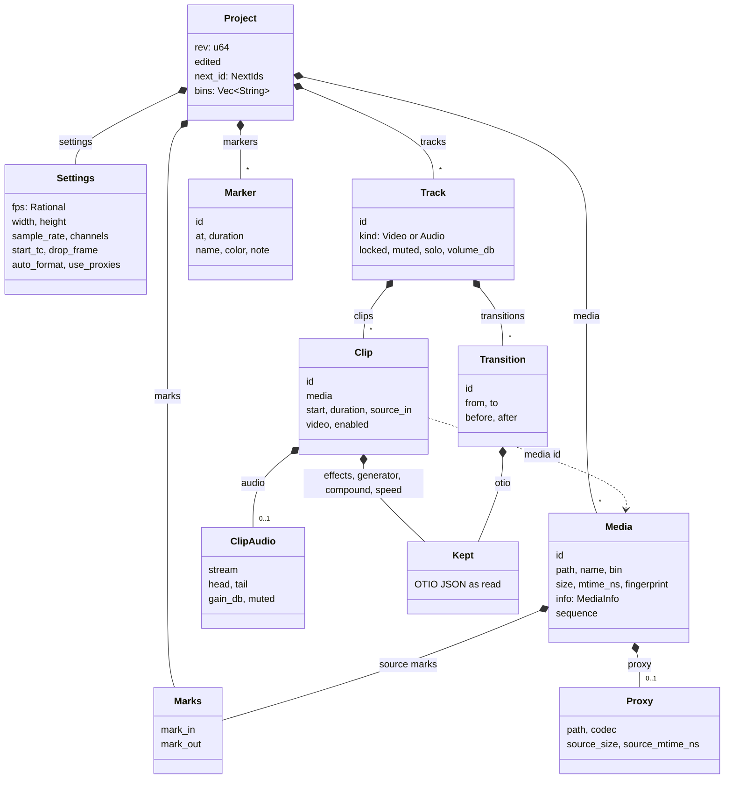
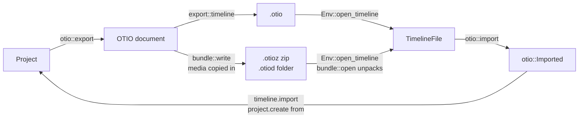

# Project model

A project is one `Project` value in vidcut-core.
It holds settings, a media pool, tracks of clips, marks, markers, and bins.
`Store` saves it as one `.vidcut` JSON file.
Only the editor changes it ([requests](requests.md)).
This page covers the types, time, ids, the file, OpenTimelineIO, and preferences.

## The project

`Project` holds `rev`.
Each change adds one to `rev`.
`edited` is the time of the last change.
`media` is the pool, in pool order.
`bins` holds paths.
A bin path uses slashes to separate parts.
Each `Media` names its `bin` (spec §3).
`tracks` lists the video tracks first.
The audio tracks follow.
A clip on a video track carries its picture.
`ClipAudio` carries the sound of that clip, with J and L offsets (`head`, `tail`).
An audio track holds sound-only clips.
`MediaInfo` keeps the probe result.
The result has streams, duration, and the start timecode.
`tape_marks` holds the In point and the Out point of the source tape.
One project is one timeline ([deviation X2](../deviations.md#x2-one-timeline-per-project-file)).

## Time

Every timeline position is a whole frame.
Every timeline length is a whole frame.
The rate is `Settings::fps`.
`Settings::fps` is an exact `Rational`.
The value is 30000/1001, not 29.97.
`source_in` on a clip counts project frames from the first frame of its media.

A request gives a time as a string.
The string parses into a `TimeSpec`.
The forms are:

- frames, such as `450f`, or a JSON integer
- seconds, such as `15s`, `1m30s`, or `250ms`
- timecode, HH:MM:SS:FF, with a semicolon for drop-frame
- a keyword: start, end, in, out, or playhead
- an offset, such as +5s

A `RangeSpec` is half-open.
The forms are A..B and A..+D.
The editor resolves a time with a `TimeContext` from the project.
`Rational::secs_to_frames` rounds `15s` to the nearest frame.
At 25 fps that frame is 375.
Timecode counts from `start_tc`.
The keyword `playhead` resolves only when the caller gives a frame to `Editor::apply`.
The live core gives the timeline playhead.
A headless request has no playhead.
The error says that the keyword is available only in a live session.
A clip reference is an id, or V1 at a time, such as V1@15s.
V1@15s is the clip under that frame on V1 (`resolve_clip`).
Timecode rules: [spec §4.3](../cut-page-spec.md#43-timecode-pp-640-688-713714).

## Ids

| Object | Id | Maker |
|---|---|---|
| media | `m1`, `m2`, and so on | `Project::alloc_media_id` |
| clip | `c1`, `c2`, and so on | `Project::alloc_clip_id` |
| marker | `k1`, `k2`, and so on | `Project::alloc_marker_id` |
| carried transition | `t1`, `t2`, and so on | `Project::alloc_transition_id` |
| track | `V1` and then the next video tracks, then `A1` and the next audio tracks. The place sets the id. | `ops::tracks`. Removal of one track renumbers the rest. |

The counters live in `NextIds`.
Each alloc function adds one to its counter.
Undo applies the saved `Change`.
That restore can put the old `next_id` back.
An id is not issued again while that object is still in the project.
`ops::MAIN` is V1.
V1 always exists.

## The `.vidcut` file

`Store` reads and writes the `Project` as pretty JSON (serde).
A media path or a proxy path inside the project folder is stored relative to that folder.
Any other path is stored absolute.
In memory, every path is absolute.
A save writes a temporary file.
The save then renames that file over the project.
A reader sees the old file or the new file.
A reader does not see part of a write.
`Store::transact` and `Store::compact` take the project lock (`Store::lock`) before they write.
`OpenProject::apply` takes the same lock for a mutation.
`Store::create` and `Store::replace` write a new file.
They do not take that lock.
Loading runs `validate::violations`.
An inconsistent file is refused.
The undo history is a separate file in the state directory ([requests](requests.md#undo-history)).

A project folder can move, including to another computer.
Relative paths keep the media with the folder ([deviation X1](../deviations.md#x1-projects-are-always-saved-standalone-json-files)).

## Fingerprints and relinking

Two stamps identify a media file.
`Media::size` and `Media::mtime_ns` are read at probe time.
`fingerprint::origin` builds the `Origin` from the path, the size, and the modification time.
The origin names each cache file for that media.
The origin text is also stamped into the cache file ([analysis](analysis.md)).
`Media::fresh_proxy` is false when the proxy came from another size or another time.
`Media::fingerprint` is a SHA-256 of the content (`fingerprint::file`).
`fingerprint::file` hashes a file of at most 10 MiB whole.
A larger file contributes 1 MiB from the start, 1 MiB from the middle, and 1 MiB from the end.
An image sequence uses three pictures (`fingerprint::pictures`): the first, the middle, and the last.

A file is missing when `Env::present` says so.
A path that is absolute only on the other kind of system counts as missing.
`media.relink` looks for a missing file by name in the `search` folders.
It relinks a candidate only when the size, the streams, the duration, the timecode, and the fingerprint match.
A file given as `path` is used even when those values differ.

## OpenTimelineIO

`export.start` to an `.otio`, `.otioz`, or `.otiod` path writes the timeline.
The write includes the whole timeline unless the request gives a range.
`otio::export` builds the document.
`export::timeline` writes it.
A file that vidcut wrote for a whole timeline also holds the rest of the project (`otio::holds_project`).
`editor::open_otio` returns that project.
A file from another editor goes into the open project (`timeline.import`) or into a new project (`editor::project_from_otio`).
Why the interchange exists: [deviation X9](../deviations.md#x9-opentimelineio-interchange).
The conventions are in [spec D40](../cut-page-spec.md#12-decisions-on-gaps-and-contradictions).

A bundle (`bundle::plan`) holds `content.otio`.
A zip bundle also holds `version.txt`.
The bundle holds the used media, whole and uncompressed, under `media`.
The layout matches the OpenTimelineIO adapters.
`bundle::open` unpacks an `.otioz` into a folder.
The folder name comes from the archive name, or from `unpack`.
`bundle::open` keeps a file whose CRC-32 matches the archive.
Anything else in the way is an error.

| vidcut object | Written as |
|---|---|
| video track | A `Video` track. The track is disabled when its video is off. An `Audio` track carries the sound of its clips. A J or L cut is an audio edit. |
| audio track | An `Audio` track. The track is disabled when it is muted. |
| clip | `Clip.2`. The source range starts from the start timecode of the media. |
| media | An `ExternalReference` with a plain path. The path is relative inside a bundle. A still is one frame long. An image sequence is an `ImageSequenceReference` at its rate. |
| Clip Color | The `color` of the item. |
| markers | The markers of the top-level stack, with their lengths. |

| Metadata | Holds |
|---|---|
| `vidcut` on clips | `clip`, `media`, `color`, `stream`, `gain_db`, and `muted`. `source_in` and `skip` for stills and speeds. The source range rounds those two values. |
| `vidcut` elsewhere | Track settings and `name`. The marker id and `color`. The timeline `fps`, `marks`, and, for a whole timeline, `project` (`ProjectMeta`). |
| `Resolve_OTIO`, which other editors read | `Link Group ID`, `Channels`, a clip volume effect, and `Media In` on a reversed clip. `Locked`, `SoloOn`, and `Audio Type` on tracks. `Note` on markers. |

`otio::import` also accepts these inputs:

- `Clip.1`
- a float rate, snapped with `rational`
- media named by a file URL, a plain path, a Windows path, or a relative path
- the `Media Url` of an offline `MissingReference`

`locate` returns no path for a URL whose scheme is not `file`.
Video tracks become V1, V2, and so on.
An audio clip that lines up with a video clip of the same media becomes the sound of that clip.
The same link group is required.
Other audio clips go on A1, A2, and so on.
A name other than the default (`default_track_name`) names a track.
Markers on clips, on tracks, and on the stack become timeline markers.
Nested tracks, unknown items, clips without media, and overlapping clips are left out.
Each omission has a warning.
Media are sought at the path first.
They are then sought by the last path parts beside the file (`MediaRef::paths`).
They are then sought by name in `search` and in the bundle folder (`find_media`).

`ImportMode` has four values.
`append` adds to the timeline.
`replace` replaces the timeline.
`compound` calls `otio::as_compound`.
`media` imports the media only.
`flatten` decomposes a compound clip.
An empty timeline takes the file rate, the start timecode, and the track settings.
A file that vidcut wrote brings its pool items in (`join_pool`).
The items go into a bin named after the file.
They get new ids.
They do not bring proxies.

`Kept` holds what vidcut does not model.
It holds the OTIO JSON as read.
Copies share it.
The `.vidcut` file saves it.
Export writes it back.

| OTIO object | Kept as |
|---|---|
| clip effects in use (`effects::read`) | `Effects` on the picture, or on `ClipAudio`. The `from` field is the source frame of the first keyframe. `carry` in `crates/vidcut-core/src/editor.rs` sets it. Keyframes stay on their source frames. Fades at the clip ends survive a split. The level of the clip volume is the gain. |
| `Transition` (`in_offset`, `out_offset`) | `Transition` (`before`, `after`). `transitions::prune` drops it when it no longer fits. Dissolves and cross fades play ([spec D50](../cut-page-spec.md#12-decisions-on-gaps-and-contradictions)). |
| `GeneratorReference` | `Generator`. Playback treats it as a gap. |
| nested `Stack` | `Compound`. Playback plays its clips. `edit.decompose` breaks it up. |
| `LinearTimeWarp`, `FreezeFrame` | `Speed`. It is written first among the effects of the clip ([spec D48](../cut-page-spec.md#12-decisions-on-gaps-and-contradictions)). |

`otio::transitions` chooses which kept transitions play.
On picture, an `SMPTE_Dissolve` plays when its editor metadata names no effect, or names a cross dissolve.
On sound, a cross fade plays when its effect type or its name is +3 dB, 0 dB, or −3 dB.
A plain `SMPTE_Dissolve` on sound plays at 0 dB.
A transition plays only when its two clips cover its frames.
It does not play when another clip on the track reaches into those frames.
When two transitions overlap, the first one plays.

## Preferences

Preferences are not in the project.
They live in `preferences.toml` in the config directory (`preferences::path`).
The file is a `Preferences` value.
It has appearance, GPU, player, thumbnail, and proxy sections.
`preferences.get` and `preferences.set` are projectless.
Every door runs them in the same way.
`preferences.set` takes a `PreferencesPatch`.
`Preferences::patched` applies the patch.
The code checks the result.
It then replaces the file by an atomic rename.
Code reads the file when it needs a value (`preferences::load`).
A running GUI also watches the file (`Msg::PreferencesChanged`).
The GUI follows GPU decoding, the audio device, the player memory budget, and the theme.

## Validation

`validate::violations` lists what breaks the model rules.
The checks are:

- ids are unique
- a track id matches its place
- video tracks come before audio tracks
- V1 is present
- in list order, a clip starts at or after the end of the previous clip
- the sound of a clip does not overlap the previous sound
- a source range stays inside its media
- media ids and bin names are known
- a gain is from -60 dB to 24 dB inclusive

The check runs when a file loads.
The load fails when the check finds a violation.
The check runs after every edit.
The edit then fails as a vidcut bug, and nothing is saved.
The check also runs when an OTIO file opens.

## Code

- `crates/vidcut-core/src/model.rs`
- `crates/vidcut-core/src/time.rs`
- `crates/vidcut-core/src/store.rs`
- `crates/vidcut-core/src/fingerprint.rs`
- `crates/vidcut-core/src/validate.rs`
- `crates/vidcut-core/src/ops/tracks.rs`
- `crates/vidcut-core/src/otio.rs`
- `crates/vidcut-core/src/otio/`
- `crates/vidcut-core/src/editor.rs`
- `crates/vidcut-core/src/preferences.rs`
- `crates/vidcut/src/bundle.rs`
- `crates/vidcut/src/export.rs`
- `crates/vidcut/src/env.rs`
- `crates/vidcut/src/preferences.rs`
