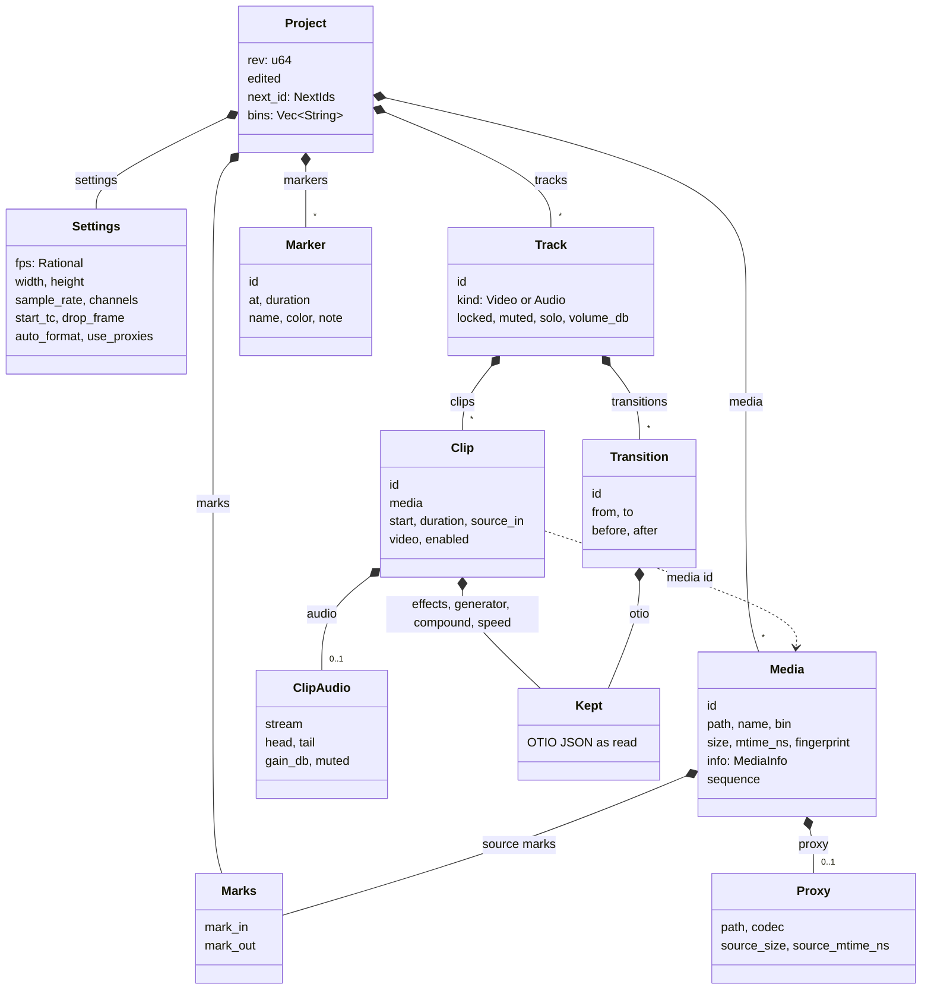
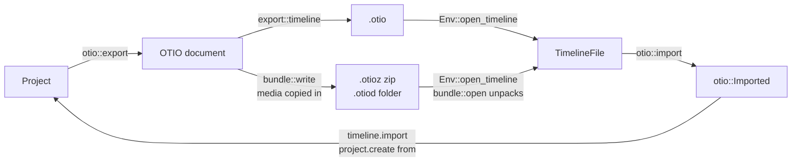

# Project model

A project is one `Project` value in vidcut-core: settings, a media pool, tracks of clips, marks, markers and bins. It is saved as one `.vidcut` JSON file and changed only by the editor ([requests](requests.md)). This page covers the types, time, ids, the file, OpenTimelineIO and preferences.

## The project

`Project` holds `rev`, one more for every change, and `edited`, when. `media` is the pool in pool order; `bins` are slash-separated paths, and each `Media` names its `bin` (spec §3). `tracks` are video tracks first, then audio tracks. A clip on a video track carries its picture and, in `ClipAudio`, its sound with J/L offsets (`head`, `tail`); audio tracks hold sound-only clips. `MediaInfo` keeps what probing found: streams, duration, start timecode. `tape_marks` holds the source tape's In and Out. One project is one timeline ([deviation X2](../deviations.md#x2-one-timeline-per-project-file)).

## Time

Every timeline position and length is a whole frame at the project's rate, `Settings::fps`, an exact `Rational` (30000/1001, not 29.97). A clip's `source_in` counts project frames from its media's first frame too.

Requests take times as strings that parse into a `TimeSpec`: frames ("450f", or a JSON integer), seconds ("15s", "1m30s", "250ms"), timecode ("HH:MM:SS:FF", with ";" for drop-frame), a keyword (start, end, in, out, playhead) or an offset ("+5s"). A `RangeSpec` is half-open: "A..B" or "A..+D". The editor resolves them with a `TimeContext` from the project: "15s" is the nearest frame (`Rational::secs_to_frames`), 375 at 25 fps; timecode counts from `start_tc`; playhead exists only in a GUI. A clip reference is an id or "V1@15s", the clip under that frame on V1 (`resolve_clip`). Timecode rules: [spec §4.3](../cut-page-spec.md#43-timecode-pp-640-688-713714).

## Ids

| Thing | Id | Made by |
|---|---|---|
| media | m1, m2 … | `Project::alloc_media_id` |
| clip | c1, c2 … | `Project::alloc_clip_id` |
| marker | k1, k2 … | `Project::alloc_marker_id` |
| carried transition | t1, t2 … | `Project::alloc_transition_id` |
| track | V1 … then A1 …, by place | `ops::tracks`; removing one renumbers the rest |

The counters live in `NextIds` and only grow, so an id names one thing for the project's life, in the undo history too. `ops::MAIN`, V1, always exists.

## The `.vidcut` file

`Store` reads and writes the `Project` as pretty JSON (serde). Media and proxy paths in or under the project's folder are stored relative to it, others absolute; in memory they are always absolute. A save writes a temporary file and renames it over the project, so readers see the old file or the new one, never part of one. Writers hold the project's lock file (`Store::lock`). Loading runs `validate::violations` and refuses an inconsistent file. The undo history is kept apart, in the state dir ([requests](requests.md#undo-history)).

**Why** relative paths: a project folder moved or copied, to another computer too, keeps its media ([deviation X1](../deviations.md#x1-projects-are-always-saved-standalone-json-files)).

## Fingerprints and relinking

Two stamps identify a media file. `Media::size` and `Media::mtime_ns`, read when it was probed, make its `Origin` (`fingerprint::origin`). The origin names and stamps every cache file made from the media ([analysis](analysis.md)), and a proxy made from another size or time is stale (`Media::fresh_proxy`). `Media::fingerprint` is a SHA-256 of the content (`fingerprint::file`): the whole of a small file, samples from the start, middle and end of a big one, three pictures of an image sequence.

A file is missing when `Env::present` says so; a path absolute only on the other kind of system counts as missing. `media.relink` looks for missing files by name in `search` folders and relinks a candidate only if its size, streams, duration, timecode and fingerprint match. A file given as `path` is used either way.

## OpenTimelineIO

`export.start` to an `.otio`, `.otioz` or `.otiod` path writes the timeline, not pictures: `otio::export` builds the document and `export::timeline` writes it, bundles through `bundle::write`, which copies the media in. Reading goes through `Env::open_timeline` and `otio::import`. A file vidcut wrote of a whole timeline also holds the rest of the project (`otio::holds_project`), so `project.create` from it gives the same project back (`editor::open_otio`). Another editor's timeline is imported into the project (`timeline.import`) or a new one (`editor::project_from_otio`).

What vidcut doesn't model, clip effects, generators and titles, compound clips, speed changes and transitions, it keeps as `Kept`: the OTIO JSON as read, shared by every copy of the project, saved in the `.vidcut` file and written back on export. Behavior: [deviation X9](../deviations.md#x9-opentimelineio-interchange).

## Preferences

Preferences are not in the project. They live in `preferences.toml` in the config dir (`preferences::path`): a `Preferences` with appearance, GPU, player, thumbnail and proxy sections. `preferences.get` and `preferences.set` are projectless, so every door runs them the same way. `preferences.set` takes a `PreferencesPatch`, applies it (`Preferences::patched`), checks it and replaces the file atomically. Code reads the file when it needs a value (`preferences::load`); a running GUI also watches it (`Msg::PreferencesChanged`) and follows GPU decoding, the audio device, the player's memory budget and the theme.

## Validation

`validate::violations` lists what breaks the model's rules: unique ids, tracks named by place with video before audio and V1 present, clips and their sound sorted without overlap on each track, sources inside their media, known media and bins, gains in range. It runs when a file loads (the load fails), after every edit (the edit fails as a vidcut bug, and nothing is saved) and when an OTIO file opens.

## Code

- `crates/vidcut-core/src/model.rs`
- `crates/vidcut-core/src/time.rs`
- `crates/vidcut-core/src/store.rs`
- `crates/vidcut-core/src/fingerprint.rs`
- `crates/vidcut-core/src/validate.rs`
- `crates/vidcut-core/src/ops/tracks.rs`
- `crates/vidcut-core/src/otio.rs`
- `crates/vidcut-core/src/otio/`
- `crates/vidcut-core/src/editor.rs`
- `crates/vidcut-core/src/preferences.rs`
- `crates/vidcut/src/bundle.rs`
- `crates/vidcut/src/export.rs`
- `crates/vidcut/src/env.rs`
- `crates/vidcut/src/preferences.rs`
