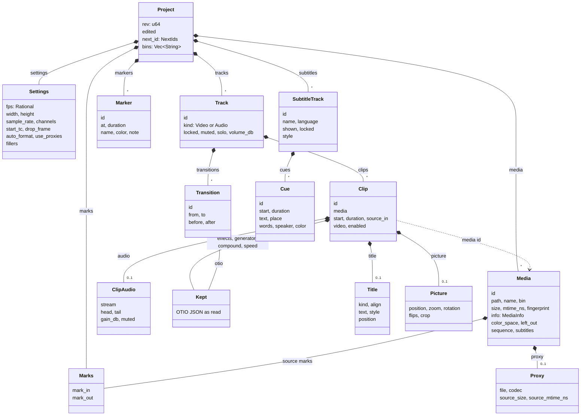
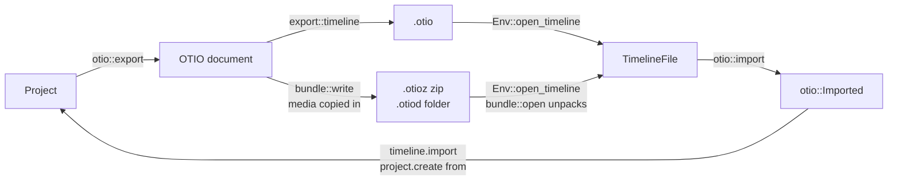

# Project model

- A project is one `Project` value in vidcut-core: settings, a media pool, tracks of clips, subtitle tracks of cues, marks, markers and bins.
- It is saved as one `.vidcut` JSON file. Only the editor changes it ([requests](requests.md)).
- This page covers the types, time, ids, the file, OpenTimelineIO and preferences.

## The project

- `Project` holds `rev`, one more for every change, and `edited`: when.
- `media` is the pool, in pool order.
- `bins` are slash-separated paths. Each `Media` names its `bin` (spec §3).
- `tracks` are video tracks first, then audio tracks.
- A clip on a video track carries its picture. In `ClipAudio`, it carries its sound, with J/L offsets (`head`, `tail`).
- Audio tracks hold sound-only clips.
- `MediaInfo` keeps what probing found: streams, duration, start timecode.
- One project is one timeline ([deviation X2](../deviations.md#x2-one-timeline-per-project-file)).

Stills:

- A file is a still ([D38](../cut-page-spec.md#12-decisions-on-gaps-and-contradictions)) when an image demuxer reads it (`image2`, the `_pipe` ones).
- A GIF or animated WebP (`gif`, `webp_anim`) of one frame is also a still.
- An animated WebP of more frames lasts as long as its frames do, because `webp_anim` reports no duration.

Media fields:

- `tape_marks` holds the In and Out of the source tape.
- `color_space` (`ColorSpace`, spec §3) reads a file whose color tags are wrong as another space.
  - `Media::video_as_read` is the `VideoInfo` of the file, read in that space. Render pieces carry it.
  - `VideoReader` retags each decoded frame with it (`color::retag`). This drops the HDR side data.
  - A proxy is made from the pictures as read in that space. Thus its own tags are right, and it is read by them.
- `left_out` holds the source frames that the Delete of the Transcription window left out (`media.leave_out`).
  - `ops::leave_out` keeps these frames in order and apart.

Folders:

- `media.add_folder` lists the folder with `Env::read_folder` (`folder::read`):
  - The files and folders of each folder are sorted by name, ignoring case, as the pool sorts.
  - Files and folders with a name that starts with a dot are left out.
  - Linked folders are not followed.
  - A folder that is the same folder as one above it, such as a bind mount, is skipped as `folder::LOOPS`.
- It adds the media in that order through `add_folder`, each into the bin named after its folder.
- Every folder that it reads gets its bin, with media or not.
- A file is media by its extension (`folder::MEDIA_TYPES`, `folder::IMAGE_TYPES`).
- The other files, and files that do not probe, are skipped and listed. A run of numbered images is listed as the run (`ImageSequence::display`).
- With `sequence`, `Folder::runs_here` finds the runs of numbered images of each folder (`sequence::find_among`).
- It is one request, so it is one undo step.

**Why** the extension:

- A probe of every sidecar and document in the folders of a camera card is slow.
- FFmpeg opens some of these files as streams. Subtitles are an example.

## Time

- Every timeline position and length is a whole frame at the rate of the project, `Settings::fps`.
- The rate is an exact `Rational` (30000/1001, not 29.97).
- The `source_in` of a clip also counts project frames, from the first frame of its media.

Requests take times as strings that parse into a `TimeSpec`:

- frames: "450f", or a JSON integer
- seconds: "15s", "1m30s", "250ms"
- timecode: "HH:MM:SS:FF", with ";" for drop-frame
- a keyword: start, end, in, out, playhead
- an offset: "+5s"

Ranges and resolution:

- A `RangeSpec` is half-open: "A..B" or "A..+D".
- The editor resolves times with a `TimeContext` from the project:
  - "15s" is the nearest frame (`Rational::secs_to_frames`): 375 at 25 fps.
  - Timecode counts from `start_tc`.
  - The playhead keyword resolves only when the caller passes a frame. The live core does this from the timeline.
  - Thus a command that the GUI runs can use the playhead keyword, and a headless command cannot.
- A clip reference is an id, or "V1@15s": the clip under that frame on V1 (`resolve_clip`).
- Timecode rules: [spec §4.3](../cut-page-spec.md#43-timecode-pp-640-688-713714).

## Ids

| Thing | Id | Made by |
|---|---|---|
| media | m1, m2 … | `Project::alloc_media_id` |
| clip | c1, c2 … | `Project::alloc_clip_id` |
| marker | k1, k2 … | `Project::alloc_marker_id` |
| carried transition | t1, t2 … | `Project::alloc_transition_id` |
| cue | q1, q2 … | `Project::alloc_cue_id` |
| track | V1 … then A1 …, by place | `ops::tracks`; removing one renumbers the rest |
| subtitle track | S1 …, by place | `ops::subtitles::add_track`; removing one renumbers the rest |

- The counters are in `NextIds`. Each alloc call adds one.
- Undo restores `next_id` with the project. Thus an id from an undone edit can be used again.
- `ops::MAIN`, V1, always exists.

## The `.vidcut` file

- `Store` reads and writes the `Project` as pretty JSON (serde).
- Media paths in or under the folder of the project are stored relative to it. Other paths are stored absolute.
- In memory, media paths are always absolute.
- A proxy is stored by its file name (`Proxy::file`). It is found in the proxy folder of this computer (`Proxy::path_in`, `Env::proxy_dir`).
- A save writes a temporary file and renames it over the project (`temp::write`). Thus readers see the old file or the new one, never part of one.
- `Store::transact`, `Store::compact` and `OpenProject::apply` hold the lock file of the project (`Store::lock`).
- `Store::create` and `Store::replace` write a new file without the lock.
- Loading runs `validate::violations`, and refuses an inconsistent file.
- The undo history is kept apart, in the state dir ([requests](requests.md#undo-history)).

Temporary files:

- Every file that vidcut writes whole goes through `temp`.
- `temp::file` and `temp::dir` make a hidden file beside the target.
  - Its name is the name of the target, with a random number and a part piece. Its extension is last, for FFmpeg.
  - It is created exclusively (`create_new`), with the usual permissions. Thus nothing that is already there, a link included, is opened.
- `Temp::keep` renames it over the target. A `Temp` that is dropped and not kept is removed.
- `temp::remove_left` removes all the temporary files of a GUI as it closes.
- `temp::write` writes, syncs and keeps a small file.
- When two processes write one target, each writes its own file, and the last rename wins.
- Windows can refuse a rename over a file that is open elsewhere. This is an error, and is never dropped.
- A model download keeps one `.part` to continue from ([analysis](analysis.md#transcription)).

**Why** relative paths: a project folder that is moved or copied, to another computer too, keeps its media ([deviation X1](../deviations.md#x1-projects-are-always-saved-standalone-json-files)).

## Fingerprints and relinking

Stamps:

- Two stamps identify a media file.
- `Media::size` and `Media::mtime_ns`, read when the file was probed, make its `Origin` (`fingerprint::origin`).
- The origin names and stamps every cache file made from the media ([analysis](analysis.md)).
- A proxy made from another size or time, or with another `color_space`, is stale (`Media::fresh_proxy`).
- The file of a proxy is named by the content of the source instead (`paths::proxy_origin`). Thus it has the same name on every computer.
- A proxy whose file is gone is lost (`Env::proxy_present`). Automatic proxies make it again, as the project names it.
- `Media::fingerprint` is a SHA-256 of the content (`fingerprint::file`):
  - the whole of a file no larger than `WHOLE`
  - else one `PIECE` from the start, the middle and the end
  - for an image sequence, three pictures (`fingerprint::pictures`)

Relinking:

- A file is missing when `Env::present` says so.
- A path that is absolute only on the other kind of system counts as missing.
- `media.relink` looks for missing files by name in `search` folders.
- It relinks a candidate only if its size, streams, duration, timecode and fingerprint match.
- A file given as `path` is used either way.

## Subtitles

- `Project::subtitles` holds the subtitle tracks. S1 is nearest the video.
- One track is `shown` at a time.
- A `Cue` spans whole frames, as a clip does.
- Its `text` is lines, with `<i>`, `<b>`, `<u>` and `` around words.
- `Place` says where on the picture the cue goes.
- `words` gives the frame on which each of its words starts, counted from its start ([spec D70](../cut-page-spec.md#12-decisions-on-gaps-and-contradictions)).
- `speaker` is the person who says it.
- `color` is its own color, over the color of the person ([deviation X63](../deviations.md#x63-subtitles-keep-their-speaker-painted-in-the-persons-color)). `Speakers::color_of` resolves it.
- The cues of a track are sorted by start, and can overlap.
- The `SubtitleStyle` of a track holds:
  - its font, size, color, outline, background and margin ([spec D61](../cut-page-spec.md#12-decisions-on-gaps-and-contradictions))
  - its bold face, letter case and shadow
  - `SubtitleWords`: how its words show as they are spoken ([spec D69](../cut-page-spec.md#12-decisions-on-gaps-and-contradictions))
  - `SpeakerPaint`: what the color of a cue paints (`SubtitleStyle::paints`; `subtitles::shown` applies it)
- `ops::subtitles` holds the edits.
- `editor::resolve_cue` reads a cue reference: its id, or a track and a time (S1@15s).

**Cues follow Track 1** ([spec D57](../cut-page-spec.md#12-decisions-on-gaps-and-contradictions)).

- `follow::follow` moves the clips of the other tracks after an edit on Track 1. It also calls `ops::subtitles::remap` with its frame mapping.
- `ops::delete_range` calls `remap` with the mapping of its range.
- `remap` maps each frame of a cue, and the frame after it.
- A frame survives when it has a place, and the next frame does not land on the same place.
- A deleted frame lands where the next kept frame does, or nowhere.
- The surviving frames, in runs, are the new spans of the cue. The first span keeps the id of the cue. The other spans get new ids.
- The frame of each word goes through the same mapping. A word on a removed frame starts on the next kept frame.
- Each span counts its words from its own start.
- A locked subtitle track is left alone.

**Files.**

- A subtitle file in the pool is a `Media` with `subtitles` (`SubtitleFile`: its format, encoding, cue count, language, first cue and warnings).
- `subtitles::pool_item` makes it when `Env::probe` meets a subtitle extension.
- It has no streams. Thus `Project::media_frames` gives it no frames, and `ops::make_clip` refuses it.
- Its cues are read from the file again when `subtitles.import` places it.

Reading:

- `subtitles::parse` decodes the bytes (`Encoding`): a BOM, else UTF-8, else UTF-16 by its zero bytes, else Windows-1252.
- It tells the format by the first lines, then by the extension.
- It reads SRT and WebVTT line by line, the `::cue` colors of a WebVTT STYLE block too.
- It reads TTML with roxmltree:
  - its styles and regions, resolved down to each span, with the style references of a region followed
  - its time base: media, or smpte with its drop mode, counted as appendix N.3 of TTML1 does
  - its language (xml:lang), which the new track takes
- The markup of each format becomes the cue markup. Other tags go.

Placing:

- `ops::subtitles::import` turns each time into the nearest frame in the time base of the file (`SubtitleTimeBase`). The time base is real time, or timecode labels when the times sit on their grid.
- When the file is in timecode, it then takes off the start timecode of the timeline, or 01:00:00:00, in frames ([deviation X41](../deviations.md#x41-subtitle-files-placed-by-their-timecode-or-from-the-timelines-start)).

Writing:

- `ops::subtitles::collect` gives the cues of a track in a range, in seconds: from zero, or in timecode.
  - `subtitles::origin` gives the frames of the start timecode at the project's rate ([spec D58](../cut-page-spec.md#12-decisions-on-gaps-and-contradictions)).
- `subtitles::write` writes the cues as SRT, WebVTT or IMSC1.
  - WebVTT writes colors other than its eight named colors as STYLE classes.
  - The IMSC1 file carries the `SubtitleStyle` of the track, and regions sized from its cues ([spec D64](../cut-page-spec.md#12-decisions-on-gaps-and-contradictions)).
  - What does not fit goes in `Written::warnings`.
- `subtitles.export` writes the file through a partial file beside it (`Env::write_file`).
- `subtitles::beside` makes the files that an export writes beside its output ([export](export.md#subtitles)).

## Titles

- A clip with a `title` is a title ([spec §8.14](../cut-page-spec.md#814-titles-pp-762764-11761178)): no media, no audio, any length, on a video track.
- `Clip::is_generator` and `Clip::is_block` count it. Thus edits treat it as a carried generator.
- A title has no speed.
- Its `Title` holds:
  - a `TitleKind`: `text`, `lower_third` or `scroll`
  - the `TitleAlign` of a lower third or a scroll
  - its lines, with markup that `rich::spans` reads into `Span`s
  - a `TitleStyle`
  - an optional `position`: the point that its anchor goes to (`Title::place`, `Title::anchor`; [spec D65](../cut-page-spec.md#12-decisions-on-gaps-and-contradictions))
- `ops::titles` holds the edits.
- `ops::titles::checked` is the check that `titles.add`, `titles.set` and `validate::violations` share.
- It checks the font, size, colors, outline and background of the style through the checks of the subtitle style (`checked_font`, `checked_size`, `checked_color`, `checked_outline`, `checked_background`).

## Pictures

- A clip of footage, a still, an image sequence or a compound clip can carry a `Picture` ([spec D75](../cut-page-spec.md#12-decisions-on-gaps-and-contradictions)):
  - where the middle of the whole picture goes (`position`)
  - its `zoom` across and down
  - its `rotation`
  - its flips
  - a `Crop` of each side
  - a `DynamicZoom`: a start and an end `ZoomBox`, and an `Ease`
- Each value is left out at its usual value. Thus a picture that `Picture::is_usual` accepts is only fitted into the frame.
- `ops::picture` holds the edits:
  - `ops::picture::checked` is the check that `picture.set`, `validate::violations` and the metadata of an OTIO file share. It leaves usual values out.
  - `ops::picture::has_picture` says which clips take a picture: not titles, generators or sound.
  - `ops::picture::clear` puts back the transform, the crop or the Dynamic Zoom (`PictureTool`), or all of them.
  - `picture.set` takes a `DynamicZoomSet`. Its fields replace their own (`DynamicZoomSet::on`).
- `place::Placing` turns the picture of a clip, with the pictures of the compound clips that it plays inside, into maps.
  - Each map goes from a pixel of the frame back to a picture (`place::Level`: the map and the part shown).
  - An export and the viewer both draw by these maps ([export](export.md#placed-pictures), [playback](playback.md#the-engine)).

## Looks

- Looks are named styles ([spec D71](../cut-page-spec.md#12-decisions-on-gaps-and-contradictions)). They are not in the project.
- `looks::Styled` is a `SubtitleLook` (a `SubtitleStyle` with `chars` and `lines`) or a `TitleLook` (a `Title` without its text: `TitleLook::of`, `TitleLook::on`).
- `looks::checked` runs each look through the check of its kind (`checked_style`, `ops::titles::checked`).
- `looks::built_in` holds the built-in looks in code.
- The user's looks are TOML files under `looks::dir`, one folder per `LookKind`.
- `looks::read` lists the looks of a folder. It puts a file that fails to parse or check in `Listing::refused`, with the reason.
- `looks::save` and `looks::delete` write and remove looks. They refuse built-in names.
- The editor reads looks through `Env::looks`, which only `AvEnv` fills. Thus tests give their own folder.
- `looks::find` looks up a name, built-in looks first, whatever its case.
- `looks.list`, `looks.save` and `looks.delete` are projectless.
- `track.set`, `titles.add`, `titles.set` and `subtitles.transcribe` take a `look` by name.

## OpenTimelineIO

- `export.start` to an `.otio`, `.otioz` or `.otiod` path writes the timeline: all of it, unless it is given a range.
- `otio::export` builds the document, and `export::timeline` writes it.
- A file that vidcut wrote of a whole timeline holds the rest of the project too (`otio::holds_project`). `editor::open_otio` gives it back.
- The file of another editor goes into the project (`timeline.import`), or into a new project (`editor::project_from_otio`).
- Why: [deviation X9](../deviations.md#x9-opentimelineio-interchange). Conventions: [spec D40](../cut-page-spec.md#12-decisions-on-gaps-and-contradictions).

**Bundles** (`bundle::plan`):

- A bundle holds `content.otio`, `version.txt` in a zip, and the media used, under `media`. This is how the adapters of OpenTimelineIO lay them out.
- The media used include the media that compound clips play, in picture or sound (`otio::used_media`). They are whole and uncompressed.
- In the kept `Stack` of a compound clip, a reference that names a file that the compound clips play also points into `media`.
- Such a reference names the file by its path, or by a file name that no other of them has (`otio::same_media`).
- Other references keep their URLs.
- `bundle::open` unpacks an `.otioz` into a folder named after it, or into `unpack`. It keeps files whose CRC-32 matches.
- Anything else in the way is an error.

| vidcut | Written as |
|---|---|
| video track | a `Video` track, disabled with its video off, and an `Audio` track of its clips' sound, J/L cuts as audio edits |
| audio track | an `Audio` track, disabled when muted |
| clip | `Clip.2`, its source range from the media's start timecode |
| media | `ExternalReference` by plain path, relative in a bundle; a still one frame long, its clips from source 0; an image sequence an `ImageSequenceReference` at its rate |
| Clip Color | the item's `color` |
| title | a `Clip.2` of a `GeneratorReference` in Resolve's shape (`otio::titles::reference`, [spec D67](../cut-page-spec.md#12-decisions-on-gaps-and-contradictions)) |
| markers | the top-level stack's, with their lengths |

The metadata:

| Metadata | Holds |
|---|---|
| `vidcut` on clips | `clip`, `media`, `color`, `stream`, `gain_db`, `muted`; `source_in` and `skip` for stills and speeds, which the source range rounds; a title's `Title`; a placed clip's `Picture`, a compound clip's too, read back before Resolve's effects |
| `vidcut` elsewhere | track settings and `name`; marker id and `color`; the timeline's `fps`, `marks` and, when whole, `project` (`ProjectMeta`, with the subtitle tracks) |
| `Resolve_OTIO` on clips | `Link Group ID`, `Channels`, a clip volume effect, and `Media In` on reversed clips |
| `Resolve_OTIO` on placed clips | Transform, Cropping, Retime and Scaling, and Dynamic Zoom (`otio::picture`), fitted, in place of carried ones |
| `Resolve_OTIO` on compound clips | a `Sequence ID`, kept or made from the compound's content; a `Link Group ID` that joins the picture and sound of one compound at the same place (`compound_links`) |
| `Resolve_OTIO` on tracks | `Locked`, `SoloOn` and `Audio Type` |
| `Resolve_OTIO` on markers | `Note` |

- Other editors read the `Resolve_OTIO` metadata.
- An import reads the Transform, Cropping, Retime and Scaling, and Dynamic Zoom of a placed clip back as its `Picture` (`picture::take`).
- `picture::take` uses the shape of the probed source.
- This occurs when the clip has no `vidcut` one, and none of them has keys or other parameters. The two keys of Dynamic Zoom are the exception.
- The notes of an export name a clip that moved past the reach of these parameters (`otio::out_of_reach`).

Import:

- `otio::import` also takes `Clip.1`, and float rates, snapped (`rational`).
- It takes media named by a `file` URL; a plain, Windows or relative path; or the `Media Url` of an offline `MissingReference`.
- `locate` returns no path for any other scheme.
- Video tracks become V1, V2, …
- An audio clip that lines up with a video clip of the same media (and link group) becomes its sound. Other audio clips go on A1, A2, …
- Names other than the defaults (`default_track_name`) name tracks.
- Markers on clips, tracks and the stack become timeline markers.
- Nested tracks, unknown items, clips without media and overlapping clips are left out, with a warning.
- Media are looked for in this order:
  1. at the path
  2. by its last parts beside the file (`MediaRef::paths`)
  3. by name in `search` and the folder of the bundle (`find_media`)
- The media of a compound clip are looked for in the same way.
- `edit.decompose` first takes the media that the compound clip already plays, for its clips and the compound clips among them.
  - `otio::same_media` finds these media: by path, then by a file name that no other of them has.

Modes:

- `ImportMode` is `append`, `replace`, `compound` (`otio::as_compound`) or `media`.
- `flatten` decomposes compound clips.
- An empty timeline takes the rate, start timecode and track settings of the file.
- A file that vidcut wrote brings its pool items (`join_pool`) into a bin named after it, with new ids, without proxies.

Kept data:

- `Kept` holds what vidcut does not model: the OTIO JSON as read.
- Copies share it. It is saved in the `.vidcut` file and written back.

| OTIO | Kept as |
|---|---|
| clip effects in use (`effects::read`) | `Effects` on the picture or `ClipAudio`. Keyframes stay on their source frames (the `from` field of `Effects`, set by `carry`), and fades stay at the clip's ends through splits; the clip volume's level is the gain |
| `Transition` (`in_offset`, `out_offset`) | `Transition` (`before`, `after`), dropped by `transitions::prune` when it does not fit; dissolves and cross fades play ([spec D50](../cut-page-spec.md#12-decisions-on-gaps-and-contradictions)) |
| `GeneratorReference` | a title when it is vidcut's or Resolve's Text, lower third or Scroll (`otio::titles::read`), else `Generator`, a block that plays as a gap |
| nested `Stack` | `Compound`, a block that plays its clips; `edit.decompose` breaks it up |
| `LinearTimeWarp`, `FreezeFrame` | `Speed`, written first among the clip's effects ([spec D48](../cut-page-spec.md#12-decisions-on-gaps-and-contradictions)) |

Which kept transitions play (`otio::transitions`):

- On picture: an `SMPTE_Dissolve` whose editor metadata names no effect but a cross dissolve.
- On sound: a cross fade found by its effect type or name (+3, 0 or −3 dB), or a plain `SMPTE_Dissolve` at 0 dB.
- A transition plays only where its two clips cover its frames, and no other clip of the track reaches into them.
- Of two transitions that overlap, the first plays.

## Preferences

The file:

- Preferences are not in the project.
- They are in `preferences.toml` in the config dir (`preferences::path`).
- The file holds a `Preferences` with these sections: appearance, GPU, player, thumbnail, cache, proxy, transcript and services ([the disk cache limit](analysis.md#the-disk-cache-limit)).
- No key of a service is ever in the file.

Requests:

- `preferences.get`, `preferences.set` and `preferences.reset` are projectless. Thus every door runs them in the same way.
- When the file is read (`preferences::load`), a key that vidcut does not have is left out. `preferences.get` names it in `ignored`. The next write drops it.
- The entries of a map, such as the languages of `transcripts.fillers`, are data, not keys. They stay.
- `preferences.reset` keeps the old file under the first free backup name: `preferences.toml.bak`, then `.bak.2` and on. Then it writes the defaults.
- Thus a second reset never replaces the backup of the first reset with defaults.
- `preferences.set` takes a `PreferencesPatch`, applies it (`Preferences::patched`), checks it and replaces the file atomically.
- Code reads the file when it needs a value (`preferences::load`).
- A running GUI also watches the file (`Msg::PreferencesChanged`). It follows GPU decoding, the audio device, the memory budget of the player, the theme and the filler words.

Reset:

- `reset` (`reset::plan`, `reset::run`) empties the config, cache and state dirs, except the paths that it keeps:
  - presets, themes and looks (unless `saved`)
  - the speech models and kept paid replies (with `keep_downloads`)
  - a proxy folder set as an absolute path, compared after parent steps and links are resolved (`dirs::canonical`)
  - the undo history of the project that its own GUI has open (`Store::history_path`)
- It refuses while another GUI runs (the registry). That GUI keeps view settings and folders in memory, and writes them back.
- When the reset is confirmed, the GUI that asks drops its own view state to defaults (`Workspace::forget_view_state`).
- Thus nothing that this GUI writes during the delete brings old settings back.
- When the reset is done, the GUI reloads its view state from disk (`Workspace::after_reset`).
- When the reset fails or is refused, the GUI puts the old view state back (`Workspace::restore_view_state`).
- A folder that the reset cannot read fails the reset. The folder does not pass for empty.

## Speakers

- `Project::speakers` (`Speakers`) says who speaks in the transcripts that the project uses.
- The transcripts are kept with the files, and number their own speakers. `Speech::speakers` names the run that numbered them.
- `names` names a person, and `colors` gives a person a color.
- `links` makes the speaker of a file (its voice: media, stream, number) a person other than the person of its run.
- `assigned` gives the words of a file between two times to a person. The last assignment comes first.
- All of these go through the history, as any edit does (`speakers.set`, `speakers.link`, `speakers.assign`).
- `speakers.join` makes one person into another person everywhere (`Speakers::join`):
  - The speakers of the files that were the first person's are linked to the other person.
  - Their cues take the key of the other person.
- A cue names its person by the same key (`Cue::speaker`).
- `Speakers::key_for` finds the person that a name names.
- Thus a name that is typed, or read from a WebVTT voice, becomes a person of its own only when no one has it.

## Validation

`validate::violations` lists what breaks the rules of the model:

- unique ids
- tracks named by place, with video before audio, and V1 present
- clips and their sound sorted without overlap on each track
- sources inside their media
- known media and bins
- gains in range
- titles on video tracks
- titles and subtitle styles that their requests would refuse

It runs at these times:

- when a file loads: the load fails
- after every edit: the edit fails as a vidcut bug, and nothing is saved
- when an OTIO file opens

## Code

- `crates/vidcut-core/src/model.rs`
- `crates/vidcut-core/src/time.rs`
- `crates/vidcut-core/src/store.rs`
- `crates/vidcut-core/src/fingerprint.rs`
- `crates/vidcut-core/src/validate.rs`
- `crates/vidcut-core/src/ops/tracks.rs`
- `crates/vidcut-core/src/otio.rs`
- `crates/vidcut-core/src/otio/`
- `crates/vidcut-core/src/editor.rs`
- `crates/vidcut-core/src/subtitles.rs`
- `crates/vidcut-core/src/subtitles/`
- `crates/vidcut-core/src/ops/subtitles.rs`
- `crates/vidcut-core/src/ops/titles.rs`
- `crates/vidcut-core/src/preferences.rs`
- `crates/vidcut/src/bundle.rs`
- `crates/vidcut/src/export.rs`
- `crates/vidcut/src/env.rs`
- `crates/vidcut/src/preferences.rs`
