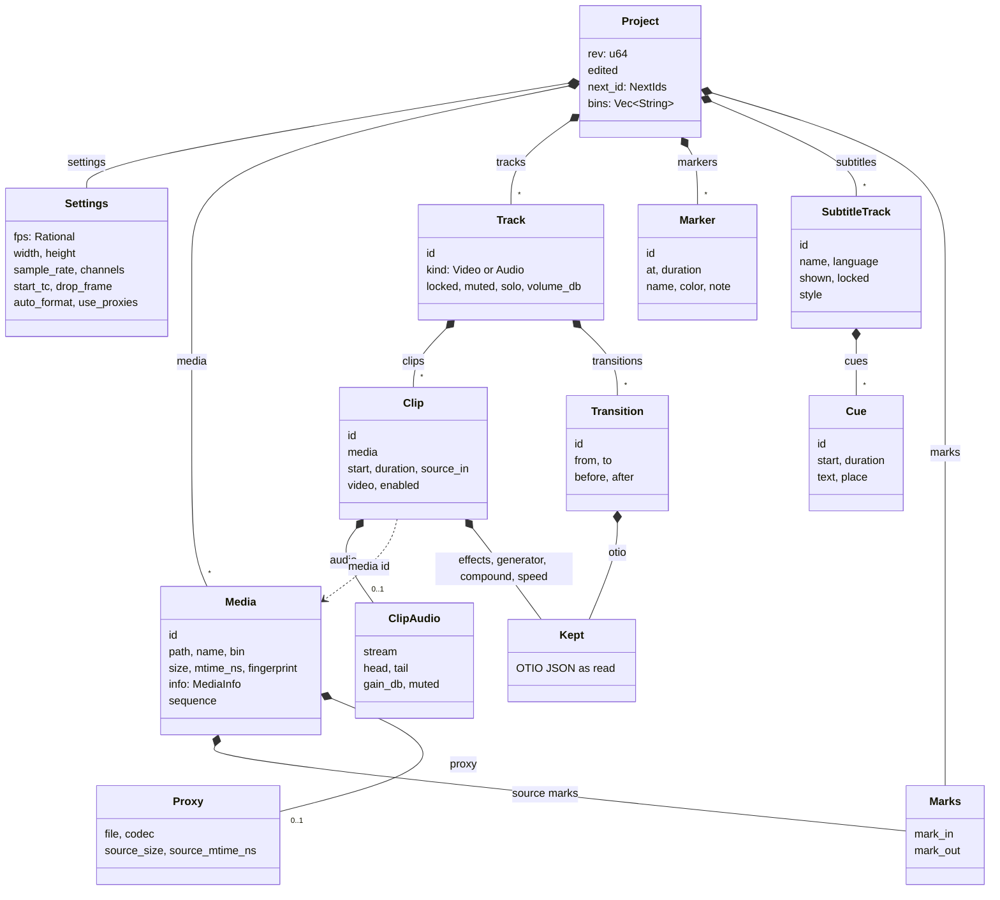
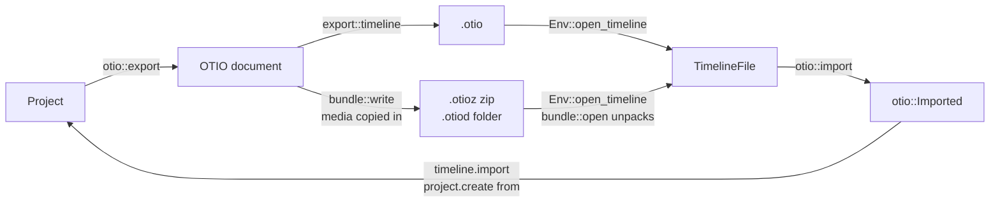

# Project model

A project is one `Project` value in vidcut-core: settings, a media pool, tracks of clips, subtitle tracks of cues, marks, markers and bins. It is saved as one `.vidcut` JSON file and changed only by the editor ([requests](requests.md)). This page covers the types, time, ids, the file, OpenTimelineIO and preferences.

## The project

`Project` holds `rev`, one more for every change, and `edited`, when. `media` is the pool in pool order; `bins` are slash-separated paths, and each `Media` names its `bin` (spec §3). `tracks` are video tracks first, then audio tracks. A clip on a video track carries its picture and, in `ClipAudio`, its sound with J/L offsets (`head`, `tail`); audio tracks hold sound-only clips. `MediaInfo` keeps what probing found: streams, duration, start timecode. A file is a still ([D38](../cut-page-spec.md#12-decisions-on-gaps-and-contradictions)) when an image demuxer reads it (`image2`, the `_pipe` ones), or when it is a GIF or animated WebP (`gif`, `webp_anim`) of one frame. An animated WebP of more frames lasts as long as its frames do, as `webp_anim` reports no duration. `tape_marks` holds the source tape's In and Out. One project is one timeline ([deviation X2](../deviations.md#x2-one-timeline-per-project-file)).

`media.add_folder` lists the folder with `Env::read_folder` (`folder::read`: each folder's files and folders sorted by name ignoring case, as the pool sorts, those named with a dot left out, linked folders not followed, and a folder that is one above it, such as a bind mount, skipped as `folder::LOOPS`) and adds its media in that order through `add_folder`, each into the bin named after its folder; every folder it reads gets its bin, with media or not. A file is media by its extension (`folder::MEDIA_TYPES`, `folder::IMAGE_TYPES`); the rest, and files that don't probe, are skipped and listed, a run of numbered images as the run (`ImageSequence::display`). With `sequence`, `Folder::runs_here` finds each folder's runs of numbered images (`sequence::find_among`). It is one request, so one undo step. **Why** the extension: probing every sidecar and document in a camera card's folders is slow, and FFmpeg opens some of them (subtitles, for one) as streams.

## Time

Every timeline position and length is a whole frame at the project's rate, `Settings::fps`, an exact `Rational` (30000/1001, not 29.97). A clip's `source_in` counts project frames from its media's first frame too.

Requests take times as strings that parse into a `TimeSpec`: frames ("450f", or a JSON integer), seconds ("15s", "1m30s", "250ms"), timecode ("HH:MM:SS:FF", with ";" for drop-frame), a keyword (start, end, in, out, playhead) or an offset ("+5s"). A `RangeSpec` is half-open: "A..B" or "A..+D". The editor resolves them with a `TimeContext` from the project: "15s" is the nearest frame (`Rational::secs_to_frames`), 375 at 25 fps; timecode counts from `start_tc`; the playhead keyword resolves only when the caller passes a frame, which the live core does from the timeline, so a command the GUI runs can use it and a headless one cannot. A clip reference is an id or "V1@15s", the clip under that frame on V1 (`resolve_clip`). Timecode rules: [spec §4.3](../cut-page-spec.md#43-timecode-pp-640-688-713714).

## Ids

| Thing | Id | Made by |
|---|---|---|
| media | m1, m2 … | `Project::alloc_media_id` |
| clip | c1, c2 … | `Project::alloc_clip_id` |
| marker | k1, k2 … | `Project::alloc_marker_id` |
| carried transition | t1, t2 … | `Project::alloc_transition_id` |
| cue | q1, q2 … | `Project::alloc_cue_id` |
| track | V1 … then A1 …, by place | `ops::tracks`; removing one renumbers the rest |
| subtitle track | S1 …, by place | `ops::subtitles::add_track`; removing one renumbers the rest |

The counters live in `NextIds`. Each alloc call adds one, and undo restores `next_id` with the project, so an id from an undone edit can be used again. `ops::MAIN`, V1, always exists.

## The `.vidcut` file

`Store` reads and writes the `Project` as pretty JSON (serde). Media paths in or under the project's folder are stored relative to it, others absolute; in memory they are always absolute. A proxy is stored by its file name (`Proxy::file`), found in this computer's proxy folder (`Proxy::path_in`, `Env::proxy_dir`). A save writes a temporary file and renames it over the project, so readers see the old file or the new one, never part of one. `Store::transact`, `Store::compact` and `OpenProject::apply` hold the project's lock file (`Store::lock`); `Store::create` and `Store::replace` write a new file without it. Loading runs `validate::violations` and refuses an inconsistent file. The undo history is kept apart, in the state dir ([requests](requests.md#undo-history)).

**Why** relative paths: a project folder moved or copied, to another computer too, keeps its media ([deviation X1](../deviations.md#x1-projects-are-always-saved-standalone-json-files)).

## Fingerprints and relinking

Two stamps identify a media file. `Media::size` and `Media::mtime_ns`, read when it was probed, make its `Origin` (`fingerprint::origin`). The origin names and stamps every cache file made from the media ([analysis](analysis.md)), and a proxy made from another size or time is stale (`Media::fresh_proxy`). A proxy's file is named by the source's content instead (`paths::proxy_origin`), so it has the same name on every computer. A proxy whose file is gone is lost (`Env::proxy_present`): automatic proxies make it again as the project names it. `Media::fingerprint` is a SHA-256 of the content (`fingerprint::file`): the whole of a file no larger than `WHOLE`, otherwise one `PIECE` from the start, the middle and the end; an image sequence is three pictures (`fingerprint::pictures`).

A file is missing when `Env::present` says so; a path absolute only on the other kind of system counts as missing. `media.relink` looks for missing files by name in `search` folders and relinks a candidate only if its size, streams, duration, timecode and fingerprint match. A file given as `path` is used either way.

## Subtitles

`Project::subtitles` holds the subtitle tracks, S1 nearest the video; one is `shown` at a time. A `Cue` spans whole frames like a clip; its `text` is lines with `<i>`, `<b>`, `<u>` and `` around words, and `Place` says where on the picture it goes. Cues of a track are sorted by start and may overlap. A track's `SubtitleStyle` is its font, size, color, outline, background and margin ([spec D61](../cut-page-spec.md#12-decisions-on-gaps-and-contradictions)). `ops::subtitles` holds the edits, and `editor::resolve_cue` reads a cue reference: its id, or a track and a time (S1@15s).

**Cues follow Track 1** ([spec D57](../cut-page-spec.md#12-decisions-on-gaps-and-contradictions)). `follow::follow`, which moves the clips of the other tracks after an edit on Track 1, also calls `ops::subtitles::remap` with its frame mapping, and `ops::delete_range` with the range's. `remap` maps each frame of a cue and the frame after it: a frame survives when it has a place and the next frame doesn't land on the same one (a deleted frame lands where the next kept one does, or nowhere). The surviving frames, in runs, are the cue's new spans; the first keeps its id, the others get new ones. A locked subtitle track is left alone.

**Files.** `subtitles::parse` decodes the bytes (`Encoding`: a BOM, else UTF-8, else UTF-16 by its zero bytes, else Windows-1252), tells the format by its first lines, then by the extension, and reads it: SRT and WebVTT line by line (a WebVTT STYLE block's `::cue` colors too), TTML with roxmltree: its styles and regions resolved down to each span, a region's style references followed, its time base (media, or smpte with its drop mode, counted as TTML1's appendix N.3 does) and its language (xml:lang), which the new track takes. Each format's markup becomes the cue markup, and other tags go. `ops::subtitles::import` turns each time into the nearest frame in the file's time base (`SubtitleTimeBase`: real time, or timecode labels when the times sit on their grid), then takes off the timeline's start timecode, or 01:00:00:00, in frames when the file is in timecode ([deviation X41](../deviations.md#x41-subtitle-files-go-straight-onto-a-track-placed-by-their-timecode)). `ops::subtitles::collect` gives a track's cues in a range in seconds, from zero or in timecode (`subtitles::origin`: the start timecode's frames at the project's rate, [spec D58](../cut-page-spec.md#12-decisions-on-gaps-and-contradictions)), and `subtitles::write` writes them as SRT, WebVTT (colors other than its eight named ones as STYLE classes) or IMSC1, the IMSC1 file carrying the track's `SubtitleStyle`; `subtitles.export` writes the file through a partial one beside it (`Env::write_file`). `subtitles::beside` makes the files an export writes beside its output ([export](export.md#subtitles)).

## OpenTimelineIO

`export.start` to an `.otio`, `.otioz` or `.otiod` path writes the timeline, all of it unless given a range: `otio::export` builds the document, `export::timeline` writes it. A file vidcut wrote of a whole timeline holds the rest of the project too (`otio::holds_project`), which `editor::open_otio` gives back; another editor's goes into the project (`timeline.import`) or a new one (`editor::project_from_otio`). Why: [deviation X9](../deviations.md#x9-opentimelineio-interchange); conventions: [spec D40](../cut-page-spec.md#12-decisions-on-gaps-and-contradictions).

**Bundles** (`bundle::plan`) hold `content.otio`, in a zip `version.txt`, and the media used, those compound clips play too, in picture or sound (`otio::used_media`), whole and uncompressed, under `media`, as OpenTimelineIO's adapters lay them out. In a compound clip's kept `Stack`, a reference that names a file the compound clips play, by its path or by a file name no other of them has (`otio::same_media`), points into `media` as well; others keep their URLs. `bundle::open` unpacks an `.otioz` into a folder named after it, or `unpack`, keeping files whose CRC-32 matches; anything else in the way is an error.

| vidcut | Written as |
|---|---|
| video track | a `Video` track, disabled with its video off, and an `Audio` track of its clips' sound, J/L cuts as audio edits |
| audio track | an `Audio` track, disabled when muted |
| clip | `Clip.2`, its source range from the media's start timecode |
| media | `ExternalReference` by plain path, relative in a bundle; a still one frame long, its clips from source 0; an image sequence an `ImageSequenceReference` at its rate |
| Clip Color | the item's `color` |
| markers | the top-level stack's, with their lengths |

| Metadata | Holds |
|---|---|
| `vidcut` on clips | `clip`, `media`, `color`, `stream`, `gain_db`, `muted`; `source_in` and `skip` for stills and speeds, which the source range rounds |
| `vidcut` elsewhere | track settings and `name`; marker id and `color`; the timeline's `fps`, `marks` and, when whole, `project` (`ProjectMeta`, with the subtitle tracks) |
| `Resolve_OTIO`, which other editors read | `Link Group ID`, `Channels`, a clip volume effect, and `Media In` on reversed clips; on compound clips a `Sequence ID`, kept or made from the compound's content, and a `Link Group ID` joining the picture and sound of one compound at the same place (`compound_links`); `Locked`, `SoloOn` and `Audio Type` on tracks; `Note` on markers |

`otio::import` also takes `Clip.1`, float rates, snapped (`rational`), and media named by a `file` URL, a plain, Windows or relative path, or an offline `MissingReference`'s `Media Url` (`locate` returns no path for any other scheme). Video tracks become V1, V2, …; an audio clip lining up with a video clip of the same media (and link group) becomes its sound, others go on A1, A2, … Names other than the defaults (`default_track_name`) name tracks; markers on clips, tracks and the stack become timeline markers. Nested tracks, unknown items, clips without media and overlapping clips are left out with a warning. Media are looked for at the path, by its last parts beside the file (`MediaRef::paths`), then by name in `search` and the bundle's folder (`find_media`), a compound clip's the same way. `edit.decompose` first takes the media the compound clip already plays (`otio::same_media`: by path, then by a file name no other of them has), for its clips and the compound clips among them.

`ImportMode` is `append`, `replace`, `compound` (`otio::as_compound`) or `media`; `flatten` decomposes compound clips. An empty timeline takes the file's rate, start timecode and track settings. A file vidcut wrote brings its pool items (`join_pool`) into a bin named after it, with new ids, without proxies.

`Kept` holds what vidcut doesn't model: the OTIO JSON as read, shared by copies, saved in the `.vidcut` file and written back.

| OTIO | Kept as |
|---|---|
| clip effects in use (`effects::read`) | `Effects` on the picture or `ClipAudio`: keyframes stay on their source frames (the `from` field of `Effects`, set by `carry`) and fades at the clip's ends through splits; the clip volume's level is the gain |
| `Transition` (`in_offset`, `out_offset`) | `Transition` (`before`, `after`), dropped by `transitions::prune` once it no longer fits; dissolves and cross fades play ([spec D50](../cut-page-spec.md#12-decisions-on-gaps-and-contradictions)) |
| `GeneratorReference` | `Generator`, a block that plays as a gap |
| nested `Stack` | `Compound`, a block that plays its clips; `edit.decompose` breaks it up |
| `LinearTimeWarp`, `FreezeFrame` | `Speed`, written first among the clip's effects ([spec D48](../cut-page-spec.md#12-decisions-on-gaps-and-contradictions)) |

Which kept transitions play (`otio::transitions`): on picture, an `SMPTE_Dissolve` whose editor metadata names no effect but a cross dissolve; on sound, a cross fade found by its effect type or name (+3, 0 or −3 dB), or a plain `SMPTE_Dissolve` at 0 dB. One plays only where its two clips cover its frames and no other clip of the track reaches into them; of two that overlap, the first.

## Preferences

Preferences are not in the project. They live in `preferences.toml` in the config dir (`preferences::path`): a `Preferences` with appearance, GPU, player, thumbnail and proxy sections. `preferences.get`, `preferences.set` and `preferences.reset` are projectless, so every door runs them the same way. A key vidcut no longer has is left out when the file is read (`preferences::load`) and named in `preferences.get`'s `ignored`; the next write drops it. `preferences.reset` keeps the old file under the first free backup name (`preferences.toml.bak`, then `.bak.2` and on), so a second reset never replaces the first one's backup with defaults, and writes the defaults. `preferences.set` takes a `PreferencesPatch`, applies it (`Preferences::patched`), checks it and replaces the file atomically. Code reads the file when it needs a value (`preferences::load`); a running GUI also watches it (`Msg::PreferencesChanged`) and follows GPU decoding, the audio device, the player's memory budget and the theme.

`reset` (`reset::plan`, `reset::run`) empties the config, cache and state dirs but the paths it keeps: presets and themes (unless `presets_and_themes`), a proxy folder set as an absolute path (compared after resolving parent steps and links, `dirs::canonical`), and the undo history of the project its own GUI has open (`Store::history_path`). It refuses while another GUI runs (the registry), since that GUI keeps view settings and folders in memory and writes them back. The GUI that asks drops its own to defaults when the reset is confirmed (`Workspace::forget_view_state`), so nothing it writes during the delete brings old settings back. It reloads them from disk when the reset is done (`Workspace::after_reset`), or puts the old ones back when it fails or is refused (`Workspace::restore_view_state`). A folder it can't read fails the reset rather than passing for empty.

## Validation

`validate::violations` lists what breaks the model's rules: unique ids, tracks named by place with video before audio and V1 present, clips and their sound sorted without overlap on each track, sources inside their media, known media and bins, gains in range. It runs when a file loads (the load fails), after every edit (the edit fails as a vidcut bug, and nothing is saved) and when an OTIO file opens.

## Code

- `crates/vidcut-core/src/model.rs`
- `crates/vidcut-core/src/time.rs`
- `crates/vidcut-core/src/store.rs`
- `crates/vidcut-core/src/fingerprint.rs`
- `crates/vidcut-core/src/validate.rs`
- `crates/vidcut-core/src/ops/tracks.rs`
- `crates/vidcut-core/src/otio.rs`
- `crates/vidcut-core/src/otio/`
- `crates/vidcut-core/src/editor.rs`
- `crates/vidcut-core/src/subtitles.rs`
- `crates/vidcut-core/src/subtitles/`
- `crates/vidcut-core/src/ops/subtitles.rs`
- `crates/vidcut-core/src/preferences.rs`
- `crates/vidcut/src/bundle.rs`
- `crates/vidcut/src/export.rs`
- `crates/vidcut/src/env.rs`
- `crates/vidcut/src/preferences.rs`
