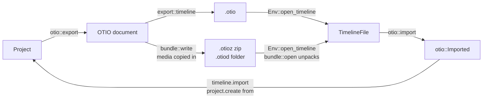

# Project model

- A project is one `Project` value in vidcut-core: settings, a media pool, tracks of clips, subtitle tracks of cues, marks, markers and bins.
- It is saved as one `.vidcut` JSON file. Only the editor changes it ([requests](requests.md)).
- This page tells about the types, time, ids, the file, OpenTimelineIO and the preferences.

```mermaid
classDiagram
  class Project {
    rev: u64
    edited
    next_id: NextIds
    bins: Vec~String~
    tape_marks, speakers
  }
  class Settings {
    fps: Rational
    width, height
    sample_rate, channels
    start_tc, drop_frame
    ripple_on, still_secs
    auto_format, use_proxies
    fillers, timeline_colors
    retime, upscaler
  }
  class Media {
    id
    path, name, bin, color
    size, mtime_ns, fingerprint
    info: MediaInfo
    color_space, super_scale, left_out
    sequence, subtitles, words
  }
  class Proxy {
    file, codec
    source_size, source_mtime_ns
  }
  class Track {
    id, name
    kind: Video or Audio
    locked, muted, solo, volume_db
    video_enabled, voice_isolation, duck
  }
  class Clip {
    id, name, color
    media
    start, duration, source_in
    video, enabled, retime
  }
  class ClipAudio {
    stream
    head, tail
    gain_db, muted, voice_isolation
  }
  class Keyframe {
    frame, value
    in_handle, out_handle
  }
  class Transition {
    id
    from, to
    before, after
  }
  class Marker {
    id
    at, duration
    name, color, note
  }
  class Marks {
    mark_in
    mark_out
  }
  class Kept {
    OTIO JSON as read
  }
  class SubtitleTrack {
    id
    name, language
    shown, locked
    style
  }
  class Cue {
    id
    start, duration
    text, place
    words, speaker, color
  }
  class Title {
    kind, align
    text, style
    position
  }
  class Picture {
    position, zoom, rotation
    anchor, flips, crop
  }
  Project *-- Settings : settings
  Project *-- "*" Media : media
  Project *-- "*" Track : tracks
  Project *-- "*" Marker : markers
  Project *-- "*" SubtitleTrack : subtitles
  SubtitleTrack *-- "*" Cue : cues
  Project *-- Marks : marks
  Media *-- Marks : source marks
  Media *-- "0..1" Proxy : proxy
  Track *-- "*" Clip : clips
  Track *-- "*" Transition : transitions
  Clip *-- "0..1" ClipAudio : audio
  ClipAudio *-- "*" Keyframe : gain_keys
  Clip *-- "0..1" Title : title
  Clip *-- "0..1" Picture : picture
  Clip ..> Media : media id
  Clip *-- Kept : effects, generator, compound, speed
  Transition *-- Kept : otio
```

## The project

- `Project` holds `rev`, one more for each change, and `edited`: when.
- `media` is the pool, in pool order. `bins` are slash-separated paths, and each `Media` names its `bin` (spec §3).
- `tracks` are the video tracks, then the audio tracks. Audio tracks hold sound-only clips.
- A clip on a video track carries its picture. Its `ClipAudio` carries its sound, with J/L offsets (`head`, `tail`).
- `tape_marks` holds the In and Out of the source tape.
- `MediaInfo` keeps what the probe found: streams, duration, start timecode.
- One project is one timeline ([deviation X2](../deviations.md#x2-one-timeline-per-project-file)).

Volume keyframes ([spec D81](../cut-page-spec.md#12-decisions-on-gaps-and-contradictions)):

- `ClipAudio::gain_keys` holds the volume keyframes of a clip, in order, on whole source frames. On a clip with a speed, they are on its retimed source.
- With keyframes, the volume is their curve (`keyframes::value_at`), and `gain_db` is not heard.
- `keyframes::reshape` makes each change. It keeps the order, one keyframe on a frame, and the ease of each keyframe.
- `ops::keyframes` holds the requests. `ops::change_speed` moves the keyframes with `keyframes::retimed`.

Speeds ([spec D48](../cut-page-spec.md#12-decisions-on-gaps-and-contradictions)):

- `Speed` holds the `sections` of a clip's speed, and `skip`.
- A `Section` starts at a frame of the clip's retimed source (`at`), at a source position (`from`). It has one `speed`.
  - Its `ease` holds the handles of the speed keyframe at its start, in frames before and after it.
- `Pace::position` gives the source position on the curve. `Pace::bend` gives the handles that an ease uses, kept inside the sections.
  - `ops::speed` and the OTIO import stop a new ease at the clip's edges. `Pace::bend` stops it at the speed keyframes, at each render and export.
- With speed keyframes, each frame shows `floor` of the curve, also backward. A clip with one backward speed shows the bottom of each stretch.
  - `ops::speed` works on the curve form. `sections` and `with` change a clip with one backward speed to that form and back.
- The retimed source has one frame for each timeline frame. `skip` is its frame at the clip's first frame.
- `render::Pace` gives the source frame at each frame of the retimed source. `source_in` is the first source frame that the clip shows.
- A trim or a split moves only `skip` and `source_in` (`Clip::walk`). Thus all the speed keyframes stay.
- The keyframes of a clip with a speed are on its retimed source (`Clip::content_at`). Thus they stay on their frames of the clip.
- `ops::speed` adds and removes speed keyframes, and holds `speed.set`, `speed.freeze`, `speed.reverse` and `speed.ease`. `ops::change_speed` gives a clip one speed.

Stills ([D38](../cut-page-spec.md#12-decisions-on-gaps-and-contradictions)):

- A file is a still when an image demuxer reads it (`image2`, the `_pipe` demuxers).
- A GIF or animated WebP (`gif`, `webp_anim`) of one frame is also a still.
- An animated WebP of more frames lasts as long as its frames do. Why: `webp_anim` reports no duration.

Media fields:

- `color_space` (`ColorSpace`, spec §3) reads a file whose color tags are wrong as another space.
  - `Media::video_as_read` is the `VideoInfo` of the file, read in that space. Render pieces carry it.
  - `VideoReader` retags each decoded frame with it (`color::retag`). This drops the HDR side data.
  - A proxy is made from the pictures as read in that space. Thus its own tags are right.
- `super_scale` (`SuperScale`, spec §3) enlarges the pictures with a better upscaler before they are fitted.
  - `upscaler` (`Upscaler`) is AI Fast, AI Best or Classic. [gpu](gpu.md#super-scale) tells which upscaler each path uses.
  - Proxies do not use it. The viewer uses it only with `viewer.super_scale` ([playback](playback.md)).
- `left_out` holds the source frames that the Delete of the Transcription window left out (`media.leave_out`, `ops::leave_out`).
  - Each edit of the media leaves these frames out. `resolve_sources` cuts each source range around them (`model::uncovered`).
  - An edit that fills the timeline In to Out can need more frames than the range. Then the frames after the range also skip them (`fit_to`).
- `words` holds the words that the project takes from the transcripts of each sound stream (`ChosenWords`, [analysis](analysis.md)).

Folders:

- `media.add_folder` lists the folder with `Env::read_folder` (`folder::read`).
  - It sorts the files and folders by name, without case, as the pool does.
  - It leaves out names that start with a dot.
  - It skips a link to a folder. A link to a file is added.
  - It skips a folder that is the same folder as one above it, for example a bind mount (`folder::LOOPS`).
- It adds the media in that order, each into the bin of its folder. Each folder that it reads gets its bin.
- A file is media by its extension (`folder::MEDIA_TYPES`, `folder::IMAGE_TYPES`). Why:
  - A probe of each sidecar and document in the folders of a camera card is slow.
  - FFmpeg opens some of these files as streams, for example subtitles.
- It lists the files that it skips, and the files that do not probe. A run of numbered images shows as the run (`ImageSequence::display`).
- With `sequence`, `Folder::runs_here` finds the runs of numbered images of each folder (`sequence::find_among`).
- It is one request, thus one undo step.

## Time

- Each timeline position and length is a whole frame at the rate of the project, `Settings::fps`.
- The rate is an exact `Rational` (30000/1001, not 29.97).
- The `source_in` of a clip also counts project frames, from the first frame of its media.

Requests take times as strings that parse into a `TimeSpec`:

- frames: "450f", or a JSON integer
- seconds: "15s", "1m30s", "250ms"
- timecode: "HH:MM:SS:FF", with ";" for drop-frame
- a keyword: start, end, in, out, playhead
- an offset: "+5s"

Ranges and resolution:

- A `RangeSpec` is half-open: "A..B" or "A..+D".
- The editor resolves times with a `TimeContext` from the project:
  - "15s" is the nearest frame (`Rational::secs_to_frames`).
  - Timecode counts from `start_tc` ([spec §4.3](../cut-page-spec.md#43-timecode-pp-640-688-713714)).
  - The playhead keyword resolves only when the caller gives a frame. The live core gives the frame of the timeline. Thus a command that the GUI runs can use the playhead, and a headless command cannot.
- A clip reference is an id, or "V1@15s": the clip under that frame on V1 (`resolve_clip`).

## Ids

| Thing | Id | Made by |
|---|---|---|
| media | m1, m2 … | `Project::alloc_media_id` |
| clip | c1, c2 … | `Project::alloc_clip_id` |
| marker | k1, k2 … | `Project::alloc_marker_id` |
| carried transition | t1, t2 … | `Project::alloc_transition_id` |
| cue | q1, q2 … | `Project::alloc_cue_id` |
| track | V1 … then A1 …, by place | `ops::tracks`; removing one renumbers the rest |
| subtitle track | S1 …, by place | `ops::subtitles::add_track`; removing one renumbers the rest |

- The counters are in `NextIds`. Each alloc call adds one.
- Undo restores `next_id` with the project. Thus an id of an undone edit can come again.
- `ops::MAIN`, V1, always exists.

## The `.vidcut` file

- `Store` reads and writes the `Project` as pretty JSON (serde).
- A media path in or under the folder of the project is stored relative to it. Other paths are stored absolute. In memory, media paths are absolute.
  - Why: a project folder that moves, to another computer too, keeps its media ([deviation X1](../deviations.md#x1-projects-are-always-saved-standalone-json-files)).
- A proxy is stored by its file name (`Proxy::file`), and found in the proxy folder of this computer (`Proxy::path_in`, `Env::proxy_dir`).
- A save writes a temporary file and renames it over the project (`temp::write`). Thus readers see the old file or the new one, never part of one.
- `Store::transact`, `Store::compact` and `OpenProject::apply` hold the lock file of the project (`Store::lock`). `Store::create` and `Store::replace` write a new file without the lock.
- A load runs `validate::violations`, and refuses an inconsistent file.
- The undo history is kept apart, in the state dir ([requests](requests.md#undo-history)).

Temporary files:

- Each file that vidcut writes whole goes through `temp`.
- `temp::file` and `temp::dir` make a hidden file beside the target. Its name is the target's, a random number and a part piece. The extension is last, for FFmpeg.
- It is created exclusive (`create_new`). Thus nothing that is already there, a link included, opens.
- `Temp::keep` renames it over the target. A `Temp` that is dropped and not kept is removed.
- `temp::remove_left` removes the temporary files of a GUI as it closes.
- When two processes write one target, each writes its own file, and the last rename wins.
- Windows can refuse a rename over a file that is open elsewhere. This is an error, never dropped.
- A model download keeps one `.part` to continue from ([analysis](analysis.md#transcription)).

## Fingerprints and relinking

Stamps:

- `Media::size` and `Media::mtime_ns`, read at the probe, make the `Origin` of the file (`fingerprint::origin`).
- The origin names and stamps each cache file made from the media ([analysis](analysis.md)).
- A proxy made from another size or time, or with another `color_space`, is stale (`Media::fresh_proxy`).
- The file of a proxy is named by the content of the source (`paths::proxy_origin`). Thus it has the same name on each computer.
- A proxy whose file is gone is lost (`Env::proxy_present`). Automatic proxies make it again, as the project names it.
- `Media::fingerprint` is a SHA-256 of the content (`fingerprint::file`). It reads a small file whole (`WHOLE`), else one `PIECE` from the start, the middle and the end. An image sequence uses three pictures (`fingerprint::pictures`).

Relinking:

- A file is missing when `Env::present` says so. A path that is absolute only on the other kind of system is missing.
- `media.relink` looks for missing files by name in `search` folders. A candidate in more of the same parent folders comes first.
- It relinks a candidate only when its size, pictures, sound streams, duration, timecode and fingerprint match.
- A file given as `path` is used either way. The answer tells what differs.

## Subtitles

- `Project::subtitles` holds the subtitle tracks. S1 is nearest the video. One track is `shown` at a time.
- A `Cue` spans whole frames, as a clip does. The cues of a track are sorted by start, and can overlap.
- Its `text` is lines, with `<i>`, `<b>`, `<u>` and `` around words. `Place` tells where on the picture it goes.
- `speaker` is the person who says it. `color` is its own color, over the color of the person (`Speakers::color_of`, [deviation X63](../deviations.md#x63-subtitles-keep-their-speaker-painted-in-the-persons-color)).
- `words` holds a `CueWord` for each word of the text, in order. The cue leaves `words` out when no word has a start frame or a style.
  - The `at` of a word is its start frame, from the start of the cue ([spec D70](../cut-page-spec.md#12-decisions-on-gaps-and-contradictions)).
- Styles nest: the track style, then the `style` of a cue, then the `style` of a word. `SubtitleStyle::for_cue` merges each over the one under it. A field left out keeps the style under it.
- The `SubtitleStyle` of a track holds:
  - its font, size, color, outline, background and margin ([spec D61](../cut-page-spec.md#12-decisions-on-gaps-and-contradictions))
  - its bold face, letter case and shadow
  - `SubtitleWords`: how its words show as they are spoken ([spec D69](../cut-page-spec.md#12-decisions-on-gaps-and-contradictions))
  - `SpeakerPaint`: what the color of a cue paints (`SubtitleStyle::paints`)
  - `SubtitleAlign`: `left`, `center` or `right`. Left out, the lines are centered.
  - `position`: `[x, y]` as fractions of the picture from the top left. Left out, the block stays in the place of the cue.
- `ops::subtitles` holds the edits. `editor::resolve_cue` reads a cue reference: its id, or a track and a time (S1@15s).

**Cues follow Track 1** ([spec D57](../cut-page-spec.md#12-decisions-on-gaps-and-contradictions)).

- `follow::follow` moves the clips of the other tracks after an edit on Track 1. It also calls `ops::subtitles::remap` with its frame mapping. `ops::delete_range` calls `remap` with the mapping of its range.
- `remap` maps each frame of a cue. A frame survives when it has a place, and the next frame does not land on the same place.
- The surviving frames, in runs, are the new spans of the cue. The first span keeps the id of the cue, and the other spans get new ids.
- The frame of each word goes through the same mapping. A word on a removed frame starts on the next kept frame. Each span counts its words from its own start.
- A locked subtitle track stays as it is.

**Files.**

- A subtitle file in the pool is a `Media` with `subtitles` (`SubtitleFile`: its format, encoding, cue count, language, first cue and warnings).
- `subtitles::pool_item` makes it when `Env::probe` meets a subtitle extension.
- It has no streams. Thus `Project::media_frames` gives it no frames, and `ops::make_clip` refuses it.
- `subtitles.import` reads its cues from the file again when it places it.

Reading:

- `subtitles::parse` decodes the bytes (`Encoding`): a BOM, else UTF-8, else UTF-16 by its zero bytes, else Windows-1252.
- It tells the format by the first lines, then by the extension.
- It reads SRT and WebVTT line by line, the `::cue` colors of a WebVTT STYLE block too.
- It reads TTML with roxmltree:
  - its styles and regions, down to each span
  - its time base: media, or smpte with its drop mode, as appendix N.3 of TTML1 counts
  - its language (xml:lang), which the new track takes
- The markup of each format becomes the cue markup. Other tags go.

Placing:

- `ops::subtitles::import` turns each time into the nearest frame in the time base of the file (`SubtitleTimeBase`). The time base is real time, or timecode labels when the times sit on their grid.
- A file in timecode then loses the start timecode of the timeline, or 01:00:00:00 ([deviation X41](../deviations.md#x41-subtitle-files-placed-by-their-timecode-or-from-the-timelines-start)).

Writing:

- `ops::subtitles::collect` gives the cues of a track in a range, in seconds: from zero, or in timecode. `subtitles::origin` gives the frames of the start timecode ([spec D58](../cut-page-spec.md#12-decisions-on-gaps-and-contradictions)).
- `subtitles::write` writes the cues as SRT, WebVTT or IMSC1.
  - WebVTT writes colors other than its eight named colors as STYLE classes.
  - The IMSC1 file carries the `SubtitleStyle` of the track, and regions sized from its cues ([spec D64](../cut-page-spec.md#12-decisions-on-gaps-and-contradictions)). What does not fit goes in `Written::warnings`.
- `subtitles.export` writes the file through a partial file beside it (`Env::write_file`).
- `subtitles::beside` makes the files that an export writes beside its output ([export](export.md#subtitles)).

## Titles

- A clip with a `title` is a title ([spec §8.14](../cut-page-spec.md#814-titles-pp-762764-11761178)): no media, no audio, no speed, any length, on a video track.
- `Clip::is_generator` and `Clip::is_block` count it. Thus edits treat it as a carried generator.
- Its `Title` holds:
  - a `TitleKind`: `text`, `lower_third` or `scroll`
  - the `TitleAlign` of a lower third or a scroll
  - its lines, with markup that `rich::spans` reads into `Span`s
  - a `TitleStyle`
  - an optional `position`: the point that its anchor goes to (`Title::place`, `Title::anchor`, [spec D65](../cut-page-spec.md#12-decisions-on-gaps-and-contradictions))
- `ops::titles` holds the edits. `ops::titles::checked` is the check that `titles.add`, `titles.set` and `validate::violations` share.
- It checks the style through the checks of the subtitle style (`checked_font`, `checked_size`, `checked_color`, `checked_outline`, `checked_background`).

## Pictures

- A clip of footage, a still, an image sequence or a compound clip can carry a `Picture` ([spec D75](../cut-page-spec.md#12-decisions-on-gaps-and-contradictions)):
  - `position`: where the middle of the whole picture goes, before the zoom and the rotation
  - its `zoom` across and down, and its `rotation`
  - its `anchor`: the point that the zoom and the turn work about (`Picture::pivot`)
  - its `pitch` and its `yaw` (`Picture::pitch`, `Picture::yaw`)
  - its flips
  - a `Crop` of each side, and the softness of its edges (`crop_softness`)
  - a `DynamicZoom`: a start and an end `ZoomBox`, and an `Ease`
  - its `composite_mode` (`CompositeMode`, `Picture::mode`) and its `opacity` (`Picture::opaque`)
- Each value is left out at its usual value. A picture that `Picture::is_usual` accepts is only fitted into the frame.
- Each value of `keyframes::PictureValue` can hold `Keyframe`s beside the plain value. `Picture::is_usual` is false while a value has keyframes.
  - These values are position, zoom, rotation, the anchor point, pitch, yaw, each crop side, the crop softness and the opacity.
  - `position_keys` holds X, and `position_y` holds Y, one number for each keyframe. Zoom and the anchor point do the same.
  - A handle `value` moves X. Y keeps the handle `frames`, with a value offset of 0 (`value_paired`).
- `ops::picture` holds the edits:
  - `ops::picture::checked` is the check that `picture.set`, `validate::violations` and the metadata of an OTIO file share.
  - `ops::picture::has_picture` tells which clips take a picture: not titles, generators or sound.
  - `ops::picture::clear` puts back one `PictureTool`, or all of them. `ops::picture::cleared` is the reset of one `PictureTool`, which the Inspector also uses.
  - `picture.set` takes a `DynamicZoomSet`. Its fields replace their own (`DynamicZoomSet::on`).
- `place::Placing` turns the picture of a clip, with the pictures of the compound clips around it, into maps.
  - Each `place::Level` maps a pixel of the frame back to a picture, with the part shown, its soft edges and its opacity.
  - Each map zooms and turns the picture about its anchor point. `place::anchored` gives the pixel where the anchor point lands.
  - Pitch and yaw lean the picture about its middle, in its own axes, before the zoom and the turn ([spec D93](../cut-page-spec.md#12-decisions-on-gaps-and-contradictions)). Thus `Level.back` is a projective map. Without a lean, it is affine.
  - An export and the viewer both draw by these maps ([export](export.md#placed-pictures), [playback](playback.md#the-engine)).
- The shader of the viewer and the export holds the sums of the composite modes (D75, `mixed` in `picture.wgsl`).

## Ducking

- A track can carry a `Duck` ([spec D76](../cut-page-spec.md#12-decisions-on-gaps-and-contradictions)). It holds `on`, its `sources` by track id, the Duck Amount, the four times, `detect` (`DuckDetect`) and `threshold_db`.
- Each value is left out at its usual value. `on` is written only when it is off.
- `track.set` takes a `DuckSet`. Its fields replace their own (`duck::patched`). A new `Duck` takes `duck::default_sources`.
- `duck::checked` is the check that `track.set`, `validate::violations` and the import of an OTIO file share.
- `ops::remove_track` renumbers the tracks. Then `duck::renamed` moves the sources to the new ids, and drops the removed track.
- An OTIO file carries the `Duck` in the `vidcut` metadata of its track. An import drops the sources that its tracks do not have (`duck::tidy`).
- [export](export.md#sound) tells how the ducking plays.

## Looks

- Looks are named styles ([spec D71](../cut-page-spec.md#12-decisions-on-gaps-and-contradictions)). They are not in the project.
- `looks::Styled` is a `SubtitleLook` (a `SubtitleStyle` with `chars` and `lines`) or a `TitleLook` (a `Title` without its text: `TitleLook::of`, `TitleLook::on`).
- `looks::checked` runs each look through the check of its kind (`checked_style`, `ops::titles::checked`).
- `looks::built_in` holds the built-in looks. The user's looks are TOML files under `looks::dir`, one folder for each `LookKind`.
- `looks::read` lists the looks of a folder. A file that fails to parse or check goes in `Listing::refused`, with the reason.
- `looks::save` and `looks::delete` refuse built-in names. `looks::find` looks up a name in any case, built-in looks first.
- The editor reads looks through `Env::looks`, which only `AvEnv` fills. Thus tests give their own folder.
- `looks.list`, `looks.save` and `looks.delete` are projectless. `track.set`, `titles.add`, `titles.set` and `subtitles.transcribe` take a `look` by name.

## OpenTimelineIO

- `export.start` to an `.otio`, `.otioz` or `.otiod` path writes the timeline, or the range given. `otio::export` builds the document, and `export::timeline` writes it.
- A file that vidcut wrote of a whole timeline holds the rest of the project too (`otio::holds_project`). `editor::open_otio` gives it back.
- The file of another editor goes into the project (`timeline.import`), or into a new project (`editor::project_from_otio`).
- [deviation X9](../deviations.md#x9-opentimelineio-interchange) tells why. [spec D40](../cut-page-spec.md#12-decisions-on-gaps-and-contradictions) has the conventions.

**Bundles** (`bundle::plan`):

- A bundle holds `content.otio`, `version.txt` in a zip, and the media used under `media`, as the adapters of OpenTimelineIO lay them out.
- The media used include the media that compound clips play (`otio::used_media`). They are whole and uncompressed.
- In a file name under `media`, `_` replaces each character that some file systems refuse. An image sequence keeps one name pattern, in its files and in the timeline text.
- In the kept `Stack` of a compound clip, a reference to a file that the compound clips play also points into `media` (`otio::same_media`). Other references keep their URLs.
- `bundle::open` unpacks an `.otioz` into a folder named after it, or into `unpack`. It keeps files whose CRC-32 matches.
  - It refuses a symbolic link in the zip, media over a size limit, and a file whose length differs from its declared size.
  - Anything in the way is an error, a symbolic link at the destination too.
- `bundle::write` moves the old `.otiod` folder aside before the new folder takes its place.

| vidcut | Written as |
|---|---|
| video track | a `Video` track, disabled with its video off, and an `Audio` track of its clips' sound, J/L cuts as audio edits |
| audio track | an `Audio` track, disabled when muted |
| clip | `Clip.2`, its source range from the media's start timecode |
| media | `ExternalReference` by plain path, relative in a bundle; a still one frame long, its clips from source 0; an image sequence an `ImageSequenceReference` at its rate |
| Clip Color | the item's `color` |
| title | a `Clip.2` of a `GeneratorReference` in Resolve's shape (`otio::titles::reference`, [spec D67](../cut-page-spec.md#12-decisions-on-gaps-and-contradictions)) |
| markers | the top-level stack's, with their lengths |

The metadata:

| Metadata | Holds |
|---|---|
| `vidcut` on clips | `clip`, `media`, `color`, `stream`, `gain_db`, `muted`; `gain_keys` from the item's first source frame; `source_in`, `skip` and `sections` of stills and speeds; a title's `Title`; a placed or compound clip's `Picture`, read before Resolve's effects |
| `vidcut` elsewhere | track settings and `name`; marker id and `color`; the timeline's `fps`, `marks` and, when whole, `project` (`ProjectMeta`, with the subtitle tracks) |
| `Resolve_OTIO` on clips | `Link Group ID`, `Channels`, a clip volume effect with the volume keyframes in its `Key Frames` (`effects::sound`), and `Media In` on reversed clips |
| `Resolve_OTIO` on placed clips | Transform, Cropping, Retime and Scaling, and Dynamic Zoom (`otio::picture`), fitted, in place of carried ones |
| `Resolve_OTIO` on compound clips | a `Sequence ID`, kept or made from the compound's content; a `Link Group ID` that joins the picture and sound of one compound at the same place (`compound_links`) |
| `Resolve_OTIO` on tracks | `Locked`, `SoloOn` and `Audio Type` |
| `Resolve_OTIO` on markers | `Note` |

- Other editors read the `Resolve_OTIO` metadata.
- An import reads the `Resolve_OTIO` effects of a placed clip back as its `Picture` (`picture::take`), by the shape of the probed source.
  - This occurs when the clip has no `vidcut` picture, and none of these effects has keys or other parameters. The two keys of Dynamic Zoom are the exception.
- The notes of an export name a clip that moved past the reach of these parameters (`otio::out_of_reach`).

Import:

- `otio::import` also takes `Clip.1`, and float rates, snapped (`rational`).
- It takes media named by a `file` URL; a plain, Windows or relative path; or the `Media Url` of an offline `MissingReference`. `locate` gives no path for other schemes.
- Video tracks become V1, V2, …. An audio clip that lines up with a video clip of the same media (and link group) becomes its sound. Other audio clips go on A1, A2, ….
- Names other than the defaults (`default_track_name`) name tracks. Markers on clips, tracks and the stack become timeline markers.
- Nested tracks, unknown items, clips without media and clips that overlap are left out, with a warning.
- A clip and its sound keep only the frames inside their media, at the clip's speed and direction. A warning tells how many frames went.
- An import looks for media at the path, then by their last parts beside the file (`MediaRef::paths`). Then it looks by name in `search` and the folder of the bundle (`find_media`).
- It looks for the media of a compound clip in the same way.
- `edit.decompose` first takes the media that the compound clip already plays (`otio::same_media`: by path, then by a file name that no other of them has).

Modes:

- `ImportMode` is `append`, `replace`, `compound` (`otio::as_compound`) or `media`. `flatten` decomposes compound clips.
- An empty timeline takes the rate, start timecode and track settings of the file.
- A file that vidcut wrote brings its pool items (`join_pool`) into a bin named after it, with new ids, without proxies.

Kept data:

- `Kept` holds what vidcut does not model: the OTIO JSON as read. Copies share it. It is saved in the `.vidcut` file and written back.

| OTIO | Kept as |
|---|---|
| clip effects in use (`effects::read`) | `Effects` on the picture or `ClipAudio`. Keyframes stay on their source frames (the `from` field of `Effects`, set by `carry`), and fades stay at the clip's ends through splits; the clip volume's level is the gain |
| the `Key Frames` of the clip volume (`effects::gain_keys`) | `ClipAudio::gain_keys`, taken out of the kept effect (`effects::drop_gain_keys`) |
| `Transition` (`in_offset`, `out_offset`) | `Transition` (`before`, `after`), dropped by `transitions::prune` when it does not fit; dissolves, wipes and cross fades play ([spec D50](../cut-page-spec.md#12-decisions-on-gaps-and-contradictions)) |
| `GeneratorReference` | a title when it is vidcut's or Resolve's Text, lower third or Scroll (`otio::titles::read`), else `Generator`, a block that plays as a gap |
| nested `Stack` | `Compound`, a block that plays its clips; `edit.decompose` breaks it up |
| `LinearTimeWarp`, `FreezeFrame` | `Speed`, written first among the clip's effects ([spec D48](../cut-page-spec.md#12-decisions-on-gaps-and-contradictions)) |
| `TimeEffect` with `Key Frames` | `Speed`, a section for each key (`ramp`). It is written back while the sections stay, else made again (`ramp_effect`) |

Which kept transitions play (`otio::transitions`):

- On picture: an `SMPTE_Dissolve` whose editor metadata names no effect but a cross dissolve.
- On picture: an Edge Wipe at 0, 90, 180 or −90 degrees (`transitions::wipe_otio`), as a wipe from the bottom, left, top or right edge. vidcut writes its wipes in this form. Other parameters, such as a border, are kept but do not play.
- On sound: a cross fade found by its effect type or name (+3, 0 or −3 dB), or a plain `SMPTE_Dissolve` at 0 dB.
- A transition plays only where its two clips cover its frames, and no other clip of the track reaches into them. Of two transitions that overlap, the first plays.

## Preferences

The file:

- Preferences are not in the project. They are in `preferences.toml` in the config dir (`preferences::path`).
- The file holds a `Preferences` with these sections: appearance, GPU, player, thumbnails, cache, proxies, transcripts, services and viewer ([the disk cache limit](analysis.md#the-disk-cache-limit)).
- `ViewerPrefs.guides` (`Guides`, `Framing`) holds the framing aspect and the safe-area lines.
- No key of a service is ever in the file.

Requests:

- `preferences.get`, `preferences.set` and `preferences.reset` are projectless. Thus each door runs them in the same way.
- `preferences::load` leaves out a key that vidcut does not have. `preferences.get` names it in `ignored`, and the next write drops it.
  - The entries of a map, such as the languages of `transcripts.fillers`, are data, not keys. They stay.
- `preferences.reset` keeps the old file under the first free backup name (`preferences.toml.bak`, then `.bak.2` and on), then writes the defaults. Why: a second reset never replaces the backup of the first.
- `preferences.set` takes a `PreferencesPatch`, applies it (`Preferences::patched`), checks it, and replaces the file atomically.
- `viewer.guides` changes the same `Guides` (`Guides::applied`). With no fields, it toggles the framing guides.
- Code reads the file when it needs a value (`preferences::load`).
- A running GUI also watches the file (`Msg::PreferencesChanged`). It follows GPU decoding, the audio device, the memory budget of the player, the theme, the filler words and the viewer guides.

Reset:

- `reset` (`reset::plan`, `reset::run`) empties the config, cache and state dirs, except the paths that it keeps:
  - presets, themes and looks (unless `saved`)
  - the downloaded models and kept paid replies (with `keep_downloads`)
  - a proxy folder set as an absolute path
  - the undo history of the project that its own GUI has open (`Store::history_path`)
- It compares the paths after it resolves links (`dirs::canonical`). It does not follow a link to reach a kept path. When it removes a link, the folder that the link names stays.
- It refuses while another GUI runs (the registry). Why: that GUI keeps view settings and folders in memory, and writes them back.
- A folder that the reset cannot read fails the reset. The folder does not pass for empty.
- The GUI that asks for a reset drops its own view state to defaults first (`Workspace::forget_view_state`). Why: nothing that it writes during the delete brings old settings back.
  - When the reset is done, the GUI reads its view state from disk again (`Workspace::after_reset`).
  - When the reset fails or is refused, the GUI puts the old view state back (`Workspace::restore_view_state`).

## Speakers

- `Project::speakers` (`Speakers`) tells who speaks in the transcripts that the project uses.
- The transcripts are kept with the files, and number their own speakers. `Speech::speakers` names the run that numbered them.
- `names` names a person, and `colors` gives a person a color.
- `links` makes the speaker of a file (its voice: media, stream, number) a person other than the person of its run.
- `assigned` gives the words of a file between two times to a person. The last assignment comes first.
- All of these go through the history, as any edit does (`speakers.set`, `speakers.link`, `speakers.assign`).
- `speakers.join` makes one person into another person everywhere (`Speakers::join`). The speakers and cues of the first person go to the other person.
- A cue names its person by the same key (`Cue::speaker`). `Speakers::key_for` finds the person that a name names.
- Thus a name that is typed, or read from a WebVTT voice, becomes a new person only when no one has it.

## Validation

`validate::violations` lists what breaks the rules of the model:

- unique ids
- tracks named by place, with video before audio, and V1 present
- clips and their sound sorted, without overlap, on each track
- sources inside their media
- known media and bins
- gains in range
- titles on video tracks
- titles, subtitle styles and duckings that their requests would refuse

It runs:

- when a file loads: the load fails
- after each edit: the edit fails as a vidcut bug, and nothing is saved
- when an OTIO file opens

## Code

- `crates/vidcut-core/src/model.rs`, `crates/vidcut-core/src/time.rs`, `crates/vidcut-core/src/store.rs`
- `crates/vidcut-core/src/fingerprint.rs`, `crates/vidcut-core/src/validate.rs`, `crates/vidcut-core/src/folder.rs`
- `crates/vidcut-core/src/keyframes.rs`, `crates/vidcut-core/src/place.rs`, `crates/vidcut-core/src/duck.rs`
- `crates/vidcut-core/src/ops/`
- `crates/vidcut-core/src/otio.rs`, `crates/vidcut-core/src/otio/`
- `crates/vidcut-core/src/editor.rs`
- `crates/vidcut-core/src/subtitles.rs`, `crates/vidcut-core/src/subtitles/`
- `crates/vidcut-core/src/preferences.rs`, `crates/vidcut/src/preferences.rs`, `crates/vidcut/src/reset.rs`
- `crates/vidcut/src/bundle.rs`, `crates/vidcut/src/export.rs`, `crates/vidcut/src/env.rs`
