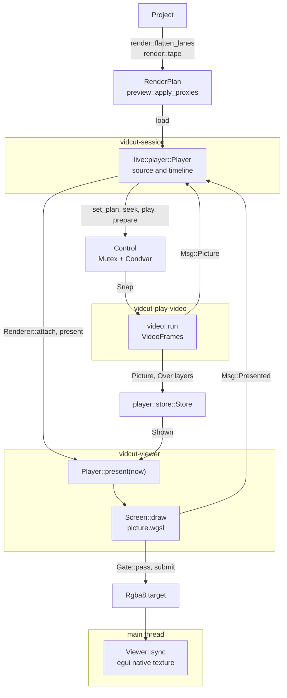
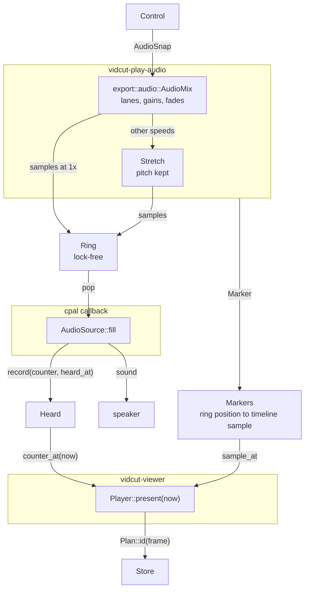

# Playback

Playback turns the timeline, or a source clip, into pictures and sound.
The start point is the playhead.
The live core builds a render plan.
The engine in `crates/vidcut-av/src/player/` decodes the plan and mixes it.
The engine uses the same reader and the same mixer as an export.
The viewer thread draws the picture in one shader pass.
The audio device is the clock.
See also [live](live.md) and [threads](threads.md).

## The plan

`render::flatten_lanes` makes the `RenderPlan` for the timeline.
The plan has video pieces.
A dissolve is a `VideoPiece::Mix`.
The plan has audio lanes.
Each lane has a `LaneTrack`.
The source viewer plays `render::tape`.
`preview::apply_proxies` swaps in the video of a fresh proxy when the project plays proxies (spec D41).
A proxy frame keeps the timestamp of its source.
The same frames are picked.
Sound stays on the original files.
After each edit or file reload, `Live::project_changed` reloads the source plan.
It schedules `Live::refresh_timeline_at`.
A burst of edits makes one plan.

## The session's player

`live::player::Player` runs on `vidcut-session`.
It keeps the plan and the playhead of `PlayerId::Source`.
It keeps the plan and the playhead of `PlayerId::Timeline`.
It runs one engine, for the player that is shown.
The engine keeps the other player's frame ready (`Player::prepare`).
That frame is decoded when the engine is idle.
It is held outside the budget.
A switch (`Player::set_plan_at`) shows it at once.
`Renderer::attach` hands the engine to the viewer thread.
A new engine starts when the sample rate changes, when the channel count changes, when the audio device changes, or when the GPU changes.
The device was opened with the old rate and the old channel count.
With no device, the engine plays to a silent `PacedOutput`.

Each seek, step, load, and switch is a numbered motion.
`Player::present_due` asks the renderer to present when the engine has its picture, or when it plays.
The `Msg::Presented` answer marks the motion on screen when the asked frame was drawn.
During play, any drawn frame marks the motion.

## The engine

`vidcut_av::player::Player::new` starts `vidcut-play-video` and `vidcut-play-audio`.
The audio output adds `vidcut-audio-out`.
A method returns at once.
Each method changes `Control`.
`Control` is the wanted state, behind a mutex and a condvar.
The threads read `Control` again on each turn.
A burst of seeks becomes the last seek.
`Control` holds the plan and the `mode`.
`Mode::Paused` is a frame.
`Mode::Playing` starts from a sample, at a speed.
A negative speed plays backward.
`Control` also holds fader `trims`, the mute, a `scrub` request, a position that the caller moves (`Player::follow`), and the `prepared` frame.
A change cancels decoding that the engine no longer needs.

`player::plan::Plan` gives each frame an `Id`.
The `Id` names what the picture shows: the file, the source position, and the layers over it.
The `Id` does not name the timeline place.
A kept picture survives an edit that moves it.

Decoding reuses the export reader, `VideoFrames`, with `Output::Decoded`.
The frames are YUV, at their own size.
Each turn does the first item that applies:

- the frame that the viewer asked for
- pictures ahead, in the play direction
- during backward play, whole windows from a keyframe
- when idle, the prepared frame and a window behind the playhead

During play, or while the viewer waits, the thread holds a `first::Claim`.
Jobs then yield.

Kept pictures live in `player::store::Store`.
The store has a memory budget and a video memory budget (`player.memory_mb`, `player.video_memory_mb`).
On macOS arm64, `SHARED_MEMORY` is true.
`apply_video_budget` then calls `Store::share`.
Pictures then share one budget.
The picture used longest ago goes first.
The prepared picture does not go.

A dissolve is not mixed in the engine.
A `VideoPiece::Mix` frame is one `Picture`.
The `Picture` has an `Over` for each layer on top.
Each `Over` has a picture and a weight, as decoded.
The viewer blends the layers as it draws.
Each layer is converted to RGB first.
An export mixes the layers in its own code values ([export](export.md)).
In the middle of a dissolve, an HDR export picture is not the viewer picture ([todo](../todo/hdr-dissolve-preview.md)).

## The clock

Each time the device callback takes sound, `Heard::record` notes the ring position and the time when the sound will be heard.
That time is the callback time plus the cpal output latency.
Each run that the audio thread queues carries a `Marker`.
The marker says: from this ring position, this timeline sample, at this speed, for this play request.
`Shared::clock_frame` chains `Heard::counter_at`, `Markers::sample_at`, and the plan.
The result is the frame heard now.
Until the sound of a play request is heard, the clock stays at the start of that request.
When the ring runs dry, the clock stops.

`Player::present` returns the kept picture for that frame.
Until that picture is decoded, it returns the newest picture that a seek landed, or the last picture shown.
That fallback is marked not exact.
`Player::next_change` says when the next frame is due.

Pictures follow the sound as heard, with latency included.
A late mix holds the picture.
The picture does not drift.

With no device, the silent `PacedOutput` pulls the ring in real time.
The clock still runs.

## The viewer thread

`Viewer::start` spawns `vidcut-viewer`.
The thread wakes when the session notifies it, when the session asks it, when the size changes, or when `next_change` is due.
Each turn calls `Player::present`.
It then calls `Screen::draw` into an RGBA target.
The target has the size of the viewer picture, in physical pixels.
One render pass of `crates/vidcut/src/gui/picture.wgsl` fits the picture the same way as an export.
The pass turns the picture upright.
It scales in YUV.
It converts to RGB with the export math (`shader_colors`).
It tone-maps HDR.
The layers of a dissolve are more draws in that pass.
On the UI thread, `Viewer::sync` shows the target as an egui native texture.

A present answers with the frame that was drawn, when the frame is exact.
A `gui.screenshot` of the viewer reads the target back, to the pixel.

Submissions go through `Gate::pass`.
They wait until the UI thread runs `logic` or `ui`.
Outside those calls, eframe configures the window surface.
The wait does not apply when the UI has been away for a long time.

A surface configure fails when another thread submits at the same time.
Presenting a hidden window can block the UI thread on NVIDIA on Wayland.
A seek and a capture continue without that present.

## GPU pictures

With `gpu.decoding` on, the reader decodes on `hw::GpuDecoder::best` where it can.
Pictures from the decoders that the viewer shows from GPU memory (`Gpu::gpu_pictures`) stay there, in the video budget.
The other pictures come down to memory.
[gpu](gpu.md) has the path of each decoder to the screen.

## Sound

`audio::run` reads `export::audio::AudioMix`.
That mixer is the export mixer.
Lanes are sample-exact.
The mix has clip gains, cross fades, and de-click fades at cuts.
A clip at another speed keeps its pitch (spec D48).
Fader gains (`AudioMix::set_lane_db`) and the mute go on top.
When the output is muted, the clock still runs.
Another play speed goes through `Stretch`, which keeps the pitch.
Backward, blocks are read forward and then reversed.
The `Ring` holds a short queue.
It has one writer and one reader, with no lock.
A seek, a pause, or a new plan empties the ring.
The cpal callback calls `AudioSource::fill`.
`AudioSource::fill` pops the ring, pads with silence, and records `Heard`.
It does not lock.
It does not allocate.
When `produce` writes samples, `audio::run` loops at once.
When sound is playing and the ring needs no more samples, `audio::run` waits up to 5 ms.
When a scrub snippet waits for room in the ring, `audio::run` waits up to 1 ms.
When no play run and no scrub snippet are active, `audio::run` waits up to 1 second.
The wait is `Shared::wait_changes`.
`Shared::notify` wakes that wait when `Control` changes.

A dragged mixer fader sends `mixer.preview`.
`Player::preview_fader` makes that preview a lane gain (`Player::set_lane_gain`).
The gain is heard at once.
No new plan is built.

[Audio scrubbing](../cut-page-spec.md#45-other-viewer-features) (spec D42) plays a short faded snippet of the frame sound.
A step triggers it.
A requested seek during pause triggers it.
The newest snippet replaces one that is still waiting.
The session's own moves use `Player::seek_quietly`.

## The two-up

The Trim Editor and Dynamic Trim show two frames.
`Cells` gives each frame its own engine, on the media of the clip (`render::tape`).
Those engines have no sound.
They use `ManualOutput`.
Each engine gets a quarter of the viewer budget (`Budget::part`).
Every UI frame, `Player::follow` gives each engine its frame and the trim speed.
The engine decodes ahead as if it were playing.
`Player::shrink_to` keeps the pictures of a run at the cell size.
Windows behind the playhead decode on `vidcut-play-windows`.
That work is one window at a time, across the followed players.
No window decodes while any player moves forward.
`Screens` draws the cells with `Screen` on the UI thread.
That draw needs no gate.

## Code

- `crates/vidcut-core/src/render.rs`
- `crates/vidcut-core/src/preview.rs`
- `crates/vidcut/src/live/mod.rs`
- `crates/vidcut/src/live/player.rs`
- `crates/vidcut-av/src/player/`
- `crates/vidcut-av/src/stretch.rs`
- `crates/vidcut-av/src/export/video.rs`
- `crates/vidcut-av/src/export/audio.rs`
- `crates/vidcut/src/gui/video.rs`
- `crates/vidcut/src/gui/picture.rs`
- `crates/vidcut/src/gui/picture.wgsl`
- `crates/vidcut/src/gui/gate.rs`
- `crates/vidcut/src/gui/cells.rs`
