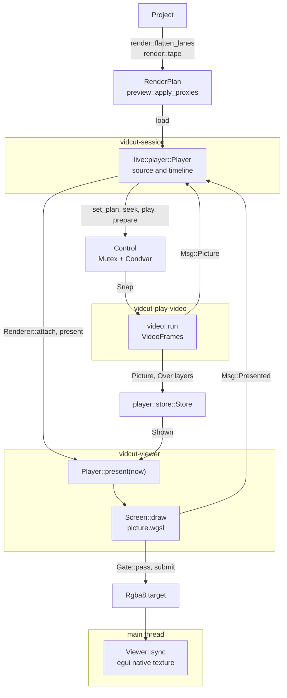
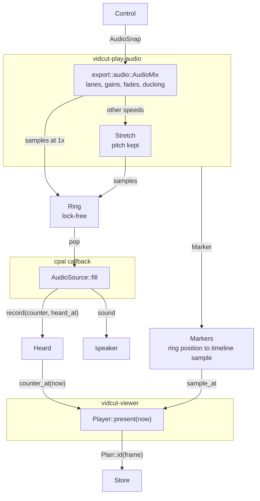
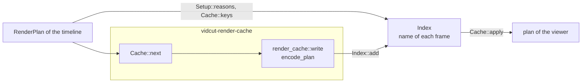

# Playback

- Playback turns the timeline or a source clip, from its playhead, into pictures in the viewer and sound.
- The live core builds a render plan. The engine in `crates/vidcut-av/src/player/` decodes and mixes the plan with the reader and the mixer of the export.
- The viewer thread draws each frame on the GPU ([the viewer thread](#the-viewer-thread)). The audio device is the clock.
- [live](live.md) has the threads around the player, and [threads](threads.md) their priorities.



## The plan

- `render::flatten_lanes` makes the `RenderPlan` of the timeline: video pieces, audio lanes, and a `LaneTrack` for each lane.
  - A dissolve or a placed picture is a `VideoPiece::Mix`. A title is a `VideoPiece::Titled`.
  - A dip to color is two halves over a `VideoPiece::Black` of its color. The outgoing picture falls over the first half, the incoming one rises over the second.
  - A Push or a Slide is two layers with the same `render::Move`: the outgoing side, then the incoming side marked `cross`. The `Move` holds the way, the values and the keys of the progress (`transitions::course_played`).
    - At a gap, the missing side is a black piece with `gap` set. It does not cover the tracks below, and the screen draws nothing for it.
    - `fs_motion` still hides the other side where the gap side covers it. Thus the tracks below show there.
  - A Smooth Cut is the outgoing side, then the incoming side with a `render::Smooth` (`Over::smooth`). The `Smooth` holds the process and the keys of the morph ([export](export.md#smooth-cuts)).
- The source viewer plays `render::tape`.
- Where the project plays proxies (spec D41), `preview::apply_proxies` puts in the video of fresh proxies. Proxy frames keep the timestamps of their sources, so the player picks the same frames. The sound stays on the originals.
- Before the proxies, `Cache::apply` puts in the frames of the render cache ([the render cache](#the-render-cache)).
- After each edit or file reload, `Live::project_changed` reloads the source plan and schedules `Live::refresh_timeline_at`. Thus a burst of edits makes one plan.

## The session's player

- `live::player::Player` runs on `vidcut-session`. It keeps the plan and playhead of `PlayerId::Source` and `PlayerId::Timeline`.
- It runs one engine, for the player that shows. The engine keeps the frame of the other player ready (`Player::prepare`). Thus a switch (`Player::set_plan_at`) shows that frame at once.
- `Renderer::attach` hands the engine to the viewer thread.
- A new engine comes for another sample rate, channel count, audio device or GPU. Why: its device opened at these values.
- With no device, the engine plays to a silent `PacedOutput`.
- Each seek, step, load and switch is a numbered motion.
  - `Player::present_due` asks the renderer to present when the engine has its picture, or plays.
  - The `Msg::Presented` answer marks the motion as on screen when the frame asked for was drawn. While playing, any frame counts.

## The engine

- `vidcut_av::player::Player::new` starts `vidcut-play-video` and `vidcut-play-audio`. Its audio output adds `vidcut-audio-out`.
- Its methods return at once. Each method changes `Control`, the wanted state behind a mutex and condvar.
- The threads read `Control` again at each turn. Thus a burst of seeks collapses into the last seek. A change cancels the decoding that it makes unnecessary.
- `Control` holds the plan and the `mode`: `Mode::Paused` at a frame, or `Mode::Playing` from a sample at a speed.
- It also holds the fader `trims`, the mute, a `scrub` request, a followed position (`Player::follow`) and the `prepared` frame.
- A `looping` range (`Player::set_loop`, spec D51) keeps `Mode::Playing` going past its end. The audio thread reads on from the start, and queues the `Marker` of the jump. Thus the ring and the clock run on.
- `player::plan::Plan` gives each frame an `Id`. The `Id` names what the picture shows (file, color reading, source position, layers over it), not where it shows. Thus kept pictures survive edits that move them.
  - Each layer over it adds its level, the edge of its wipe and the frame of its move (`Moving::key`). Why: a change of a wipe's edge or of a Border keeps the level, and the picture is a new one.
  - The incoming layer of a Smooth Cut also adds the point and the process of its morph (`Smooth::at`). Why: a change of the Ease or the Process keeps the level.

**Decoding**

- Decoding uses the reader of the export, `VideoFrames`, with `VideoFrames::keeping`: frames at their own size.
  - GPU frames of the kinds that the viewer takes stay on the GPU.
- Each turn does the first of these:
  1. the viewer's frame
  2. pictures ahead in the direction of play
  3. when playing backward, whole windows from a keyframe
  4. when idle, the prepared frame and a window behind the playhead
- Each piece of the plan tells which frames the player may decode before they are asked for (`player::plan::Fill`). Where layers overlap, each layer must allow it (`Plan::fill_at`).
- A play that does not find the frame at the playhead decodes a frame ahead of the clock. The lead is the mean time of the recent seeks (`seek_cost`).
- A piece with an AI upscaler, an AI Retime Process or an AI Smooth Cut fills no frames behind the playhead (`Fill::of`, `Plan::fill_at`). Why: an AI picture takes much GPU time. For an upscaler, a frame before the current run also starts a new run ([gpu](gpu.md)).
- Such a piece gives no lead, and does not change `seek_cost`. Why: after an AI clip, a jump in another clip does not land far ahead of the clock.
- While paused in such a piece, a seek keeps only the asked frame. The player then makes only the next frame ahead (`SLOW_AHEAD`). Why: each AI picture takes much GPU time.
- The viewer's frame, play backward and steps back decode the frames that they need. The prepared frame is made with an AI upscaler too, so the next clip shows its first frame at once.
- While it plays, or while its viewer waits, the decoding thread holds a `first::Claim`. Thus jobs yield.

**Kept pictures**

- Kept pictures live in one cache for the whole process (`store::global`, a `player::store::Store`). The engine of the viewer and the engines of the two-up share it.
- The cache has a memory budget and a video-memory budget (`player.memory_mb`, `player.video_memory_mb`). `player::set_budget` sets them.
- The default video budget is a share of the memory of the GPU that decodes, with a floor (`Budget::gpu_video`, `Gpu::memory_mb`). Why: the small dedicated share of an integrated GPU does not make the budget small.
- Apple silicon has one shared budget.
- While an AI upscaler holds GPU memory, the video budget is smaller (`store::Lent`, [gpu](gpu.md)).
- The least recently used pictures go first, whichever engine decoded them. The prepared picture of each engine never goes (`Store::hold`).
- An engine can show a picture that another engine decoded, by its `Id`.
- Each engine plans its decoding with its part of the budget (`Config::part`). When the last engine ends, the cache empties.

**How a picture was made**

- Each layer of a kept picture carries an `Origin`. The decoding thread writes it when it makes the layer (`VideoFrames::next_layers`).
- The `Origin` tells what made the layer (`Made`). It is one of these:
  - a source frame as it is
  - a black or colored frame, or a still image
  - a Retime Process, with the two source frames, the position between them and the time that it took
  - the nearer source frame, when a Retime Process finds a shot change between the two frames
  - a Smooth Cut, with its process, its position and the time that it took
- The number of a source frame counts from 0 at the first frame of the file.
- With an AI upscaler, the `Origin` tells the upscaler and the two sizes (`Upscaled`). When the frame needs no enlarging, it tells that the upscaler was not used.
- The `Origin` also tells when the layer was made, and how long the draw took to make it (`took`).
  - `took` is the time from the start of the layer to its picture: the decode, the upscaler and the Retime Process or Smooth Cut.
  - `Picture::took` adds the times of the layers of a picture.
- A picture from the render cache also carries the record of its frame in the cache file (`Cached`).
  - The record tells how each layer of the frame was made when the cache was written (`Making`).
  - It also holds the time of writing, as a date. Why: an `Instant` has no meaning in another process.
  - The stats panel shows these layers in place of the cached layer. The other layers of the picture stay.
  - The Render Cache row tells the time of writing.
- The stats panel shows the `Origin` of each layer of the picture on the screen (`MadeStats`). It also shows how long ago each layer was made.
  - Each picture on the screen comes from the kept pictures. Thus the age of a layer tells whether the layer was made just now or kept from earlier.
  - The layers of a dissolve can have different ages.
  - A layer without an `Origin` shows "Not recorded". When no layer has an `Origin`, the panel does not show the group.
  - Until a frame is decoded, the panel shows the `Origin` of the picture that the viewer shows in its place.
- Why: the reports of the GPU stages (`interpolate::report`, `super_scale::report`) tell only their last work. That work is usually ahead of the playhead. Thus they do not tell about a paused frame or a step back.
- The panel keeps each group and each line for one second after a frame last had it (`HeldGroup`). A kept line shows no value.
  - A group keeps its widest size for one second too.
  - Why: frames that follow each other can have different lines. For example, at 50% speed with a Retime Process, every second frame is made between two source frames. Without this, the panel changes its size on each frame.

**Dissolves and placed pictures**

- The engine does not mix. A `VideoPiece::Mix` frame is one `Picture` with an `Over` (picture and weight) for each layer on top. Each layer is as decoded.
- The viewer blends the layers as it draws, in the timeline color space ([spec D50](../cut-page-spec.md#12-decisions-on-gaps-and-contradictions)), as an export does ([export](export.md#timeline-colors)). `Shown::colors` carries that space (`RenderPlan::colors`).
- A wipe draws a part of each side (`shown_part`), in the timeline color space too.
- A Push or a Slide gives each layer the frame of its move (`Move::at`, `Over::moving`). The viewer moves the two sides as it draws.
- A Smooth Cut gives its incoming layer the morphed frame, at full weight (`VideoFrames::smooth_frame`). Thus it covers the outgoing layer.
- Placed pictures ([spec D75](../cut-page-spec.md#12-decisions-on-gaps-and-contradictions)) are layers of a `VideoPiece::Mix`. Their placement is not in the kept pictures.
  - `Player::present` hands the `Placed` pictures of each layer with the frame (`Shown`, `Plan::placed_at`). Thus a move or a zoom keeps the frames decoded.
  - For a Dynamic Zoom, `Plan::placed_at` moves the `Run` of each `Placed` picture to the frame.
  - `Shown::crosses` marks the side of a dissolve that mixes with the side before it (`Over::cross`).
- While pictures are dragged, `Player::preview_pictures` puts each dragged picture in place of the picture of its clip.
  - The live core then plans the timeline again with them (`Msg::PreviewPictures`), at most once each `RELOAD_EVERY`. Why: a picture that stops filling the frame needs the tracks below it decoded.

**Super Scale and Retime Process**

- `Shown::scales` gives the Super Scale of each layer (`Plan::scales_at`). With `viewer.super_scale` on, the shader enlarges such a layer with a sharper kernel (`sharp`), by its Sharpness, where the viewer enlarges the picture.
- With an AI upscaler, `VideoFrames` runs `Source::ai_picture` for the viewer too. The viewer then gets the large upright picture of the AI upscaler.
  - With a Retime Process other than Nearest, a made frame comes from two enlarged and placed pictures ([export](export.md#which-source-frame)).
  - These two pictures always take the kernel of Super Scale, as an export does. `viewer.super_scale` does not change them.
  - A seek with AI Fast decodes the whole chunk first. The upscaler makes the asked frame first, and the rest of the chunk follows.
  - A seek with AI Slow starts a new stream at the asked frame. Its first picture comes after the first chunk of the stream.
  - While playing, the player skips the frames that it cannot make in time. A replay makes again the frames that it skipped.
  - The key of the kept frames holds the upscaler, the timeline size and the timeline colors (`source_key`). Why: they decide the enlarged picture.
  - Of the placement, the key holds only the value that sets the size of the enlarged picture: the largest zoom and the Dynamic Zoom (`detail`).
  - Thus a change of Sharpness, position, crop or opacity keeps the frames. A moved clip and a cut of the piece (`VideoPiece::part`) keep them too.
  - The enlarged picture holds no placement (`Sampling::Own`). The draw places it at each frame with the Sharpness of that frame (`Plan::scales_at`).
- With `viewer.super_scale` off, the live core plans the viewer without Super Scale (`preview_plan`).
- With a Retime Process other than Nearest, `VideoFrames` makes the frames between the source frames for the viewer too ([export](export.md#which-source-frame)).
  - The key of such a frame holds the process, the Super Scale, the placement, the timeline size and the timeline colors (`source_key`). Why: the frame is made at its placement, and the viewer draws it with that placement and its opacity.
  - Why the timeline colors: an HDR picture goes to the AI stages only in an SDR timeline, tone-mapped.
  - The `Id` also holds the exact source position (`Plan::id`). Thus each made frame is a kept picture of its own.
  - The `Id` also holds the keyframe position of the frame and the place of its Dynamic Zoom (`placed_now`). The keyframe position is in it only when the picture has keyframes.
  - Why: the made frame keeps the placement of its frame (`Sampling::Placed`), and the draw uses that placement.
  - A cut of the piece (`VideoPiece::part`) does not change these values. Thus a piece that plays in part from the cache keeps the `Id` of each frame.
  - A frame of an AI process aims ahead of the clock by the mean time of the recent made frames (`make_cost`). On the way, the player skips the frames between. Why: they would be late.
  - Ahead of the playhead, it makes only frames past the clock by the lead, and after the reader. Thus slow frames spread evenly, and the reader never seeks back.
  - A skipped frame moves the reader to its exact source time, as a made frame does (`exact_at`). Why: a step back between the two would seek.

**Titles and subtitles**

- Titles and subtitles are not in the kept pictures. Thus an edit of a title or a cue keeps the frames decoded.
- `player::titles` draws each title of the plan at the size of the plan, with `burn::title`, on the decoding thread. Then it wakes the viewer.
  - It draws before it keeps a frame under the title, for the prepared frame, and for the frame at the playhead.
  - It keeps the drawings used last (an `Lru`).
  - Each drawing is where its kind puts it, without its own place, opacity or rotation. Thus a moved or turned title is not drawn again.
- `Player::preview_title` shows the title of one clip (`ShownTitle::clip`) in place of the plan's title, without a new plan.
- `Player::present` hands each title of a frame as a `TitleOver`:
  - the picture, in premultiplied RGBA, and how many layers go under it
  - its move from how it was drawn: its place, zoom and rotation, or the `Run::top` of a scroll. The viewer's shader does the transform.
  - its level, from a fade or its opacity (`Lettering`)
  - the pictures of the compound clips around it (`ShownTitle::placed`)
- Until a title is drawn, the newest drawing of its clip shows, moved to its place. Thus a drag, a new color or new text does not blink. The frame is not exact until then.
- `Player::set_subtitles` takes the shown track (`SubtitleView`), each cue with its color set (`Speakers::color_of`).
- `player::subtitles` draws what shows at a frame with `burn::draw`, at the times when titles draw. It keeps the drawings by what they show (`subtitles::shown`, an `Lru`).
- `Player::present` hands the subtitles with the titles, above each layer. A subtitle that is not drawn yet shows the newest drawing.

## The clock



- Each time the callback of the device takes sound, `Heard::record` notes the ring position, and when that sound is heard. That is the time of the callback plus the output latency of cpal.
- Each run that the audio thread queues carries a `Marker`: from this ring position, this timeline sample, at this speed, for this play request.
- `Shared::clock_frame` chains `Heard::counter_at`, `Markers::sample_at` and the plan into the frame heard at this moment.
- Until the sound of a play request is heard, the clock stands at its start. When the ring runs dry, the clock stops.
- `Player::present` returns the kept picture of that frame. Until it is decoded, it returns the newest picture that a seek landed on, or the last picture shown.
  - That result is not exact. Its placement, titles and subtitles are still those of this frame.
- `Player::next_change` tells when the next frame is due.
- Without a device, the silent `PacedOutput` pulls the ring in real time. Thus the clock runs.

**Why:** pictures follow the sound as it is heard, latency included. A late mix holds the picture, and the picture does not drift.

The audio device:

- `CpalOutput` plays on the device chosen in Preferences, else on the default device of the system.
- cpal can say that a stream on the default must be rebuilt, or that it lost its device (`answer`). Then `follow` on `vidcut-audio-out` opens a stream on the new default.
- The new stream plays silence until `Turns::switch` gives it the turn. Then it takes the ring where the old stream left off. Only one stream takes sound at a time.
- The old stream plays out what it holds for a moment after the new stream opens.
- When there is no default yet, as when the default is unplugged, it tries again a few times.
- A chosen device that is lost fails at once. After a failure, the viewer says so until a stream plays again.

**Why:**

- WASAPI does not move a stream to a new default ([gotchas](../gotchas.md#operating-systems-and-libraries)).
- The new stream opens before the old one stops. Thus the gap in the clock is only the difference between the latencies of the two devices. `VIDCUT_DEBUG` reports this gap.

## The viewer thread

- `Viewer::start` spawns `vidcut-viewer`. The thread wakes when the session notifies or asks, when the size changes, or when `next_change` comes due.
- Each turn calls `Player::present`, then `Screen::draw` into an RGBA target the size of the viewer's picture in physical pixels.
- With an SDR timeline and one layer, one render pass of `crates/vidcut-av/src/screen/picture.wgsl` draws it all.
- With an HDR timeline, the passes draw into a picture of 16-bit floats (`Wide`), in the PQ or HLG code values of the timeline.
  - Each layer, title and subtitle goes to linear light, to BT.2020, and to the curve of the timeline.
  - Then `fs_screen` converts that picture to the target: BT.709, tone-mapped.
  - Thus the layers, titles and subtitles mix in the code values of the timeline.
- With an SDR timeline and more than one layer or a composite mode, the passes also draw into `Wide`, in SDR code values. Thus a color above 1 or below 0 stays between the layers and in the composite modes. `fs_screen` then clips each value.
- An export, a proxy and a thumbnail draw with the same `Screen`, always into `Wide` (`Screen::for_export`). They write the planes of the output from there ([export](export.md#timeline-colors)).
- The drawing:
  - It fits the picture and turns it upright.
  - It first converts each picture into the timeline color space, at the size of the picture (`fs_convert`, `shader_colors`). In an SDR timeline, it tone-maps HDR.
    - Then it deinterlaces an interlaced picture (`fs_bwdif`, [gpu](gpu.md#deinterlacing-and-hdr)).
    - The converted picture is 16-bit floats. The scaling below reads it.
    - Why: the spec converts the input before the sizing ([spec §13](../cut-page-spec.md#13-order-of-operations-pp-287296-3407)). A conversion that is not linear gives other edges after a scale.
  - It reads the chroma of each frame at the site that the frame's chroma location gives (`chroma_site`). An H.264 or HEVC 4:2:0 frame with no chroma location is sited left, the default of these formats (`color::default_site`). Another frame with no chroma location is read as centered.
  - The viewer enlarges with one bilinear sample, and shrinks with a box of bilinear samples.
  - An export, a proxy and a thumbnail scale with a bicubic kernel (`sharp`). The kernel widens when the picture shrinks.
  - The kernel widens up to 4 times. Above a shrink of 4:1, the draw first halves the converted picture into smaller levels (`halvings`, `fs_halve`).
  - The kernel then reads the level where the shrink is 4:1 or less. The larger shrink of the two axes selects the level.
  - Why: each pixel has the same work at any shrink. A kernel that widens without a limit puts all the work of a small picture on few GPU threads.
  - Why: the viewer must be fast, and an export must keep the detail of the picture.
  - The layers of a dissolve are more draws in the pass.
  - A placed layer maps each pixel back through its `place::Placing` levels, with their soft crop edges and opacity ([export](export.md#placed-pictures)). It covers its edges in part, and goes over the layers below, premultiplied.
  - A layer with a composite mode needs the layers below it. The pass ends, and the canvas is copied (`Below`). `fs_mode` mixes the layer with that copy (`mixed`).
  - The two sides of a dissolve with a placed picture add into a picture of their own (`Mixing`). `fs_paired` lays it over the copy of the canvas. Thus a mix below 0 is not clipped before it goes over.
  - Each title is one more draw after the layers under it (`fs_title`). Its `Lettering` holds one affine map back to the drawing (`place::lettered`, `Placing::inner`), and the levels of its compound clips.
  - A wipe draws the incoming side only inside its part of the frame (`shown_part`).
  - The two sides of a Push or a Slide draw into two pictures of their own (`Moves`), each over transparent.
    - `fs_motion` then lays them over the canvas, premultiplied. `Moving::shift` gives where each side is, in pixels of the frame.
    - The sides draw without their composite modes. When the outgoing clip has a mode, `fs_motion_mode` mixes the moved result with the copy of the canvas (`Below`, `mixed`).
    - Why: thus the tracks below do not move, and the motion blur does not blur them, as in Resolve ([gotchas](../gotchas.md#resolves-otio-files)).
    - Each side moves by whole pixels. The band comes from the exact edges, on top.
    - A feather fades the upper side linearly across the band. In a corner, the smaller of the two fades applies.
    - With a feather, the side that moves out never moves back. Its picture stays in place while the move is shorter than the band, and the fade keeps its place.
    - The motion blur is a box along the move, with one tap for each pixel of its length, up to 512. Taps past the frame repeat its edge pixels.
    - A Push blurs the whole result. A Slide mixes the blur in by the part of the box that the moving side covers.
    - Why: these rules give Resolve's renders within about 1 pixel ([gotchas](../gotchas.md#resolves-otio-files)).
- On the UI thread, `Viewer::sync` shows the target as an egui native texture.
- A present answers with the frame drawn, if it is exact. A `gui.screenshot` of the viewer reads the target back, to the pixel.
- Submissions go through `Gate::pass`. They wait until the UI thread runs `logic` or `ui`, because eframe configures the surface of the window outside these. If the UI is away for long, submissions do not wait.

**Why:**

- A surface configure fails if another thread submits at the same time.
- A present to a hidden window can block the UI thread (NVIDIA on Wayland).
- When the UI thread is away, seeks and captures go on without it.

## GPU pictures

- With `gpu.decoding` on, the reader decodes on `hw::GpuDecoder::best` where it can.
- The viewer shows the pictures of some decoders from GPU memory (`Gpu::gpu_pictures`). These pictures stay there, in the video budget. The pictures of the other decoders come down.
- [gpu](gpu.md) has the path of each decoder to the screen.
- The shader lays a picture by its straight alpha. AYUV64 holds the alpha in its one texture. A picture in memory with alpha is `yuva444p12le`, with the alpha in a fourth texture (`Picture::alpha_plane`).
- A picture in memory in RGB or 4:4:4 is `yuv444p12le`, and a 4:2:2 picture stays 4:2:2 (`Relayout`). Why: 4:2:0 loses color detail.

## Sound

- `audio::run` reads `export::audio::AudioMix`, the mixer of the export ([export](export.md#sound)). It mixes the lanes sample-exact, with their gains, fades and speeds (spec D48).
- Fader gains (`AudioMix::set_lane_db`) and the mute go on top. While the sound is muted, the clock runs on.
- The ducking of the plan (`Dip`) goes on each lane as in an export ([export](export.md#sound)). A new plan brings its own (`AudioMix::replan`).
- Other play speeds go through `Stretch`, which keeps the pitch. To play backward, `audio::run` reads blocks forward and reverses them.
- The `Ring` holds a short queue, with one writer, one reader and no locks. A seek, pause or new plan empties it.
- The callback of cpal calls `AudioSource::fill`. It pops the ring, pads with silence and records `Heard`. It never locks or allocates.
  - Thus, while sound plays or a scrub snippet waits for room, the audio thread polls the ring. Else it sleeps until `Control` changes (`Shared::notify`).

Ducking in the preview:

- `Live::hear_ducking` hears the sources of the timeline's plan before the player gets it.
- It takes only the measurements that this process keeps (`env::kept_measure`). Why: the session thread reads no file.
- It measures the rest on `vidcut-measure`, at job priority. Until then, those clips dip nothing.
- `Msg::DuckHeard` then loads the timeline again. A measurement that failed shows as a notice, and is not tried again until the next `track.set` with `duck`.

Faders:

- A dragged mixer fader sends `mixer.preview`. `Player::preview_fader` makes the value a lane gain (`Player::set_lane_gain`). The user hears it at once, with no new plan.

[Audio scrubbing](../cut-page-spec.md#45-other-viewer-features) (spec D42):

- A step, or a requested seek while paused, plays a short faded snippet of the sound of the frame. The newest snippet replaces a snippet that still waits.
- The moves that the session makes itself use `Player::seek_quietly`.

## The two-up

- The Trim Editor and Dynamic Trim show two frames, or four while a slip or slide runs.
- `Cells` gives each frame its own engine on the media of the clip (`render::tape`, no sound), with `ManualOutput`. The engines keep their pictures in the cache of the viewer.
- In each UI frame, `Player::follow` gives each engine its frame and the speed of the trim. The engine decodes ahead as if it plays.
- The windows behind decode on `vidcut-play-windows`: one at a time across the followed players, and none while a player moves forward.
- `Screens` draws the cells with `Screen` on the UI thread. This needs no gate.

The sound of a Dynamic Trim run:

- It comes from the viewer's own engine. The UI works out what a run plays (`heard`): a trimmed copy of the timeline.
- In the copy, the clip whose frames change under the playhead goes on past the playhead, in the direction of the run. The copy plays from the frame of that clip.
- For a slip, the copy holds that clip alone, made longer past the playhead. It plays the other way, because its media moves under the playhead against the run.
- `Handle::audition` sends the copy. `Player::audition` plays it at the speed of the run, with black pictures and no loop. Thus only its sound is decoded.
- The audition keeps the timeline's own plan and position. `Player::end_audition` puts them back, the loop too, when the run stops or a seek, play or pause comes.
- A timeline reload during the audition only replaces the kept plan.

Ripple Delete Silence:

- While Ripple Delete Silence is open, the stripes that it still cuts reach the session (`Handle::skip`). Then a play of the timeline is an audition too, with its pictures.
- `Live::play_skipping` cuts the parts from a copy of the timeline (`ops::remove_parts`), and plays the copy from the place of the playhead in it (`skipped_to`).
- A change of the stripes during play starts the play again from there (`Live::set_skipping`).
- During play, `Player::position` maps the position of the engine back past the stretches that the cuts take out (`ops::removed_time`, `unskipped`). Thus the playhead jumps what Remove closes up.
- A stripe on another track under the picture of Track 1 leaves a gap there, as Remove does. The playhead runs through the gap.

## The render cache

The render cache keeps on disk the frames that are slow to make (spec D98). The viewer plays them from there. Exports do not read it.



What it renders:

- `render_cache::reasons` gives the reasons of each video piece of the plan (`Reason`).
  - `Reason::Retime` and `Reason::AiRetime` hold the `Retime`. `Reason::SuperScale` holds the `Upscaler`.
  - `stats::reason_names` names them as Stats for Nerds does. The line, the Stats row and `cache.status` use these names.
- `Setup::reasons` keeps the reasons of the mode. Smart keeps all. User keeps `Reason::On`, `Reason::Effect` and the kinds that `RenderCachePrefs` turns on.
- A clip set to `ClipCache::Off` gives no `Reason::Media` and no `Reason::SuperScale`. Its other reasons stay (spec D98).
- An `Effect` with `render_cache` on gives `Reason::Effect`, also in a `Placed` around a title. An effect that is off gives none.
- Each `VideoPiece::Source` and `VideoPiece::Black` holds `excluded` from its track. A compound clip's inner tracks take it from the track of the compound clip.
  - In User mode, an excluded piece gives no `Reason::Speed`, `Reason::Retime`, `Reason::AiRetime`, `Reason::Transition`, `Reason::Opacity` or `Reason::Composite`.
  - Why the black pieces: the black side of a Push or a dip is a part of the transition of the track.
- Slow media (`Reason::Media`) are of two kinds:
  - With GPU decoding on, media of a long-GOP codec that the GPU decoder does not take (vidcut-av `render_cache::slow`).
  - The render thread checks each file once. It keeps the answer by the path of the file, until the GPU preferences change.
  - The answers come in a message that names its job. The live core drops the answers of a job that it stopped.
  - Media that the proxy rules pick (`Proxies::wants`), while the original plays.
- `Reason::Drops` is for a marked part (`Cache::marked`). It is a reason of the timeline level, and only Smart keeps it.

The two levels (spec D98):

- `Setup::levels` puts each reason of a layer at a level. `Reason::On`, `Reason::Media`, `Reason::Speed`, `Reason::Retime`, `Reason::AiRetime` and `Reason::SuperScale` go to the clip level. The other reasons go to the timeline level.
- A layer takes the clip level only when all these are true. Otherwise all its reasons go to the timeline level.
  - It is a video file (`lone`). A layer with a Retime Process and a placement also plays forward.
    - Why: the export makes the frames between two source frames only forward ([export](export.md#which-source-frame)). A placed layer at the clip level needs these made frames.
  - Its media has no alpha channel (`Setup::opaque`).
    - Why: the cache files have no alpha channel. The tracks below would not show through the clip.
  - Its clip is not set to `ClipCache::Off`.
- `Cache::apply` puts the timeline level first. Where a frame of the timeline level is not there, it puts each found frame of the clip level in place of the layer (`from_file`).
  - The layer keeps its `placed` and its `retime`. The file takes the place of the media, as a proxy does. Thus the Transform and the effects work on it as on the media.
  - A layer with a Retime Process takes the Nearest retime and no `super_scale`. Why: the file holds its frames as the timeline shows them.
  - A placed layer with a Retime Process also takes `made`: the `Shape` of its media (`Setup::shape`). The draw then places the colors of the file as a made frame (`Sampling::Placed`).
    - The shape is that of the media. With AI Super Scale, the enlarged picture has the shape of the media, with its sides rounded to whole pixels.
  - With an AI upscaler, the file holds the enlarged picture. The layer then takes `Upscaler::Classic` with its Sharpness. Thus the draw uses the same kernel, and the AI upscaler does not run again.
  - `Index::run` follows the names of a file. Thus a run continues while the file holds the next name of the layer, also where a slow speed shows a frame twice.
  - A file of the clip level can hold one name many times, for example a freeze frame. `Index::add` keeps the first place of each name in the file. Thus a run starts at the start of the repeat.

The names of frames:

- The cache keeps the frame after the tracks mix. `render_cache::bare` takes off the titles on top of all tracks. Thus an edit of their text keeps the cache.
- `Cache::keys` names each frame by a SHA-256 of its piece of one frame (`VideoPiece::part`).
  - In the piece, the fingerprint of each media takes the place of its path.
  - The piece has no clip ids and no times on the timeline. Thus a part that moves keeps its names.
  - The piece has no `ClipCache`, no `excluded` and no `render_cache` of its effects. Thus a change of these settings keeps the names.
  - The player's key of a decoded frame (`source_key`) also leaves out the `render_cache` of effects. Thus a check in Render Cache Effects does not upscale again.
  - The name also holds the `Look` (the size and the codec), the frame rate, the colors of the timeline and the version of vidcut.
- `Cache::clip_keys` names each frame of the clip level by a SHA-256 of its source frame alone (`alone`). It holds the media, the frame and the colors of the media.
  - Without a Retime Process, the name has no speed, no placement and no clip settings. Thus a frame that two clips show has one name.
  - With an AI upscaler, the name holds the upscaler, but not the Sharpness. Why: the Sharpness changes only the draw after the cache.
  - The name also holds the size, the colors of the timeline, the codec and the version of vidcut. The size is that of the media, or of its proxy with proxies on (`Look::longest`).
  - With an AI upscaler, the size is that of the enlarged picture (`Setup::upscaled`, vidcut-av `ai_size`). It comes from the placement and the timeline size, as in an export. Thus a zoom that changes it renders the clip again.
    - `ai_size` takes the size, the pixel shape and the rotation of the media (`Shape`). With proxies on, it takes the size of the proxy.
    - `ai_size` and the reader get the enlarged size from the same function (`enlarged`). Thus the job has the size of the enlarged pictures that playback keeps (`Kept::at`).
  - With a Retime Process, the size is that of the `Look`. The name also holds the Retime Process, the `super_scale`, the placement and the exact source position (`VideoPiece::exact`).
    - Thus a change of the Transform or of an effect renders a placed clip again.
    - `alone` takes the opacity and the composite mode out of the placement. Why: they change only the alpha and the mix, not the colors in the file.
- An `Lru` keeps the names of each piece, by a hash of the piece after the same cleaning. Thus a piece that only moves, for example after a ripple edit, is not hashed again.
- `Look::of` gives the size and the codec. With proxies on, the size is that of proxies. With proxies off, the size is that of the timeline.
  - The codec is `render_cache.codec` (`CacheCodec`). With Automatic and proxies on, it is that of proxies.
- The live core takes the names from the plan before the proxies. Thus a switch of proxies finds the cache of the other `Look`.

The format on disk:

- The files are in the render cache folder of the project (`PlaybackFiles::render_cache_in`). It is `render-cache` beside the proxies, unless set.
  - The live core takes the folder of the open project (`Background::open`). A change of the folder or of the project reads the index again.
  - `cache.render` without a GUI takes the folder of its project.
- Each written run of frames gives three files with one name: `<name>.mkv`, `<name>.keys` and `<name>.made`.
  - The name is the hex of a SHA-256 of the names of its frames, cut to 16 bytes (`name_of`).
  - `render_cache::write` writes the video first, then the `.keys` file, then the `.made` file.
  - Each file goes to a temporary file first, and then takes its name (`temp::write`). Thus a reader never finds a part of a file.
  - A failed write leaves none of the three.
- The `.mkv` file is Matroska with one video stream and no sound. Its `VIDCUT_ORIGIN` tag is "render cache".
  - It holds at most 2 s of frames in a row (`Cache::next`). Each frame of the timeline has one picture, at the frame rate of the timeline.
  - `cache_encoders` gives the codec. The size is that of the `Look`, or that of the clip level.
- The `.keys` file holds the name of each frame of the video, in order (`write_keys`).
  - Each name is 16 bytes: a SHA-256, cut to 16 bytes. The file has no header.
  - One name can come more than once, for example in a freeze frame.
- The `.made` file is JSON (`Record`). It holds the time of writing and the record of each frame.
  - `written` is the time of writing, in milliseconds since 1970, UTC.
  - `frames` has one list for each frame of the video, in order. The list has an item for each layer of the frame, from the bottom up.
  - An item is a pair: how the layer was made (`Made`), and the AI upscaler (`Upscaled`) or null. A layer without an `Origin` gives null.
  - `render_cache::write` takes these from the `Origin` of each layer that the draw made (`VideoFrames::next_made`), or of the kept picture (`VideoFrames::next_kept`).
  - The reader of an `.mkv` file that has a `.made` file reads it (`render_cache::kept`).
- Why the names and the records are in two files: `Index::scan` reads all `.keys` files at the start. The player reads a `.made` file only when its video plays. Thus the scan stays small.
- In the cache dir, the videos count in the limit of the disk cache ([the disk cache limit](analysis.md#the-disk-cache-limit)). The `.keys`, `.made` and `.marks` files do not count (`Kind::keeps`).
- Outside the cache dir, no file counts. Delete Render Cache removes them.
- Outside the cache dir, the render reads the free space of the disk before each run of frames (`system::disk`). With less than `KEEP_FREE_PERCENT` free, it stops with an error.
  - Why: a render that nobody watches must not fill a disk. In the cache dir, the limit of the disk cache keeps that space free, and removes old files to make room.

An example of a `.made` file, with one frame of one layer:

```json
{"written":1793462400000,"frames":[[[{"Between":{"retime":"frame_blend","frames":[12,13],"at":0.5,"took":{"secs":0,"nanos":3000000}}},null]]]}
```

The index:

- `Index::scan` reads the `.keys` files on `vidcut-render-index`, when the mode first is not Off. It removes a `.keys` file and its `.made` file without their video.
- The disk cache can remove a video at any time. `Cache::apply` removes from the index each file of the plan that is gone (`Index::remove`). Thus the background render makes its frames again.

The jobs:

- `Cache::next` gives the next `Job` with its own plan. The draw of the export makes its frames (`encode_plan`), as for proxies.
  - At the timeline level, `render_cache::segment` cuts the plan of the timeline.
  - At the clip level, the plan holds the one layer, with no placement, at the size of the media (`clip_plan`). With an AI upscaler, the plan has the size of the enlarged picture, and the layer keeps its `super_scale`.
  - With a Retime Process, the plan has the size of the `Look`. The layer keeps its `retime`, its `super_scale` and its `placed`.
  - A job of the clip level draws in the colors mode of the export (`VideoFrames::colors_only`). Thus a placed layer gives its made frames, with no edges and no alpha ([export](export.md#effects)).
  - At the same place, the clip level renders first. Then the render goes on from there at the timeline level.
- The background render starts at the frames that playback made before the playhead (`Kept::played_from`).
  - It goes back from the playhead while the store keeps the picture of each frame.
  - Why: the render writes these frames before the memory lets them go.
- A job finds each frame that the store keeps (`Kept::at`). The draw draws the kept picture (`VideoFrames::next_kept`). Thus the frame is not made again.
  - A job of the timeline level takes the whole kept picture.
  - A job of the clip level takes the picture of its layer (`Job::layer`): the kept picture for the bottom layer, or its picture in `over`.
  - The bottom layer of a kept picture with layers over it gives a new picture of the same frame, without them (`Picture::alone`).
  - A job of the clip level takes a layer only when it holds no placement (`Sampling::Own`). Its upright size must be the size of the job.
  - Thus it takes the decoded frames of a clip with slow media or a speed, and the enlarged pictures of AI Super Scale.
  - The reader decodes nothing for a kept frame (`Take::Skip`). Each source of the frame only marks that it skipped (`Source::skipped`).
  - The next frame that the job makes reads on from there (`Source::advance`). More than `DECODE_AHEAD` past the last decoded frame, the source seeks. Otherwise it decodes forward.
  - Why the limit: the same rule places a source at the start of a piece (`reads_on`).
  - A seek after a skip also ends the run of the AI upscaler. Why: the run takes the source frames in order (`miss`), and the skipped frames did not reach it.
  - The start of a piece still decodes from the keyframe to the first frame of the piece (`Source::open`, `open_next`).
  - The player keeps decoding the frames that it skips (`skip_frame`). Why: its decoder stays at the playhead for play.
  - `Kept` finds the picture by the `Id` of its frame in two plans of the timeline before the proxies. One plan has no cache, and the other has the cache (`Cache::apply`).
    - Why: where the viewer plays a layer from its cache file, the frame has another `Id`. With proxies off, the viewer has the plan with the cache.
    - The render applies the cache to its plan when it starts. Why: the viewer makes its plan again after each change of the cache. Thus both have the same cache.
    - A job of the timeline level can thus take a frame that the viewer drew from a file of the clip level.
  - Where a part of a piece plays from the cache, `Cache::apply` cuts the piece of the viewer. The made frames in the rest of that piece keep their `Id`. Thus the job finds them.
  - The render reads the store without a change of its order (`Store::peek`). Thus the pictures of the viewer leave the memory in their own order.
- A job takes no kept picture in these cases (`Kept::fits`). It makes each frame.
  - A job of the timeline level has another size than the timeline, as with proxies on. Why: a made picture has the size of its plan.
  - The layer of a job of the clip level has a placement. Only a layer with a Retime Process keeps it in the job (`alone`).
    - The job draws the colors of that layer over the whole frame (`Look::whole`).
    - The viewer keeps the frames that fall on a source frame without the placement (`shown`). The other frames hold their placement (`Sampling::Placed`).
  - The timeline has HDR colors. Why: the reader of the player makes its pictures without the colors of the timeline (`with_timeline`).
- `cache_encoders` gives the encoders, in order. The encoders that the GPU makes and plays come first (`round`).
  - With a chosen codec: the encoders that make it, with the options of its grade (`grade_options`).
    - ProRes 422: Apple's hardware (VideoToolbox), the GPU through Vulkan, and the CPU.
    - ProRes 4444: Apple's hardware when it takes 4:4:4 (`chroma_444`), and the CPU.
    - ProRes 4444 XQ: the CPU. Why: no check shows that Apple's encoder takes this grade. The exports do not use it either.
    - Why Vulkan makes no ProRes 4444: the test of the encoders tries it with 4:2:2 only (`probes`).
    - DNxHR: the CPU. HEVC and AV1: the GPU, and the CPU.
    - No encoder of another codec takes its place. With no encoder, `render_cache::write` fails, and the background render stops with the error.
  - With Automatic and proxies on: the encoders of the proxy codec.
  - With Automatic and proxies off: ProRes 422 HQ on the GPU or the CPU, and HEVC and AV1 at a high quality on the GPU.
  - Why: ProRes 422 HQ is the render cache format of a new project in Resolve. HEVC and AV1 take the values of their own choices (`grade_options`).
- `preferences.get` gives the first encoder of each codec (`cache_codecs`). Preferences shows it under Codec.

The line and the Stats row:

- `Background::apply` also makes the parts of the line (`Cache::parts`), after `Cache::apply`. Each `Part` holds its reasons and its cached frames, in runs.
  - A frame counts as cached when `Cache::apply` plays it from the cache. That is its timeline level, or else the clip level of each layer.
  - Why: the background render can still fill the clip level of a frame. The timeline level can already hold that frame.
- The parts change only when the plan is made again. The plan is made again after each edit, write, delete, scan and change of the preferences. Thus the line follows the render.
- The `Snapshot` carries the parts (`render_cache`). The timeline draws them under both rulers (`paint::cache_line`). `paint::cache_reasons` gives the reasons under the pointer.
- The timeline draws no line while it shows another project than the current one: a drag, a trim or a step of the history.
- `PlayerStats::with_cache` adds the Render Cache row for the frame on screen of the timeline. The GUI and `player.state` both call it.
  - For a picture from the cache, the Super Scale group names the AI upscaler that made it, from the render cache.
    - Each `Part` keeps the Super Scale of its layers for this (`VideoPiece::super_scales`). Why: the plan of a cached layer has `Upscaler::Classic`.
    - A frame of the timeline level has no Super Scale in the plan. A layer with a Retime Process at the clip level has none either. The group then takes the first AI upscaler of the part.
    - A layer of the clip level has `Upscaler::Classic` in the plan, where the part has an AI upscaler. The group then takes that upscaler. This also holds while the timeline level of the frame is still to render.
  - The Retime Process group names the Retime Process of a picture from the cache in the same way.
    - Each `Part` keeps the Retime Processes of its layers and its Smooth Cuts (`VideoPiece::retimes`). The player's `retimes_at` uses the same function.
    - A cached layer has the Nearest retime in the plan. Where the plan has no Retime Process, the group takes the first of the part.

The background render (`live::render_cache::Background`):

- `Background::tick` reads a `Mark` at each turn of the live core: the revision, the playhead, the play and the jobs.
- A changed `Mark`, a play, a job or a `Background::touch` is activity. Each activity stops the render at once (`AtomicBool`).
  - A stopped job can end after the next job starts. Its end message carries its `AtomicBool`, and `Background::event` ignores it unless it names the running job.
  - The live core touches it for the previews of a change: titles, pictures, audition, skips and the history.
- After `render_cache.after_secs` without activity, `vidcut-render-cache` starts (`Work::Job`).
  - It renders from the playhead forward, then from the start.
  - It writes one file at a time (vidcut-av `render_cache::write`), and adds it to the index (`Index::add`). The viewer then reloads the plan.
  - It uses the AI models that the viewer has loaded, with no second copy ([gpu](gpu.md#super-scale)).
  - It ends when the mode has nothing left to render. An edit or a change of the preferences starts it again.
- `cache.render` in a GUI starts the render at once (`Background::render_now`). It does not wait for the time without activity.
  - It first stops a render that runs. Thus only one render writes the cache.
- Without a GUI, the CLI process renders the cache (`render_all`).
  - It makes the plan of the viewer, as the live core does (`flatten_lanes`, `shown`), and scans the index.
  - It runs the same `Render` on the thread of the request, from the start. It ends when the mode has nothing left to render.
- `cache.status` (`Background::status`) and `cache.delete` (`Live::cache_delete`) are live requests.
  - `cache.status` gives the folder of the cache.
  - All also removes the marks (`Index::clear`).
  - They scan the index on the live thread when `vidcut-render-index` has not ended. The later result of that thread is then dropped.
  - All removes each file of the folder. Unused keeps the names of the open timeline (`Index::keep_only`). Clips removes the files that hold frames of the clips (`Index::drop_with`).
    - At the clip level, `Cache::names` gives only the frames of the media of each clip.
    - A compound clip gives the media of the clips in it (`otio::played_by`).

The marks of dropped frames:

- The engine counts the frames that it shows, and adds the `Picture::took` of each new one (`Status::frames`, `Status::making`). It also counts the late and the skipped frames.
- At each turn, the live core gives these counts to `drops::Drops::watch`.
  - It counts only in Smart mode, with the timeline playing forward at normal speed.
  - It does not count during a job, a background render, a skip of the parts or an audition.
  - It does not count while the window is hidden. The GUI tells it from the viewport state of egui (`Renderer::shown`).
  - Each start of a count, or a change of `Player::motion`, waits for one second. A seek changes `motion`.
- A second drops frames when its late and skipped frames are a quarter or more of the frames due in it.
- A stretch of such seconds ends at the next second that does not drop frames, or when the count stops. `Background::mark` then marks it when both of these are true:
  - It has 5 seconds or more.
  - Its new frames took longer to make, on average, than their frame time. Why: a second can show no new frame at all.
- `Cache::mark` marks each piece of the plan that holds a frame of the stretch. The mark is the name of the piece (`Setup::piece_name`).
  - The name is a SHA-256 of the piece after the cleaning of `Cache::keys`, cut to 16 bytes. The `Look` is in it.
  - Thus a moved piece keeps its mark. A piece with other frames, or another `Look`, has another name.
- The index keeps the marks (`Index::mark`). It writes them to `drops.marks` in the render cache folder at once.
  - The file holds the names, 16 bytes each, with no header, as a `.keys` file does.
  - The file does not count in the limit of the disk cache (`Kind::keeps`).

## Code

- `crates/vidcut-core/src/render.rs`, `crates/vidcut-core/src/duck.rs`, `crates/vidcut-core/src/preview.rs`, `crates/vidcut-core/src/render_cache.rs`
- `crates/vidcut/src/live/mod.rs`, `crates/vidcut/src/live/player.rs`, `crates/vidcut/src/live/render_cache.rs`, `crates/vidcut/src/live/drops.rs`
- `crates/vidcut-av/src/render_cache.rs`, `crates/vidcut-av/src/proxy.rs`
- `crates/vidcut-av/src/player/`, `crates/vidcut-av/src/stretch.rs`
- `crates/vidcut-av/src/export/video.rs`, `crates/vidcut-av/src/export/audio.rs`
- `crates/vidcut/src/gui/video.rs`, `crates/vidcut-av/src/screen/`, `crates/vidcut/src/gui/cells.rs`
