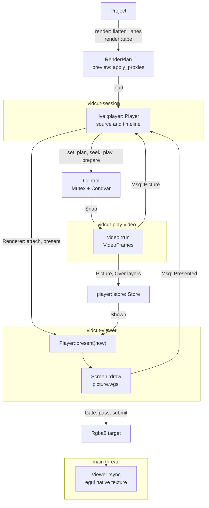
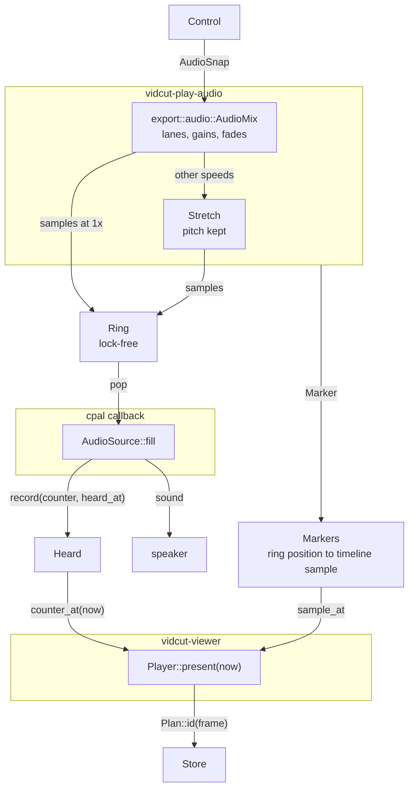

# Playback

Playback turns the timeline or a source clip, from its playhead, into pictures in the viewer and sound. The live core builds a render plan, the engine in `crates/vidcut-av/src/player/` decodes and mixes it with the export's own reader and mixer, and the viewer thread draws it in one shader pass. The audio device is the clock. See also [live](live.md) and [threads](threads.md).

## The plan

`render::flatten_lanes` makes the timeline's `RenderPlan`: video pieces (a `VideoPiece::Mix` during a dissolve), audio lanes, and a `LaneTrack` per lane. The source viewer plays `render::tape`. `preview::apply_proxies` swaps in fresh proxies' video where the project plays proxies (spec D41): proxy frames keep their sources' timestamps, so the same frames are picked, and sound stays on the originals. After each edit or file reload, `Live::project_changed` reloads the source plan and schedules `Live::refresh_timeline_at`, so a burst of edits makes one plan.

## The session's player

`live::player::Player`, on `vidcut-session`, keeps the plan and playhead of `PlayerId::Source` and `PlayerId::Timeline` but runs one engine, for the one shown. The engine keeps the other's frame ready (`Player::prepare`): decoded when idle and held outside the budget, so a switch (`Player::set_plan_at`) shows it at once. `Renderer::attach` hands the engine to the viewer thread. A new engine comes with another sample rate or channel count, which its device opened at, or another audio device or GPU. With no device, it plays to a silent `PacedOutput`.

Each seek, step, load and switch is a numbered motion. `Player::present_due` asks the renderer to present once the engine has its picture or plays, and the `Msg::Presented` answer marks it on screen if the frame asked for was drawn (any frame, while playing).

## The engine

`vidcut_av::player::Player::new` starts `vidcut-play-video` and `vidcut-play-audio`; its audio output adds `vidcut-audio-out`. Methods return at once: each changes `Control`, the wanted state behind a mutex and condvar. The threads read it anew each turn, so a burst of seeks collapses into the last. It holds the plan, the `mode` (`Mode::Paused` at a frame, or `Mode::Playing` from a sample at a speed, negative backward), fader `trims`, the mute, a `scrub` request, a position the caller moves itself (`Player::follow`) and the `prepared` frame. A change cancels decoding it no longer needs. A `looping` range (`Player::set_loop`, spec D51) keeps `Mode::Playing` going past its end: the audio thread reads on from its start and queues the jump's `Marker` before the sound ahead of it, so the ring and the clock run on, and decoding reads ahead across the jump.

`player::plan::Plan` gives each frame an `Id` naming what the picture shows (file, source position, layers over it), not where, so kept pictures survive edits that move them.

**Decoding** reuses the export's reader, `VideoFrames`, with `Output::Decoded`: YUV frames at their own size. Each turn does the first of: the viewer's frame; pictures ahead in the direction of play; playing backward, whole windows from a keyframe; when idle, the prepared frame and a window behind the playhead. Playing, or while its viewer waits, it holds a `first::Claim`, so jobs yield.

**Kept pictures** live in `player::store::Store` under a memory and a video-memory budget (`player.memory_mb`, `player.video_memory_mb`). By default the video budget is half the in-use GPU's dedicated memory (`Gpu::memory_mb`, [gpu](gpu.md)), else 1 GB, and Apple silicon has one shared budget. The least recently used go first, never the prepared one.

**Dissolves** aren't mixed here: a `VideoPiece::Mix` frame is one `Picture` with an `Over` (picture and weight) per layer on top, each as decoded, and the viewer blends them as it draws, each converted to its RGB first. An export mixes them in its own code values ([export](export.md)), so mid-dissolve an HDR export's picture is not the viewer's ([todo](../todo/hdr-dissolve-preview.md)).

## The clock

Each time the device's callback takes sound, `Heard::record` notes the ring position and when it will be heard: the callback's time plus cpal's output latency. Each run the audio thread queues carries a `Marker`: from this ring position, this timeline sample, at this speed, for this play request. `Shared::clock_frame` chains `Heard::counter_at`, `Markers::sample_at` and the plan into the frame heard now. Until a play request's sound is heard, the clock stands at its start; when the ring runs dry, it stops.

`Player::present` returns that frame's kept picture or, until it is decoded, the newest one a seek landed or the last one shown, marked not exact. `Player::next_change` says when the next frame is due.

**Why:** pictures follow the sound as heard, latency included, and a late mix holds the picture rather than drifting.

Without a device, the silent `PacedOutput` pulls the ring in real time, so the clock still runs.

`CpalOutput` plays on the device chosen in Preferences or, without one, on the system's default. When cpal says a stream on the default must be rebuilt or has lost its device (`answer`), `follow` on `vidcut-audio-out` opens one on the new default. It plays silence until `Turns::switch` gives it the turn, and then takes the ring where the old one left off. Only one stream takes sound at a time, and the old one plays out what it holds for a moment after the new one opens, however long that took. With no default yet, as when the default is unplugged, it tries again for a moment. It gives up after a few tries in a row with no sound between them, and a chosen device that is lost fails at once: the viewer says so until a stream plays again.

**Why:** WASAPI doesn't move a stream to a new default ([gotchas](../gotchas.md#operating-systems-and-libraries)). Opening the new stream before the old one stops leaves the clock a gap of only the difference in the two devices' latencies, which `VIDCUT_DEBUG` reports.

## The viewer thread

`Viewer::start` spawns `vidcut-viewer`, which wakes when the session notifies or asks, the size changes, or `next_change` comes due. Each turn calls `Player::present`, then `Screen::draw` into an RGBA target the size of the viewer's picture in physical pixels. One render pass of `crates/vidcut/src/gui/picture.wgsl` fits the picture as the export does, turns it upright, scales in YUV and converts to RGB with the export's math (`shader_colors`), tone-mapping HDR; a dissolve's layers are more draws in it. On the UI thread, `Viewer::sync` shows the target as an egui native texture.

A present answers with the frame drawn, if exact; a `gui.screenshot` of the viewer reads the target back, to the pixel.

Submissions go through `Gate::pass`: they wait until the UI thread runs `logic` or `ui`, outside which eframe configures the window's surface, unless the UI has been away for long.

**Why:** a surface configure fails if another thread submits meanwhile, and presenting a hidden window can block the UI thread (NVIDIA on Wayland). Seeks and captures go on without it.

## GPU pictures

With `gpu.decoding` on, the reader decodes on `hw::GpuDecoder::best` where it can. Pictures of the decoders the viewer shows from GPU memory (`Gpu::gpu_pictures`) stay there, in the video budget; the rest come down. [gpu](gpu.md) has each decoder's path to the screen.

## Sound

`audio::run` reads `export::audio::AudioMix`, the export's mixer: lanes sample-exact, clip gains, cross fades, de-click fades at cuts, and clips at other speeds with their pitch kept (spec D48). Fader gains (`AudioMix::set_lane_db`) and the mute go on top; muted, the clock runs on. Other play speeds go through `Stretch`, which keeps the pitch; backward, blocks are read forward and reversed. The `Ring` holds a short queue, one writer and one reader without locks; a seek, pause or new plan empties it. cpal's callback calls `AudioSource::fill`, which pops it, pads with silence and records `Heard`, never locking or allocating. So while sound plays, or a scrub snippet waits for room, the audio thread polls the ring; with neither, it sleeps until `Control` changes (`Shared::notify`).

A dragged mixer fader sends `mixer.preview`; `Player::preview_fader` makes it a lane gain (`Player::set_lane_gain`), heard at once with no new plan.

[Audio scrubbing](../cut-page-spec.md#45-other-viewer-features) (spec D42): a step, or a requested seek while paused, plays a short faded snippet of the frame's sound, the newest replacing one still waiting. The session's own moves use `Player::seek_quietly`.

## The two-up

For the Trim Editor's and Dynamic Trim's two frames, four while a slip or slide runs, `Cells` gives each its own engine on the clip's media (`render::tape`, no sound), with `ManualOutput` and a quarter of the viewer's budget (`Budget::part`). Every UI frame, `Player::follow` gives each its frame and the trim's speed, and the engine decodes ahead as if playing; `Player::shrink_to` keeps a run's pictures at the cell's size. Windows behind decode on `vidcut-play-windows`, one at a time across followed players, none while any moves forward. `Screens` draws the cells with `Screen` on the UI thread, which needs no gate.

A Dynamic Trim run's sound comes from the viewer's own engine. The UI works out what a run plays (`heard`): a copy of the timeline trimmed so that the clip whose frames change under the playhead goes on past it in the run's direction, from that clip's frame; for a slip the copy holds that clip alone, lengthened past the playhead. `Handle::audition` sends it, and `Player::audition` plays it at the run's speed, a slip's the other way since its media moves under the playhead against the run, with black pictures and no loop, so only its sound is decoded, keeping the timeline's own plan and position. `Player::end_audition` puts them back, the loop too, when the run stops, as do a seek, play or pause; a timeline reload meanwhile only replaces the plan kept.

## Code

- `crates/vidcut-core/src/render.rs`
- `crates/vidcut-core/src/preview.rs`
- `crates/vidcut/src/live/mod.rs`
- `crates/vidcut/src/live/player.rs`
- `crates/vidcut-av/src/player/`
- `crates/vidcut-av/src/stretch.rs`
- `crates/vidcut-av/src/export/video.rs`
- `crates/vidcut-av/src/export/audio.rs`
- `crates/vidcut/src/gui/video.rs`
- `crates/vidcut/src/gui/picture.rs`
- `crates/vidcut/src/gui/picture.wgsl`
- `crates/vidcut/src/gui/gate.rs`
- `crates/vidcut/src/gui/cells.rs`
