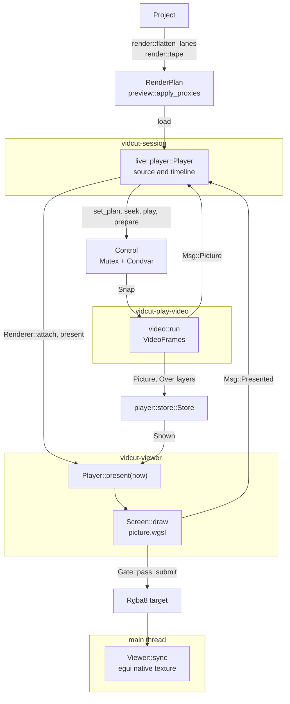
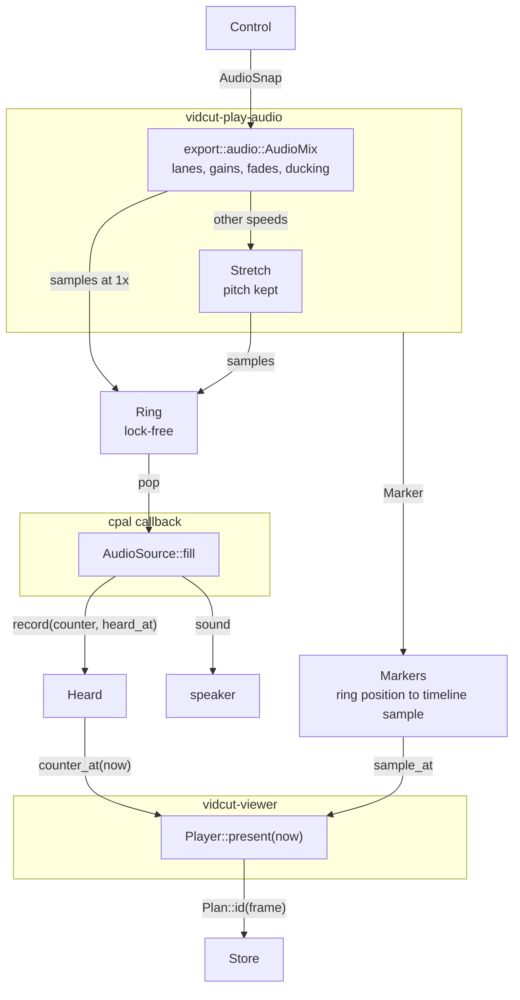

# Playback

- Playback turns the timeline or a source clip, from its playhead, into pictures in the viewer and sound.
- The live core builds a render plan.
- The engine in `crates/vidcut-av/src/player/` decodes and mixes the plan with the export's own reader and mixer.
- The viewer thread draws the plan in one shader pass.
- The audio device is the clock.
- See also [live](live.md) and [threads](threads.md).

## The plan

- `render::flatten_lanes` makes the `RenderPlan` of the timeline:
  - video pieces: a `VideoPiece::Mix` during a dissolve or under a placed picture, and a `VideoPiece::Titled` under a title
  - audio lanes
  - a `LaneTrack` per lane
- The source viewer plays `render::tape`.
- Where the project plays proxies (spec D41), `preview::apply_proxies` puts in the video of fresh proxies.
- Proxy frames keep the timestamps of their sources. Thus the player picks the same frames. The sound stays on the originals.
- After each edit or file reload, `Live::project_changed` reloads the source plan and schedules `Live::refresh_timeline_at`. Thus a burst of edits makes one plan.

## The session's player

- `live::player::Player` runs on `vidcut-session`. It keeps the plan and playhead of `PlayerId::Source` and `PlayerId::Timeline`.
- It runs one engine, for the player that shows.
- The engine keeps the frame of the other player ready (`Player::prepare`). It decodes that frame when idle and holds it outside the budget.
- Thus a switch (`Player::set_plan_at`) shows that frame at once.
- `Renderer::attach` hands the engine to the viewer thread.
- A new engine comes for another sample rate or channel count, because its device opened at these values. A new engine also comes for another audio device or GPU.
- With no device, the engine plays to a silent `PacedOutput`.

Motions:

- Each seek, step, load and switch is a numbered motion.
- `Player::present_due` asks the renderer to present when the engine has its picture, or plays.
- The `Msg::Presented` answer marks the motion as on screen if the frame asked for was drawn. While playing, any frame counts.

## The engine

- `vidcut_av::player::Player::new` starts `vidcut-play-video` and `vidcut-play-audio`. Its audio output adds `vidcut-audio-out`.
- Methods return at once. Each method changes `Control`, the wanted state behind a mutex and condvar.
- The threads read `Control` again at each turn. Thus a burst of seeks collapses into the last seek.
- `Control` holds:
  - the plan
  - the `mode`: `Mode::Paused` at a frame, or `Mode::Playing` from a sample at a speed (negative for backward)
  - the fader `trims` and the mute
  - a `scrub` request
  - a position that the caller moves itself (`Player::follow`)
  - the `prepared` frame
- A change cancels the decoding that it makes unnecessary.
- A `looping` range (`Player::set_loop`, spec D51) keeps `Mode::Playing` going past the end of the range:
  - The audio thread reads on from the start of the range.
  - It queues the `Marker` of the jump before the sound that comes after the jump. Thus the ring and the clock run on.
  - Decoding reads ahead across the jump.
- `player::plan::Plan` gives each frame an `Id`. The `Id` names what the picture shows (file, how its colors are read, source position, layers over it), not where it shows.
- Thus kept pictures survive edits that move them.

**Decoding**

- Decoding uses the export's reader, `VideoFrames`, with `Output::Decoded`: YUV frames at their own size.
- Each turn does the first of these:
  1. the viewer's frame
  2. pictures ahead in the direction of play
  3. when playing backward, whole windows from a keyframe
  4. when idle, the prepared frame and a window behind the playhead
- Each piece of the plan says which frames the player may decode before they are asked for (`player::plan::Fill`).
  - By default, the player fills frames ahead of the playhead and behind it.
  - A piece with an AI upscaler fills no frames behind the playhead. An AI picture takes much GPU time. A frame before the current run starts a new run of the upscaler ([gpu](gpu.md)).
  - Where layers overlap, a fill is allowed only when each layer allows it (`Plan::fill_at`).
  - The viewer's frame, play backward and steps back still decode the frames that they need.
  - The prepared frame is made also with an AI upscaler. Thus the next clip can show its first frame at once.
- While it plays, or while its viewer waits, the decoding thread holds a `first::Claim`. Thus jobs yield.

**Kept pictures**

- Kept pictures live in `player::store::Store` under a memory budget and a video-memory budget (`player.memory_mb`, `player.video_memory_mb`).
- By default, the video budget is half the memory of the GPU that decodes (`Gpu::memory_mb`, [gpu](gpu.md)). It is at least 1 GB (`Budget::gpu_video`).
- Thus the small dedicated share of an integrated GPU does not make the budget small.
- Apple silicon has one shared budget.
- The least recently used pictures go first. The prepared picture never goes.

**Dissolves**

- The engine does not mix dissolves.
- A `VideoPiece::Mix` frame is one `Picture` with an `Over` (picture and weight) on top for each layer. Each layer is as decoded.
- The viewer blends the layers as it draws, in the timeline color space ([spec D50](../cut-page-spec.md#12-decisions-on-gaps-and-contradictions)). An export mixes in the same colors ([export](export.md#timeline-colors)).
- `Shown::colors` carries the timeline color space of the plan (`RenderPlan::colors`) to the viewer.
- A wipe is mixed on the CPU (`Picture::at_wipe`), in the timeline color space too.

**Placed pictures**

- Placed pictures ([spec D75](../cut-page-spec.md#12-decisions-on-gaps-and-contradictions)) are layers of a `VideoPiece::Mix`, as the layers of a dissolve are.
- Their placement is not in the kept pictures.
- `Player::present` hands the `Placed` pictures of each layer with the frame, in `Shown` (`Plan::placed_at`). Thus a move or zoom of a placed picture keeps the frames decoded.
- For a Dynamic Zoom, `Plan::placed_at` moves the `Run` of each `Placed` picture to the frame. Thus the box of that frame places the picture.
- `Shown::crosses` marks the side of a dissolve that mixes with the side before it (`Over::cross`).
- `Shown::scales` gives the Super Scale of each layer (`Plan::scales_at`).
  - With `viewer.super_scale` on, the shader enlarges such a layer with a sharper kernel (`sharp`). Its Sharpness selects the kernel.
  - It does this only where the viewer enlarges the picture.
- With AI Fast or AI Best, `VideoFrames` runs `Source::ai_picture` for the viewer too, as an export does. The viewer then gets the large upright picture of the AI upscaler.
  - With AI Fast, a seek must decode the whole chunk of 15 frames first. The AI upscaler then makes the asked frame first. The rest of the chunk follows.
  - While playing, the player skips the frames it cannot make in time. The frames that it made stay in its kept pictures, as other frames do. A replay computes again the frames that it skipped, and the frames that left its kept pictures.
  - With AI Best, a seek starts a new stream at the asked frame. Its first picture comes after the stream's first chunk of 17 frames.
  - Whether the picture is enlarged depends on its placement and on the timeline size, as in an export.
  - Thus the key of its kept frames holds its Super Scale, its placement and the timeline size (`source_key`).
- With `viewer.super_scale` off, the live core plans the viewer without Super Scale (`preview_plan`).
- While pictures are dragged, `Player::preview_pictures` at once puts each dragged picture in place of the picture of its clip.
- The live core then plans the timeline again with the dragged pictures (`Msg::PreviewPictures`), `RELOAD_EVERY` apart at most.
- This is necessary because a picture that stops filling the frame needs the tracks below it decoded.

**Titles**

- Titles are not in the kept pictures. Thus an edit of a title keeps the frames decoded.
- `player::titles` draws each title of the plan at the size of the plan. It uses `burn::title`, the export's drawing, on the decoding thread.
- It draws the titles at these times, and then wakes the viewer:
  - before it keeps a frame that the title shows over
  - for the prepared frame
  - for the frame at the playhead, when the titles of that frame are not drawn yet
- It keeps the drawings used last (an `Lru`).
- Each drawing is where its kind puts it, without its own place, opacity or rotation. Thus a moved or turned title is not drawn again.
- `Player::preview_title` shows the title of one clip (`ShownTitle::clip`) in place of the plan's title, without a new plan. The decoding thread draws it next.
- `Player::present` hands the titles of a frame with the frame, in `Shown`. Each title is a `TitleOver`. It holds:
  - the picture, in premultiplied RGBA
  - how many layers go under it
  - how it is moved, scaled and turned from how it was drawn: its place, zoom and rotation, or the `Run::top` of a scroll. The viewer's shader does the transform.
  - the level at which a fade or its opacity draws it (in the shader's `Lettering`)
  - the pictures of the compound clips that it plays inside (`ShownTitle::placed`). A picture that `Player::preview_pictures` drags takes the place of its own.
- Until a title is drawn, the newest drawing of its clip shows, moved to its place. Thus a drag, a new color or new text does not blink.
- The frame is not exact until the title is drawn.

**Subtitles**

- Subtitles come the same way, without a plan.
- `Player::set_subtitles` takes the shown track (`SubtitleView`). The `color` of each cue is already set: its own color, or the color of its person (`Speakers::color_of`).
- `player::subtitles` draws what shows at a frame with `burn::draw`, on the decoding thread, at the times when titles are drawn.
- It keeps the drawings used last (an `Lru`), by what they show: the pieces of each cue at that frame (`subtitles::shown`).
- Thus a track whose words show as they are spoken is drawn again at each word, and at each step of a pop.
- A cue edit decodes nothing again.
- `Player::present` hands the subtitles with the titles, above every layer.
- A subtitle that is not drawn yet shows the newest drawing.

## The clock

- Each time the callback of the device takes sound, `Heard::record` notes the ring position and when that sound will be heard. That time is the time of the callback plus the output latency of cpal.
- Each run that the audio thread queues carries a `Marker`: from this ring position, this timeline sample, at this speed, for this play request.
- `Shared::clock_frame` chains `Heard::counter_at`, `Markers::sample_at` and the plan into the frame that is heard at this moment.
- Until the sound of a play request is heard, the clock stands at its start.
- When the ring runs dry, the clock stops.
- `Player::present` returns the kept picture of that frame.
- Until that picture is decoded, `Player::present` returns the newest picture that a seek landed on, or the last picture shown. It marks this picture as not exact.
- `Player::next_change` says when the next frame is due.

**Why:** pictures follow the sound as it is heard, latency included. A late mix holds the picture, and the picture does not drift.

- Without a device, the silent `PacedOutput` pulls the ring in real time. Thus the clock still runs.

The audio device:

- `CpalOutput` plays on the device chosen in Preferences. Without a chosen device, it plays on the default device of the system.
- cpal can say that a stream on the default must be rebuilt, or that it has lost its device (`answer`). Then `follow` on `vidcut-audio-out` opens a stream on the new default.
- The new stream plays silence until `Turns::switch` gives it the turn. Then it takes the ring where the old stream left off.
- Only one stream takes sound at a time.
- After the new stream opens, the old stream plays out what it holds for a moment, however long the open took.
- When there is no default yet, as when the default is unplugged, it tries again for a moment.
- It gives up after a few tries in a row with no sound between them.
- A chosen device that is lost fails at once.
- After a failure, the viewer says so until a stream plays again.

**Why:**

- WASAPI does not move a stream to a new default ([gotchas](../gotchas.md#operating-systems-and-libraries)).
- The new stream opens before the old one stops. Thus the gap in the clock is only the difference between the latencies of the two devices.
- `VIDCUT_DEBUG` reports this gap.

## The viewer thread

- `Viewer::start` spawns `vidcut-viewer`.
- The thread wakes when the session notifies or asks, when the size changes, or when `next_change` comes due.
- Each turn calls `Player::present`, then `Screen::draw` into an RGBA target. The target has the size of the viewer's picture in physical pixels.
- With an SDR timeline, one render pass of `crates/vidcut/src/gui/picture.wgsl` does all the drawing into the target.
- With an HDR timeline, the passes draw into a picture of 16-bit floats (`Wide`) in the PQ or HLG code values of the timeline:
  - Each layer is converted to linear light, then to BT.2020 colors, then to the PQ or HLG curve of the timeline. Titles and subtitles are converted the same way from sRGB.
  - Then one more draw (`fs_screen`) converts that picture to the target: to BT.709, tone-mapped with the export's math.
  - Thus the layers, titles and subtitles mix in the timeline's code values, as in an export.
- The drawing:
  - It fits the picture as the export does, and turns it upright.
  - It scales in YUV and converts to RGB with the export's math (`shader_colors`). In an SDR timeline, it tone-maps HDR.
  - The layers of a dissolve are more draws in the pass.
  - The draw of a placed layer maps each pixel back through its `place::Placing` levels to the decoded picture. It taps the picture as finely as it is shrunk.
  - The draw of a placed layer also covers its edges in part, and lays the layer over the layers below, premultiplied.
  - The two sides of a dissolve with a placed picture are added into a picture of their own (`Mixing`). That picture is then laid over the frame.
  - Each title is one more draw after the layers under it (`fs_title`).
  - Its `Lettering` holds one affine map from each pixel back to the drawing (`place::lettered`). The map also goes through the pictures of its compound clips (`Placing::inner`).
  - `Lettering` also holds the `place::Placing` levels of these compound clips. They cover the edges of each compound clip in part, as for a placed layer.
  - The draw taps the title as finely as it is shrunk. Outside the drawing, a tap is clear.
  - For a title in a placed compound clip, these are the sums of the export (`export::place::title`).
- On the UI thread, `Viewer::sync` shows the target as an egui native texture.
- A present answers with the frame drawn, if it is exact.
- A `gui.screenshot` of the viewer reads the target back, to the pixel.
- Submissions go through `Gate::pass`. They wait until the UI thread runs `logic` or `ui`, because eframe configures the window's surface outside these.
- If the UI has been away for long, submissions do not wait.

**Why:**

- A surface configure fails if another thread submits at the same time.
- A present to a hidden window can block the UI thread (NVIDIA on Wayland).
- When the UI thread is away, seeks and captures go on without it.

## GPU pictures

- With `gpu.decoding` on, the reader decodes on `hw::GpuDecoder::best` where it can.
- The viewer shows the pictures of some decoders from GPU memory (`Gpu::gpu_pictures`). These pictures stay there, in the video budget.
- The pictures of the other decoders come down.
- [gpu](gpu.md) has the path of each decoder to the screen.

## Sound

- `audio::run` reads `export::audio::AudioMix`, the export's mixer. It gives:
  - lanes, sample-exact
  - clip gains and cross fades
  - de-click fades at cuts
  - clips at other speeds, with their pitch kept (spec D48)
- Fader gains (`AudioMix::set_lane_db`) and the mute go on top. When the sound is muted, the clock runs on.
- The ducking of the plan (`Dip`) goes on each lane as in an export ([export](export.md#sound)). A new plan brings its own (`AudioMix::replan`).

Ducking in the preview:

- `Live::hear_ducking` hears the sources of the timeline's plan before the player gets it.
- It takes only the measurements that this process keeps (`env::kept_measure`). Thus the session thread reads no file.
- It measures the rest on `vidcut-measure`, as a job. Until then, those clips dip nothing.
- `Msg::DuckHeard` then loads the timeline again. A measurement that failed shows as a notice, and is not tried again until the next `track.set` with `duck`.
- Other play speeds go through `Stretch`, which keeps the pitch.
- To play backward, `audio::run` reads blocks forward and reverses them.
- The `Ring` holds a short queue, with one writer and one reader, and no locks. A seek, pause or new plan empties it.
- The callback of cpal calls `AudioSource::fill`. It pops the ring, pads with silence and records `Heard`. It never locks or allocates.
- Thus, while sound plays or a scrub snippet waits for room, the audio thread polls the ring.
- When neither occurs, the audio thread sleeps until `Control` changes (`Shared::notify`).

Faders:

- A dragged mixer fader sends `mixer.preview`.
- `Player::preview_fader` makes the fader value a lane gain (`Player::set_lane_gain`). The user hears it at once, with no new plan.

[Audio scrubbing](../cut-page-spec.md#45-other-viewer-features) (spec D42):

- A step, or a requested seek while paused, plays a short faded snippet of the sound of the frame.
- The newest snippet replaces a snippet that still waits.
- The moves that the session makes itself use `Player::seek_quietly`.

## The two-up

- The Trim Editor and Dynamic Trim show two frames, or four while a slip or slide runs.
- `Cells` gives each frame its own engine on the media of the clip (`render::tape`, no sound). Each engine has `ManualOutput` and a quarter of the viewer's budget (`Budget::part`).
- In every UI frame, `Player::follow` gives each engine its frame and the speed of the trim. The engine decodes ahead as if it plays.
- `Player::shrink_to` keeps the pictures of a run at the size of the cell.
- The windows behind decode on `vidcut-play-windows`: one at a time across the followed players, and none while any player moves forward.
- `Screens` draws the cells with `Screen` on the UI thread. This needs no gate.

The sound of a Dynamic Trim run:

- The sound of a Dynamic Trim run comes from the viewer's own engine.
- The UI works out what a run plays (`heard`). It is a trimmed copy of the timeline.
- In the copy, the clip whose frames change under the playhead goes on past the playhead, in the direction of the run.
- The copy plays from the frame of that clip.
- For a slip, the copy holds that clip alone, made longer past the playhead.
- `Handle::audition` sends the copy. `Player::audition` plays it at the speed of the run, with black pictures and no loop. Thus only its sound is decoded.
- A slip plays the other way, because its media moves under the playhead against the run.
- The audition keeps the timeline's own plan and position.
- When the run stops, `Player::end_audition` puts the plan and position back, the loop too. A seek, play or pause also does this.
- A timeline reload during the audition only replaces the kept plan.

Ripple Delete Silence:

- While Ripple Delete Silence is open, the stripes that it still cuts reach the session (`Handle::skip`).
- Then a play of the timeline is an audition too, with its pictures.
- `Live::play_skipping` cuts the parts from a copy of the timeline (`ops::remove_parts`). It plays the copy at the speed asked, from the place of the playhead in it (`skipped_to`).
- A change of the stripes during play starts the play again from there (`Live::set_skipping`).
- `ops::removed_time` gives the stretches of the timeline that the cuts take out.
- During play, `Player::position` maps the position of the engine back past these stretches (`unskipped`).
- Thus the timeline's playhead jumps what Remove closes up, and stays where the audition ends.
- A stripe on another track under the picture of Track 1 leaves a gap there, as Remove does. The playhead runs through the gap.

## Code

- `crates/vidcut-core/src/render.rs`
- `crates/vidcut-core/src/duck.rs`
- `crates/vidcut-core/src/preview.rs`
- `crates/vidcut/src/live/mod.rs`
- `crates/vidcut/src/live/player.rs`
- `crates/vidcut-av/src/player/`
- `crates/vidcut-av/src/stretch.rs`
- `crates/vidcut-av/src/export/video.rs`
- `crates/vidcut-av/src/export/audio.rs`
- `crates/vidcut/src/gui/video.rs`
- `crates/vidcut/src/gui/picture.rs`
- `crates/vidcut/src/gui/picture.wgsl`
- `crates/vidcut/src/gui/gate.rs`
- `crates/vidcut/src/gui/cells.rs`
