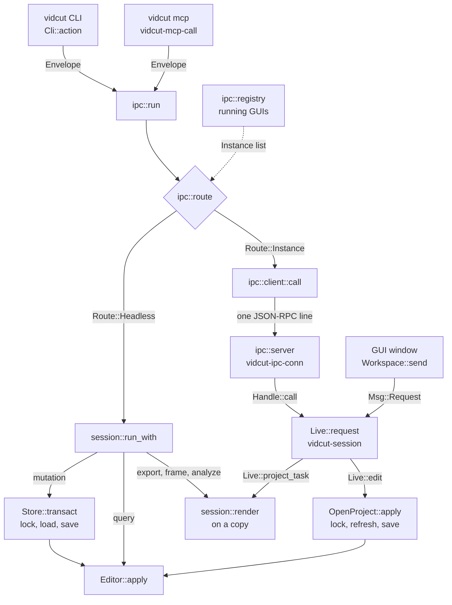
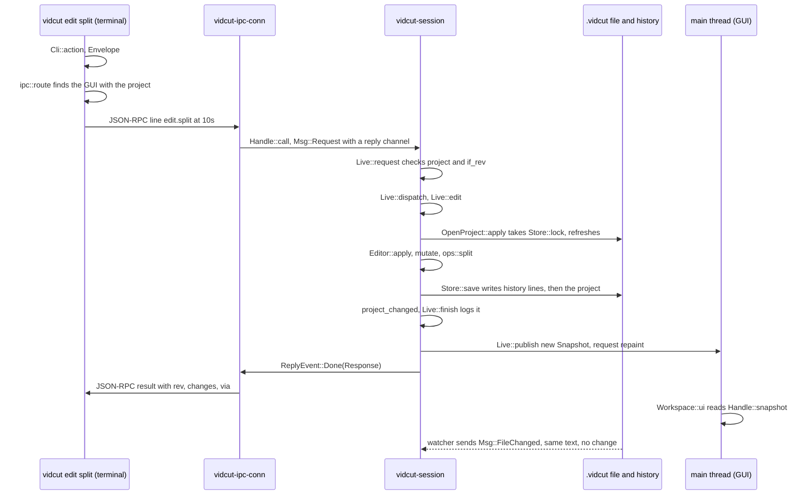

# Requests

Every action, from a key press in the GUI to an agent's tool call, is one `Request`. This page follows a request from its front door to `Editor::apply` and back. The vocabulary and the editor are in vidcut-core; the GUI's side is in [live](live.md).

## One vocabulary

`Request` has one variant per method, serialized as `method` and `params`. Its JSON schema (`session::schema`) generates the CLI commands (`cli::command`) and the MCP tools (`mcp::tools`), so every door names things alike.

An `Envelope` adds the two options every request takes: `if_rev` (fail with `ErrorCode::Conflict` unless the project is at that revision) and `dry_run`. `Envelope::from_json` takes them off the request object first, and out of `params` only when they are not there. Every answer is a `Response`: the revision after it, the ids created, modified and deleted (`Changes`), the result, `dry_run`, `warnings`, and where it ran (`via`).

Three questions drive the routing:

| Question | True for |
|---|---|
| `Request::is_projectless` | needs no project: `schema`, `doctor`, `reset`, `probe`, `project.create`, presets, encoders, decoders, preferences, keys |
| `Request::is_live` | needs a running GUI: `project.open`, the viewer, player, mixer preview, pool view, selection, `gui.*` and `jobs.*` |
| `Request::is_mutation` | anything that is not live and not a read, render, export, analysis, preset, preference, `project.create`, `probe` or `edit.copy`. The match in `Request::is_mutation` is the list. Undo and redo count, and call `step_history` |

## Front doors

| Door | Entry | Hands the envelope to |
|---|---|---|
| CLI | `Cli::action` gives `Action::Run` | `ipc::run` |
| MCP | `mcp::serve` reads JSON-RPC on stdin; each tool call gets a `vidcut-mcp-call` thread | `ipc::run` |
| IPC | `ipc::server::start` in the GUI: `vidcut-ipc` accepts, one `vidcut-ipc-conn` thread per connection | `Handle::call` |
| GUI | `Workspace::send` | `Handle::request`; no reply, errors become notices |

The CLI and MCP make paths absolute first (`Request::paths_mut`), since the GUI runs in its own directory.

## Routing

`ipc::run` asks `ipc::route` where the request runs:

1. Projectless requests, and the `headless` option, run here.
2. The `instance` option (a pid or a socket, also `VIDCUT_SOCKET`) picks a GUI.
3. With a project, the GUI that has it open, else here; a live request then fails with NO_INSTANCE (`ErrorCode::NoInstance`).
4. Without one, the only GUI with a project open (any GUI, for a live request). None: here, or NO_INSTANCE for a live request. Several: a usage error.

The registry (`ipc::registry`) is a folder in the user's runtime dir: each GUI writes an `Instance` entry (pid, socket, open project) and listens on that socket; `registry::list` removes dead ones. `ipc::client::call` sends one JSON-RPC line and reads progress notifications until the answer; closing the connection cancels the call.

## Headless

`session::run_with` refuses live requests, answers projectless ones itself, and otherwise opens the project's `Store`. A mutation runs in `Store::transact`: take the lock (`Store::lock`), load the project and its history, `Editor::apply`, save if the revision moved. A query needs no lock. `proxy.generate` encodes on a copy first, outside the lock (spec D41), and `subtitles.transcribe` transcribes on one (`work_first`); inside the lock their edit finds the work done.

## Live

`Handle::call` and `Handle::request` put a `Msg::Request` on the `vidcut-session` thread's channel. `Live::request` checks the expected project and `if_rev`; `Live::dispatch` answers now or schedules the work. Edits go through `Live::edit` to `OpenProject::apply`, which takes the headless runs' lock, re-reads the file if it changed, applies and saves before answering. The new `Snapshot` is published before the replies go: once a client hears back, the GUI's state shows the change.

## Requests that only read

`export.start`, `export.plan`, `frame.render`, `storyboard.render` and the `analyze` methods leave the editor path. Headless, `session::run_with` loads the project, checks `if_rev` and calls `session::render`; a GUI calls it from `Live::project_task` on a worker thread, with a copy of the project. `session::render` hands exports to `session::export_media` ([export](export.md)) and runs the `analyze` methods as queries on a throwaway `Editor` ([analysis](analysis.md)). A GUI's media export is a job (`Live::start_export`). None takes the lock.

## The editor

`Editor::apply` checks `if_rev`, then:

- A query goes to `query`.
- `history.undo` and `history.redo` call `step_history`.
- A mutation runs `mutate` on a clone of the project: it resolves times and clip references and calls the edit operations in `ops` (`ops::split` for `edit.split`). Carried transitions that no longer fit go (`otio::transitions::prune`); `validate::violations` checks the result, and a violation fails the edit as a vidcut bug.
- A dry run stops here and reports the `Changes`.
- An edit that changes nothing makes no revision and no undo step.
- Otherwise the clone becomes the project, `rev` goes up by one, and the history gets an `Entry`: a label (`describe`) and the `Change`.

`apply` runs a list of requests in order on one clone: one revision, one undo step, and any error fails them all. Undo, redo and `apply` can't be in the list.

## Undo history

A `Change` is a tree of what differs: replaced values (`Set`), object fields (`Fields`) and lists of things with ids (`Items`), so a step costs what it changed. Undo applies it backward and still makes a new revision: revisions only grow.

The history is a `.jsonl` file in the state dir's `history` folder, named by a digest of the project's path (`HistoryFile`). Each save appends lines ending with a hash of the project text it wrote. On load (`Store::load_text`), a project file that doesn't match that hash was changed by something else: `Editor::record_external` makes the difference from the last saved state one undoable step by `file`. A history file that is there but can't be read (`HistoryFile::read_tail` fails after a few tries, or its last saved project can't be rebuilt) is never written over: the editor keeps the session's steps in memory, says why (`Editor::history_trouble`: a GUI notice, `history.get`'s warnings), and appends them once the file reads again where it left off (`Store::save`, `Store::recover`). A GUI notices such writes through its file watcher (`Msg::FileChanged`, `OpenProject::reload`). Behavior: [spec §8.10](../cut-page-spec.md#810-undo-pp-651652), [deviation X4](../deviations.md#x4-undo-history-persists-across-sessions-and-cli-runs).

Each `Entry` keeps a `Step` beside its `Change`: the label (`describe`), who made it (the request's `Client`), when, when its GUI opened the project (`Editor::opened_at`), the clips and frames it changed (`steps::places`, from the project before and after) and an `apply`'s commands. Lines written before steps had these load with them empty. The CLI and `mcp` put the `Client` on the `Envelope` (the `client` key of a JSON-RPC request); a GUI gives its own and its IPC callers' in `Live::request`.

`Editor::history_steps` reads the steps without their changes (`HistoryFile::steps_now`, through one handle). A `StepsCache` keeps what it read, so a GUI reads only what a save appended, and the whole file again after a compaction. `history.get` lists them with the runs one client made in a row (`steps::listing`, `steps::groups`); `history.go` undoes or redoes to a step as one revision.

The history is a tree. Each saved step gets an id (`Tail` keeps the next; a save that finds none, written by an older vidcut, takes the next after the largest id in the file), and a step placed where steps could still be redone moves them into a `Branch` hanging after its place (`Tree::place_at`), so the reader of the file rebuilds the versions it already holds. `history.restore` undoes or redoes to where a version branched and writes its steps again under their own ids, stamped with the time of the restore: the reader sees a version's first id come back and takes the version out, and the steps it replaces become a version replaced then. A version inside another comes back with the ones holding it, outermost first, in the same revision (`Editor::chain`, `editor::climb`), and hovering a version's step draws the project as it was then (`PreviewAt`, `Past::version_at`). A compaction (`HistoryFile::compact`) leaves the steps and versions together at 90% of the limit, so the next steps don't compact again: the versions get up to a tenth of it, named ones first, then the newest, and those that hang before the oldest step kept go. It gives no step an id and carries the next one over, and it drops the names of the steps it drops, and the name of the start once the start moves. A name is a `Mark` line on a step's id (`history.mark`), saved without a new revision (`Editor::unsaved`); the GUI watches the history file, so a name given elsewhere shows at once. `history.revert` applies one step's change backward as a new step; `Change::touched` and `change::overlap` find a later step that changed the same thing, which refuses it. A run of items moved together touches its whole list, and a reorder moves only the items it listed, so items added since keep their places. When the change no longer fits, the revert names the later step after which it stops fitting. `steps::since` compares two projects for "since this step": clips, dissolves, cross fades, markers, media, tracks, bins, In and Out marks and settings; for a step still to redo it counts what redoing to it brings (`steps::since_step`), and for a version's step what going there brings (`steps::since_version`, `history.get` with `branch`), in the panel and in `history.get` alike. The kind and who filters offer what any step has, the versions' too (`steps::every_step`).

The History panel (`HistoryUi`, docked beside the Media Pool, its width kept in the config folder) previews a step without changing the project. `Handle::history_preview` asks the live core; `Live::preview_step` hands the step to the `vidcut-preview` thread, which makes the project as it was (`Store::project_at`) for the newest step asked only, so a long history never holds up the live core. A `Past` keeps the states it made for the current revision, the newest few dozen, and makes each new one from the nearest it holds (`Editor::project_between`, reading only the steps between), so moving one row costs one step however long the history is. The result is published in the snapshot (`HistoryPreview`), which the timeline draws in place of the project, its tracks and length too, outlining what the step changed; the panel's rows are laid out once per history and kept (`HistoryUi`). The keyboard cursor's preview lasts while the panel has the keys, and a press on the timeline while a past state is drawn only ends it (`Workspace::history_swallows`), up to its release. An undo, redo or `history.go` from the GUI publishes a `Flash` of what it moved through. Behavior: [deviations X33–X38](../deviations.md#x33-each-undo-step-says-what-where-and-how-much).

**Why** the lock, the revision and the reload: the CLI, agents and the GUI edit one file at once ([deviation X1](../deviations.md#x1-projects-are-always-saved-standalone-json-files)). The lock orders the writers, the file always holds the latest project, and `if_rev` refuses an edit to a project that changed since the client read it.

## Code

- `crates/vidcut-core/src/request.rs`
- `crates/vidcut-core/src/editor.rs`
- `crates/vidcut-core/src/store.rs`
- `crates/vidcut-core/src/history.rs`
- `crates/vidcut-core/src/steps.rs`
- `crates/vidcut-core/src/describe.rs`
- `crates/vidcut-core/src/change.rs`
- `crates/vidcut-core/src/ops.rs`
- `crates/vidcut/src/main.rs`
- `crates/vidcut/src/cli.rs`
- `crates/vidcut/src/mcp.rs`
- `crates/vidcut/src/ipc/`
- `crates/vidcut/src/session.rs`
- `crates/vidcut/src/live/mod.rs`
- `crates/vidcut/src/live/project.rs`
- `crates/vidcut/src/gui/workspace.rs`
- `crates/vidcut/src/gui/history.rs`
