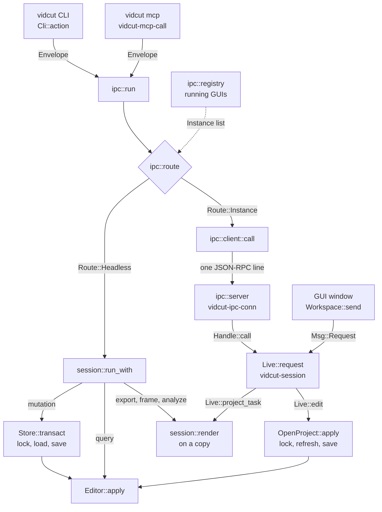
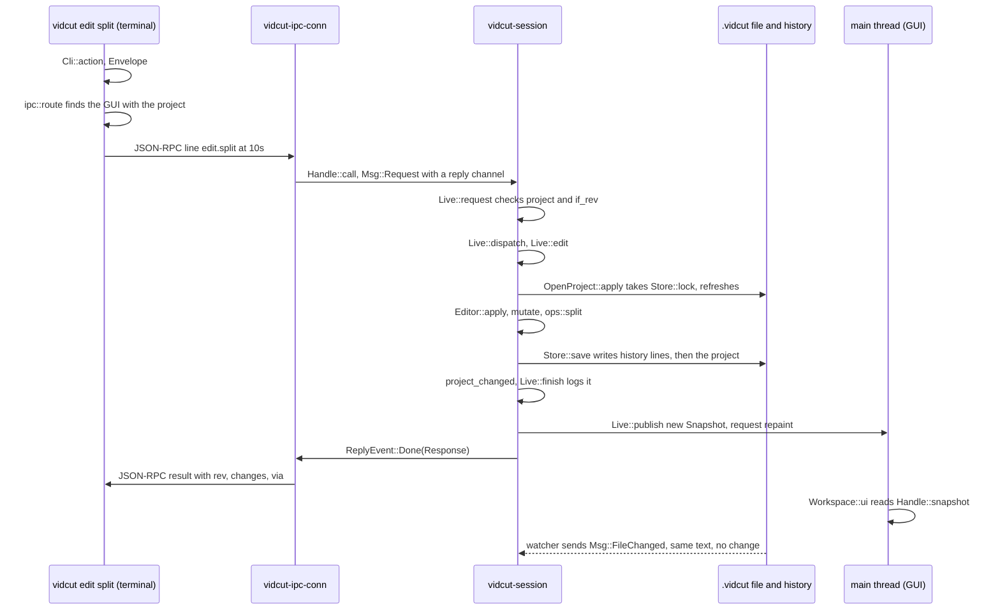

# Requests

Every action is one `Request`.
A key press in the GUI is one `Request`.
A tool call from an agent is one `Request`.
This page follows a request from a front door to `Editor::apply`.
It also follows the answer back.
The vocabulary and the editor are in vidcut-core.
The GUI side is in [live](live.md).

## One vocabulary

`Request` has one variant for each method.
The JSON form has `method` and `params`.
`session::schema` builds the JSON schema.
`cli::command` builds the CLI commands from that schema.
`mcp::tools` builds the MCP tools from that schema.
Every door uses the same names.

An `Envelope` adds two options.
Every request accepts both options.
`if_rev` fails with `CONFLICT` when the project is not at that revision.
`dry_run` reports the result and does not commit it.
`Envelope::from_json` removes `if_rev` and `dry_run` from the JSON object.
When a key is absent on that object, `from_json` removes it from `params`.

Every answer is a `Response`.
`rev` is the revision after the request.
`changes` holds the ids that the request created, modified, and deleted (`Changes`).
`result` is the method result.
`dry_run` is true for a dry run.
`via` says where the request ran.
`warnings` lists problems that did not fail the request.

Three questions drive the routing.

| Method | When it returns true |
|---|---|
| `Request::is_projectless` | The request needs no project. The methods are `schema`, `doctor`, `probe`, `project.create`, `presets.list`, `presets.get`, `presets.save`, `presets.delete`, `encoders.list`, `decoders.list`, `preferences.get`, `preferences.set`, and `keys.list`. |
| `Request::is_live` | The request needs a running GUI. The methods are `project.open`, the viewer methods, the player methods, `mixer.preview`, the pool methods, the selection methods, the `gui` methods, and the `jobs` methods. |
| `Request::is_mutation` | The request is not live, and it is not in the false list below. `Editor::apply` then calls `mutate`, or `step_history` for `history.undo` and `history.redo`. |

`Request::is_mutation` is false for these methods:

- `project.get`, `project.summary`, and `project.create`
- `track.list`, `bins.list`, `marks.get`, and `markers.list`
- `media.list`, `media.get`, and `probe`
- `timeline.get`, `timeline.at`, `timeline.edit_points`, and `timeline.boring`
- `analyze.silence`, `analyze.scenes`, `analyze.black`, and `analyze.loudness`
- `storyboard.render`, `history.get`, `schema`, and `doctor`
- `export.plan`, `export.start`, and `frame.render`
- `presets.list`, `presets.get`, `presets.save`, and `presets.delete`
- `encoders.list`, `decoders.list`, `preferences.get`, `preferences.set`, and `keys.list`
- `edit.copy`

A true result does not always add an undo step.
An edit that changes nothing adds no revision and no undo step.
`history.undo` and `history.redo` are mutations.
They move the history.
They do not call `mutate`.

The headless path calls `Store::transact` for a mutation.
`OpenProject::apply` takes `Store::lock` for a mutation.

## Front doors

| Door | Entry | Next call |
|---|---|---|
| CLI | `Cli::action` returns `Action::Run`. | `ipc::run` |
| MCP | `mcp::serve` reads JSON-RPC on stdin. Each tool call gets a `vidcut-mcp-call` thread. | `ipc::run` |
| IPC | `ipc::server::start` runs in the GUI. `vidcut-ipc` accepts a connection. One `vidcut-ipc-conn` thread serves that connection. | `Handle::call` |
| GUI | `Workspace::send` | `Handle::request`. There is no reply. An error becomes a notice. |

The CLI and MCP make paths absolute first (`Request::paths_mut`).
The GUI runs in its own directory.

## Routing

`ipc::run` calls `ipc::route`.
`ipc::route` chooses where the request runs.
Do these checks in order:

1. If `Request::is_projectless` is true, return `Route::Headless`.
2. If the `headless` option is set, return `Route::Headless`.
3. If the `instance` option is set, choose that GUI.
   The value is a pid or a socket path.
   `VIDCUT_SOCKET` supplies the same value.
4. If the command names a project and a GUI has it open, choose that GUI.
   If no GUI has it open and the request is live, fail with `ErrorCode::NoInstance`.
   If no GUI has it open, return `Route::Headless`.
5. If the command names no project, collect the open GUIs.
   A live request uses every GUI.
   Another request uses a GUI that has a project open.
   If one GUI matches, choose it.
   If none matches and the request is live, fail with `ErrorCode::NoInstance`.
   If none matches, return `Route::Headless`.
   If several GUIs match, return a usage error.

The registry is `ipc::registry`.
It is a folder in the user runtime directory.
Each GUI writes an `Instance` entry.
The entry has the pid, the socket, and the open project.
The GUI listens on that socket.
`registry::list` removes a dead entry.
`ipc::client::call` sends one JSON-RPC line.
It reads progress notifications until the answer.
Closing the connection cancels the call.

## Headless

`session::run_with` refuses a live request.
It answers a projectless request itself.
For any other request, it opens the `Store` of the project.
A mutation runs in `Store::transact`.
`Store::transact` takes the lock (`Store::lock`), loads the project and its history, calls `Editor::apply`, and saves when the revision moved.
A query does not take the lock.
`proxy.generate` encodes on a copy first, outside the lock (spec D41).

## Live

`Handle::call` and `Handle::request` send `Msg::Request` to the `vidcut-session` thread.
`Live::request` checks the expected project and `if_rev`.
`Live::dispatch` answers now, or it schedules the work.
An edit goes through `Live::edit` to `OpenProject::apply`.
`OpenProject::apply` takes the same lock as a headless run.
It reads the file again when the file changed.
It applies the edit and saves before the answer.
The new `Snapshot` is published before the replies go out.
After a client receives the answer, the GUI state shows the change.

## Requests that only read

These requests leave the editor path:

- `export.start`
- `export.plan`
- `frame.render`
- `storyboard.render`
- the `analyze` methods

In a headless run, `session::run_with` loads the project, checks `if_rev`, and calls `session::render`.
In a GUI, `Live::project_task` calls `session::render` on a worker thread.
The worker has a copy of the project.
`session::render` gives an export to `session::export_media` ([export](export.md)).
It runs an `analyze` method as a query on a throwaway `Editor` ([analysis](analysis.md)).
A media export in a GUI is a job (`Live::start_export`).
None of these requests takes the lock.

## The editor

`Editor::apply` checks `if_rev`.
Then it does one of these steps:

- A query goes to `query`.
- `history.undo` and `history.redo` call `step_history`.
- A mutation calls `mutate` on a clone of the project.
  `mutate` resolves times and clip references.
  It calls the edit operation in `ops`.
  `edit.split` calls `ops::split`.
  `otio::transitions::prune` removes a carried transition that no longer fits.
  `validate::violations` checks the result.
  A violation fails the edit as a vidcut bug.
- A dry run stops here.
  It reports the `Changes`.
- An edit that changes nothing makes no revision.
  It makes no undo step.
- Otherwise the clone becomes the project.
  `rev` increases by one.
  The history gets an `Entry`.
  The entry has a label from `describe` and the `Change`.

`apply` can run a list of requests.
It runs them in order on one clone.
The list makes one revision and one undo step.
Any error fails the whole list.
`history.undo`, `history.redo`, and `apply` cannot be in the list.

## Undo history

A `Change` is a tree of differences.
`Set` replaces a value.
`Fields` replaces object fields.
`Items` is a list of things with ids.
A step stores only what changed.
Undo applies the `Change` backward.
Undo still makes a new revision.
Revisions only grow.

The history is a `.jsonl` file.
It lives in the `history` folder of the state directory.
`HistoryFile` names the file from a digest of the project path.
Each save appends lines.
The last line ends with a hash of the project text that the save wrote.
On load, `Store::load_text` compares the project file with that hash.
A file that does not match was changed by something else.
`Editor::record_external` makes that difference one undo step.
The step label is `external change`.
A GUI sees such a write through its file watcher.
The watcher sends `Msg::FileChanged`.
`OpenProject::reload` reads the file.
Behavior: [spec §8.10](../cut-page-spec.md#810-undo-pp-651652), [deviation X4](../deviations.md#x4-undo-history-persists-across-sessions-and-cli-runs).

The CLI, agents, and the GUI edit one file at a time ([deviation X1](../deviations.md#x1-projects-are-always-saved-standalone-json-files)).
The lock orders the writers.
The file holds the latest project.
`if_rev` refuses an edit when the project changed after the client read it.

## Code

- `crates/vidcut-core/src/request.rs`
- `crates/vidcut-core/src/editor.rs`
- `crates/vidcut-core/src/store.rs`
- `crates/vidcut-core/src/history.rs`
- `crates/vidcut-core/src/change.rs`
- `crates/vidcut-core/src/ops.rs`
- `crates/vidcut/src/main.rs`
- `crates/vidcut/src/cli.rs`
- `crates/vidcut/src/mcp.rs`
- `crates/vidcut/src/ipc/`
- `crates/vidcut/src/session.rs`
- `crates/vidcut/src/live/mod.rs`
- `crates/vidcut/src/live/project.rs`
- `crates/vidcut/src/gui/workspace.rs`
