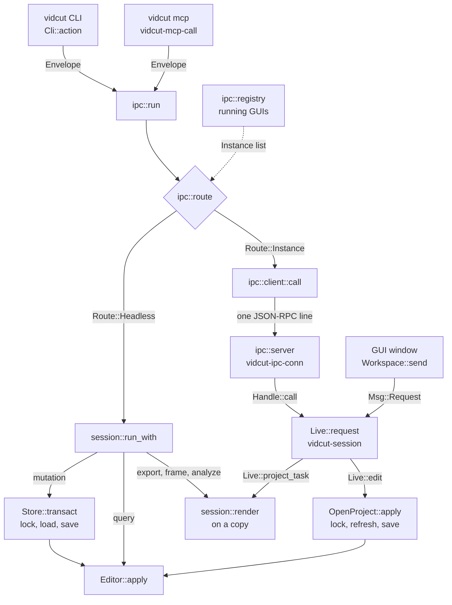
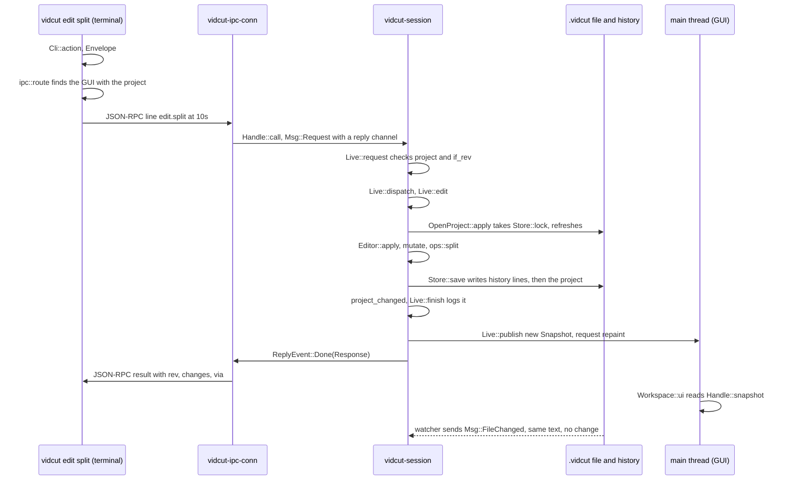

# Requests

- Each action is one `Request`, from a key press in the GUI to the tool call of an agent.
- This page follows a request from its front door to `Editor::apply` and back.
- The vocabulary and the editor are in vidcut-core. [live](live.md) has the side of the GUI.

## One vocabulary

- `Request` has one variant for each method. It is serialized as `method` and `params`.
- Its JSON schema (`request::protocol_schema`) generates the CLI commands (`cli::command`) and the MCP tools (`mcp::tools`). Thus each door uses the same names.
- An `Envelope` adds the two options of each request: `if_rev` (fail with `ErrorCode::Conflict` unless the project is at that revision) and `dry_run`.
  - `Envelope::from_json` takes these options from the request object, else from `params`.
- Each answer is a `Response`: the revision after the request, the ids that changed (`Changes`), the result, `dry_run`, `warnings`, and where the request ran (`via`).

Three questions drive the routing:

| Question | True for |
|---|---|
| `Request::is_projectless` | needs no project: `schema`, `doctor`, `reset`, `probe`, `project.create`, presets, looks, encoders, decoders, preferences, keys |
| `Request::is_live` | needs a running GUI: `project.open`, the viewer, player, mixer preview, pool view, selection, `gui.*` and `jobs.*` |
| `Request::is_mutation` | anything that is not live and not a read, render, export, analysis, preset, preference, `project.create`, `probe` or `edit.copy`. The match in `Request::is_mutation` is the list. Undo and redo count, and call `step_history` |

## Front doors

| Door | Entry | Hands the envelope to |
|---|---|---|
| CLI | `Cli::action` gives `Action::Run` | `ipc::run` |
| MCP | `mcp::serve` reads JSON-RPC on stdin; each tool call gets a `vidcut-mcp-call` thread | `ipc::run` |
| IPC | `ipc::server::start` in the GUI: `vidcut-ipc` accepts, one `vidcut-ipc-conn` thread per connection | `Handle::call` |
| GUI | `Workspace::send` | `Handle::request`; no reply, errors become notices |

The CLI and MCP first make paths absolute (`Request::paths_mut`). Why: the GUI runs in its own directory.

## Routing

`ipc::run` asks `ipc::route` where the request runs:

1. Projectless requests, and the `headless` option, run here.
2. The `instance` option picks a GUI: a pid or a socket. `VIDCUT_SOCKET` also sets it.
3. With a project: the GUI that has it open, else here. Here, a live request fails with NO_INSTANCE (`ErrorCode::NoInstance`).
4. Without a project: the only GUI that has a project open. For a live request, any GUI.
   - With no such GUI: here, or NO_INSTANCE for a live request.
   - With several: a usage error.

The registry and the client:

- The registry (`ipc::registry`) is a folder in the runtime dir of the user.
- Each GUI writes an `Instance` entry (pid, socket, open project), and listens on that socket. `registry::list` removes the entries of dead GUIs.
- `ipc::client::call` sends one JSON-RPC line, and reads progress notifications until the answer. When the connection closes, the call is cancelled.

## Headless

- `session::run_with` refuses live requests, and answers projectless requests itself. For other requests, it opens the `Store` of the project.
- A mutation runs in `Store::transact`: take the lock (`Store::lock`), load the project and its history, `Editor::apply`, and save if the revision moved.
- A query needs no lock.
- `proxy.generate` (spec D41), the transcriptions and the re-timings first do their work on a copy, outside the lock (`work_first`). Inside the lock, the edit finds the work done.
  - The transcriptions are `subtitles.transcribe`, `media.transcribe` and `analyze.words`. The re-timings are `subtitles.retime` and `subtitles.time_words`.

## Live

- `Handle::call`, `Handle::request` and `Handle::request_answered` put a `Msg::Request` on the channel of the `vidcut-session` thread.
- `Live::request` checks the expected project and `if_rev`. `Live::dispatch` answers at once, or schedules the work.
- Edits go through `Live::edit` to `OpenProject::apply`. It takes the lock of the headless runs, and reads the file again if it changed. Then it applies the edit, and saves before it answers.
- The live core publishes the new `Snapshot` before the replies go. Thus, when a client hears back, the GUI shows the change.

## Requests that only read

- `export.start`, `export.plan`, `frame.render`, `storyboard.render` and the `analyze` methods do not go through the editor. None of them takes the lock.
- Headless, `session::run_with` loads the project, checks `if_rev` and calls `session::render`. A GUI calls `session::render` from `Live::project_task` on a worker thread, with a copy of the project.
- `session::render` hands exports to `session::export_media` ([export](export.md)). It runs the `analyze` methods as queries on a throwaway `Editor` ([analysis](analysis.md)).
- The media export of a GUI is a job (`Live::start_export`).

## The editor

`Editor::apply` checks `if_rev`, then:

- A query goes to `query`. `history.undo` and `history.redo` call `step_history`.
- A mutation runs `mutate` on a clone of the project.
  - It resolves times and clip references, and calls the edit operations in `ops` (`ops::split` for `edit.split`).
  - Carried transitions that do not fit after the edit go (`otio::transitions::prune`).
  - `validate::violations` checks the result. A violation fails the edit as a vidcut bug.
- A dry run stops here and reports the `Changes`.
- An edit that changes nothing makes no revision and no undo step.
- Else the clone becomes the project, and `rev` goes up by one. The history gets an `Entry`: a label (`describe`) and the `Change`.
- The label of a request that sets fields names each field that changed (`describe::set`). [Deviation X33](../deviations.md#x33-each-undo-step-says-what-where-and-how-much) lists these requests and the exceptions.
  - The old value comes from the project before the edit, and the new value from the params.
  - A value that the project does not have shows as "usual". A field shows no old value when the things that it changes have different old values.
  - A quiet field shows only its name, and does not count toward the limit of fields with values.
- In an `apply`, `batch` names each command against the project after the commands before it.

`apply`:

- `apply` runs a list of requests in order on one clone. It makes one revision and one undo step. An error fails all the requests in the list.
- Undo, redo and `apply` cannot be in the list. A command in the list cannot set `if_rev` or `dry_run: true`. These options go on the `apply` request.

## Undo history

Changes:

- A `Change` is a tree of what differs: replaced values (`Set`), object fields (`Fields`) and lists of things with ids (`Items`). Thus a step costs what it changed.
- Undo applies a change backward, and makes a new revision. Revisions only grow.

The history file:

- The history is a `.jsonl` file in the `history` folder of the state dir. A digest of the path of the project names it (`HistoryFile`).
- Each save appends lines. They end with a hash of the project text that the save wrote.
- On load (`Store::load_text`), a project file that does not match that hash was changed by something else. Then `Editor::record_external` makes the difference from the last saved state one undoable step, by `file`.
- vidcut never writes over a history file that it cannot read. Examples: `HistoryFile::read_tail` fails, or the last saved project cannot be rebuilt.
  - Then the editor keeps the steps of the session in memory and tells why (`Editor::history_trouble`: a GUI notice, the warnings of `history.get`).
  - It appends these steps when the file reads again where it left off (`Store::save`, `Store::recover`).
- A GUI sees such writes through its file watcher (`Msg::FileChanged`, `OpenProject::reload`).
- [spec §8.10](../cut-page-spec.md#810-undo-pp-651652) and [deviation X4](../deviations.md#x4-undo-history-persists-across-sessions-and-cli-runs) tell the behavior.

Steps:

- Each `Entry` keeps a `Step` beside its `Change`. The `Step` holds:
  - the label (`describe`)
  - who made it (the `Client` of the request), and when
  - when its GUI opened the project (`Editor::opened_at`)
  - the clips and frames that it changed (`steps::places`, from the project before and after)
  - the commands of an `apply`, and the request that made it (`Call`: its method and params)
- The CLI and `mcp` put the `Client` on the `Envelope` (the `client` key of a JSON-RPC request). A GUI gives its own `Client`, and the `Client` of its IPC callers, in `Live::request`.
- `Editor::history_steps` reads the steps without their changes (`HistoryFile::steps_now`, through one handle).
- A `StepsCache` keeps what it read. Thus a GUI reads only what a save appended. After a compaction, it reads the whole file again.
- `history.get` lists the steps, with the runs that one client made in a row (`steps::listing`, `steps::groups`). `history.go` undoes or redoes to a step, as one revision.

The tree of versions:

- The history is a tree. Each saved step gets an id, and `Tail` keeps the next id. When the tail has no next id, a save takes the one after the largest id in the file.
- A step can go where steps can still be redone. Then it moves those steps into a `Branch` that hangs after its place (`Tree::place_at`). Thus the reader of the file rebuilds the versions that it already holds.
- `history.restore` undoes or redoes to the place where a version branched. Then it writes the steps of the version again under their own ids, stamped with the time of the restore.
  - When the reader sees the first id of a version come back, it takes that version out.
  - The steps that the restore replaces become a version.
  - A version inside another version comes back with the versions that hold it, outermost first, in the same revision (`Editor::chain`, `editor::climb`).
- When the user hovers over the step of a version, the timeline draws the project as it was then (`PreviewAt`, `Past::version_at`).

Compaction (`HistoryFile::compact`):

- It leaves the steps and versions under the limit, with room. Why: the next steps do not compact again at once.
- The versions get a small share of the limit: named versions first, then the newest. The versions that hang before the oldest kept step go.
- It gives no step an id, and carries the next id over.
- It drops the names of the steps that it drops. When the start moves, it also drops the name of the start.

Names:

- A name is a `Mark` line on the id of a step (`history.mark`). It is saved without a new revision (`Editor::unsaved`).
- The GUI watches the history file. Thus a name given elsewhere shows at once.

Revert:

- `history.revert` applies the change of one step backward, as a new step.
- `Change::touched` and `change::overlap` find a later step that changed the same thing. Such a step refuses the revert, and the revert names it.
- A run of items moved together touches its whole list. A reorder moves only the items that it listed. Thus items added after it keep their places.

"Since this step":

- `steps::since` compares two projects: clips, dissolves, cross fades, markers, media, tracks, bins, In and Out marks, and settings.
- For a step still to redo, it counts what a redo to that step brings (`steps::since_step`). For the step of a version, it counts what a move to that step brings (`steps::since_version`, `history.get` with `branch`).
- The panel and `history.get` show the same counts. The kind and the who filters offer the values that any step has (`steps::every_step`).

The History panel (`HistoryUi`):

- It docks at the right side of the window. The config folder keeps its width.
- When the current step changes, the panel scrolls only as far as that row needs.
- Copy as Command copies the `Call` of a step as a `vidcut rpc` command, as the export jobs do (`vidcut_command`).
- It previews a step without a change to the project:
  - `Handle::history_preview` asks the live core. `Live::preview_step` hands the step to the `vidcut-preview` thread.
  - That thread makes the project as it was (`Store::project_at`), only for the newest step asked. Why: a long history never holds up the live core.
  - A `Past` keeps the states used last for the current revision (an `Lru`). It makes each new state from the nearest state that it holds (`Editor::project_between`). Thus a move of one row costs one step.
  - The snapshot publishes the result (`HistoryPreview`). The timeline draws it in place of the project, and outlines what the step changed.
- While a past state is drawn, a press on the timeline only ends the preview (`Workspace::history_swallows`).
- An undo, redo or `history.go` from the GUI publishes a `Flash` of what it moved through.
- [deviations X33–X38](../deviations.md#x33-each-undo-step-says-what-where-and-how-much) tell the behavior.

**Why** the lock, the revision and the reload: the CLI, agents and the GUI edit one file at the same time ([deviation X1](../deviations.md#x1-projects-are-always-saved-standalone-json-files)).

- The lock orders the writers.
- The file always holds the latest project.
- `if_rev` refuses an edit to a project that changed after the client read it.

## Code

- `crates/vidcut-core/src/request.rs`, `crates/vidcut-core/src/editor.rs`, `crates/vidcut-core/src/store.rs`
- `crates/vidcut-core/src/history.rs`, `crates/vidcut-core/src/steps.rs`, `crates/vidcut-core/src/past.rs`
- `crates/vidcut-core/src/describe.rs`, `crates/vidcut-core/src/change.rs`, `crates/vidcut-core/src/ops.rs`
- `crates/vidcut/src/main.rs`, `crates/vidcut/src/cli.rs`, `crates/vidcut/src/mcp.rs`, `crates/vidcut/src/ipc/`
- `crates/vidcut/src/session.rs`, `crates/vidcut/src/live/mod.rs`, `crates/vidcut/src/live/project.rs`
- `crates/vidcut/src/gui/workspace.rs`, `crates/vidcut/src/gui/history.rs`
