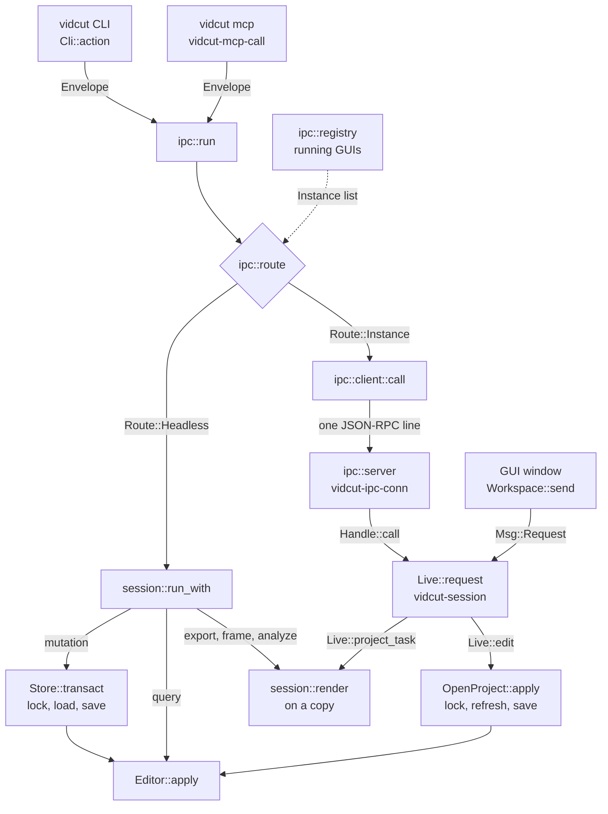
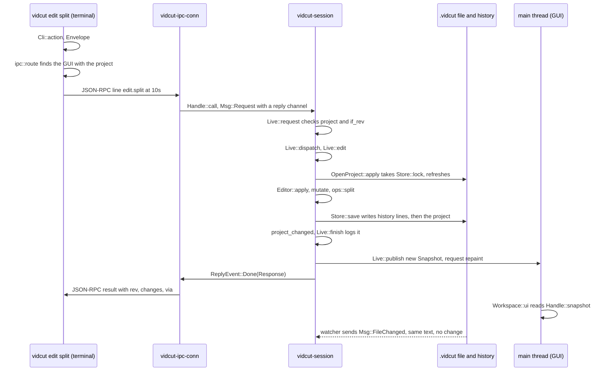

# Requests

Every action, from a key press in the GUI to an agent's tool call, is one `Request`. This page follows a request from its front door to `Editor::apply` and back. The vocabulary and the editor are in vidcut-core; the GUI's side is in [live](live.md).

## One vocabulary

`Request` has one variant per method, serialized as `method` and `params`. Its JSON schema (`session::schema`) generates the CLI commands (`cli::command`) and the MCP tools (`mcp::tools`), so every door names things alike.

An `Envelope` adds the two options every request takes: `if_rev` (fail with `CONFLICT` unless the project is at that revision) and `dry_run`. `Envelope::from_json` takes them off the request object first, and out of `params` only when they are not there. Every answer is a `Response`: the revision after it, the ids created, modified and deleted (`Changes`), the result, `dry_run`, `warnings`, and where it ran (`via`).

Three questions drive the routing:

| Question | True for |
|---|---|
| `Request::is_projectless` | needs no project: `schema`, `doctor`, `reset`, `probe`, `project.create`, presets, encoders, decoders, preferences, keys |
| `Request::is_live` | needs a running GUI: `project.open`, the viewer, player, mixer preview, pool view, selection, `gui.*` and `jobs.*` |
| `Request::is_mutation` | anything that is not live and not a read, render, export, analysis, preset, preference, `project.create`, `probe` or `edit.copy`. The match in `Request::is_mutation` is the list. Undo and redo count, and call `step_history` |

## Front doors

| Door | Entry | Hands the envelope to |
|---|---|---|
| CLI | `Cli::action` gives `Action::Run` | `ipc::run` |
| MCP | `mcp::serve` reads JSON-RPC on stdin; each tool call gets a `vidcut-mcp-call` thread | `ipc::run` |
| IPC | `ipc::server::start` in the GUI: `vidcut-ipc` accepts, one `vidcut-ipc-conn` thread per connection | `Handle::call` |
| GUI | `Workspace::send` | `Handle::request`; no reply, errors become notices |

The CLI and MCP make paths absolute first (`Request::paths_mut`), since the GUI runs in its own directory.

## Routing

`ipc::run` asks `ipc::route` where the request runs:

1. Projectless requests, and the `headless` option, run here.
2. The `instance` option (a pid or a socket, also `VIDCUT_SOCKET`) picks a GUI.
3. With a project, the GUI that has it open, else here; a live request then fails with NO_INSTANCE (`ErrorCode::NoInstance`).
4. Without one, the only GUI with a project open (any GUI, for a live request). None: here, or NO_INSTANCE for a live request. Several: a usage error.

The registry (`ipc::registry`) is a folder in the user's runtime dir: each GUI writes an `Instance` entry (pid, socket, open project) and listens on that socket; `registry::list` removes dead ones. `ipc::client::call` sends one JSON-RPC line and reads progress notifications until the answer; closing the connection cancels the call.

## Headless

`session::run_with` refuses live requests, answers projectless ones itself, and otherwise opens the project's `Store`. A mutation runs in `Store::transact`: take the lock (`Store::lock`), load the project and its history, `Editor::apply`, save if the revision moved. A query needs no lock. `proxy.generate` encodes on a copy first, outside the lock (spec D41).

## Live

`Handle::call` and `Handle::request` put a `Msg::Request` on the `vidcut-session` thread's channel. `Live::request` checks the expected project and `if_rev`; `Live::dispatch` answers now or schedules the work. Edits go through `Live::edit` to `OpenProject::apply`, which takes the headless runs' lock, re-reads the file if it changed, applies and saves before answering. The new `Snapshot` is published before the replies go: once a client hears back, the GUI's state shows the change.

## Requests that only read

`export.start`, `export.plan`, `frame.render`, `storyboard.render` and the `analyze` methods leave the editor path. Headless, `session::run_with` loads the project, checks `if_rev` and calls `session::render`; a GUI calls it from `Live::project_task` on a worker thread, with a copy of the project. `session::render` hands exports to `session::export_media` ([export](export.md)) and runs the `analyze` methods as queries on a throwaway `Editor` ([analysis](analysis.md)). A GUI's media export is a job (`Live::start_export`). None takes the lock.

## The editor

`Editor::apply` checks `if_rev`, then:

- A query goes to `query`.
- `history.undo` and `history.redo` call `step_history`.
- A mutation runs `mutate` on a clone of the project: it resolves times and clip references and calls the edit operations in `ops` (`ops::split` for `edit.split`). Carried transitions that no longer fit go (`otio::transitions::prune`); `validate::violations` checks the result, and a violation fails the edit as a vidcut bug.
- A dry run stops here and reports the `Changes`.
- An edit that changes nothing makes no revision and no undo step.
- Otherwise the clone becomes the project, `rev` goes up by one, and the history gets an `Entry`: a label (`describe`) and the `Change`.

`apply` runs a list of requests in order on one clone: one revision, one undo step, and any error fails them all. Undo, redo and `apply` can't be in the list.

## Undo history

A `Change` is a tree of what differs: replaced values (`Set`), object fields (`Fields`) and lists of things with ids (`Items`), so a step costs what it changed. Undo applies it backward and still makes a new revision: revisions only grow.

The history is a `.jsonl` file in the state dir's `history` folder, named by a digest of the project's path (`HistoryFile`). Each save appends lines ending with a hash of the project text it wrote. On load (`Store::load_text`), a project file that doesn't match that hash was changed by something else: `Editor::record_external` makes the difference from the last saved state one undoable "external change" step. A GUI notices such writes through its file watcher (`Msg::FileChanged`, `OpenProject::reload`). Behavior: [spec §8.10](../cut-page-spec.md#810-undo-pp-651652), [deviation X4](../deviations.md#x4-undo-history-persists-across-sessions-and-cli-runs).

**Why** the lock, the revision and the reload: the CLI, agents and the GUI edit one file at once ([deviation X1](../deviations.md#x1-projects-are-always-saved-standalone-json-files)). The lock orders the writers, the file always holds the latest project, and `if_rev` refuses an edit to a project that changed since the client read it.

## Code

- `crates/vidcut-core/src/request.rs`
- `crates/vidcut-core/src/editor.rs`
- `crates/vidcut-core/src/store.rs`
- `crates/vidcut-core/src/history.rs`
- `crates/vidcut-core/src/change.rs`
- `crates/vidcut-core/src/ops.rs`
- `crates/vidcut/src/main.rs`
- `crates/vidcut/src/cli.rs`
- `crates/vidcut/src/mcp.rs`
- `crates/vidcut/src/ipc/`
- `crates/vidcut/src/session.rs`
- `crates/vidcut/src/live/mod.rs`
- `crates/vidcut/src/live/project.rs`
- `crates/vidcut/src/gui/workspace.rs`
