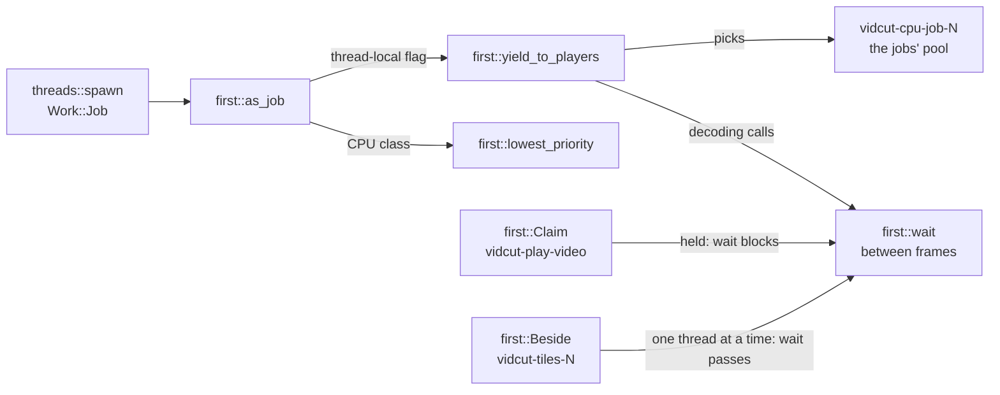

# Threads

vidcut uses std threads, channels, mutexes, condvars and atomics, and no async runtime or pool crate. Each thread does one thing and has a name that starts with "vidcut-". The `vidcut` crate starts its threads through `threads::spawn` and `threads::scoped`, which set their priority; vidcut-av starts its own with `std::thread::Builder`. How the GUI's threads talk is in [live](live.md).

## The threads

Priority: **interactive** and **job** are the `Work` kinds; **inherited** sets nothing (on Linux, the starter's class); **starter's** also copies the starter's yield flag.

| Thread | Started by | Does | Priority |
|---|---|---|---|
| main | the OS | `gui::run`, a CLI request, or `mcp::serve` | default |
| `vidcut-session` | `live::start` | `Live::run` | interactive |
| `vidcut-viewer` | `Viewer::start` | draws the viewer | interactive |
| `vidcut-ipc`, `vidcut-ipc-conn` | `ipc::server::start`; one per connection | accepts; serves one | interactive |
| `vidcut-mcp-call` | `mcp::serve`, per tool call | one MCP call | interactive |
| `vidcut-task`, `vidcut-make`, `vidcut-measure` | the core, per `Step` | their step | task: its `Work`; make: interactive; measure: job |
| vidcut-j1, vidcut-j2, … | `Live::start_export`, `Live::start_encode` | an export, proxy or transcription job | job |
| `vidcut-history` | `OpenProject::apply` | `Store::compact` | job |
| `vidcut-preview` | `Live::preview_step` | the project as it was at a step of the history (`Store::project_at`, from the nearest state its `Past` keeps), the newest asked only | interactive |
| `vidcut-worker-N`, `vidcut-tiles-N` | `Workers::new`, `Tiles::begin_frame` | filmstrips and waveforms; timeline tiles | job |
| `vidcut-missing-media`, `vidcut-look` | `MissingWatch::start`, `look::watch` | media and proxy files; the OS's look | interactive |
| `vidcut-ask`, `vidcut-file-dialog`, `vidcut-import-dialog`, `vidcut-project-dialog`, `vidcut-audio-devices`, `vidcut-gpu-label`, `vidcut-show-in-folder`, `vidcut-open-file` | `Ask::send`, `Picked::ask`, `Workspace::import_media`, `Workspace::pick_project`, `Workspace::open_preferences`, `Workspace::open_hearing`, `file_manager::show`, `file_manager::open` | UI helpers | interactive |
| `vidcut-quit`, `vidcut-exit-watch` | `Port::quit`, `threads::end_within` | quit fallback, exit watchdog | interactive |
| `vidcut-viewer-close`, `vidcut-two-up-close`, `vidcut-frees-imports` | `threads::closing` | drop players, Vulkan imports | interactive |
| `vidcut-cancel` | `ipc::client::call` | watches a CLI call's cancel | interactive |
| `vidcut-proxies`, `vidcut-transcribe`, `vidcut-story-N` | `session::run_with`, `storyboard::render` | a headless proxy encode or transcription; storyboard pictures | starter's (`Work::current`) |
| `vidcut-upload` | `speech_api::transcribe` | a paid speech service's upload and reply, while the job's thread reports and cancels | inherited |
| `vidcut-speakers` | `transcribe::speakers_of` | a speaker model's run, while the job's thread reports the time and cancels it | inherited |
| `vidcut-play-video`, `vidcut-play-audio`, `vidcut-play-windows` | `Player::new`; windows once followed | an engine's decoding, mix, two-up windows | inherited |
| `vidcut-audio-out` | `CpalOutput`, `PacedOutput` | the device's stream, or paced silence | inherited |
| `vidcut-encode` | `Worker::spawn` | an output's encoders and muxer | starter's |
| `vidcut-open` | `Ahead::start` | opens sources ahead | starter's |
| `vidcut-light-N`, `vidcut-scenes` | `light::analysis`, `analysis::picture_stats` | HDR light; frame scores | starter's |
| `vidcut-cpu-N`, `vidcut-cpu-job-N` | the first `pool::run` or `pool::give` | the two CPU pools | inherited; lowest class |
| `vidcut-give-back` | `buffers::give_back` | `malloc_trim` (Linux, glibc) | inherited |

On Windows `look::watch` starts two `vidcut-look` threads; Linux and macOS start one. Omarchy's palette is watched by a `notify` watcher that `Live` holds, not by a thread of its own.

Libraries start their own (FFmpeg, GPU drivers, CUDA, transcribe.cpp's ggml, cpal, PipeWire, `notify`, zbus, ctrlc).

## `threads::spawn` and `Work`

`threads::spawn(name, work, f)` names the thread and, for `Work::Job`, calls `vidcut_av::first::as_job` first. `threads::scoped` does the same for a scoped thread. `Work::Interactive` is work someone waits on; `Work::Job` is media work nobody watches frame by frame (exports, proxies). A thread knows its own kind (`Work::current`), so the helpers it starts can work as it does. `threads::closing` keeps the handle for `threads::join_closing`.

## Job priority

`first::as_job` gives the thread the lowest CPU class (the idle class on Linux) and sets its yield flag. Decoding loops call `first::wait` between frames; on a yielding thread it blocks while any `first::Claim` is held, until a cancel. An engine's `vidcut-play-video` claims while it plays or its viewer waits for a picture. A timeline tile's decode holds `first::Beside`, which lets one yielding thread at a time pass the claims, so the filmstrip keeps filling in during playback, one tile at a time.

**Why:** jobs and players share the GPU's decoder, which no CPU priority reaches.

## The CPU pools

There are two pools (`crates/vidcut-av/src/pool.rs`). A yielding caller uses the jobs' pool, whose threads set the lowest class themselves, so that work runs at job priority everywhere. Each pool has a thread fewer than its share of cores, as the caller works too.

- `pool::run` splits a call into slices, works on them beside the pool and returns when all are done, oldest work first.
- `pool::graph` makes every FFmpeg filter graph. It sets the graph's `execute` callback, so a filter's slices go through `pool::run` and the graph starts no threads.
- Tasks (`crates/vidcut-av/src/pool/tasks.rs`) decode frames that stand alone, such as image sequences (`decode::standalone`), on decoders each pool thread keeps until idle. They come back in order; one not started yet runs on the thread that wants it.

## Decoders belong to their readers

Every video decoder is a `VideoReader`'s: opened with it, used on its thread, closed when it drops (`decode::open_readers` counts them). A file whose pieces a plan has left stays open a short while, a few at a time and fewer on a GPU (`staying` in `crates/vidcut-av/src/export/video.rs`), so a piece of it that comes back, or a playhead dragged back, resumes its reader instead of opening the file again. One file at a time opens ahead, on `vidcut-open`. Readers on a GPU share its `GpuDecoder` device but not their decoders, and a GPU decoder takes one thread. On the CPU, frames that stand alone decode on the pool; other streams take FFmpeg frame threads, as many as `pool::threads_for` gives: fewer on a job's thread, one for single frames.

Shot and black analyses that decode on the CPU take turns (`turns::cpu_analysis`): one runs at once for every few cores (`CORES_EACH`), with the frame threads it would have alone, and the rest wait in the order they asked; a cancel takes a waiting one out of the line. One that decodes on the GPU takes a single thread and doesn't wait.

**Why:** a GUI starts an analysis for each request, so an agent asking for many at once would run them all, each with its own frame threads and decoder memory. An analysis scores its pictures on one thread and keeps only a few cores busy, so a few at a time finish as many as all at once, with fewer decoders in memory and fewer threads on the cores.

## How the process ends

Threads a reader or player leaves behind as it drops (the source opener's helper, an engine's `vidcut-play-windows`) go to `vidcut_av::ending`. The CLI and MCP return from `main`, which waits for them (`ending::join`) before it exits. When the GUI's window closes, `App::on_exit` runs on the UI thread:

1. `threads::end_within` starts `vidcut-exit-watch`; `threads::ending` marks each stage.
2. `Handle::shutdown` sends `Msg::Shutdown`, and the UI joins `vidcut-session`. `Live::shutdown` cancels the jobs, waits briefly, deletes partial files of any still running, answers waiting clients, and unregisters.
3. eframe drops the `App`: the viewer thread is joined and its engine dropped on `vidcut-viewer-close`; `Tiles` joins its workers; `Cells` closes the two-up.
4. `gui::run` calls `threads::join_closing`, which joins those threads and the ones left to `ending`, then `threads::exit_now`, which flushes output and, on Unix, ends at once, skipping exit handlers.

Threads still running end with the process. If ending takes too long, the watchdog prints the stage and, on Linux, each thread's wait channel, then aborts under `VIDCUT_DEBUG`, else exits with 1. For `gui.quit`, `vidcut-quit` shuts the core down and exits if the window doesn't close in time.

## Code

- `crates/vidcut/src/threads.rs`, `crates/vidcut-av/src/first.rs`, `crates/vidcut-av/src/pool.rs`
- `crates/vidcut-av/src/decode.rs`, `crates/vidcut-av/src/decode/standalone.rs`
- `crates/vidcut-av/src/export/worker.rs`, `crates/vidcut-av/src/export/ahead.rs`
- `crates/vidcut/src/gui/mod.rs`, `crates/vidcut/src/gui/app.rs`
