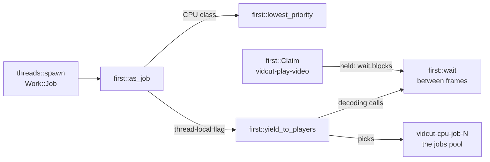

# Threads

vidcut uses std threads, channels, mutexes, condvars, and atomics.
It uses no async runtime.
It uses no pool crate.
Each thread does one thing.
Each thread name starts with `vidcut-`.
The `vidcut` crate starts its threads through `threads::spawn` and `threads::scoped`.
Those calls set the priority.
vidcut-av starts its own threads with `std::thread::Builder`.
How the GUI threads talk is in [live](live.md).

## The threads

`Work::Interactive` and `Work::Job` are the `Work` kinds.
`threads::spawn` sets one of them.
Inherited priority sets nothing.
On Linux, the thread then keeps the scheduling class of its starter.
Starter priority also copies the yield flag of the starter.

| Thread | Starter | Work | Priority |
|---|---|---|---|
| main | The OS. | `gui::run`, one CLI request, or `mcp::serve`. | The process default. `Work::current` on this thread is `Work::Interactive`. |
| `vidcut-session` | `live::start` | `Live::run` | `Work::Interactive` |
| `vidcut-viewer` | `Viewer::start` | Draws the viewer. | `Work::Interactive` |
| `vidcut-ipc`, `vidcut-ipc-conn` | `ipc::server::start`. One connection thread for each connection. | `vidcut-ipc` accepts. `vidcut-ipc-conn` serves one connection. | `Work::Interactive` |
| `vidcut-mcp-call` | `mcp::serve`, for each tool call | One MCP call. | `Work::Interactive` |
| `vidcut-task` | The core, for each `Step::Task` | The task. | The `Work` of that step. |
| `vidcut-make` | The core, for each `Step::Make` | Builds a project from an OpenTimelineIO file. | `Work::Interactive` |
| `vidcut-measure` | The core, for each `Step::Measure` | Measures media, or unpacks an `.otioz`. | `Work::Job` |
| vidcut- plus the job id (`j` and a number) | `Live::start_export`, `Live::start_encode` | One export or one proxy job. The name is built as `vidcut-` plus that id. | `Work::Job` |
| `vidcut-history` | `OpenProject::apply` | `Store::compact` | `Work::Job` |
| `vidcut-worker-N` | `Workers::new` | Filmstrips and waveforms. | `Work::Job` |
| `vidcut-tiles-N` | `Tiles::begin_frame` | Timeline tiles. | `Work::Job` |
| `vidcut-missing-media` | `MissingWatch::start` | Checks media files. | `Work::Interactive` |
| `vidcut-look` | `look::watch` | Watches the OS look. Windows starts two threads with this name, for the personalize key and the accent key. Linux and macOS start one. | `Work::Interactive` |
| `vidcut-ask` | `Ask::send` | One UI request that needs an answer. | `Work::Interactive` |
| `vidcut-file-dialog` | `Picked::ask` | The file dialog. | `Work::Interactive` |
| `vidcut-import-dialog` | `Workspace::import_media` | The import dialog. | `Work::Interactive` |
| `vidcut-project-dialog` | `Workspace::pick_project` | The project dialog. | `Work::Interactive` |
| `vidcut-audio-devices` | `Workspace::open_preferences` | Lists audio devices. | `Work::Interactive` |
| `vidcut-show-in-folder` | `file_manager::show` | Shows a file in the folder. | `Work::Interactive` |
| `vidcut-open-file` | `file_manager::open` | Opens a finished output with the system program. | `Work::Interactive` |
| `vidcut-quit` | `Port::quit` | Quits if the window does not close in time. | `Work::Interactive` |
| `vidcut-exit-watch` | `threads::end_within` | The exit watchdog. | `Work::Interactive` |
| `vidcut-viewer-close` | `threads::closing` | Drops the viewer player. | `Work::Interactive` |
| `vidcut-two-up-close` | `threads::closing` | Drops the two-up players. | `Work::Interactive` |
| `vidcut-frees-imports` | `threads::closing` | Drops Vulkan imports. | `Work::Interactive` |
| `vidcut-cancel` | `ipc::client::call` | Watches cancel on a CLI call. | `Work::Interactive` |
| `vidcut-proxies` | `session::run_with` | A headless proxy encode. | The starter `Work` (`Work::current`). On the CLI or MCP, the starter is the main thread, so this is `Work::Interactive`. |
| `vidcut-story-N` | `storyboard::render` | Storyboard pictures. | The starter `Work` (`Work::current`). |
| `vidcut-play-video` | `Player::new`, in vidcut-av | Decodes pictures for one engine. | Inherited. The builder does not call `threads::spawn`. |
| `vidcut-play-audio` | `Player::new`, in vidcut-av | Mixes sound for one engine. | Inherited. |
| `vidcut-play-windows` | `Player::new`, once a player is followed | Decodes two-up windows. | Inherited. |
| `vidcut-audio-out` | `CpalOutput`, `PacedOutput` | Holds the device stream, or paced silence. | Inherited. |
| `vidcut-encode` | `Worker::spawn` | The encoders and the muxer of one output. | The starter yield flag, copied with `first::set_yields`. |
| `vidcut-open` | `Ahead::start` | Opens the next source. | The starter yield flag, copied with `first::set_yields`. |
| `vidcut-light-N` | `light::analysis` | HDR light. | Inherited from the starter. |
| `vidcut-scenes` | `analysis::picture_stats` | Frame scores. | Inherited from the starter. |
| `vidcut-cpu-N` | The first `pool::run` or `pool::give` that is not yielding | The normal CPU pool. | Inherited. The pool starts one thread fewer than the core count. |
| `vidcut-cpu-job-N` | The first yielding `pool::run` or `pool::give` | The job CPU pool. | The threads set the lowest CPU class. The pool starts one thread fewer than `clamp(cores / 2, 1, 16)`. |
| `vidcut-give-back` | `buffers::give_back` | Calls `malloc_trim` on Linux with glibc. | Inherited. |

Libraries start their own threads.
Those libraries are FFmpeg, the GPU drivers, CUDA, cpal, PipeWire, `notify`, zbus, and ctrlc.

## `threads::spawn` and `Work`

`threads::spawn` takes a name, a `Work` value, and a function.
For `Work::Job`, it calls `vidcut_av::first::as_job` first.
`threads::scoped` does the same for a scoped thread.
`Work::Interactive` is work that someone waits on.
`Work::Job` is media work that nobody watches frame by frame.
Exports and proxies are `Work::Job`.
A thread knows its own kind (`Work::current`).
A helper that it starts can use the same kind.
`threads::closing` keeps the handle for `threads::join_closing`.
vidcut-av does not call `threads::spawn`.
`vidcut-encode` and `vidcut-open` copy the yield flag with `first::set_yields` inside their own builder.

## Job priority

`first::as_job` gives the thread the lowest CPU class.
On Linux, that class is the idle class.
It also sets the yield flag.
A decoding loop calls `first::wait` between frames.
On a yielding thread, `first::wait` blocks while any `first::Claim` is held.
It blocks until a cancel.
`vidcut-play-video` holds a claim while it plays, or while its viewer waits for a picture.

Jobs and players share the GPU decoder.
CPU priority does not reach that decoder.
The yield flag does.

## The CPU pools

There are two pools (`crates/vidcut-av/src/pool.rs`).
A yielding caller uses the job pool.
The job-pool threads set the lowest class themselves.
That work then runs at job priority on every caller.
The normal pool starts one thread fewer than the core count.
The job pool takes half the core count.
That count is at least 1 and at most 16.
The job pool then starts one thread fewer than that count.
The caller does work too.
`pool::threads_for` is a separate count, for FFmpeg frame threads.
`Reading::Frames` gets one of those threads.

- `pool::run` splits one call into slices.
  The caller works on slices beside the pool.
  `pool::run` returns when every slice is done.
  The oldest batch is first.
- `pool::graph` makes every FFmpeg filter graph.
  It sets the `execute` callback of the graph.
  Filter slices then go through `pool::run`.
  The graph starts no thread.
- Tasks (`crates/vidcut-av/src/pool/tasks.rs`) decode frames that stand alone, such as an image sequence (`decode::standalone`).
  Each pool thread keeps its decoders until it is idle.
  The frames come back in order.
  A frame that has not started runs on the thread that wants it.

## Decoders belong to their readers

Every video decoder belongs to a `VideoReader`.
It opens with the reader.
It is used on the reader thread.
It closes when the reader drops.
`decode::open_readers` counts the open readers.
A file whose pieces a plan has left stays open for a short time (`staying` in `crates/vidcut-av/src/export/video.rs`).
The file stays when it is younger than 10 seconds.
At most 4 such files stay open.
At most 2 of them are on a GPU.
A piece of that file that comes back, or a playhead dragged back, resumes the reader.
It does not open the file again.
One file at a time opens ahead, on `vidcut-open`.
Readers on a GPU share its `GpuDecoder` device.
They do not share their decoders.
A GPU decoder takes one thread.
On the CPU, a frame that stands alone decodes on the pool.
Another stream takes FFmpeg frame threads.
`pool::threads_for` returns 1 for `Reading::Frames`.
For a stream on a yielding thread, it returns half the core count.
For a stream on another thread, it returns the core count.
Both counts are at least 1 and at most 16.

## How the process ends

A reader or a player can leave a thread behind when it drops.
Examples are the helper of the source opener, and `vidcut-play-windows` of an engine.
Those threads go to `vidcut_av::ending`.
The CLI and MCP return from `main`.
`main` waits for them (`ending::join`) before it exits.
When the GUI window closes, `App::on_exit` runs on the UI thread:

1. `threads::end_within` starts `vidcut-exit-watch`.
   `threads::ending` marks each stage.
2. `Handle::shutdown` sends `Msg::Shutdown`.
   The UI joins `vidcut-session`.
   `Live::shutdown` cancels the jobs.
   It waits a short time.
   It deletes the partial files of a job that is still running.
   It answers the waiting clients.
   It unregisters the GUI.
3. eframe drops the `App`.
   The viewer thread is joined.
   Its engine is dropped on `vidcut-viewer-close`.
   `Tiles` joins its workers.
   `Cells` closes the two-up.
4. `gui::run` calls `threads::join_closing`.
   That call joins those threads and the threads left to `ending`.
   It then calls `threads::exit_now`.
   `threads::exit_now` flushes output.
   On Unix, it ends at once and skips the exit handlers.

Threads that are still running end with the process.
If ending takes too long, the watchdog prints the stage.
On Linux, it also prints the wait channel of each thread.
When `VIDCUT_DEBUG` is set, `vidcut_av::debug` is true and the watchdog aborts.
Otherwise it exits with status 1.
For `gui.quit`, `vidcut-quit` shuts the core down.
It exits if the window does not close in time.

## Code

- `crates/vidcut/src/threads.rs`, `crates/vidcut-av/src/first.rs`, `crates/vidcut-av/src/pool.rs`
- `crates/vidcut-av/src/decode.rs`, `crates/vidcut-av/src/decode/standalone.rs`
- `crates/vidcut-av/src/export/worker.rs`, `crates/vidcut-av/src/export/ahead.rs`
- `crates/vidcut/src/gui/mod.rs`, `crates/vidcut/src/gui/app.rs`
