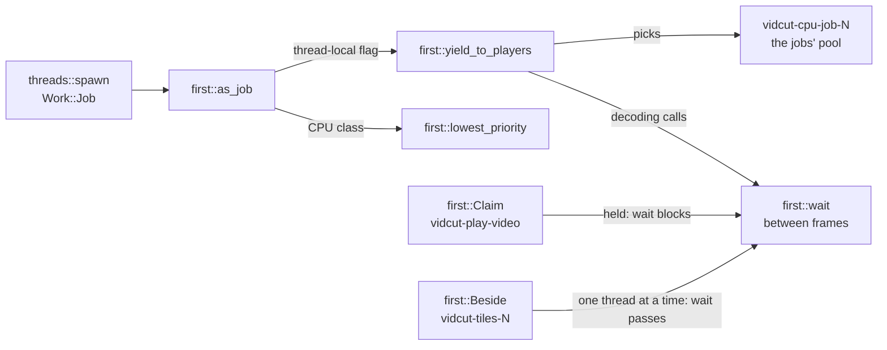

# Threads

- vidcut uses std threads, channels, mutexes, condvars and atomics. It uses no async runtime and no pool crate.
- Each thread does one thing. The name of each thread starts with "vidcut-".
- The `vidcut` crate starts its threads through `threads::spawn` and `threads::scoped`. These set the priority of the thread.
- vidcut-av starts its own threads with `std::thread::Builder`.
- How the GUI's threads talk is in [live](live.md).

## The threads

The values in the Priority column:

- **interactive** and **job** are the `Work` kinds.
- **inherited** sets nothing. On Linux, the thread has the class of its starter.
- **starter's** is the same as inherited, and the thread also copies the yield flag of its starter.

| Thread | Started by | Does | Priority |
|---|---|---|---|
| main | the OS | `gui::run`, a CLI request, or `mcp::serve` | default |
| `vidcut-session` | `live::start` | `Live::run` | interactive |
| `vidcut-viewer` | `Viewer::start` | draws the viewer | interactive |
| `vidcut-ipc`, `vidcut-ipc-conn` | `ipc::server::start`; one per connection | accepts; serves one | interactive |
| `vidcut-mcp-call` | `mcp::serve`, per tool call | one MCP call | interactive |
| `vidcut-task`, `vidcut-make`, `vidcut-measure` | the core, per `Step` | their step | task: its `Work`; make: interactive; measure: job |
| vidcut-j1, vidcut-j2, … | `Live::start_export`, `Live::start_encode` | an export, proxy or transcription job | job |
| `vidcut-history` | `OpenProject::apply` | `Store::compact` | job |
| `vidcut-cache` | `main`, for the GUI | `disk_cache::start`: the index from one listing at startup, then `disk_cache::rebuild` every hour | job |
| `vidcut-preview` | `Live::preview_step` | the project at a step of the history (`Store::project_at`, from the nearest state its `Past` keeps); only the newest step asked | interactive |
| `vidcut-worker-N`, `vidcut-tiles-N` | `Workers::new`, `Tiles::begin_frame` | filmstrips and waveforms; timeline tiles | job |
| `vidcut-missing-media`, `vidcut-look` | `MissingWatch::start`, `look::watch` | media and proxy files; the OS's look | interactive |
| `vidcut-ask` | `Ask::send` | a UI helper | interactive |
| `vidcut-file-dialog` | `Picked::ask` | a UI helper | interactive |
| `vidcut-import-dialog`, `vidcut-import-drop` | `Workspace::import_media`, `Workspace::import_dropped` | UI helpers | interactive |
| `vidcut-project-dialog` | `Workspace::pick_project` | a UI helper | interactive |
| `vidcut-audio-devices` | `Workspace::open_preferences` | a UI helper | interactive |
| `vidcut-show-in-folder`, `vidcut-open-file` | `file_manager::show`, `file_manager::open` | UI helpers | interactive |
| `vidcut-quit`, `vidcut-exit-watch` | `Port::quit`, `threads::end_within` | quit fallback, exit watchdog | interactive |
| `vidcut-viewer-close`, `vidcut-two-up-close`, `vidcut-frees-imports` | `threads::closing` | drop players, Vulkan imports | interactive |
| `vidcut-cancel` | `ipc::client::call` | watches the cancel of a CLI call | interactive |
| `vidcut-proxies`, `vidcut-transcribe`, `vidcut-story-N` | `session::run_with`, `storyboard::render` | a headless proxy encode or transcription; storyboard pictures | starter's (`Work::current`) |
| `vidcut-upload` | `speech_api::transcribe` | the upload to a paid speech service and its reply, while the job's thread reports and cancels | inherited |
| `vidcut-speakers` | `transcribe::speakers_of` | the run of a speaker model, while the job's thread reports the time and cancels it | inherited |
| `vidcut-play-video`, `vidcut-play-audio`, `vidcut-play-windows` | `Player::new`; windows once followed | the decoding, mix and two-up windows of an engine | inherited |
| `vidcut-audio-out` | `CpalOutput`, `PacedOutput` | the stream of the device, or paced silence | inherited |
| `vidcut-encode` | `Worker::spawn` | the encoders and muxer of an output | starter's |
| `vidcut-open` | `Ahead::start` | opens sources ahead | starter's |
| `vidcut-light-N`, `vidcut-scenes` | `light::analysis`, `analysis::picture_stats` | HDR light; frame scores | starter's |
| `vidcut-cpu-N`, `vidcut-cpu-job-N` | the first `pool::run` or `pool::give` | the two CPU pools | inherited; lowest class |
| `vidcut-give-back` | `buffers::give_back` | `malloc_trim` (Linux, glibc) | inherited |

- On Windows, `look::watch` starts two `vidcut-look` threads. Linux and macOS start one.
- A `notify` watcher that `Live` holds watches Omarchy's palette. This watcher has no thread of its own.
- Libraries start their own threads: FFmpeg, GPU drivers, CUDA, transcribe.cpp's ggml, cpal, PipeWire, `notify`, zbus and ctrlc.

## `threads::spawn` and `Work`

- `threads::spawn(name, work, f)` names the thread. For `Work::Job`, it first calls `vidcut_av::first::as_job`.
- `threads::scoped` does the same for a scoped thread.
- `Work::Interactive` is work that someone waits on.
- `Work::Job` is media work that nobody watches frame by frame, such as exports and proxies.
- A thread knows its own kind (`Work::current`). Thus the helpers that it starts can work in the same way.
- `threads::closing` keeps the handle for `threads::join_closing`.

## Job priority

- `first::as_job` gives the thread the lowest CPU class (the idle class on Linux) and sets its yield flag.
- Decoding loops call `first::wait` between frames. On a yielding thread, `first::wait` blocks while any `first::Claim` is held, until a cancel.
- The `vidcut-play-video` thread of an engine claims while it plays, and while its viewer waits for a picture.
- The decode of a timeline tile holds `first::Beside`. This lets one yielding thread at a time pass the claims.
- Thus the filmstrip continues to fill in during playback, one tile at a time.

**Why:** jobs and players share the decoder of the GPU, and no CPU priority reaches that decoder.

## The CPU pools

- There are two pools (`crates/vidcut-av/src/pool.rs`).
- A yielding caller uses the jobs' pool. The threads of that pool set the lowest class themselves. Thus that work runs at job priority everywhere.
- Each pool has one thread fewer than its share of cores, because the caller works too.
- `pool::run` splits a call into slices and works on them beside the pool. It returns when all slices are done. It does the oldest work first.
- `pool::graph` makes every FFmpeg filter graph. It sets the `execute` callback of the graph, so the slices of a filter go through `pool::run`. The graph starts no threads.
- Tasks (`crates/vidcut-av/src/pool/tasks.rs`) decode frames that stand alone, such as image sequences (`decode::standalone`).
- Tasks use decoders that each pool thread keeps until it is idle.
- Tasks come back in order. A task that has not started yet runs on the thread that wants it.

## Decoders belong to their readers

- Every video decoder belongs to a `VideoReader`. It opens with the reader, works on the thread of the reader, and closes when the reader drops.
- `decode::open_readers` counts the open readers.
- A file whose pieces a plan has left stays open for a short time (`staying` in `crates/vidcut-av/src/export/video.rs`). A few files stay open at a time, and fewer on a GPU.
- Thus, when a piece of that file comes back, or when the user drags the playhead back, its reader resumes. vidcut does not open the file again.
- One file at a time opens ahead, on `vidcut-open`.
- Readers on a GPU share its `GpuDecoder` device, but not their decoders. A GPU decoder takes one thread.
- On the CPU, frames that stand alone decode on the pool.
- Other streams on the CPU take FFmpeg frame threads, as many as `pool::threads_for` gives. It gives fewer on the thread of a job, and one for single frames.

Shot and black analyses:

- Shot and black analyses that decode on the CPU take turns (`turns::cpu_analysis`).
- One analysis runs at a time for every few cores (`CORES_EACH`). It has the frame threads that it would have alone.
- The other analyses wait in the order that they asked. A cancel takes a waiting analysis out of the line.
- An analysis that decodes on the GPU takes a single thread and does not wait.

**Why:**

- A GUI starts an analysis for each request. Thus an agent that asks for many at once would run them all.
- Each analysis would have its own frame threads and decoder memory.
- An analysis scores its pictures on one thread and keeps only a few cores busy.
- Thus a few analyses at a time finish as many as all at once. They also keep fewer decoders in memory and fewer threads on the cores.

## How the process ends

- When a reader or a player drops, it can leave threads behind. Examples are the helper of the source opener and the `vidcut-play-windows` of an engine.
- These threads go to `vidcut_av::ending`.
- The CLI and MCP return from `main`. `main` waits for these threads (`ending::join`) before it exits.

When the GUI's window closes, `App::on_exit` runs on the UI thread:

1. `threads::end_within` starts `vidcut-exit-watch`. `threads::ending` marks each stage.
2. `Handle::shutdown` sends `Msg::Shutdown`, and the UI joins `vidcut-session`.
   - `Live::shutdown` cancels the jobs and waits briefly.
   - Then it deletes the partial files of the jobs that still run, answers the waiting clients, and unregisters.
3. eframe drops the `App`.
   - The viewer thread is joined, and its engine is dropped on `vidcut-viewer-close`.
   - `Tiles` joins its workers. `Cells` closes the two-up.
4. `gui::run` calls `threads::join_closing`. This joins those threads and the threads left to `ending`.
   - Then `gui::run` calls `threads::exit_now`. This flushes the output. On Unix, it ends the process at once, without the exit handlers.

After these steps:

- Threads that still run end with the process.
- If ending takes too long, the watchdog prints the stage. On Linux, it also prints the wait channel of each thread.
- Then the watchdog aborts under `VIDCUT_DEBUG`, or else exits with 1.
- For `gui.quit`, if the window does not close in time, `vidcut-quit` shuts the core down and exits.

## Code

- `crates/vidcut/src/threads.rs`, `crates/vidcut-av/src/first.rs`, `crates/vidcut-av/src/pool.rs`
- `crates/vidcut-av/src/decode.rs`, `crates/vidcut-av/src/decode/standalone.rs`
- `crates/vidcut-av/src/export/worker.rs`, `crates/vidcut-av/src/export/ahead.rs`
- `crates/vidcut/src/gui/mod.rs`, `crates/vidcut/src/gui/app.rs`
